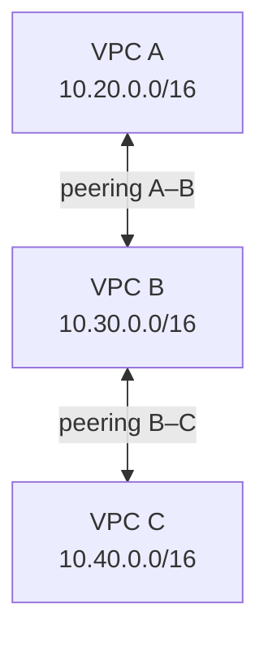

# Conversa técnica — Vitória e Adassa

Aprendizados e próximos passos em redes: justificar a conexão, explicar o caminho, distinguir controles e proteção e escolher evidências antes de mudar a arquitetura.

## Contexto e foco da revisão

Esta página organiza temas da análise de mentoria fornecida pelo usuário. A transcrição integral e os desenhos da sessão não foram recebidos para conferência nesta rodada. Não é reprodução de falas, avaliação individual ou orientação oficial do processo seletivo.

O foco é passar de reconhecer a finalidade de um serviço para **prever o comportamento de um fluxo e investigar uma falha**. Uma conversa acompanhada não comprova que todos os exercícios foram resolvidos com autonomia ou que uma configuração foi implementada.

A pergunta de revisão é: **consigo mostrar por onde a comunicação deveria passar, o que poderia impedi-la e qual evidência pediria antes de mudar alguma coisa?**

Os exemplos abaixo são autorais e fictícios, usando a Loja Horizonte. Eles complementam a [trilha Redes do zero](../../../technical-knowledge/01-fundamentals/redes/README.md), sem substituir suas aulas ou criar outro catálogo de simulados.

## Escolher pela necessidade e pela capacidade de operar

Antes de recomendar uma conexão, descubra quais sistemas precisam conversar, qual operação depende disso, o impacto de uma interrupção, os requisitos de desempenho, o orçamento e quem sustentará a solução.

Uma recomendação precisa responder a duas perguntas: **por que atende à necessidade?** e **por que o cliente consegue operá-la?** Inclua quem configura, monitora, investiga falhas, aprova mudanças e valida a recuperação.

Transforme adjetivos em requisitos. “Rápido” para qual operação e com qual expectativa? “Resiliente” contra qual interrupção? “Barato” considerando implantação, uso, contingência e operação? Um link com boa banda pode não atender à latência necessária; uma arquitetura conhecida pode exigir uma capacidade operacional que o time ainda não tem.

Não é necessário escolher Direct Connect, VPN ou outro serviço antes de obter essas respostas. Compare alternativas, custos aplicáveis e limitações no contexto declarado, sem presumir que uma conexão dedicada sempre produzirá menor latência.

## Separar caminho, permissão, proteção e atendimento

A analogia do condomínio ajuda a distinguir **saber chegar ao endereço** de **ter autorização para entrar**. Ela não reproduz todos os mecanismos de uma rede: ida e resposta podem exigir análises diferentes, e uma autorização na entrada não comprova que o serviço interno funciona.

Como extensão didática da analogia, pergunte: cheguei e pude entrar, mas o atendimento funciona? Acrescente a proteção do canal e o alcance de cada evidência.

| Pergunta | O que explicar no desenho |
|---|---|
| Quem acessa o quê? | Origem, destino, operação, nome/endereço, protocolo e porta |
| Há caminho de ida e resposta? | Rotas e próximos saltos em cada direção |
| O tráfego está permitido? | Controles aplicáveis ao fluxo, como Security Groups e listas de controle de acesso da rede, as NACLs |
| Qual trecho está protegido? | Onde começa e termina TLS ou um túnel; o que permanece fora dessa proteção |
| O serviço atende? | Processo, dependências e resultado necessário ao cliente |
| O que comprova a conclusão? | Observação obtida, hipótese que ela discrimina e o que continua incerto |

Essa é uma organização para raciocinar, não uma obrigação de testar todas as camadas quando a evidência já restringiu o problema. Caminho privado, permissão de tráfego, autenticação, autorização da operação e aplicação saudável são conclusões diferentes.

## Reconhecer, aplicar e diagnosticar uma topologia

Reconhecer é explicar a função do componente. Aplicar é prever quem consegue falar com quem em um desenho concreto. Diagnosticar é escolher uma observação que diferencie as hipóteses quando a comunicação esperada falha.

Considere três VPCs, redes virtuais isoladas na AWS, com blocos distintos. Existem somente os dois peerings desenhados; B não executa um proxy ou outro mecanismo de trânsito para A e C.

As setas representam conexões de peering existentes, não testes de aplicação aprovados. A possui peering com B; B possui peering com C; não existe peering A–C. As faixas são fictícias e não autorizam enviar tráfego a elas.

Antes da explicação, preveja: uma instância em A alcança diretamente C usando B como trânsito desses peerings? **Não:** peering não fornece essa transitividade. Um proxy de aplicação em B seria outro mecanismo, com outras premissas. Mesmo A–B exige rotas e controles adequados. [Documentação de peering](https://docs.aws.amazon.com/vpc/latest/peering/vpc-peering-basics.html).

Agora substitua os peerings por attachments, conexões das VPCs a um Transit Gateway (TGW), e peça comunicação A↔B, mantendo A↔C isolado. Não basta anexar as três redes:

- A associação determina qual tabela do TGW trata o tráfego recebido de um attachment; a propagação adiciona seus destinos às tabelas selecionadas.
- As sub-redes participantes das VPCs também precisam de rotas adequadas, incluindo a resposta.
- Para o isolamento pretendido, confira as tabelas nas duas direções, a propagação e possíveis rotas abrangentes ou caminhos alternativos. Os controles continuam sendo necessários.

O [capítulo de peering e TGW](../../../technical-knowledge/01-fundamentals/redes/10-peering-tgw.md) desenvolve esse desenho. As regras são documentadas em [como o Transit Gateway funciona](https://docs.aws.amazon.com/vpc/latest/tgw/how-transit-gateways-work.html); este exemplo não representa uma configuração implantada ou testada.

## Quando ping responde, qual operação ainda falha?

Comece delimitando “não abre”: o nome não resolve, a conexão expira, a negociação TLS falha ou há uma resposta HTTP? Confirme de onde saiu o ping, para qual endereço e se é o destino que a aplicação realmente usa.

| Evidência | Conclusão possível | O que ainda não comprova |
|---|---|---|
| Resposta a ping | Houve resposta ICMP no recorte testado | TCP à porta da aplicação, TLS ou compra funcionando |
| Conexão TCP estabelecida | Um endpoint aceitou a conexão naquela porta | Identidade TLS válida ou resposta útil da aplicação |
| Negociação TLS válida | O canal e a identidade passaram pelas verificações daquele teste | Permissão da operação ou dependências saudáveis |
| Resposta HTTP recebida | Um componente respondeu à requisição | Sucesso do checkout; identifique quem emitiu a resposta |
| Health check aprovado no balanceador | O teste configurado teve sucesso | Todas as operações de negócio funcionando |

As regras de [Security Groups](https://docs.aws.amazon.com/vpc/latest/userguide/security-group-rules.html) distinguem protocolo, porta e tipos/códigos ICMP. Por isso, sucesso ou bloqueio de ping não decide sozinho a hipótese sobre a aplicação. No caso de um Application Load Balancer (ALB), o [troubleshooting oficial](https://docs.aws.amazon.com/elasticloadbalancing/latest/application/load-balancer-troubleshooting.html) também separa conectividade, controles, saúde e resposta dos destinos.

Para cada verificação, diga **qual hipótese ela testa**, **que resultado espera** e **o que mudaria se o resultado fosse outro**. Uma lista de SG, NACL, logs e servidor web ainda não explica a investigação. Antes de propor uma arquitetura nova, localize a falha no caminho existente.

## Escolha, roteamento e recuperação são perguntas diferentes

| Pergunta | O que sustenta a resposta |
|---|---|
| Qual combinação de conexões faz sentido? | Necessidade, criticidade, prazo, desempenho, proteção, orçamento e operação |
| Como o tráfego escolhe um caminho? | Rotas, anúncios de redes, preferências e configuração em cada direção |
| O que acontece na falha e no retorno? | Detecção, caminhos elegíveis, políticas, conexões da aplicação e validação |

O BGP, protocolo de troca de informações de roteamento, trabalha com anúncios e seleção por políticas e atributos. As [políticas do Direct Connect](https://docs.aws.amazon.com/directconnect/latest/UserGuide/routing-and-bgp.html) descrevem critérios como prefixos e preferências; isso não equivale a medir continuamente qual link oferece a menor latência à aplicação.

**O link voltou ou a jornada voltou?** Interface ativa e sessão BGP estabelecida são evidências distintas de rotas corretas e aplicação funcional. A AWS documenta [problemas de roteamento mesmo com interface e BGP ativos](https://docs.aws.amazon.com/directconnect/latest/UserGuide/ts-routing.html).

Separe failover, mudança para outro caminho após falha; failback, retorno ao caminho preferido; e fallback, uma alternativa de comportamento da aplicação. São termos cujo uso precisa ser definido no cenário. Não prometa retorno automático nem permanência obrigatória no secundário: a previsão depende das rotas elegíveis, políticas, detecção e estado da aplicação.

Valide o anúncio e a instalação das rotas, a ida, a resposta, os controles e uma operação representativa. Recuperar conectividade não confirma uma compra de resultado desconhecido; esse problema continua no capítulo de [timeout e idempotência de ACID](../../../technical-knowledge/01-fundamentals/acid/07-timeout-idempotencia.md).

## Revisões técnicas: delimitar cada garantia

Estas ressalvas verificam mecanismos em documentação primária. Não atribuem formulações imprecisas a falantes da sessão nem transformam experiência informal em regra universal.

| Tema | Explicação a preservar |
|---|---|
| Direct Connect e criptografia | Não há criptografia em trânsito por padrão. TLS protege sua sessão; IPsec protege o tráfego do túnel; MACsec protege um enlace Ethernet em condições compatíveis. É preciso identificar endpoints, trechos e configuração. [Criptografia no Direct Connect](https://docs.aws.amazon.com/directconnect/latest/UserGuide/encryption-in-transit.html) |
| AES e SHA | Criptografia e integridade não são funções equivalentes. HMAC com SHA pode oferecer integridade/autenticidade; AES-GCM combina criptografia e autenticação. Não transformar a lista de algoritmos aceitos em recomendação automática. [Opções de VPN](https://docs.aws.amazon.com/vpn/latest/s2svpn/tunnel-configure.html) · [Boas práticas](https://docs.aws.amazon.com/vpn/latest/s2svpn/cgw-best-practice.html) |
| Subnet pública | A classificação envolve rota ao Internet Gateway. No acesso direto de uma EC2 por IPv4, endereço público aplicável, controles e processo atendendo também precisam existir. [Internet Gateway](https://docs.aws.amazon.com/vpc/latest/userguide/VPC_Internet_Gateway.html) |
| Saída por NAT | No exemplo de NAT Gateway público zonal IPv4, a carga inicia a conexão e recebe respostas; isso não publica a carga para conexões externas não solicitadas. A documentação atual possui outras modalidades; não generalize o desenho zonal. [NAT gateways](https://docs.aws.amazon.com/vpc/latest/userguide/vpc-nat-gateway.html) |
| CIDR e broadcast | Um /16 reserva espaço de endereçamento; VPC não suporta broadcast. Dimensione consumo, crescimento, subdivisão e sobreposição. [Blocos de subnets](https://docs.aws.amazon.com/vpc/latest/userguide/subnet-sizing.html) |
| Faixas sobrepostas | Peering não aceita blocos sobrepostos. Dizer “use NAT” não resolve o desenho: qualquer tradução proposta precisa explicar endereços, direção, resolução de nomes e retorno, além de suas limitações. [Limites de peering](https://docs.aws.amazon.com/vpc/latest/peering/vpc-peering-basics.html) |

Privado não significa criptografado, e criptografia em trânsito não demonstra proteção em repouso. Uma proteção de rede também não substitui autorização da operação. O nome do serviço precisa vir acompanhado da garantia e das condições para obtê-la.

## Praticar do fluxo simples à contingência

Não é preciso começar pela conexão híbrida mais sofisticada. Use a sequência abaixo como revisão por objetivos; para aprender do zero, siga a ordem das aulas do curso, começando por 00 e estudando endereçamento em 01.

| Ordem de revisão | Exercício | Evidência de compreensão e apoio existente |
|---|---|---|
| 1. Cliente e aplicação | Identificar origem, nome, endereço, protocolo, porta e resposta esperada | Delimita a falha antes da ferramenta. [00 — Do clique à resposta](../../../technical-knowledge/01-fundamentals/redes/00-clique-resposta.md) |
| 2. Caminho e controles | Desenhar ida e resposta; remover uma rota ou permissão | Explica o novo resultado. [02 — Rotas](../../../technical-knowledge/01-fundamentals/redes/02-rotas-ida-volta.md) e [07 — SG e NACL](../../../technical-knowledge/01-fundamentals/redes/07-sg-nacl.md) |
| 3. Conexão e operação | Variar a falha entre conexão, TLS, HTTP e dependência | Escolhe evidência que discrimina hipóteses. [09 — Investigação](../../../technical-knowledge/01-fundamentals/redes/09-investigacao-evidencias.md) |
| 4. Redes conectadas | Comparar peering e TGW com comunicação seletiva | Prevê A↔B e A↔C sem pistas. [10 — Peering e TGW](../../../technical-knowledge/01-fundamentals/redes/10-peering-tgw.md) |
| 5. Caminhos alternativos | Justificar a escolha e prever falha e retorno | Separa link, rota e jornada. [11 — Conectividade híbrida](../../../technical-knowledge/01-fundamentals/redes/11-conectividade-hibrida.md) e [12 — Recuperação](../../../technical-knowledge/01-fundamentals/redes/12-falha-recuperacao-dns.md) |
| 6. Crescimento | Subdividir faixas e detectar sobreposição | Justifica o bloco e verifica contas. [01 — IP e CIDR](../../../technical-knowledge/01-fundamentals/redes/01-ip-cidr-subnets.md) e [L1 — Cálculos e rotas](../../../technical-knowledge/01-fundamentals/redes/laboratorio/l1-cidr-rotas.md) |

Quem estuda desenha e explica primeiro. Depois, quem acompanha muda uma condição: outra origem, porta diferente, resposta bloqueada, nome apontando para outro destino ou contingência ativa sem recuperação da operação. Peça a nova previsão antes da correção.

Use os [seis simulados de redes já existentes](../../../technical-knowledge/01-fundamentals/redes/simulados/README.md) e seus acessos separados para condução. Não há novo gabarito nesta página nem atribuição das causas de cada rodada. Os [laboratórios existentes](../../../technical-knowledge/01-fundamentals/redes/laboratorio/README.md) rodam localmente nos limites descritos; os endereços fictícios de topologias não são alvos de testes.

## Registrar aprendizado sem inventar experiência

Pedir esclarecimento, reconhecer que não implementou algo e voltar a uma dúvida ainda sem resposta são posturas úteis. Complete a delimitação: “não configurei diretamente; consigo explicar a função e o caminho esperado, e estes são os pontos que precisaria validar”. Use somente se representar o conhecimento real.

Separe **estudei**, **previ o comportamento**, **executei um laboratório** e **implementei em um ambiente real**. Para cada prática, registre previsão, observação, limite e próxima dúvida. Uma mentoria pode iniciar um processo de aprendizado; não vira automaticamente uma história STAR de implantação, ganho financeiro ou recuperação de incidente.

Não deduza o motivo de uma etapa de entrevista a partir da sessão nem declare todas as lacunas encerradas. DNS e políticas do Route 53 podem ser aprofundados nas [aulas de nomes](../../../technical-knowledge/01-fundamentals/redes/03-dns-nomes.md) e [recuperação](../../../technical-knowledge/01-fundamentals/redes/12-falha-recuperacao-dns.md); estes links não afirmam que os temas foram concluídos na conversa.

## Como as duas revisões se complementam

A revisão com a Adassa enfatiza caminho, permissão, proteção, escolha da conectividade e comportamento na falha. A [revisão com o Cleber](../05-mentoria-transacoes/candidato.md) aprofunda necessidade de negócio, operação executada, alternativas, validação e risco da mudança.

O critério compartilhado é sustentar a decisão: **qual problema resolvo, por que escolhi este mecanismo, o que ele garante e qual evidência permite verificar o resultado?**

As explicações e exercícios desta página são autorais, derivados dos temas da análise recebida. As referências primárias foram consultadas em **7 de novembro de 2026** para revisar conceitos e condições; não comprovam acontecimentos ou avaliações pessoais. Nenhum teste de rede ou diagnóstico AWS foi executado para produzir este material. Relatos pessoais, registros preenchidos e dúvidas sobre atribuição permanecem privados.

[← Praticar](../../../praticar/index.html) · [Redes do zero](../../../technical-knowledge/01-fundamentals/redes/README.md) · [Equívocos e correções documentadas](../../../technical-knowledge/01-fundamentals/redes/equivocos-correcoes.md) · [Registro de evidências e feedback](../../../templates/mock-interview-feedback.md)
