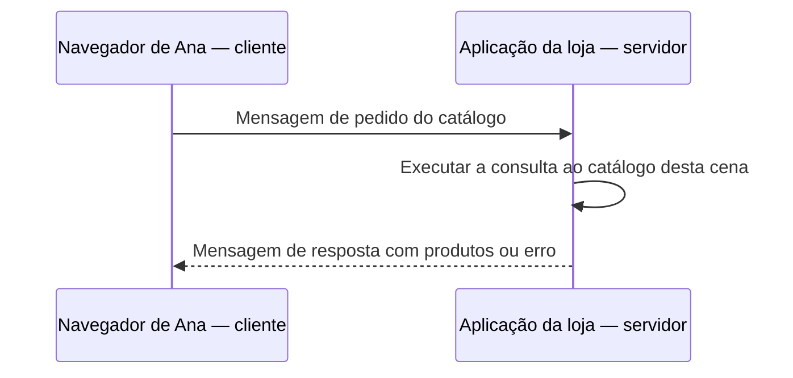

# 00 — O que acontece quando abro um site?

[Índice](README.md) · [Próxima: endereços e blocos](01-ip-cidr-subnets.md) · [Glossário](glossario.md)

**Pergunta:** Ana abre o catálogo da Loja Horizonte. Quem precisa conversar para os produtos aparecerem? **Objetivo:** desenhar o pedido e a resposta, identificar os programas e explicar o que uma falha ainda não permite concluir. **Pré-requisitos:** nenhum conhecimento de redes; basta reconhecer um navegador.

## Uma conversa pequena antes dos serviços

O navegador de Ana não conhece sozinho o catálogo atualizado. Ele envia um pedido a outro programa, que procura a informação e devolve uma resposta. Nesta primeira cena, vamos imaginar somente esses dois programas. Banco, nuvem, nomes e proteção serão acrescentados quando a pergunta exigir.

Um **processo** é um programa em execução. O navegador é um processo; a aplicação da loja pode executar em outro computador. Chamamos de **cliente** o papel que inicia a solicitação e de **servidor** o papel que a atende. “Servidor” pode designar esse software, não apenas uma máquina. Mais tarde, a aplicação será servidora para Ana e cliente do banco.

Uma **rede** conecta sistemas para trocar informação. A **interface de rede** é o ponto pelo qual um sistema participa dela: pode ser uma placa física ou uma interface virtual. Um computador pode ter mais de uma interface e mais de um endereço.

Um **endereço** permite identificar um destino no contexto da comunicação. Vamos estudar o endereço IP no próximo capítulo. Ele não é o nome da pessoa, sua senha ou a descrição completa de um serviço.

Uma **mensagem** contém informação que os programas trocam. Ela pode ser dividida em unidades menores para atravessar a rede. No nível IP, chamaremos essas unidades de **pacotes**. Não suponha que um pedido de catálogo seja exatamente um pacote ou que cada pacote corresponda a uma compra.

Um **protocolo** combina como interpretar a conversa: formato, significado e comportamento esperado. HTTP é o protocolo de aplicação que usaremos para pedir o catálogo; seus detalhes chegam no capítulo 04. Primeiro reconheça os papéis.

As setas representam mensagens lógicas, não cabos nem pacotes individuais. O desenho pressupõe um caminho de comunicação que ainda vamos investigar. A seta interna é processamento da aplicação, não tráfego para outra máquina.

## Uma analogia e sua fronteira

Pense em uma encomenda num condomínio: conhecer o apartamento ajuda a indicar o destino; saber chegar à portaria e ser autorizado a entrar são outras perguntas. Acrescentaremos uma terceira: **o atendimento funciona depois que chegamos?** Essa extensão é uma escolha didática desta trilha.

O limite é que um programa não é um porteiro e a rede não entende, sozinha, se Ana pode ver determinado pedido. A autorização de negócio exige regras da aplicação. A analogia organiza perguntas; não configura rotas ou permissões.

## Camadas como divisão de responsabilidades

No modelo TCP/IP, responsabilidades diferentes colaboram. Ler a tabela de cima para baixo ajuda a acompanhar o que um programa quer enviar; a recepção interpreta o que chegou.

| Responsabilidade | Pergunta inicial | Peça que veremos |
|---|---|---|
| Aplicação | Que informação foi pedida e com que significado? | HTTP, DNS e a lógica da loja |
| Transporte | Como programas trocam dados entre seus pontos de comunicação? | TCP e UDP |
| Internet | Que endereços e caminhos conectam redes? | IP e rotas |
| Enlace | Como atravessar o trecho de rede atual? | Interface e tecnologia local |

A [RFC 1122](https://www.rfc-editor.org/rfc/rfc1122.html#section-1.1.3) descreve responsabilidades da arquitetura de comunicação; especificações posteriores atualizam protocolos específicos. É um mapa para fazer perguntas, não uma regra de que cada produto pertence a uma única caixa.

**Aprofundamento opcional — OSI e rede local.** OSI divide responsabilidades em sete camadas, incluindo sessão e apresentação. Use-o para localizar uma função, sem exigir decorar números para investigar uma porta. Em uma LAN, rede local, um switch pode encaminhar quadros usando endereços MAC, identificadores de enlace. Esses identificadores não substituem o IP no caminho entre redes. Uma LAN física e uma VPC AWS não devem ser tratadas como o mesmo mecanismo por analogia.

## Se nada apareceu na tela

“Não abriu” ainda não localiza a falha. O pedido pode não ter saído, não ter chegado, ter sido recusado, ter ficado esperando ou ter recebido um erro que a tela não mostrou. Uma resposta do servidor também não prova que uma operação diferente, como comprar, funciona.

Registre: quem iniciou, qual operação, quando, de onde e qual resposta foi observada. É informação mais útil que escolher imediatamente um serviço AWS.

## Responda antes de abrir

**1. A aplicação atende Ana e depois consulta um banco. Ela continua sendo apenas servidora?**

Resposta comentada

Ela é servidora na conversa iniciada pelo navegador e cliente na conversa que inicia com o banco. O papel pertence à interação. Chamar a máquina de servidor não impede que um processo nela também faça solicitações.

**2. O navegador recebeu o catálogo. Isso comprova que a compra funciona?**

Resposta comentada

Comprova que aquela consulta recebeu uma resposta utilizável nas condições observadas. Comprar pode exigir autenticação, escrita, estoque e dependências não usadas nessa leitura. A evidência precisa corresponder à operação que queremos validar.

**3. Transferência de entendimento: a fotografia abriu, mas o preço não. Desenhe dois pedidos em vez de um e diga o que investigaria.**

Resposta comentada

Fotografia e preço podem vir de destinos ou operações diferentes. Identifique os dois pedidos e suas respostas, sem concluir que “a rede está toda boa” ou “o site inteiro caiu”. O sucesso de uma conversa restringe parte das hipóteses; não valida automaticamente a outra.

## Resumo e próxima leitura

Consigo identificar cliente, servidor, processo, interface, mensagem e pacote e desenhar ida e resposta. Ainda não sei configurar ou proteger esse caminho. A próxima pergunta é [como reconhecer quais endereços pertencem à mesma faixa](01-ip-cidr-subnets.md).
