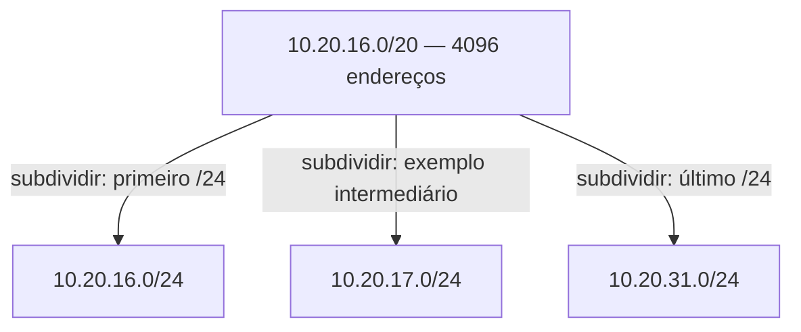

# 01 — IP, CIDR e sub-redes sem decorar tabelas

[Anterior](00-clique-resposta.md) · [Índice](README.md) · [Próxima: rotas](02-rotas-ida-volta.md)

**Pergunta:** o endereço `10.20.17.10` cabe no bloco de exercício `10.20.16.0/20`? **Objetivo:** calcular uma faixa, reconhecer alinhamento, subdivisão e sobreposição e separar a conta matemática da disponibilidade na AWS. **Pré-requisito:** os papéis do [capítulo 00](00-clique-resposta.md).

## Um endereço e um conjunto de endereços

IPv4 representa um endereço com 32 bits. Um **bit** admite 0 ou 1; cada grupo de 8 bits é um **octeto**. Escrevemos quatro octetos em decimal, de 0 a 255: `10.20.2.10`. Esse endereço pode estar associado a uma interface. Ele não descreve, sozinho, todos os endereços daquele computador.

**CIDR** escreve um bloco com endereço e tamanho do prefixo: `10.20.2.0/24`. O **prefixo** fixa os primeiros 24 bits; os 8 restantes variam. O bloco contém `2^(32-24) = 256` endereços. `10.20.2.0/24` descreve a rede; `10.20.2.10` é um endereço dentro dela. Uma **sub-rede**, ou subnet, separa um desses conjuntos para determinado uso.

A **máscara** é outra escrita da mesma fronteira: `/24` corresponde a `255.255.255.0`. Os bits 1 indicam a parte fixa. Não representa a quantidade de máquinas nem uma permissão de acesso. A [RFC 4632](https://www.rfc-editor.org/rfc/rfc4632.html) fundamenta a organização por prefixos, sem depender das antigas classes de redes.

| Bloco canônico | Máscara | Primeiro e último endereço | Total |
|---|---|---|---:|
| `10.20.0.0/16` | `255.255.0.0` | `10.20.0.0` a `10.20.255.255` | 65536 |
| `10.20.16.0/20` | `255.255.240.0` | `10.20.16.0` a `10.20.31.255` | 4096 |
| `10.20.2.0/24` | `255.255.255.0` | `10.20.2.0` a `10.20.2.255` | 256 |
| `10.20.2.32/28` | `255.255.255.240` | `10.20.2.32` a `10.20.2.47` | 16 |

São contas e faixas do exemplo, não um plano de produção.

## Por que o /20 avança 16 no terceiro octeto?

Com `10.20` fixos, `/20` acrescenta 4 bits fixos do terceiro octeto. Os outros 4 bits desse octeto variam em 16 valores. A máscara ali é 240; `256-240=16`. Os inícios alinhados são 0,16,32,48 e assim por diante.

No bloco `10.20.16.0/20`, o terceiro octeto vai de 16 a 31. Por isso `10.20.17.10` pertence e `10.20.32.1` não. `10.20.17.0/20` não é um início canônico: há bits de host preenchidos. Uma ferramenta pode rejeitar ou normalizar a entrada; não confunda normalização com uma faixa começando em 17.



As setas representam **subdivisão de conjuntos**, não tráfego. Há 16 sub-redes /24 nesse /20; mostramos só três. Cada uma tem 256 endereços e os conjuntos não se cruzam.

## Sobreposição: não basta cada faixa parecer boa

`10.20.2.0/24` ocupa parte de `10.20.0.0/16`: há sobreposição. `10.20.3.0/24` e `10.20.2.0/24` são separados. Se duas redes usarem a mesma faixa, conhecer o destino numérico pode não distinguir qual recurso se pretendia alcançar.

Uma precisão importante: **dois blocos CIDR canônicos que se sobrepõem têm relação de contenção**. Um cabe inteiro no outro. Intervalos arbitrários podem se cruzar parcialmente: `10.20.2.20–10.20.2.80` e `10.20.2.64–10.20.2.100` compartilham 64–80, mas nenhum contém todo o outro. Esses intervalos não são cada qual um único CIDR alinhado.

A analogia são ruas numeradas separadas para setores do condomínio. O limite é que números de apartamentos não seguem a matemática binária de prefixos; desenhar uma rua não cria roteamento ou isolamento.

## Privado, público e o próprio computador

As faixas IPv4 privadas da [RFC 1918](https://www.rfc-editor.org/rfc/rfc1918.html) são `10.0.0.0/8`, `172.16.0.0/12` e `192.168.0.0/16`. Não são destinadas a roteamento público direto na internet. **Privado não significa criptografado ou autorizado.** Um endereço fora dessas três faixas também pode ter uso reservado; não conclua automaticamente que é público utilizável.

**Loopback** é o caminho para o próprio sistema: usaremos `127.0.0.1`, sem publicar o laboratório na rede. Em IPv6, o loopback é `::1`. IPv6 usa 128 bits e outra escrita, como `2001:db8::10`, reservado aqui para documentação pela [RFC 3849](https://www.rfc-editor.org/rfc/rfc3849.html). Exige políticas de rota, acesso e proteção; não é automaticamente inseguro nem dispensa controles. Consulte a [arquitetura de endereçamento IPv6](https://www.rfc-editor.org/rfc/rfc4291.html).

## Total não é quantidade automaticamente atribuível

Uma convenção comum de sub-redes IPv4 reserva endereço de rede e broadcast, resultando em `total-2` para os blocos desta tabela. Há exceções, como /31 e /32; essa fórmula não é uma lei universal nem a regra de atribuição da AWS.

Para **uma subnet IPv4 comum da AWS, sem BYOIP (uso de endereços próprios, Bring Your Own IP)**, são reservados os primeiros quatro endereços e o último. Assim, um /24 tem 256 no total e 251 atribuíveis; um /28 tem 16 e 11; um /20 tem 4096 e 4091; um /16 tem 65536 e 65531. Em `10.20.2.0/24`, as reservas são `.0`, `.1`, `.2`, `.3` e `.255`. Isso não significa que toda subnet tenha um servidor DNS próprio em `.2`. O resolvedor da VPC possui endereçamento específico. A AWS **não suporta broadcast numa VPC**; não dimensione /16 para “broadcast a 65 mil máquinas”. A documentação descreve exceções como BYOIP. [R1 — dimensionamento de subnets](https://docs.aws.amazon.com/vpc/latest/userguide/subnet-sizing.html)

Endereços são consumidos por interfaces e serviços, não somente por máquinas. Pergunte sobre crescimento, quantas interfaces/IP s serão usados, divisão por zonas, recuperação, integrações e capacidade operacional. Uma faixa maior também amplia o risco de sobreposição com redes que serão conectadas depois.

## Calcular e conferir localmente

O [L1](laboratorio/l1-cidr-rotas.md) executa testes positivos e negativos com `ipaddress`, biblioteca padrão de Python. Este trecho não envia tráfego:

```python
from ipaddress import ip_address, ip_network, ip_interface
bloco = ip_network("10.20.16.0/20")
print(bloco.num_addresses)                       # 4096
print(ip_address("10.20.17.10") in bloco)         # True
print(ip_interface("10.20.17.10/20").network)     # 10.20.16.0/20
```

`ip_network(..., strict=True)` rejeita um endereço de rede desalinhado. `hosts()` tem regras próprias para enumerar hosts e **não é a lista automática de IP s atribuíveis na AWS**. [API do módulo](https://docs.python.org/3/library/ipaddress.html)

## Responda antes de abrir

**1. Mudar `10.20.17.10` para `10.20.17.10/20` muda o endereço para 17.0?**

<details><summary>Resposta comentada</summary>

Não. O endereço continua 17.10; o prefixo permite identificar sua rede canônica 16.0/20. Não se deve usar 17.0 como início daquele /20. Separar interface e rede evita dimensionar ou anunciar um bloco diferente do pretendido.

</details>

**2. Um /24 com 251 IP s atribuíveis significa 251 servidores disponíveis?**

<details><summary>Resposta comentada</summary>

Não necessariamente. Essa conta tem escopo de atribuição IPv4 comum na AWS, não capacidade de aplicação. Interfaces e serviços podem consumir múltiplos endereços; ainda existem carga, limites e requisitos de disponibilidade a avaliar.

</details>

**3. Transferência: divida `10.20.2.0/24` em /28. Quantos blocos existem? O último começa em 240 ou 255?**

<details><summary>Resposta comentada</summary>

São 16 blocos de 16 endereços. O último é `10.20.2.240/28` e termina em `10.20.2.255`. Um endereço terminado em `.255` não é início alinhado de /28. Na regra AWS comum desse bloco, o último endereço ainda está entre os reservados.

</details>

## Resumo e próxima leitura

Consigo calcular faixas e questionar sobreposição e consumo. Um endereço caber num bloco ainda não cria caminho: [vamos às rotas de ida e volta](02-rotas-ida-volta.md).
