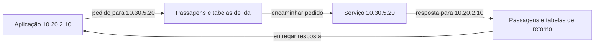

# 02 — Rotas: saber o destino não cria o caminho

[Anterior](01-ip-cidr-subnets.md) · [Índice](README.md) · [Próxima: nomes e DNS](03-dns-nomes.md)

**Pergunta:** a aplicação conhece `10.30.5.20`. Por onde envia e como recebe a resposta? **Objetivo:** ler uma tabela pequena, escolher o prefixo mais específico e acompanhar os dois sentidos. **Pré-requisito:** endereços, prefixos e pertencimento do capítulo 01.

## Quem escolhe a próxima etapa?

Uma **rota** indica o que fazer com tráfego para determinado conjunto de destinos. Uma **tabela de rotas** reúne essas decisões. O **próximo salto** é o próximo ponto de encaminhamento. Um **gateway** é uma passagem para outra rede ou domínio de encaminhamento; seu papel concreto depende da arquitetura.

A rota não contém o percurso físico completo nem garante que o destino esteja funcionando. Cada etapa do caminho precisa de uma decisão compatível. Uma rota **local** descreve o encaminhamento no domínio local considerado; seu significado exato depende do sistema. Uma rota **default**, de último recurso, atende destinos que não encontraram opção mais específica.

A analogia é uma placa: “apartamentos deste setor por aqui; demais setores pela portaria”. A placa não garante que a porta esteja aberta ou que alguém possa entrar. Na rede, uma rota tampouco autentica Ana ou concede permissão para consultar um pedido.

## Escolher pelo destino, com um exemplo delimitado

Esta é uma **tabela fictícia de um roteador**, não um comando de sistema operacional ou uma configuração AWS executada. Todas as rotas estão ativas, têm prefixos distintos e não há empate de prioridade:

| Destino | Alvo simbólico | Leitura |
|---|---|---|
| `10.20.0.0/16` | rede-local | Encaminhamento no domínio local deste exemplo |
| `10.30.0.0/16` | passagem-geral | Destinos da rede 30 |
| `10.30.5.0/24` | passagem-especifica | Exceção para o setor 5 da rede 30 |
| `0.0.0.0/0` | passagem-padrao | Demais destinos IPv4 |

Para `10.30.5.20`, /16, /24 e /0 casam. Escolhemos /24 porque fixa mais bits: é o **prefixo mais específico**, ou longest prefix match. Para `10.30.8.20`, escolhemos /16. Um destino fora desses blocos usa /0.

A regra não consulta a menor latência nem corrige um alvo errado. Se `passagem-especifica` estiver mal configurada, a existência da rota geral não comprova recuperação. Na AWS, também há regras para empates, rotas estáticas/propagadas e listas de prefixos: este exemplo não pretende implementá-las. [R2 — tabelas](https://docs.aws.amazon.com/vpc/latest/userguide/VPC_Route_Tables.html) e [prioridade das rotas](https://docs.aws.amazon.com/vpc/latest/userguide/route-tables-priority.html).

## Falhas de tabela

| Alteração no exercício | Efeito a investigar |
|---|---|
| Apagar /24, mantendo /16 | O destino 5 passa a usar a passagem geral; ela atende esse destino? |
| Apontar /24 para outra rede | O prefixo continua sendo escolhido, mas o próximo salto não entrega ao destino pretendido |
| Apagar /24 e /16, mantendo /0 | A existência de default não significa que seu alvo saiba alcançar endereços privados da rede 30 |

O [L1](laboratorio/l1-cidr-rotas.md) permite mudar essa tabela em Python e prever a seleção. É um algoritmo didático; nenhuma rota do computador ou da AWS é alterada.

## O caminho da resposta também precisa existir

As setas são sentidos de comunicação; as caixas de passagens resumem etapas que ainda precisaríamos inspecionar. A tabela do destino pode não saber voltar à rede 20, mesmo que o pedido tenha chegado à rede 30.

O retorno não precisa percorrer equipamentos fisicamente idênticos. Porém, **assimetria**, caminhos diferentes nos sentidos opostos, exige cuidado: um controle que acompanha o estado de uma conexão pode precisar observar os fluxos compatíveis com esse estado. Esses controles aparecem no capítulo 07.

## O mesmo bloco em funções diferentes

`0.0.0.0/0` é um conjunto que inclui todos os endereços IPv4. Como **destino de rota**, indica abrangência de encaminhamento. Como **origem ou destino de uma regra de acesso**, indica quais endereços a regra considera. No segundo caso também precisamos conhecer ação, protocolo, direção e porta. Escrever /0 numa tabela de rotas não é “liberar todas as portas”.

Na AWS, cada subnet tem uma tabela associada e os alvos representam recursos específicos. Uma seta entre dois ícones não substitui associação, rota de ida, retorno e controles. Essa implementação será construída nos capítulos 06 e 10; ainda estamos aprendendo a ler o caminho.

## Responda antes de abrir

**1. Qual rota escolhemos para `10.30.5.99`? Ela prova que o serviço responde?**

Resposta comentada

O /24 é mais específico entre os prefixos que contêm o endereço. A escolha só descreve o próximo encaminhamento na tabela fictícia. Alvo, outras etapas, retorno, permissões e programa ainda precisam funcionar.

**2. O destino recebeu o pedido, mas Ana não recebeu resposta. Falta necessariamente a rota de retorno?**

Resposta comentada

É uma hipótese, não uma conclusão única. A aplicação pode não responder, um controle pode bloquear o retorno ou a comunicação pode ter outra falha. Uma observação de chegada elimina parte da investigação de ida; escolha agora evidência que diferencie o que resta.

**3. Transferência: mude o destino para `10.30.8.20` e remova somente /24. O resultado da seleção muda?**

Resposta comentada

Não: esse destino já usava /16. A alteração afeta o setor 5, não todo o bloco 30. Isso mostra por que precisamos especificar origem, destino e tabela, em vez de dizer apenas que “uma rota foi removida”.

## Resumo e próxima leitura

Consigo separar encaminhamento, permissão e atendimento e verificar os dois sentidos. Agora falta entender como um nome como `loja.test` pode fornecer informação para começar a conversa: [DNS](03-dns-nomes.md).
