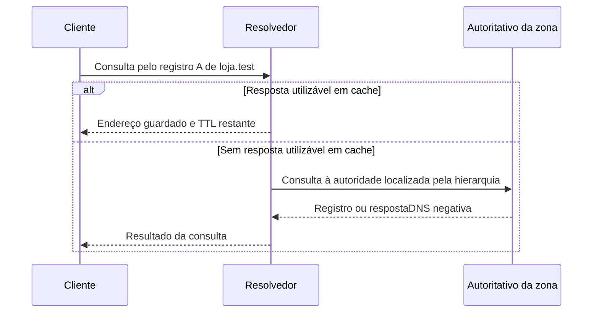

# 03 — DNS: o nome precisa virar informação utilizável

[Anterior](02-rotas-ida-volta.md) · [Índice](README.md) · [Próxima: transportes e portas](04-transportes-portas-http.md)

**Pergunta:** Ana usa um nome; a rede encaminha por endereços. Como essas informações se relacionam? **Objetivo:** distinguir os papéis do DNS, interpretar respostas diferentes e explicar os limites de um teste que substitui a resolução. **Pré-requisitos:** cliente/servidor, endereço e caminho dos capítulos 00–02.

## Nome não é a URL inteira

Considere `https://loja.test:8443/catalogo`. A **URL** descreve o esquema de acesso (`https`), o nome do host (`loja.test`), uma porta explícita (`8443`) e o caminho (`/catalogo`). Um **domínio** organiza nomes numa hierarquia. Um endereço IP identifica um destino no contexto da rede; a porta ajuda a escolher a conversa com um programa, assunto do capítulo 04.

DNS, sistema de nomes de domínio, devolve informações sobre nomes por meio de registros. Nesta trilha, `loja.test` é reservado ao ambiente de laboratório; não é uma loja pública a consultar. DNS não retorna a página do catálogo nem escolhe o caminho HTTP da URL.

## Quem pergunta e quem mantém os dados?

O **resolvedor** recebe uma consulta e procura uma resposta, possivelmente reutilizando informações guardadas. Um servidor **autoritativo** mantém os dados da zona sob sua responsabilidade. Uma **zona** é uma unidade administrativa do espaço de nomes; não é necessariamente todo o domínio e suas subpartes delegadas.

A analogia é consultar uma agenda para encontrar um endereço de atendimento. O limite é que DNS também armazena outros tipos de informação, tem hierarquia e cache e pode devolver erros; não é um catálogo único com respostas instantaneamente atualizadas.

| Registro | Informação neste recorte |
|---|---|
| A | Endereço IPv4 associado ao nome |
| AAAA | Endereço IPv6 associado ao nome |
| CNAME | Outro nome, cujo resultado ainda pode precisar ser resolvido |
| TTL | Tempo de vida associado ao dado para orientar sua retenção em cache; não é um tipo de registro de endereço |

Um **alias do Route 53** é um recurso daquele provedor, configurado em registros suportados; não é um tipo universal de registro DNS chamado ALIAS. Regras de destinos e uso no nome principal da zona diferem de um CNAME. [Alias no Route 53](https://docs.aws.amazon.com/Route53/latest/DeveloperGuide/routing-to-aws-resources.html).

## Cache muda o percurso

**Cache** guarda informação para reutilização. Não precisamos refazer toda a busca a cada requisição de catálogo: pode existir resposta em cache no cliente ou no resolvedor e até uma conexão já reutilizável.

As setas mostram consultas/respostas DNS, não pedidos HTTP. O resolvedor localizar a autoridade pode exigir outras consultas pela hierarquia; elas estão resumidas, não negadas pelo desenho. O exemplo é conceitual, não um servidor DNS executado nos laboratórios.

Um TTL de 60 segundos é uma hipótese que poderíamos adotar num exercício, não uma promessa de que todos trocarão de destino exatamente em 60 segundos. Há caches e conexões existentes; respostas negativas também podem ser guardadas. [Conceitos DNS](https://www.rfc-editor.org/rfc/rfc1034.html) e [cache negativo](https://www.rfc-editor.org/rfc/rfc2308.html).

## Interpretar antes de alterar

Estes registros são **sintéticos**, para leitura:

| Consulta e observação | Conclusão sustentada | O que continua aberto |
|---|---|---|
| A `loja.test`: NOERROR, A 127.0.0.1 | Essa consulta obteve um IPv4 | Porta, TLS e catálogo ainda não foram testados |
| AAAA `loja.test`: NOERROR, sem registro do tipo procurado | Pode ser uma resposta sem dados desse tipo, NODATA | Não significa que o nome inteiro inexista; conferir a mensagem completa |
| A `ausente.test`: NXDOMAIN | O resultado informa nome inexistente naquele contexto | Verificar zona, autoridade e cache antes de inventar outro destino |
| A `loja.test`: SERVFAIL | O servidor não conseguiu concluir a consulta | A causa pode ser diferente de nome inexistente |
| Nenhuma resposta até o prazo | O cliente esgotou a espera | Não houve resposta que comprovasse NXDOMAIN ou SERVFAIL |

NODATA não é um código de resposta (RCODE) separado equivalente a NXDOMAIN. Interpretamos código, tipo e seções da resposta, não apenas a ausência de um endereço na tela. [Mensagens DNS](https://www.rfc-editor.org/rfc/rfc1035.html) e [terminologia de resposta negativa](https://www.rfc-editor.org/rfc/rfc2308.html).

## Um teste controlado não corrige o DNS real

No [L4](laboratorio/l4-nome-certificado.md), o executor informa o nome e o endereço de loopback ao `curl --resolve`. Isso substitui a resolução para aquele par nome/porta no teste, mantendo o nome da URL para HTTP/TLS. **Não executa nem comprova uma consulta ao DNS real**, e não corrige o DNS do computador.

Use os comandos do roteiro com o servidor e a CA do laboratório. Não altere `/etc/hosts` ou o DNS da rede. Um teste por endereço sem preservar o nome também pode mudar o servidor virtual e a validação do certificado; não seria a mesma experiência. [Opção resolve do curl](https://curl.se/docs/manpage.html#--resolve).

## Aprofundamento: DNS público, privado e híbrido

Uma zona pública atende nomes pela estrutura pública de DNS; uma zona privada da AWS depende do contexto e das associações permitidas. Mesmo nome pode ter respostas diferentes conforme o resolvedor consultado.

A nomenclatura atual é **Route 53 VPC Resolver**, antes chamado Route 53 Resolver. Num cenário híbrido, um endpoint **inbound** recebe consultas para a AWS vindas da rede local; um endpoint **outbound** encaminha consultas da AWS para resolvedores externos conforme regras. São direções do ponto de vista da AWS. Precisam de caminho de rede e permissões: o endpoint não cria sozinho uma VPN ou conexão física. Esses componentes serão apresentados depois; não são pré-requisitos do núcleo DNS. [R3 — VPC Resolver](https://docs.aws.amazon.com/Route53/latest/DeveloperGuide/resolver.html).

## Responda antes de abrir

**1. Receber um A significa que o catálogo está funcionando?**

Resposta comentada

Significa que a consulta obteve uma informação de endereço. Ela não abriu uma conexão com o serviço, validou o canal ou recebeu o catálogo. O nome pode inclusive apontar a um endereço incorreto ou antigo, ainda em cache.

**2. Um timeout DNS permite afirmar que o domínio não existe?**

Resposta comentada

Não. Ausência de resposta até o prazo é diferente de receber uma resposta NXDOMAIN. Precisamos investigar consulta, resolvedor, caminho, prazo e observações, sem atribuir a mesma causa a sintomas diferentes.

**3. Transferência: com o mesmo nome e certificado, --resolve faz a requisição funcionar. Qual hipótese ficou mais forte?**

Resposta comentada

O caminho escolhido explicitamente e o serviço podem funcionar para aquele teste, enquanto a resolução usual continua suspeita. Ainda precisamos testar a resolução real no contexto afetado; o comando a substituiu. Alterar também o nome, a porta ou a validação TLS enfraqueceria essa comparação.

## Resumo e próxima leitura

Consigo separar nome, URL e informação DNS, consultar o contexto e interpretar o que houve antes de culpar a aplicação. Agora vamos descobrir [quem atende uma porta e que tipo de resposta observamos](04-transportes-portas-http.md).
