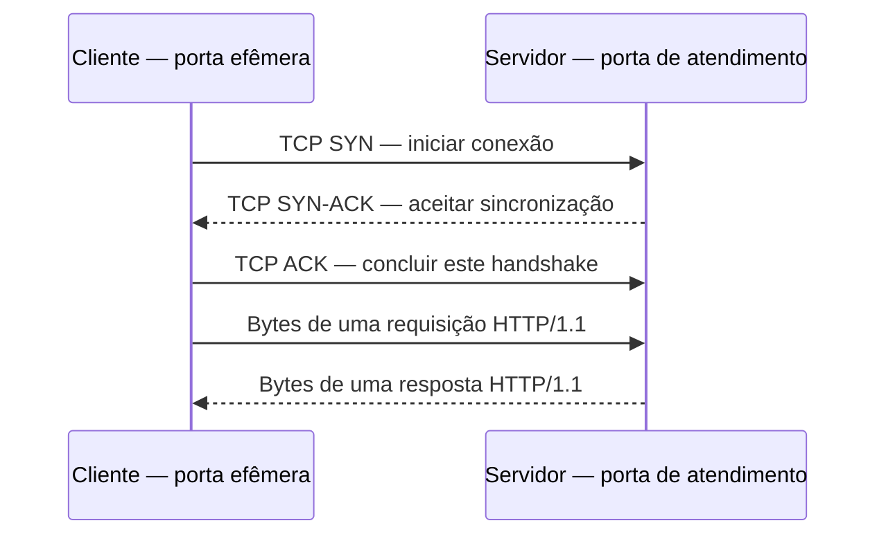

# 04 — TCP, UDP, ICMP, portas e HTTP

[Anterior](03-dns-nomes.md) · [Índice](README.md) · [Próxima: HTTPS e TLS](05-https-tls.md)

**Pergunta:** o endereço responde a ping, mas o catálogo não abre. O que foi realmente testado? **Objetivo:** distinguir conexão, espera e resposta de aplicação e propor um teste que discrimine hipóteses. **Pré-requisitos:** capítulos 00–03; não é necessário conhecer configurações de fabricantes.

## Escolher o processo que atende

Um endereço IP não escolhe sozinho o programa desejado. TCP e UDP usam **portas**, números associados aos pontos de comunicação. Um processo precisa estar **escutando**, ou listening, no endereço e na porta apropriados. **Bind** é a associação do ponto de atendimento a um endereço/porta local.

No laboratório HTTP, um programa escuta em `127.0.0.1` e numa porta livre acima de 1024. Outra máquina não acessa esse listener como se ele estivesse publicado em todas as interfaces. Um processo pode existir e ainda estar ligado ao endereço errado, a outra porta ou nem ter iniciado seu atendimento.

A analogia é chegar ao prédio certo e procurar o guichê correto. O limite: portas são identificadores de protocolos de transporte, não portas físicas. Porta TCP 8080 e porta UDP 8080 não são a mesma conversa.

## Origem, destino e conexão

Considere um exemplo **sintético**: cliente `127.0.0.1:53000` conversa com servidor `127.0.0.1:18080` usando TCP. A porta 18080 é do atendimento; 53000 é uma porta temporária de origem, **efêmera**, escolhida nesse exemplo. Os intervalos reais dependem do sistema e da configuração. O executor do laboratório descobre portas livres, em vez de depender desses números.

No retorno, os papéis dos endereços e portas se invertem: servidor 18080 para cliente 53000. Não se abre uma nova conexão iniciada pelo servidor só para responder nessa mesma conversa.

**TCP** estabelece uma conexão e oferece à aplicação um fluxo de bytes ordenado, com mecanismos de retransmissão e controle. Isso não garante prazo universal, disponibilidade eterna ou confirmação da compra. **UDP** envia datagramas sem oferecer por si só a mesma conexão, ordenação ou retransmissão; o protocolo que o usa pode acrescentar mecanismos. **ICMP** transporta mensagens de controle/diagnóstico relacionadas ao IP. Ping costuma usar ICMP Echo; não é uma requisição HTTP. [TCP](https://www.rfc-editor.org/rfc/rfc9293.html), [UDP](https://www.rfc-editor.org/rfc/rfc768.html) e [ICMP](https://www.rfc-editor.org/rfc/rfc792.html).



As setas resumem eventos do protocolo, não todos os pacotes e confirmações. Pressupomos TCP sem TLS nesta demonstração local. O TCP pode confirmar recebimento de bytes antes de o programa concluir uma regra de negócio.

## O que cada sintoma permite dizer?

| Observação | Hipóteses a distinguir | Evidência útil |
|---|---|---|
| Conexão recusada | Sem listener ou rejeição ativa por algum componente | Endereço/porta do listener, origem da resposta e controles |
| Timeout ao conectar | Caminho, descarte, destino ou espera no estabelecimento | Fluxo, tempos e registros de cada trecho |
| Conexão estabelecida, sem resposta HTTP no prazo | Programa lento/parado, dependência ou outro problema depois da conexão | Log de recebimento, processamento e tempos por etapa |
| Resposta HTTP de erro | Algum componente entendeu a conversa HTTP e respondeu | Código, emissor, logs e operação afetada |

Nenhuma linha determina uma causa única. Um intermediário também pode responder ou rejeitar. Ping funcionar testa somente a troca correspondente nas condições observadas; ping falhar pode refletir um controle ICMP enquanto TCP/HTTPS funciona. Não usaremos ping em domínios ou redes externas como teste genérico.

## Ler uma mensagem HTTP pequena

HTTP dá significado à solicitação e à resposta. `GET` pede uma representação; `/catalogo` indica o recurso. Neste exemplo textual HTTP/1.1, Host identifica o atendimento esperado:

```http
GET /catalogo HTTP/1.1
Host: loja.test

```

Uma resposta poderia começar por `HTTP/1.1 200 OK` e conter os produtos. Famílias 2xx indicam sucesso da operação HTTP conforme o código, 4xx relacionam falhas atribuídas ao pedido e 5xx falhas do servidor ao atendê-lo. Isso não identifica automaticamente o emissor nem confirma uma compra. Um proxy, componente intermediário que atende/encaminha, pode gerar o erro. [Semântica HTTP](https://www.rfc-editor.org/rfc/rfc9110.html).

HTTP/1.1 e HTTP/2 comumente usam TCP; HTTP/3 usa QUIC, baseado em UDP. QUIC acrescenta confiabilidade e proteção próprias; UDP não significa que a aplicação não possa oferecer entrega confiável. O núcleo dos nossos laboratórios declara **HTTP/1.1 sobre TCP**, com TLS apenas no L4. [HTTP/3](https://www.rfc-editor.org/rfc/rfc9114.html).

## Prever antes de executar

O [L2](laboratorio/l2-processo-porta.md) compara resposta 200, porta sem listener e erro HTTP controlado. O [L3](laboratorio/l3-conectou-demorou.md) introduz um atraso no handler, função que atende o pedido. Esse atraso ocorre **depois da conexão**: não simula perda de SYN, não cria timeout de estabelecimento TCP e não prova defeito de rede.

No curl, `--connect-timeout` limita a fase de conexão, que pode incluir resolução e negociações pertinentes; `--max-time` limita o tempo total. Não some tempos acumulados como se fossem durações independentes. Os roteiros explicam as flags usadas na versão disponível. [Documentação da ferramenta](https://curl.se/docs/manpage.html#--connect-timeout).

## Responda antes de abrir

**1. Um ACK do TCP comprova que o pedido foi gravado no banco?**

<details><summary>Resposta comentada</summary>

Não. Transporte de bytes e confirmação de uma transação são eventos distintos. A aplicação precisa processar o pedido e cumprir seu protocolo de negócio. Para uma operação com resultado desconhecido, será necessário investigar o estado, não interpretar um ACK como recibo comercial.

</details>

**2. Ping responde. Vale abrir todas as portas para resolver o catálogo?**

<details><summary>Resposta comentada</summary>

Não. Primeiro identifique quem inicia a comunicação, endereço, protocolo e porta do catálogo. Verifique listener, caminho, controles e resposta conforme as evidências. Uma alteração ampla aumenta exposição sem demonstrar qual hipótese resolveu.

</details>

**3. Transferência: o servidor passa de 18080 para 18081, mas o cliente continua na 18080. Uma resposta recusada permite concluir que o programa morreu?**

<details><summary>Resposta comentada</summary>

Não. O processo pode estar saudável em 18081. A comparação correta verifica o ponto de atendimento e a configuração do cliente. Depois, um erro HTTP 503 em 18081 seria uma evidência diferente: houve resposta HTTP, ainda que insatisfatória para a operação.

</details>

**4. A conexão abriu em poucos milissegundos, mas o primeiro byte demorou. A banda do link é necessariamente baixa?**

<details><summary>Resposta comentada</summary>

Não. Espera na aplicação, pool, banco ou dependência pode atrasar a resposta. Separe etapas, identifique quem recebeu o pedido e escolha evidência que discrimine processamento e transporte. Conexão rápida não mede toda a jornada, e demora de resposta não mede sozinha a capacidade do link.

</details>

## Resumo e próxima leitura

Consigo separar endereço, porta, conexão, resposta e resultado de negócio. Ainda precisamos proteger e validar a identidade do canal: [HTTPS e TLS](05-https-tls.md).
