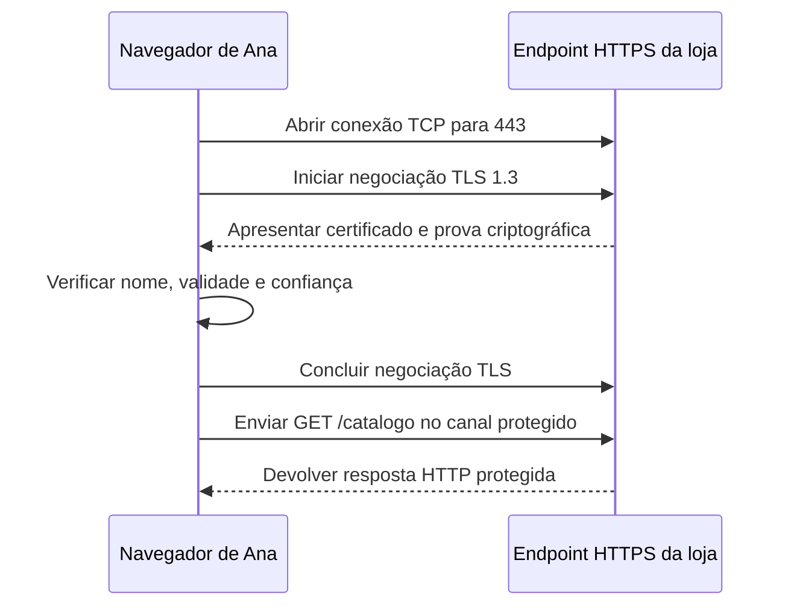

# 05 — HTTPS e TLS: quem está do outro lado?

[← 04 — Transportes, portas e HTTP](04-transportes-portas-http.md) · [Índice](README.md) · [Próxima: VPC, sub-redes e saída →](06-vpc-subnets-saida.md)

Ana abre o catálogo da Loja Horizonte. O nome foi resolvido e a conexão TCP chegou à porta 443, mas o navegador rejeitou o certificado. Há um serviço respondendo; ainda falta verificar se ele apresenta uma identidade aceitável para o nome solicitado.

**Objetivo:** explicar o que HTTPS protege, como o certificado participa da verificação e onde essa proteção termina. **Pré-requisitos:** reconhecer nome, endereço IP, porta e requisição HTTP, apresentados nas aulas anteriores. Não é necessário conhecer criptografia nem instalar certificados.

## O canal protege uma conversa

**HTTPS** é HTTP com proteção de TLS, *Transport Layer Security*. TLS oferece confidencialidade, para dificultar a leitura por terceiros, e integridade, para detectar alterações no canal. Também permite autenticar o outro participante. Nosso exemplo usa HTTP sobre TCP e TLS 1.3, com autenticação do servidor por certificado, sem retomada de sessão nem envio antecipado de dados. HTTP/3 usa outro arranjo de transporte, com QUIC; não estamos descrevendo esse arranjo aqui. [TLS 1.3, finalidade e propriedades](https://www.rfc-editor.org/rfc/rfc8446.html#section-1)

Pense numa conversa dentro de um envelope lacrado, entregue a alguém cuja identificação foi conferida. O lacre representa a proteção contra leitura e alteração; conferir o destinatário representa a validação da identidade. O limite da analogia: TLS usa negociação e provas criptográficas, não um selo físico. Ele também não impede que o destinatário autorizado use mal a informação depois de recebê-la.

Um **certificado** relaciona uma chave pública a uma identidade, com assinatura de uma autoridade emissora. A chave pública não é uma senha compartilhada. No fluxo TLS 1.3 deste exemplo, o servidor prova que possui a chave privada correspondente; as partes derivam chaves de sessão para proteger os dados. Não cifram cada requisição diretamente com a chave pública do certificado. [Negociação TLS 1.3](https://www.rfc-editor.org/rfc/rfc8446.html#section-2)

## Conferir o nome faz parte da conexão

Usaremos `https://loja.test/catalogo`. `loja.test` é um nome fictício reservado para testes, sem serviço público ou certificado já emitido. [Reserva de `.test`](https://www.rfc-editor.org/rfc/rfc6761.html#section-6.2) O navegador precisa verificar, entre outros pontos:

- **Nome:** o nome pedido deve corresponder a uma identidade adequada no certificado. Para um nome DNS, usa-se a extensão **SAN**, *Subject Alternative Name*, com uma entrada de nome DNS; o campo antigo *Common Name* não substitui essa verificação.
- **Validade:** o certificado precisa estar dentro do período aceito, considerando o relógio e a política do cliente.
- **Cadeia de confiança:** as assinaturas precisam formar um caminho aceito até uma autoridade em que o cliente confia.

Conhecer o IP de um servidor não elimina a verificação do nome. [Identidade do serviço e nomes no SAN](https://www.rfc-editor.org/rfc/rfc9525.html#section-4.1)

O diagrama responde **quando a requisição do catálogo pode ser enviada**, resumindo várias mensagens da negociação:

Se a validação falhar, o cliente deste exemplo interrompe antes do `GET`. A conectividade TCP não comprova a conclusão de TLS.

**Responda antes de abrir:** o certificado é confiável, mas contém apenas `outro.test`. Basta o IP estar correto?

Resposta comentada

Não. Confiança na autoridade e correspondência do nome são verificações diferentes. Aceitar qualquer nome assinado permitiria confundir serviços distintos. É preciso corrigir o nome utilizado ou apresentar um certificado apropriado, preservando a validação.

## TLS, login e permissão são decisões diferentes

No fluxo usual, o certificado do servidor não identifica Ana. **Autenticação da pessoa** verifica quem está usando a aplicação; **autorização** decide quais ações essa pessoa pode realizar. Uma conexão HTTPS válida ainda pode receber uma recusa HTTP de acesso. TLS não torna correto o cálculo do preço nem autoriza consultar pedidos alheios.

**Responda antes de abrir:** receber `403` por HTTPS demonstra que TLS falhou?

Resposta comentada

Não. O cliente recebeu uma resposta HTTP por um canal estabelecido. A recusa deve ser investigada no componente que a emitiu e em suas regras. Trocar o certificado não concede uma permissão de negócio.

## A proteção tem pontos de início e fim

**Terminar TLS** significa que um componente conclui a negociação e pode ler o HTTP recebido. Na publicação da aula 08, esse componente será um balanceador: navegador → balanceador é uma conexão; balanceador → aplicação é outra. Proteger a primeira não cifra automaticamente a segunda. Proteção **em trânsito** também não descreve como dados ficam armazenados **em repouso**.

O **AWS Certificate Manager, ACM**, ajuda a emitir, armazenar e gerenciar certificados, com condições próprias de renovação e integração. Quem negocia TLS é o componente que utiliza o certificado, como o balanceador, não uma passagem obrigatória pelo ACM a cada requisição. [R4 — papel do ACM](https://docs.aws.amazon.com/acm/latest/userguide/acm-overview.html)

**Responda antes de abrir:** navegador → balanceador usa HTTPS e balanceador → aplicação usa HTTP. A conversa inteira está cifrada?

Resposta comentada

Não. O primeiro trecho está protegido por TLS; o segundo não tem essa proteção. Uma rede privada não transforma HTTP em HTTPS. Se o requisito exigir cifragem também até a aplicação, esse trecho precisa de uma decisão explícita.

## Uma falha e uma transferência

**Falha:** o certificado venceu. Registre nome solicitado, ponto de terminação, mensagem de validação e relógio do cliente; confira a cadeia e a implantação do certificado. Desativar a verificação esconderia o defeito e removeria parte da proteção.

**Exercício de transferência:** a aplicação agora chama `https://api.externa.test`. Explique quem vira cliente TLS e quais verificações continuam necessárias.

Ver solução comentada

A aplicação é cliente dessa nova conexão. Precisa validar a identidade correspondente a `api.externa.test`, a confiança e a validade do certificado conforme sua biblioteca e política. O certificado da loja não protege essa comunicação nem dá permissão de uso da API. Os nomes continuam fictícios; nenhuma chamada externa é necessária.

Você agora consegue separar conexão TCP, canal TLS, identidade do serviço e autorização. Na próxima aula, vamos localizar esses participantes em uma VPC e distinguir caminhos de entrada e de saída.

[← Anterior](04-transportes-portas-http.md) · [Índice](README.md) · [Próxima: VPC, sub-redes e saída →](06-vpc-subnets-saida.md)
