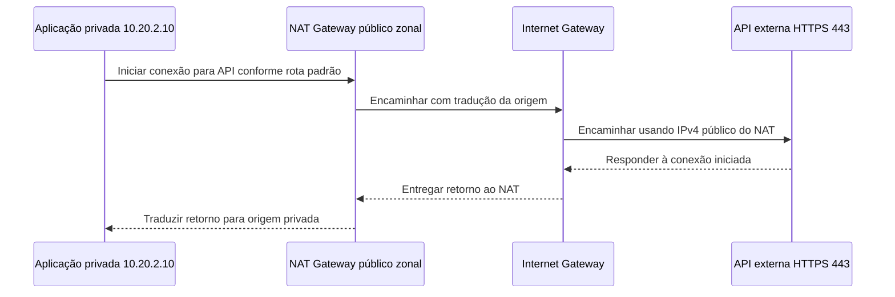

# 06 — VPC, sub-redes e saída: por onde a aplicação conversa?

[← 05 — HTTPS e TLS](05-https-tls.md) · [Índice](README.md) · [Próxima: Security Groups e NACLs →](07-sg-nacl.md)

A aplicação da Loja Horizonte consulta o banco privado normalmente, mas não consegue chamar uma API externa. Colocar ambos os destinos na mesma investigação esconderia uma diferença: o banco está dentro da VPC; a API precisa de um caminho de saída.

**Objetivo:** localizar aplicação e banco, interpretar suas rotas e explicar por que saída para a internet não publica a aplicação. **Pré-requisitos:** IP, CIDR, rota, porta e TLS. O desenho é fictício e não exige conta AWS, criação de recursos ou tráfego nessas redes.

## Primeiro, onde as peças ficam

Uma **Região AWS** é uma área geográfica; dentro dela existem **Zonas de Disponibilidade**, ou **AZs**, localizações isoladas. Uma **VPC** é uma rede virtual logicamente isolada. A VPC é regional; uma **sub-rede** é uma faixa de endereços dessa VPC contida em uma única AZ. [Regiões e AZs](https://docs.aws.amazon.com/AWSEC2/latest/UserGuide/using-regions-availability-zones.html), [sub-redes](https://docs.aws.amazon.com/vpc/latest/userguide/configure-subnets.html)

Uma instância **EC2** é um servidor virtual que pode executar a aplicação. Sua **interface de rede**, também chamada **ENI**, funciona como uma placa de rede virtual, com endereços e controles associados. Aqui, a aplicação usa `10.20.2.10` e o banco usa `10.20.3.20`. São endereços privados de participantes diferentes. Executar o programa em um contêiner, por exemplo com Amazon ECS, não elimina a necessidade de entender sua interface e seu caminho de rede. [Interfaces de rede](https://docs.aws.amazon.com/AWSEC2/latest/UserGuide/using-eni.html)

Pense numa VPC como um condomínio com setores e caminhos internos. Um endereço localiza uma unidade; uma saída indica por onde alcançar destinos externos. O limite: a VPC não é uma parede física nem concede permissão por proximidade. Caminho e autorização continuam sendo decisões diferentes.

## Um mapa pequeno, com três papéis

Escolhemos IPv4 e a VPC `10.20.0.0/16`. Este recorte ensina roteamento; não é uma implantação completa com tolerância a falhas.

| Sub-rede | Papel neste desenho | Rotas principais propostas |
|---|---|---|
| `web`, `10.20.1.0/24` | Área pública de entrada e do NAT zonal escolhido | `10.20.0.0/16 → local`; `0.0.0.0/0 → IGW` |
| `app`, `10.20.2.0/24` | Aplicação privada `10.20.2.10` | `10.20.0.0/16 → local`; `0.0.0.0/0 → NAT` |
| `db`, `10.20.3.0/24` | Banco privado `10.20.3.20:5432` | `10.20.0.0/16 → local`; sem rota padrão externa |

**Local** é o alvo da rota que permite comunicação dentro da VPC. Cada sub-rede está associada a uma tabela de rotas. Para `10.20.3.20`, a rota `/16` é mais específica que `/0`: a consulta ao banco não passa pelo NAT. Permissões e serviço atendendo continuam necessários. [Tabelas de rotas](https://docs.aws.amazon.com/vpc/latest/userguide/subnet-route-tables.html), [prioridade pelo prefixo mais específico](https://docs.aws.amazon.com/vpc/latest/userguide/route-tables-priority.html)

O **Internet Gateway, IGW**, oferece o caminho entre a VPC e a internet. Uma sub-rede com rota direta para ele é pública. Isso não torna todo recurso automaticamente acessível. Para uma EC2 receber HTTPS diretamente por IPv4 público, seriam necessários: IGW anexado, rota apropriada, IPv4 público associado, controles permitindo o fluxo e processo atendendo no endereço/porta corretos. Ter só a rota ou só o IP público não basta. Esta é uma comparação; nossa aplicação permanece privada. [R5 — IGW e requisitos de acesso IPv4](https://docs.aws.amazon.com/vpc/latest/userguide/VPC_Internet_Gateway.html)

**Responda antes de abrir:** a aplicação ganhou uma rota `0.0.0.0/0 → IGW`, mas continua sem IPv4 público. Isso resolve o acesso direto IPv4 pela internet?

Resposta comentada

Não. A rota não fornece um endereço IPv4 público nem libera filtros. Também mudaria a classificação da sub-rede. Neste cenário, manteremos a aplicação privada e escolheremos separadamente entrada controlada e saída.

## Sair não é receber conexões novas

**NAT**, tradução de endereços de rede, permite representar a origem privada por outro endereço e reconhecer o tráfego de resposta. Para a chamada a `api.externa.test:443`, escolhemos um **NAT Gateway público em modalidade zonal**, com Elastic IP, na sub-rede pública `web`, cuja tabela aponta ao IGW. A tabela de `app` envia o tráfego externo ao NAT. O nome é fictício; não corresponde a uma API a ser acessada.

O diagrama mostra a saída iniciada pela aplicação e seu retorno, omitindo a negociação TLS:

O NAT mantém o mapeamento para respostas; não publica a porta da aplicação para novas conexões de Ana. Também não substitui TLS nem verifica autorização da API. [R6 — NAT público e retorno](https://docs.aws.amazon.com/vpc/latest/userguide/vpc-nat-gateway.html)

**Responda antes de abrir:** Ana pode usar o Elastic IP do NAT para iniciar uma conexão com o catálogo privado?

Resposta comentada

Não por esse mecanismo. O NAT Gateway não funciona como balanceador de entrada ou encaminhamento público arbitrário para a aplicação. A aula 08 escolherá uma entrada própria para o catálogo.

Zonal é uma escolha deste exemplo, não a única modalidade atual. Existe também **NAT Gateway regional**, com organização diferente; ele fica fora do núcleo desta aula. Um NAT zonal compartilhado entre AZs cria uma dependência da AZ em que está. Preço e resiliência exigem análise própria, não uma promessa deste desenho. [Modalidade regional](https://docs.aws.amazon.com/vpc/latest/userguide/nat-gateways-regional.html), [limites do desenho zonal](https://docs.aws.amazon.com/vpc/latest/userguide/nat-gateway-basics.html)

## A rota existe, mas ainda pode falhar

**Falha:** a tabela de `app` aponta ao NAT, mas a sub-rede do NAT perdeu sua rota ao IGW. O acesso à API falha; a consulta privada ao banco pode continuar. Isso é compatível com caminhos diferentes, não prova que “a VPC inteira caiu”. Compare a tabela realmente associada à origem, o destino escolhido e o caminho de retorno, antes de alterar permissões.

**Responda antes de abrir:** um endpoint de VPC resolve qualquer acesso externo e concede permissões à aplicação?

Resposta comentada

Não. Endpoints oferecem acesso privado a serviços ou recursos específicos suportados; não são saída universal para qualquer API. A autorização exigida pelo serviço continua necessária, inclusive pelo **IAM**, serviço de identidades e permissões de recursos AWS, quando aplicável. [Endpoints e AWS PrivateLink](https://docs.aws.amazon.com/vpc/latest/privatelink/what-is-privatelink.html)

**Exercício de transferência:** a API externa falha e o banco responde. Que dois destinos e rotas você compararia, sem tornar o banco público?

Ver solução comentada

Compararia `10.20.3.20:5432`, pela rota local, com o endereço resolvido da API em 443, pela rota padrão de `app`, NAT zonal e IGW. Confirmaria o retorno e os controles de cada fluxo. O sucesso do banco não comprova a saída externa; publicar o banco não corrige o caminho da API.

Você já separa endereço, tabela associada, caminho local e saída traduzida. Agora falta verificar quem pode atravessar esses caminhos: esse é o papel dos controles da próxima aula.

[← Anterior](05-https-tls.md) · [Índice](README.md) · [Próxima: Security Groups e NACLs →](07-sg-nacl.md)
