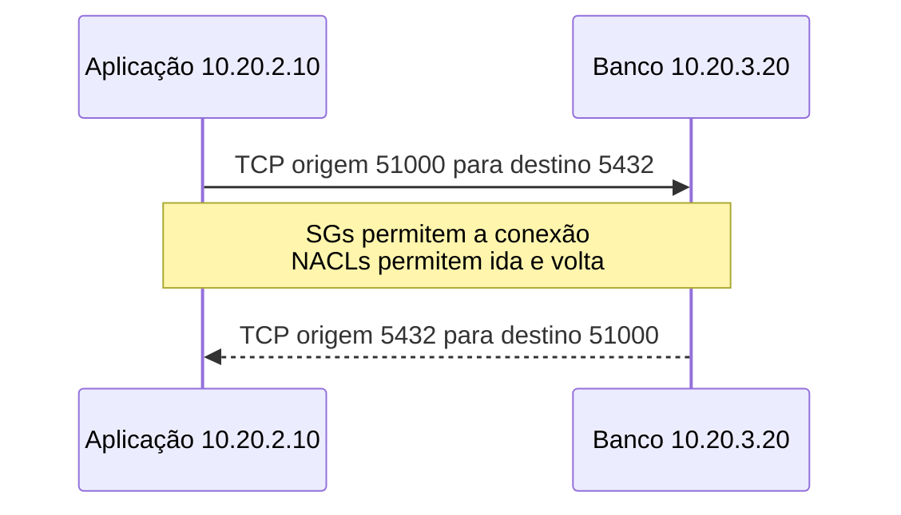

# 07 — Security Groups e NACLs: ter caminho não é ter permissão

[← 06 — VPC, sub-redes e saída](06-vpc-subnets-saida.md) · [Índice](README.md) · [Próxima: publicar uma aplicação →](08-publicar-aplicacao.md)

A aplicação `10.20.2.10` encontra uma rota para o banco `10.20.3.20`, mas não consegue abrir a conexão TCP na porta 5432. A estrada existe. Precisamos verificar as regras para atravessá-la, nos dois sentidos, sem concluir que o banco deve ficar público.

**Objetivo:** prever como Security Groups e NACLs tratam uma conexão e seu retorno, e escolher evidências para investigar um bloqueio. **Pré-requisitos:** direção do fluxo, portas de origem e destino, sub-redes e rotas. Os exemplos são registros sintéticos para raciocinar no papel, não regras completas de implantação.

## Duas formas de controlar a passagem

O **Security Group, SG**, controla tráfego permitido nos recursos aos quais está associado. Na EC2, relacionamos esse controle à interface de rede da instância. Suas regras concedem acesso: não há regra explícita de negação. Se vários grupos estiverem associados, suas permissões se somam; um grupo restritivo não anula o acesso concedido por outro. [R7 — regras de Security Groups](https://docs.aws.amazon.com/vpc/latest/userguide/security-group-rules.html)

SG é **stateful**: acompanha o estado das conexões. Para uma conexão permitida, o tráfego de resposta é permitido pelo SG sem precisar de uma regra independente liberando as portas de retorno. Isso não cria rotas, não abre a porta no processo e não dispensa os demais controles. [R7 — estado das conexões](https://docs.aws.amazon.com/vpc/latest/userguide/vpc-security-groups.html)

A **Network ACL**, ou **NACL**, é uma lista de controle de acesso associada à sub-rede. Tem regras de entrada e saída que permitem ou negam tráfego. A avaliação começa pelo menor número; a primeira regra correspondente decide. Uma regra de negação 90 pode impedir o que uma permissão 100 permitiria. A regra final `*` nega o que não encontrou correspondência anterior.

NACL é **stateless**: não usa o estado da conexão para liberar automaticamente sua resposta. Ida e volta precisam de regras compatíveis. A avaliação acontece quando o tráfego entra ou sai da sub-rede, não na comunicação interna à mesma sub-rede. [R7 — funcionamento das NACLs](https://docs.aws.amazon.com/vpc/latest/userguide/vpc-network-acls.html)

A analogia é uma portaria com autorização por unidade, comparada a uma barreira na entrada de um setor. A portaria reconhece o retorno de uma visita autorizada; a barreira aplica sua lista em cada direção. O limite: são filtros de rede, não pessoas identificando intenções. Passar por eles não autoriza uma compra nem revela se um pedido pertence a Ana.

## Acompanhe uma conexão inteira

Chamaremos os grupos de `grupo-app` e `grupo-db`, nomes didáticos. O SG da aplicação permite saída TCP 5432 para o grupo do banco; o SG do banco permite entrada TCP 5432 originada no grupo da aplicação. Referenciar um SG seleciona as interfaces associadas para a regra; não copia suas regras nem autentica a pessoa usuária.

A aplicação escolhe uma **porta efêmera**, temporária, para sua ponta da conexão. Usaremos `51000` nesta tentativa. O banco responde de 5432 para **51000**, não para 5432 na aplicação. A faixa de portas efêmeras depende do sistema e do componente; não existe uma única faixa universal. [Portas efêmeras em NACLs](https://docs.aws.amazon.com/vpc/latest/userguide/custom-network-acl.html#nacl-ephemeral-ports)

O diagrama destaca o par de portas e o sentido do retorno, supondo rotas e filtros compatíveis:

Para a tentativa específica, as NACLs de `app` e `db` precisam permitir:

| Fronteira e direção | Outro lado | Porta de destino no pacote |
|---|---|---:|
| Saída da sub-rede `app` | Banco `10.20.3.20` | 5432 |
| Entrada da sub-rede `db` | Aplicação `10.20.2.10` | 5432 |
| Saída da sub-rede `db` | Aplicação `10.20.2.10` | 51000 |
| Entrada da sub-rede `app` | Banco `10.20.3.20` | 51000 |

A tabela explica um pacote observado hipoteticamente. Uma política real deve considerar a faixa efêmera efetiva dos clientes, outras conexões necessárias e a ordem completa das regras; fixar apenas `51000` quebraria tentativas que escolhessem outra porta.

**Responda antes de abrir:** o SG do banco permite a conexão. A NACL permite entrada em 5432, mas nega toda saída. O SG resolve o retorno?

Resposta comentada

Não. O retorno permitido pelo SG ainda pode ser bloqueado na NACL. É necessário analisar a saída da sub-rede do banco para a porta efêmera da aplicação e a entrada na sub-rede da aplicação. Liberar mais portas no SG não corrige a negação da NACL.

## Uma entrada intermediária muda quem inicia a conexão

Na publicação com **Application Load Balancer, ALB**, da próxima aula, teremos duas conexões diferentes:

1. Navegador, com sua porta efêmera, → ALB em 443.
2. ALB, com outra porta efêmera, → aplicação em 8080.

O SG da aplicação pode permitir 8080 a partir do SG do ALB. A requisição veio originalmente de Ana, mas a conexão TCP recebida pela aplicação é iniciada pelo ALB. As NACLs devem contemplar os dois trechos e seus retornos; uma regra para a primeira conexão não configura a segunda. [SGs do ALB e dos destinos](https://docs.aws.amazon.com/elasticloadbalancing/latest/application/load-balancer-update-security-groups.html)

**Responda antes de abrir:** se o navegador usa 443, a aplicação atrás do ALB precisa necessariamente receber essa mesma conexão em 443?

Resposta comentada

Não. O ALB recebe uma conexão e inicia outra conforme o destino configurado. Aqui, a segunda usa 8080. Isso também delimita TLS: HTTPS até o ALB não protege automaticamente esse segundo trecho HTTP.

## Uma falha pede uma hipótese verificável

**Falha sintética:** depois de uma mudança de NACL, a aplicação espera até esgotar o prazo ao consultar o banco. A tabela mostra como investigar sem transformar hipótese em conclusão:

| Hipótese | Regra ou componente a conferir | Fluxo | Evidência que distingue |
|---|---|---|---|
| Falta permissão no SG | Saída de `grupo-app` e entrada de `grupo-db` | App → DB:5432 | Grupos realmente associados e regras efetivas |
| Retorno bloqueado | Primeira regra NACL correspondente à saída e entrada | DB:5432 → app:51000 | Regras ordenadas dos dois lados e porta da tentativa |
| Banco não atende | Processo e endereço em escuta | Chegada ao DB:5432 | Estado do serviço e registros da conexão |

Uma captura das regras comprova configuração naquele instante, não que a consulta funcionou. A aula 09 aprofundará as evidências.

**Responda antes de abrir:** negar UDP 53 no SG e na NACL bloqueia toda resolução DNS da VPC?

Resposta comentada

Não. Há exceções documentadas: SGs e NACLs não bloqueiam consultas ao resolvedor DNS fornecido pela AWS, o **Route 53 VPC Resolver**, também chamado AmazonProvidedDNS. Documentos antigos usam Route 53 Resolver. A AWS oferece DNS Firewall para filtragem nesse caminho; isso não significa que todo DNS para qualquer destino ignore filtros. [Exceção no SG](https://docs.aws.amazon.com/vpc/latest/userguide/security-group-rules.html#security-group-rule-basics), [exceção na NACL](https://docs.aws.amazon.com/vpc/latest/userguide/vpc-network-acls.html#nacl-basics), [nome atual do resolvedor](https://docs.aws.amazon.com/Route53/latest/DeveloperGuide/resolver.html)

## Controles diferentes e uma transferência

SG e NACL filtram tráfego de rede. O **AWS WAF**, firewall de aplicações web, aplica regras a requisições HTTP/HTTPS. TLS protege um canal; o **IAM**, AWS Identity and Access Management, controla acesso a recursos AWS. Nenhum deles decide sozinho se Ana pode ler o pedido de Bruno: a aplicação precisa preservar essa autorização. [Papel do WAF](https://docs.aws.amazon.com/waf/latest/developerguide/what-is-aws-waf.html), [papel do IAM](https://docs.aws.amazon.com/IAM/latest/UserGuide/introduction.html)

**Exercício:** a aplicação consulta a API externa por HTTPS 443 e escolhe a porta 52000. Qual é a porta de destino do retorno ao chegar à sub-rede da aplicação? Um SG permitido substitui TLS ou IAM?

Ver solução comentada

O retorno chega à porta 52000 da aplicação, após a tradução do NAT. A NACL precisa permitir esse retorno conforme a política da faixa efêmera. O SG não substitui TLS nem IAM: cada um atua na responsabilidade descrita acima, e a autorização do pedido permanece na aplicação.

Você agora consegue separar rota, permissão, estado e retorno. O próximo passo reúne esses controles para publicar uma entrada que realmente alcance um serviço atendendo.

[← Anterior](06-vpc-subnets-saida.md) · [Índice](README.md) · [Próxima: publicar uma aplicação →](08-publicar-aplicacao.md)
