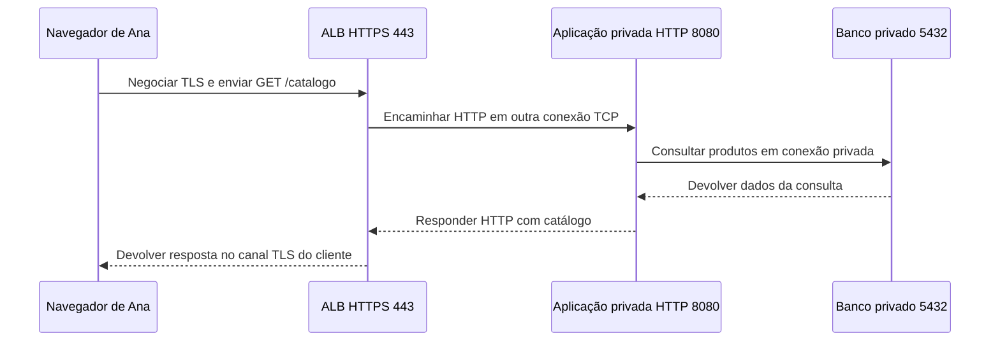

# 08 — Publicar uma aplicação: da entrada ao serviço que atende

[← 07 — Security Groups e NACLs](07-sg-nacl.md) · [Índice](README.md) · [Próxima: investigação e evidências →](09-investigacao-evidencias.md)

O catálogo funciona dentro da rede, mas Ana precisa acessá-lo pelo navegador. Queremos uma entrada HTTPS e manter a aplicação e o banco sem IPv4 público. O NAT de saída não resolve essa necessidade: precisamos de um componente que receba as conexões e encaminhe as requisições ao programa certo.

**Objetivo:** explicar cada trecho da publicação e distinguir porta em escuta, destino saudável e jornada funcionando. **Pré-requisitos:** HTTP, TLS, rotas, SGs e NACLs. Este é um desenho proposto; nada foi implantado ou medido na AWS.

## Defina o atendimento antes do produto

Um **listener** é o ponto configurado para receber conexões em determinado protocolo e porta. Um **destino**, ou *target*, é quem recebe o encaminhamento, como a aplicação em uma EC2. Um **grupo de destinos**, *target group*, reúne destinos e configura protocolo, porta e verificações de saúde.

A **verificação de saúde**, *health check*, é uma requisição periódica para avaliar uma condição definida. Por exemplo, pedir `GET /saude` na porta 8080 e esperar HTTP 200. O caminho e o código são escolhas do cenário; o que esse teste comprova depende do que `/saude` verifica.

Pense numa recepção que atende um telefone público e encaminha a ligação para um ramal. O listener é o atendimento da entrada; o destino é o ramal configurado. O limite: a recepção não escreve o programa do ramal, e uma resposta a “está aí?” não comprova que uma compra possa ser concluída.

## Por que escolhemos ALB nesta etapa

Queremos encaminhar requisições HTTP do catálogo e poder distinguir caminhos ou nomes. Escolhemos um **Application Load Balancer, ALB**, que trabalha com essas informações da aplicação. É uma opção, não requisito universal para publicar qualquer sistema. [Componentes e roteamento do ALB](https://docs.aws.amazon.com/elasticloadbalancing/latest/application/introduction.html)

Um **Network Load Balancer, NLB**, atende necessidades de transporte, como encaminhar TCP ou UDP, sem desempenhar o mesmo roteamento por caminho HTTP. Ele também pode terminar TLS com um listener TLS. Com listener TCP em 443, pode encaminhar o TLS até o destino sem decifrá-lo. Portanto, “NLB nunca usa TLS” seria uma conclusão errada. [NLB e seus listeners](https://docs.aws.amazon.com/elasticloadbalancing/latest/network/load-balancer-listeners.html)

CloudFront é uma alternativa adicional para requisitos de distribuição de conteúdo; não é necessário acrescentá-lo a este percurso para entender a publicação. Cada componente novo exigiria justificar seu papel e seus próprios trechos de comunicação.

## Um percurso, duas conexões

Mantemos a VPC `10.20.0.0/16`, a aplicação privada `10.20.2.10` e o banco privado `10.20.3.20:5432`. **Mudança explícita:** o endpoint apresentado a Ana continua HTTPS 443, mas o programa atrás do ALB passa a atender HTTP 8080. Não estamos afirmando que o mesmo canal TLS chega ao programa.

Para um ALB convencional nas AZs da Região, precisamos de sub-redes em pelo menos duas AZs distintas. Acrescentamos `web-b`, `10.20.4.0/24`, ao recorte da aula 06; `web`, `10.20.1.0/24`, será `web-a`. As duas são públicas, com rota ao IGW. O ALB é voltado à internet; a aplicação continua na sub-rede privada `app`. Ter o ALB em duas AZs não duplica a aplicação nem torna o banco tolerante a falhas. [Sub-redes exigidas pelo ALB](https://docs.aws.amazon.com/elasticloadbalancing/latest/application/application-load-balancers.html#subnets-load-balancer)

O diagrama responde **quem conversa com quem**, omitindo DNS, portas efêmeras e retorno dos controles para manter o percurso legível:

**Limite de proteção:** ALB → aplicação usa HTTP neste desenho didático; esse trecho não está cifrado por TLS. Se houver exigência de cifragem até a aplicação, esta proposta precisa ser revista para configurar e avaliar outro trecho TLS. “Está numa sub-rede privada” não atende sozinho a esse requisito. [Listeners do ALB](https://docs.aws.amazon.com/elasticloadbalancing/latest/application/load-balancer-listeners.html)

**Responda antes de abrir:** abrir 443 no SG da aplicação corrige o ALB encaminhando para 8080?

Resposta comentada

Não. A regra precisa corresponder à conexão ALB → aplicação, em 8080 neste cenário, e o processo precisa atender nessa porta. A permissão deve ter a origem apropriada, como o SG do ALB. Também devem funcionar rotas, NACLs e retorno. Abrir uma porta diferente não corrige o destino configurado.

## Nome, certificado e encaminhamento precisam concordar

Em um domínio próprio válido, um registro **alias do Route 53** pode apontar o nome do catálogo ao ALB. DNS informa como localizar a entrada; não encaminha cada requisição HTTP através do Route 53. Nosso nome `loja.test` permanece fictício e reservado para o laboratório: não é um domínio público a registrar ou validar no ACM. [Alias para balanceadores](https://docs.aws.amazon.com/Route53/latest/DeveloperGuide/routing-to-elb-load-balancer.html)

No ALB, o listener HTTPS utiliza um certificado apropriado para o nome solicitado, por exemplo gerenciado pelo ACM. O SG da entrada permite os clientes definidos em 443; sua saída e o SG da aplicação permitem 8080 entre ALB e aplicação, incluindo a verificação de saúde escolhida. O banco recebe 5432 somente das origens autorizadas da aplicação. [Certificado do listener](https://docs.aws.amazon.com/elasticloadbalancing/latest/application/https-listener-certificates.html), [permissões ALB/destinos](https://docs.aws.amazon.com/elasticloadbalancing/latest/application/load-balancer-update-security-groups.html)

**Responda antes de abrir:** trocar a URL pelo IP é sempre um teste equivalente?

Resposta comentada

Não. A troca pode mudar o nome validado no certificado, o **SNI**, indicação de nome enviada na negociação TLS, e o **Host**, cabeçalho HTTP usado no atendimento. Uma falha nesse teste não prova que a aplicação caiu. O laboratório local mostrará como fixar o endereço preservando o nome, sem desativar a validação; isso também não prova que o DNS foi corrigido.

## Saudável para qual operação?

**Falha sintética:** `/saude` responde 200 porque verifica apenas o processo, mas a consulta ao banco esgota o prazo e `/catalogo` falha. Processo rodando, porta acessível, health check aprovado, homepage abrindo e compra funcionando são observações diferentes.

O ALB verifica periodicamente os destinos. Se todos os destinos registrados estiverem não saudáveis, há comportamento documentado de **fail-open**, encaminhando a eles mesmo assim; não use “o health check garante que nunca chegará tráfego a um destino ruim” como regra absoluta. [Saúde e fail-open](https://docs.aws.amazon.com/elasticloadbalancing/latest/application/target-group-health-checks.html)

**Responda antes de abrir:** Ana recebeu HTTP 502. Isso identifica, sozinho, um erro no banco?

Resposta comentada

Não. É preciso identificar quem produziu o código. Registros do ALB distinguem seu código do código retornado pelo destino; registros da aplicação ajudam a investigar a dependência. Uma resposta gerada pelo ALB e uma resposta da aplicação apenas repassada têm causas possíveis diferentes. [Erros do ALB e dos destinos](https://docs.aws.amazon.com/elasticloadbalancing/latest/application/load-balancer-troubleshooting.html)

**Exercício de transferência:** o health check está aprovado e o catálogo abre, mas criar um pedido falha. Escolha uma verificação seguinte e diga o que ela pode concluir.

Ver solução comentada

Em ambiente autorizado, acompanharia uma tentativa de pedido fictício nos registros da aplicação e de suas dependências, mantendo nome, caminho e identidade da tentativa. Ver o catálogo apenas demonstra aquela leitura. A falha pode estar na escrita, em permissões ou em outra dependência; não justifica publicar o banco nem declarar defeito no ALB sem evidência.

Você consegue agora seguir nome → entrada HTTPS → outra conexão até a aplicação → dependência privada, explicando os limites de cada verificação. A próxima aula transforma esse mapa em uma investigação orientada por evidências.

[← Anterior](07-sg-nacl.md) · [Índice](README.md) · [Próxima: investigação e evidências →](09-investigacao-evidencias.md)
