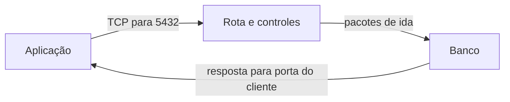

# 09 — A loja ficou lenta. Que evidência ajuda a encontrar a causa?

Ana consegue abrir o catálogo da Loja Horizonte, mas a confirmação de uma compra demora. Alguém sugere aumentar a capacidade do link. Outra pessoa sugere liberar mais portas. Nenhuma das duas propostas explica ainda onde o tempo foi gasto.

Nesta aula, você vai transformar um sintoma em hipóteses que possam ser comparadas. Ao terminar, deverá conseguir descrever um fluxo, escolher uma evidência que distingue duas causas e dizer o que ainda não foi demonstrado.

## Antes de investigar

Você precisa distinguir endereço IP, porta, rota, Security Group e NACL. Se esses termos ainda se confundem, retome [as permissões de rede](07-sg-nacl.md) e [a publicação da aplicação](08-publicar-aplicacao.md). Não é necessário conhecer comandos de diagnóstico de memória.

Continuamos com a aplicação em `10.20.2.10` e o banco privado em `10.20.3.20`, dentro da VPC `10.20.0.0/16`. A aplicação inicia uma conexão TCP para a porta `5432` do banco. TCP é o transporte; `5432` é a porta escolhida para PostgreSQL neste cenário. A resposta precisa voltar à aplicação.

Todos os registros e acontecimentos desta aula são sintéticos. Não consultamos uma conta AWS nem executamos tráfego nesses endereços.

## A portaria ajuda, mas não atende a compra

Imagine que um entregador conhece o endereço, encontra o caminho e recebe autorização da portaria. Isso não prova que a pessoa responsável está disponível para atendê-lo. Na loja, rota e permissão também não provam que o banco consegue processar a consulta naquele momento.

O limite da analogia é importante: uma requisição pode atravessar vários processos e esperar em filas internas. A demora percebida por Ana inclui mais do que o tempo de viagem dos pacotes.



O desenho pergunta se a aplicação chega ao banco e recebe uma resposta. O caminho de volta está explícito. Mesmo que os pacotes atravessem os controles, ainda precisamos observar a conexão e o trabalho realizado pelo banco.

## Comece pelo impacto, depois desenhe o fluxo

Uma investigação útil encadeia decisões; não consiste em executar todas as ferramentas disponíveis.

1. **Delimite o impacto.** O catálogo abre? Só confirmar a compra falha? Afeta todos os usuários ou uma parte? Desde quando? Registre o horário e o comportamento observado, sem transformar coincidência em causa.
2. **Mapeie a operação.** Identifique quem inicia cada conexão, o destino, o protocolo, a porta e o retorno. Navegador → aplicação e aplicação → banco são conexões diferentes.
3. **Localize a espera ou a falha.** Houve erro de DNS, conexão TCP, TLS, resposta HTTP ou processamento interno? Um limite de espera, chamado *timeout*, informa que a etapa não terminou a tempo; sozinho, não revela por quê.
4. **Compare hipóteses.** Por exemplo: “a conexão com o banco é bloqueada” e “a aplicação espera por uma conexão disponível em seu pool”. Um pool é um conjunto de conexões que a aplicação reutiliza.
5. **Procure uma evidência discriminante.** Escolha uma observação que favoreça uma hipótese e enfraqueça a outra. Ver repetidamente um log de consulta iniciada não substitui medir a espera anterior ao início da consulta.
6. **Mitigue com o menor risco compatível com a evidência.** Corrigir uma regra específica identificada é diferente de abrir todas as portas. Reverter uma mudança conhecida pode ser uma contenção, desde que seu efeito e seus limites sejam compreendidos.
7. **Valide a jornada e comunique os limites.** Repita a operação relevante de modo controlado, confira o resultado e diga o que continua incerto. A página inicial abrir não comprova a confirmação de uma compra.

Em um exemplo inventado, o registro da aplicação mostra espera pelo pool antes de enviar a consulta. Isso muda o próximo teste: investigar uso e disponibilidade das conexões pode ser mais útil do que aumentar a banda. Não concluímos que a rede está perfeita; encontramos uma explicação mais específica para aquela espera.

## O que significa um link bom?

“Bom” depende da operação, do orçamento, da proteção necessária, da resiliência e da capacidade da equipe de operar a solução. Transferir fotos em lote e responder a pequenas consultas interativas têm necessidades diferentes.

| Medida | Pergunta que ajuda a responder | Limite da conclusão |
| --- | --- | --- |
| Latência | Quanto tempo um trecho ou uma ida e volta leva? | É preciso declarar qual trecho e qual medida; não é automaticamente o tempo da compra. |
| Banda ou capacidade do enlace | Quanto tráfego o enlace pode transportar por unidade de tempo nas condições declaradas? | Capacidade contratada não é a transferência útil observada pela aplicação. |
| Throughput | Quanto dado foi efetivamente transferido por unidade de tempo no teste definido? | Depende também de protocolo, concorrência, perda e recursos nas pontas. |
| Perda | Que parte dos pacotes enviados não chegou ao ponto observado? | Exige método e pontos de observação; um erro HTTP não é uma medida de perda. |
| Jitter | Quanto o atraso varia entre observações? | Variação de atraso pode importar muito para áudio e pouco para outra operação. |
| Retransmissão TCP | Houve reenvio de segmentos para recuperar a comunicação? | Reenvio pode acompanhar perda ou outras condições; não identifica sozinho o componente culpado. |

O [guia de medição de throughput TCP da IETF](https://www.rfc-editor.org/rfc/rfc6349.html) distingue desempenho do transporte de critérios isolados do enlace. Aqui usamos essas ideias para escolher perguntas; não realizamos um teste de capacidade nem propomos gerar carga em redes de terceiros.

## Duas ferramentas, duas perguntas diferentes

O **VPC Reachability Analyzer** modela a configuração de rede entre uma origem e um destino. Pode apontar uma rota ou controle que impede o caminho modelado. Ele não envia pacotes e não verifica se o processo está atendendo. Um resultado alcançável não comprova a saúde de um destino do ALB nem uma transação de negócio. Há também limites de cobertura: em caminhos TCP por tabela de um Transit Gateway, a análise considera apenas a ida. O retorno precisa de verificação própria. [Como o Reachability Analyzer funciona](https://docs.aws.amazon.com/vpc/latest/reachability/how-reachability-analyzer-works.html).

Os **VPC Flow Logs** registram metadados de fluxos observados em interfaces de rede, como endereços, portas e ação. Não são o conteúdo da conversa SQL ou HTTP. O registro abaixo representa um formato personalizado, com oito campos escolhidos nesta ordem; não é o formato padrão completo da AWS. A primeira linha é um cabeçalho didático, não uma linha emitida pelo serviço.

```text
interface-id srcaddr dstaddr srcport dstport protocol action log-status
eni-0123456789abcdef0 10.20.2.10 10.20.3.20 49152 5432 6 ACCEPT OK
```

Neste registro fictício, a interface é a do banco. A aplicação usa a porta de origem temporária `49152`; o destino é `5432`; `6` identifica TCP. `ACCEPT` informa aceitação do tráfego observado. `OK` descreve o registro dos dados do log, e não a saúde do banco. Não há evidência suficiente para afirmar que o TCP se completou, que a autenticação no banco funcionou ou que uma compra foi registrada.

Um `REJECT` pode indicar bloqueio por controles ou outras condições, como pacotes após o fechamento da conexão. A entrega dos logs pode atrasar, e `SKIPDATA` indica registros omitidos. Por isso, ausência de linha não é prova automática de ausência de tráfego. Consulte a [definição dos campos de Flow Logs](https://docs.aws.amazon.com/vpc/latest/userguide/flow-log-records.html) antes de interpretar um arquivo real.

## A evidência precisa corresponder à pergunta

| Evidência | Conclusão possível | Conclusão que seria um salto |
| --- | --- | --- |
| Um ping recebeu resposta | Houve resposta ICMP para aquele teste. | HTTPS funciona, o certificado é válido ou a compra termina. |
| O modelo de rede aponta uma NACL bloqueando o retorno | Existe um impedimento na configuração analisada. | Esse é o único problema da jornada. |
| Flow Log mostra `ACCEPT` na ida | O tráfego observado foi aceito naquele ponto. | O banco respondeu e confirmou a operação. |
| Aplicação registra espera pelo pool | Há espera nessa etapa da aplicação. | Aumentar o link resolverá o problema. |
| Uma consulta termina, mas a resposta HTTP demora | Existe trabalho ou espera em outra etapa. | O banco está saudável em qualquer carga e operação. |

Uma falha possível é corrigir o primeiro bloqueio encontrado e encerrar o incidente sem repetir a operação. Pode haver um segundo impedimento ou uma dependência lenta. Valide o fluxo específico e depois a jornada que motivou a investigação.

**Aprofundamento opcional — tamanho de pacote.** MTU é o tamanho máximo de pacote IP admitido em um enlace. Túneis acrescentam cabeçalhos e podem reduzir o espaço disponível para os dados. A descoberta do tamanho utilizável no caminho, chamada PMTUD, é uma hipótese adicional quando pacotes pequenos passam e operações maiores falham. Isso exige evidência própria; não é motivo para alterar a MTU de toda a rede como primeiro teste. Esse tema também aparece no [método de teste TCP da IETF](https://www.rfc-editor.org/rfc/rfc6349.html#section-3.1).

## Responda antes de abrir

### 1. O ping funciona. Por que a investigação ainda não terminou?

<details>
<summary>Resposta comentada</summary>

Ping usa ICMP, enquanto a operação pode usar TCP, TLS e HTTP. Os controles e o serviço podem tratar esses fluxos de formas diferentes. Precisamos verificar a operação, a porta e o nome corretos, preservando a validação TLS quando houver HTTPS.

</details>

### 2. Um Flow Log tem `ACCEPT OK`. A consulta PostgreSQL funcionou?

<details>
<summary>Resposta comentada</summary>

Não há informação suficiente. `ACCEPT` trata do tráfego observado e `OK` do registro do log. Precisamos de evidência sobre conexão, autenticação, execução e resultado. Uma linha da ida também não comprova o retorno.

</details>

### 3. A aplicação espera pelo pool. Qual próximo teste distingue melhor as hipóteses?

<details>
<summary>Resposta comentada</summary>

Observar conexões em uso, tempo de espera e duração das operações ajuda a separar falta de conexões disponíveis de bloqueio no estabelecimento de uma conexão. Compare horários e operações equivalentes. Abrir mais portas não testa a hipótese do pool.

</details>

### 4. O Reachability Analyzer informa um caminho alcançável. O que falta validar?

<details>
<summary>Resposta comentada</summary>

O tráfego real e a jornada: retorno quando não coberto, processo atendendo, negociação de segurança, resposta da aplicação e resultado esperado. A análise de configuração é uma evidência útil, com um escopo definido.

</details>

## Exercício de transferência

Troque o fluxo: agora a aplicação chama uma API externa por HTTPS, porta `443`, e apenas essa chamada demora. O catálogo e o acesso ao banco continuam funcionando. Sem executar tráfego, desenhe a ida e a volta, incluindo a saída escolhida para a internet. Escreva duas hipóteses em etapas diferentes e uma evidência que as distingue. Termine com uma mensagem de incidente que separe fato, hipótese e próximo teste.

Uma boa defesa explica por que o teste escolhido reduz a incerteza e como evita expor dados ou ampliar permissões sem necessidade. Para exercitar em ambiente controlado, veja os [laboratórios locais](laboratorio/README.md) e os [simulados de investigação](simulados/README.md).

## O que levar desta aula

Descreva o impacto e o fluxo antes de escolher a ferramenta. Combine evidências de configuração, transporte e aplicação. Corrija uma hipótese sustentada pelos dados e valide a jornada; comunique o que ainda não sabe.

[Anterior: publicar a aplicação](08-publicar-aplicacao.md) · [Próxima: peering e Transit Gateway](10-peering-tgw.md) · [Índice da trilha](README.md)
