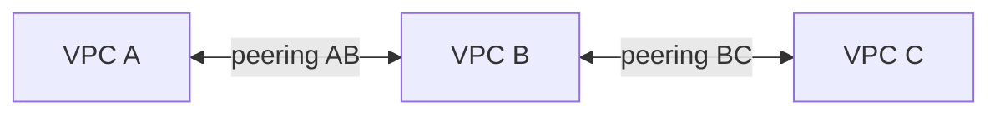
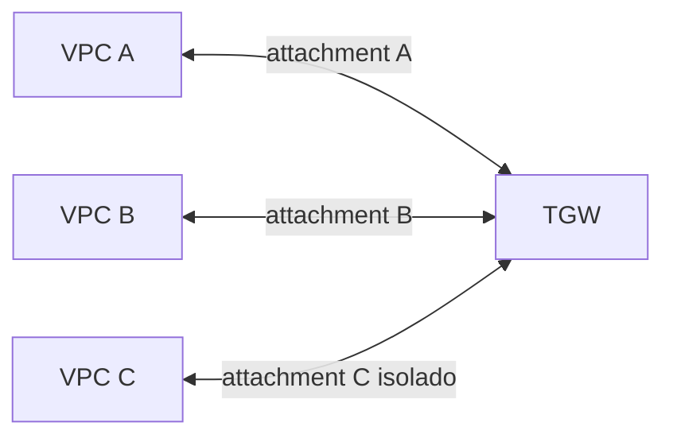

# 10 — Conectar duas redes também conecta uma terceira?

A Loja Horizonte separou três ambientes. A VPC A contém a loja, a B contém um serviço interno e a C contém um ambiente que precisa permanecer isolado da loja. Há um peering A ↔ B e outro B ↔ C. Uma rota em A para C seria suficiente para atravessar B?

Nesta aula, você vai explicar por que essa conclusão falha e desenhar uma política explícita: A pode conversar com B; A não deve alcançar C. É a primeira aula da etapa seguinte da trilha. O núcleo de investigação termina na [aula anterior](09-investigacao-evidencias.md).

## O que você precisa saber e o que mudou

Retome CIDR, correspondência de rota mais específica e ida e retorno se necessário. Uma VPC é uma rede virtual; uma tabela de rotas decide para onde encaminhar pacotes destinados a um prefixo. Permissão para a aplicação continua sendo uma verificação separada.

Neste cenário fictício, os intervalos são distintos:

| Rede | CIDR | Papel nesta aula |
| --- | --- | --- |
| A | `10.20.0.0/16` | Loja Horizonte |
| B | `10.30.0.0/16` | Serviço interno compartilhado com A |
| C | `10.40.0.0/16` | Ambiente isolado de A |

Não criamos conexões AWS. Primeiro examinamos dois peerings; depois os substituímos, no desenho, por attachments de um Transit Gateway. As duas topologias não estão misturadas.

## Peering: uma passagem entre duas redes

Uma ligação direta entre dois condomínios não concede passagem automática pelo segundo até um terceiro. O **VPC peering** liga duas VPCs, mas não transforma a VPC intermediária em roteador de trânsito.

As setas representam dois peerings independentes. A conversa A ↔ B e a conversa B ↔ C podem funcionar, mas o desenho não oferece uma conversa IP A ↔ C via B. Essa restrição é chamada **ausência de roteamento transitivo**. Adicionar em A uma rota para C apontando para o peering AB não cria essa capacidade. [Limites do VPC peering](https://docs.aws.amazon.com/vpc/latest/peering/vpc-peering-basics.html).

Para A conversar diretamente com B, as tabelas das subnets participantes precisam de rotas nas duas direções. No exemplo mínimo:

| Tabela da subnet em | Destino adicional | Alvo |
| --- | --- | --- |
| A | `10.30.0.0/16` | Peering AB |
| B | `10.20.0.0/16` | Peering AB |

As rotas locais de cada VPC continuam existindo. Security Groups, NACLs e processos precisam permitir e atender o fluxo escolhido. O estado ativo do peering não substitui essas condições. [Rotas para conexões de peering](https://docs.aws.amazon.com/vpc/latest/peering/vpc-peering-routing.html).

O limite da analogia: uma aplicação em B pode receber uma requisição de A e iniciar outra para C. Isso é um **proxy de aplicação**, com duas conversas e decisões próprias; não prova que peering passou a ser transitivo. Se a política proíbe que A obtenha acesso a C por intermediários, precisamos avaliar esse comportamento também.

## Transit Gateway: o cruzamento precisa de regras

Um **AWS Transit Gateway**, ou TGW, encaminha pacotes entre redes conectadas a ele. Cada ligação de uma rede ao TGW é um **attachment**. Conectar não significa permitir todos os pares: as tabelas de rotas do TGW determinam os destinos alcançáveis.

O desenho mostra as ligações lógicas e seus attachments, não uma autorização entre todos os nós. A política abaixo permite A ↔ B e mantém C sem caminho para A e B. Supomos que não há peering paralelo, rota padrão para outro intermediário nem proxy que contorne essa separação.

Há duas decisões diferentes dentro do TGW:

- **Associação:** escolhe a tabela consultada quando o pacote entra por um attachment. Cada attachment pode estar associado a uma tabela.
- **Propagação:** instala as rotas de um attachment em uma ou mais tabelas. Um attachment pode propagar para várias tabelas, independentemente da tabela a que está associado.

A [documentação de roteamento do TGW](https://docs.aws.amazon.com/vpc/latest/tgw/how-transit-gateways-work.html) descreve essa separação. Não presumimos que as associações e propagações padrão implementem nossa política; escolhemos explicitamente as seguintes configurações.

| Attachment | Tabela associada | Tabelas para as quais propaga seu CIDR |
| --- | --- | --- |
| A | `rt-ab` | `rt-ab` |
| B | `rt-ab` | `rt-ab` |
| C | `rt-c` | `rt-c` |

Com isso, as tabelas do TGW ficam assim:

| Tabela TGW | Destino | Alvo |
| --- | --- | --- |
| `rt-ab` | `10.20.0.0/16` | Attachment A |
| `rt-ab` | `10.30.0.0/16` | Attachment B |
| `rt-c` | `10.40.0.0/16` | Attachment C |

Não há rota para C em `rt-ab`, nem para A ou B em `rt-c`, nem rota padrão nessas tabelas. Se uma propagação adicional instalar o CIDR de C em `rt-ab`, a política muda. A presença dos attachments, sozinha, não permite concluir isolamento. As [tabelas de rotas do TGW](https://docs.aws.amazon.com/vpc/latest/tgw/tgw-route-tables.html) são parte da configuração a revisar.

## A VPC também precisa encaminhar: acompanhe ida e retorno

As tabelas do TGW não substituem as das subnets. Para este exemplo, as subnets participantes usam as rotas abaixo, além de suas rotas locais:

| VPC | Destino adicional | Alvo na tabela da subnet |
| --- | --- | --- |
| A | `10.30.0.0/16` | TGW |
| B | `10.20.0.0/16` | TGW |
| C | Nenhum destino A ou B | Nenhuma rota para esses pares |

Uma aplicação em A envia para um endereço em B. A rota da subnet de A escolhe o TGW. O pacote entra pelo attachment A, consulta `rt-ab` e segue ao attachment B. Na resposta, a subnet de B envia para o TGW; o pacote entra pelo attachment B, consulta `rt-ab` e segue ao attachment A. Precisamos ainda dos controles e do serviço atendendo.

Na direção A → C, a subnet de A não possui a rota correspondente. Mesmo que alguém a adicionasse apontando para o TGW, `rt-ab` continuaria sem rota para C. Essa é uma defesa de roteamento desta topologia, não uma demonstração de toda a segurança da organização. Também é necessário revisar subnets e AZs habilitadas no attachment, rotas alternativas e permissões.

## Quando a ligação falha — e quando a escolha precisa mudar

Uma falha possível é associar B a `rt-c` por engano: a ida de A ainda pode alcançar B, mas a resposta entra por B e consulta uma tabela sem rota para A. Corrigir apenas a tabela de A não resolveria esse retorno. Outra falha é propagar C para uma tabela compartilhada e criar um acesso não pretendido.

CIDRs sobrepostos exigem outra decisão de desenho. Dois ambientes com o mesmo intervalo tornam destinos ambíguos e não podem formar um peering comum. Reendereçar pode ser adequado; oferecer somente um serviço específico pode ser outra opção, conforme a necessidade. “Colocar NAT” não é uma solução completa: uma proposta de tradução teria de declarar endereços antes e depois, iniciador, DNS e retorno. Não adotamos tradução nesta aula.

| Critério | Peering | Transit Gateway |
| --- | --- | --- |
| Modelo | Ligação direta entre um par de VPCs | Hub com attachments e políticas de roteamento |
| Administração | Rotas e ligações distribuídas entre os pares | Rotas nas VPCs e tabelas centrais, com associação e propagação |
| Isolamento | Depende dos pares existentes e das demais configurações | Pode separar grupos por tabelas; uma propagação errada altera o alcance |
| Cobrança a conferir | Modelo de transferência e condições do peering | Modelo de attachments, processamento e transferência aplicáveis |

Não existe um número universal de VPCs que torne uma opção melhor. Compare pares realmente necessários, responsabilidade operacional, mudanças, disponibilidade regional e cobrança vigente. A solução mais centralizada também exige governar sua política central.

## Responda antes de abrir

### 1. A ↔ B e B ↔ C funcionam por peering. Uma rota em A cria A ↔ C?

Resposta comentada

Não. O peering não fornece trânsito por B. Uma rota não cria uma capacidade ausente. Uma aplicação em B que faça uma segunda chamada é outro mecanismo e precisa ser avaliada separadamente.

### 2. Qual tabela do TGW trata a resposta que entra pelo attachment B?

Resposta comentada

A tabela associada ao attachment B. No desenho, é `rt-ab`, que contém a rota para A. A tabela consultada não é escolhida pelo attachment pelo qual a primeira requisição entrou.

### 3. C foi propagada para `rt-ab`. Por que revisar isso mesmo sem mudança nos attachments?

Resposta comentada

A propagação pode instalar uma rota para C na tabela usada pelo tráfego de A e B. O alcance depende das rotas e das outras condições do caminho. O inventário de attachments não basta para demonstrar a política.

### 4. A ida chega a B, mas a resposta não volta. Que duas tabelas do retorno você verificaria?

Resposta comentada

A tabela da subnet de B, que precisa encaminhar o destino em A para o TGW, e a tabela associada ao attachment B, que precisa apontar para o attachment A. Depois verificaria controles e entrega dentro de A. Não alteraria permissões amplas sem evidência.

## Exercício de transferência

A regra mudou: C poderá consumir um serviço em B, enquanto A ↔ C deve continuar sem caminho direto. Proponha as tabelas das VPCs e a associação e propagação dos três attachments. Acompanhe uma requisição C → B e sua resposta. Explique também por que o serviço em B não deve funcionar inadvertidamente como ponte para A.

Você pode apresentar mais de um desenho. Defenda a política pelo caminho dos pacotes e pelas rotas ausentes, não pelo nome do produto. Os [laboratórios de leitura de evidências](laboratorio/README.md) ajudam a praticar sem criar recursos AWS.

## O que levar desta aula

Conectividade não é transitiva por intuição. Em um TGW, associação escolhe onde consultar, propagação instala rotas, e as tabelas das VPCs continuam necessárias. Defenda a ida, o retorno e os pares que devem permanecer isolados.

[Anterior: investigação com evidências](09-investigacao-evidencias.md) · [Próxima: conectividade híbrida](11-conectividade-hibrida.md) · [Índice da trilha](README.md)
