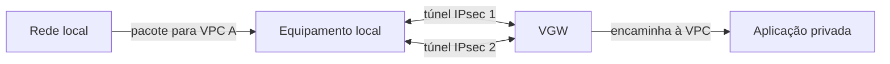
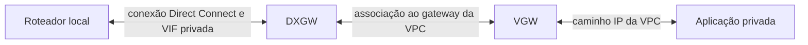

# 11 — Como a rede da empresa conversa com a loja na AWS?

Bruno trabalha em uma unidade da Loja Horizonte que mantém um sistema na rede local. Esse sistema precisa acessar um serviço privado da loja na AWS. Publicar o banco na internet não faz parte do requisito. Precisamos de um caminho entre redes, permissões específicas e proteção adequada à comunicação.

Nesta aula, você vai comparar Site-to-Site VPN e Direct Connect pelos requisitos e acompanhar uma topologia válida de cada opção. Ao terminar, deverá conseguir explicar o papel de cada componente e por que “a conexão está ativa” não demonstra que o serviço funciona.

## Premissas e pré-requisitos

Use os conceitos de CIDR, rotas e retorno da [aula sobre interligação de VPCs](10-peering-tgw.md). **Rede local**, ou *on-premises*, significa aqui a rede administrada pela empresa fora da AWS; não significa o computador pessoal de quem lê.

A rede local fictícia é `172.20.0.0/16`. A VPC A continua sendo `10.20.0.0/16`, sem sobreposição. Para acompanhar uma conversa, usaremos um cliente local `172.20.1.10` e a aplicação `10.20.2.10`. O serviço privado escolhido para este exercício aceita HTTPS na porta `443`; isso é uma nova interface privada hipotética, diferente da conexão ALB → aplicação em `8080` da aula 08.

Os exemplos são projetos de papel. Não configuramos equipamentos, túneis, circuitos ou sessões BGP.

## Primeiro a necessidade, depois a conexão

Uma estrada reservada e um trajeto protegido por um túnel atendem necessidades diferentes. Na rede, o meio de transporte, a proteção e a disponibilidade também precisam ser descritos separadamente. O limite da analogia é que uma conexão dedicada pode transportar dados sem criptografá-los, enquanto um túnel criptografado ainda depende dos enlaces por onde passa.

Antes de escolher, responda:

- Que operação depende do caminho, com qual criticidade e janela aceitável de indisponibilidade?
- Qual volume, variação de demanda e previsibilidade de desempenho precisamos verificar?
- Quais dados atravessam o caminho e em quais trechos precisam de criptografia e autenticação?
- Que prazo de implantação e orçamento existem, incluindo provedores, equipamentos e operação?
- Quem configura, monitora, testa a contingência e atende a uma falha dos dois lados?

Não adotaremos “VPN é sempre lenta” nem “Direct Connect sempre tem menor latência”. A escolha precisa de requisitos e medições do caminho e da carga relevantes.

## VPN: uma conexão, dois túneis, vários componentes

**AWS Site-to-Site VPN** oferece túneis IPsec entre a rede local e a AWS. Neste exemplo, eles atravessam a internet. IPsec é um conjunto de mecanismos para proteger a comunicação IP; o túnel transporta os pacotes entre suas pontas com a proteção negociada.

| Componente | Papel no exemplo |
| --- | --- |
| Equipamento *customer gateway* | Roteador ou software administrado na rede local; termina o lado local dos túneis. |
| Recurso *Customer Gateway* na AWS | Representa informações desse equipamento na configuração AWS. Criá-lo não instala nem configura o equipamento local. |
| Virtual Private Gateway, ou VGW | Gateway do lado AWS, anexado à VPC A neste desenho. |
| Conexão Site-to-Site VPN | Configuração que reúne dois túneis entre os lados. |
| Túneis 1 e 2 | Caminhos IPsec que precisam ser configurados e monitorados. |

Essa distinção entre equipamento, representação e gateway está na [descrição dos componentes de Site-to-Site VPN](https://docs.aws.amazon.com/vpn/latest/s2svpn/how_it_works.html). Um Transit Gateway também pode terminar uma VPN, mas nesta aula escolhemos VGW; não precisamos adicionar TGW ao caminho.

As duas linhas entre equipamento e VGW representam os dois túneis da conexão, não dois equipamentos locais. O retorno percorre um caminho válido no sentido inverso; não presumimos que use sempre o mesmo túnel. Configurar somente um túnel desperdiça a alternativa oferecida pela conexão. [Túneis da conexão VPN](https://docs.aws.amazon.com/vpn/latest/s2svpn/VPNTunnels.html).

Para negociar a proteção, as pontas precisam de parâmetros compatíveis. **IKE**, o protocolo de troca de chaves, autentica as pontas e estabelece os acordos de segurança usados por IPsec. Propostas incompatíveis podem impedir essa negociação. **DPD**, detecção de uma ponta sem resposta, ajuda a identificar essa condição; sua ação configurada não é um teste de compra. A [especificação de IKEv2](https://www.rfc-editor.org/rfc/rfc7296.html) descreve o mecanismo, e as [opções de túnel da AWS](https://docs.aws.amazon.com/cli/latest/reference/ec2/modify-vpn-tunnel-options.html) mostram parâmetros distintos para negociação e detecção.

**Aprofundamento opcional — nomes nas propostas de segurança.** Não trate AES e SHA como alternativas para a mesma função. AES é usado em cifragem; SHA é uma família de funções de hash. Construções como HMAC combinam hash e chave para autenticação de mensagens e verificação de integridade. Algumas combinações criptográficas integram funções. Isso não é uma recomendação de algoritmo: uma opção aparecer numa lista de suporte não basta para recomendá-la hoje. A [definição de HMAC](https://www.rfc-editor.org/rfc/rfc2104.html) explica a distinção; a política atual de segurança e a compatibilidade das pontas orientariam uma implantação real.

## Direct Connect: escolha um caminho completo

**AWS Direct Connect** fornece conectividade dedicada até a AWS. A conexão e a conectividade do local da empresa até o ponto de conexão envolvem responsabilidades que precisam ser verificadas com os participantes. Essa ligação não substitui rotas, permissões ou proteção da aplicação. [Visão geral do Direct Connect](https://docs.aws.amazon.com/directconnect/latest/UserGuide/Welcome.html).

Neste exemplo escolhemos uma **private virtual interface**, ou VIF privada: uma interface lógica para alcançar recursos privados. Ela se liga a um **Direct Connect gateway**, ou DXGW, associado ao VGW anexado à VPC A.

O caminho escolhido é **VIF privada → DXGW → VGW → VPC**. O DXGW e sua associação não são um túnel IPsec implícito. Uma arquitetura com TGW usaria um caminho diferente, com VIF de trânsito; não misturamos esses tipos de VIF e gateways. A [associação de VGW a Direct Connect gateway](https://docs.aws.amazon.com/directconnect/latest/UserGuide/virtualgateways.html) documenta o caminho adotado.

Direct Connect **não criptografa o tráfego por padrão**. TLS pode proteger a conversa entre aplicações. IPsec pode proteger um caminho de túnel. MACsec, quando suportado e configurado, protege o trecho entre os equipamentos participantes até a localização Direct Connect. Cada opção tem escopo e condições; nenhuma deve ser presumida em todos os trechos do desenho. [Criptografia no Direct Connect](https://docs.aws.amazon.com/directconnect/latest/UserGuide/encryption-in-transit.html).

## BGP anuncia caminhos; não mede a compra

Podemos configurar roteamento dinâmico na VPN deste cenário e usamos BGP no Direct Connect. **BGP** é um protocolo de troca de informações de alcançabilidade. Um **vizinho BGP** é a outra ponta com a qual se estabelece essa troca. Um **ASN** identifica um sistema autônomo, um domínio administrativo de roteamento. Um **anúncio** informa um prefixo alcançável por um caminho. Políticas e atributos influenciam quais rotas são aceitas e preferidas. [Definição de BGP na RFC 4271](https://www.rfc-editor.org/rfc/rfc4271.html).

Em nosso desenho, a rede local anuncia `172.20.0.0/16` e recebe um anúncio para alcançar `10.20.0.0/16`, conforme a configuração. Isso não permite qualquer acesso por si só. BGP não é firewall, não autentica a compra e não escolhe simplesmente “o link com menor ping”. No Direct Connect, prefixo mais específico e atributos como preferência local participam das regras de seleção. [Políticas de roteamento e BGP do Direct Connect](https://docs.aws.amazon.com/directconnect/latest/UserGuide/routing-and-bgp.html).

## Acompanhe a conversa e reconheça a falha

O cliente `172.20.1.10` resolve o nome privado do serviço e inicia TCP para `10.20.2.10:443`. A rede local precisa encaminhar o destino da VPC ao caminho escolhido. No lado AWS, a tabela da subnet da aplicação precisa de caminho de retorno para `172.20.0.0/16` via VGW, por propagação habilitada ou rota apropriada ao desenho. Controles dos dois lados precisam permitir a conversa. TLS ainda valida o nome e a confiança do serviço; a aplicação ainda decide quem pode fazer a operação.

Uma falha possível: o túnel está ativo, mas a rota da subnet para a rede local não foi instalada. A ida pode chegar e o retorno falhar. Outra: BGP está `Established`, estado de vizinhança estabelecida, mas um filtro não aceita o prefixo necessário. Estado BGP, túnel disponível e aplicação respondendo são evidências diferentes. A [escolha entre rotas estáticas e dinâmicas na VPN](https://docs.aws.amazon.com/vpn/latest/s2svpn/VPNRoutingTypes.html) depende também da capacidade do equipamento.

A resolução de nomes privados entre as redes precisa de desenho próprio. Conectar os IPs não faz o DNS local conhecer automaticamente os nomes da VPC. Vamos tratar disso na [próxima aula](12-falha-recuperacao-dns.md).

## Responda antes de abrir

### 1. Criar o recurso Customer Gateway configura o roteador da empresa?

Resposta comentada

Não. O recurso representa informações do equipamento para a AWS. A equipe responsável ainda configura o equipamento, os túneis, o roteamento e os controles locais. É preciso separar os dois lados da responsabilidade.

### 2. Direct Connect torna TLS desnecessário?

Resposta comentada

Não. A conexão não criptografa por padrão. Devemos declarar a proteção exigida e os trechos cobertos. TLS continua podendo proteger a conversa entre aplicações, com validação de identidade; uma conexão dedicada não oferece essa validação automaticamente.

### 3. O vizinho BGP está estabelecido. Que evidência ainda falta?

Resposta comentada

Precisamos confirmar anúncios recebidos e aceitos, rotas instaladas e selecionadas, ida e retorno, controles, transporte e serviço. Uma sessão estabelecida permite a troca de rotas; não demonstra que o prefixo necessário está utilizável nem que a operação termina.

### 4. Por que dois túneis não resolvem toda indisponibilidade?

Resposta comentada

Podem compartilhar equipamento, energia e acesso à internet no local. Uma falha compartilhada pode afetar ambos. A redundância deve ser comparada aos modos de falha que queremos suportar, e a alternativa precisa ser configurada e testada.

## Exercício de transferência

A rede local precisa enviar um pequeno conjunto de pedidos continuamente e, em outra janela, um grande lote de fotos. Escreva quais requisitos e medições pediria antes de escolher VPN, Direct Connect ou uma combinação. Proponha um caminho principal e uma contingência, desenhe ida e retorno e marque pelo menos duas dependências compartilhadas.

Não atribua um preço, prazo de instalação ou latência sem uma fonte e condições aplicáveis. Defenda como a equipe verificaria proteção, capacidade e operação. Os [simulados](simulados/README.md) oferecem situações em que um indicador de infraestrutura está positivo e a jornada ainda falha.

## O que levar desta aula

Escolha conectividade híbrida pelos requisitos. Diferencie equipamento, recurso de configuração, túneis e gateways. Declare um caminho válido e sua proteção. Confirme as rotas e a operação nas duas direções, além do estado dos componentes.

[Anterior: peering e TGW](10-peering-tgw.md) · [Próxima: DNS, falhas e recuperação](12-falha-recuperacao-dns.md) · [Índice da trilha](README.md)
