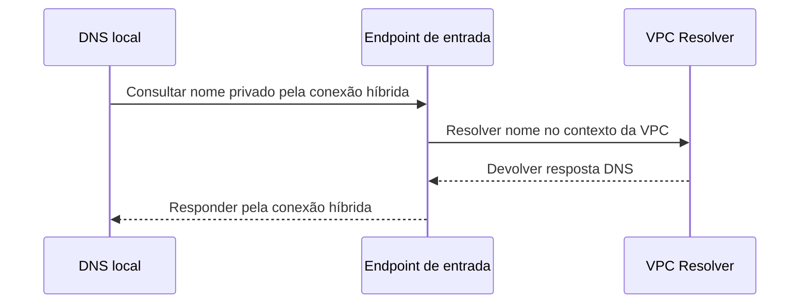
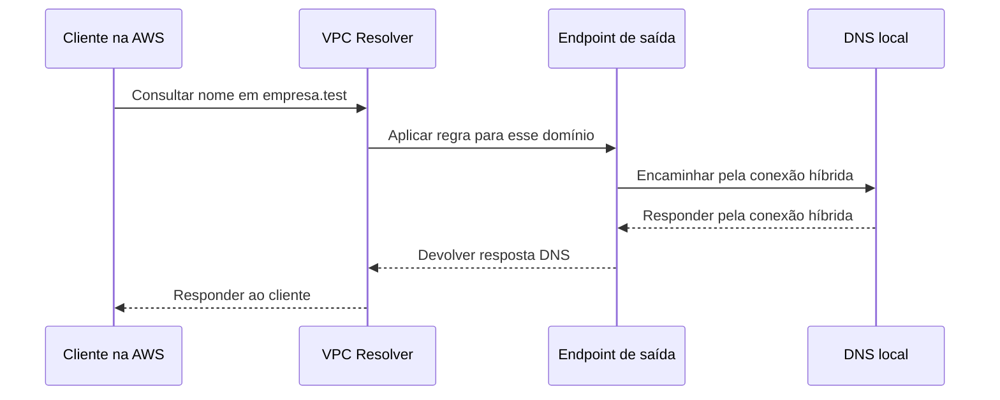

# 12 — O caminho alternativo está disponível. A loja já voltou?

A Loja Horizonte tem uma conexão principal entre a rede local e a AWS e uma VPN preparada para contingência. A conexão principal falha. O painel mostra um túnel disponível, mas Bruno ainda não consegue concluir sua operação. Depois, o caminho principal retorna. A equipe deve migrar tudo imediatamente?

Nesta aula, você vai separar disponibilidade de componentes de recuperação da jornada. Ao terminar, deverá explicar o que DNS, BGP e os testes de saúde de um ALB conseguem mudar, e quais evidências faltam antes de declarar recuperação.

## Premissas e pré-requisitos

Use os conceitos de DNS, TLS e [conectividade híbrida](11-conectividade-hibrida.md). DNS responde a perguntas sobre nomes; uma rota encaminha pacotes; TLS protege uma conversa e verifica a identidade esperada conforme sua configuração.

A rede local continua sendo `172.20.0.0/16` e a VPC A, `10.20.0.0/16`. Acrescentamos, como hipótese de projeto, uma VPN de contingência à conexão Direct Connect da aula anterior. O retorno por cada caminho precisa estar previsto nos dois lados. Não criamos nem derrubamos conexões reais e não medimos um tempo de recuperação.

## Um desvio só ajuda se chegar ao destino certo

Um desvio sinalizado na estrada ajuda somente se estiver transitável e levar ao local necessário. O estabelecimento também precisa estar pronto para atender. O limite da analogia é que as decisões de rede podem mudar em momentos diferentes: o roteador atualiza um caminho, o DNS mantém uma resposta em cache e uma aplicação conserva uma conexão anterior.

**Failover** é a mudança para uma alternativa após uma falha. **Failback** é o retorno ao caminho ou ambiente preferido. **Fallback da aplicação** é um comportamento alternativo, como permitir consultar o catálogo enquanto uma operação indisponível é suspensa. Exibir uma mensagem alternativa não significa recuperar a compra.

Um retorno automático ou manual depende do desenho. Pode haver políticas que voltem a preferir o caminho principal assim que suas rotas retornam; outra solução pode exigir uma ação controlada. Não existe a regra universal “fica na contingência para sempre” ou “sempre retorna automaticamente”.

## Redundância precisa enfrentar dependências compartilhadas

Os dois túneis de uma conexão VPN oferecem alternativas no lado AWS, mas podem compartilhar o mesmo equipamento, energia e provedor local. Uma VPN de contingência também pode depender do equipamento que atende o caminho principal. Compare esses pontos com as falhas que o negócio precisa suportar. [Configuração e redundância dos túneis VPN](https://docs.aws.amazon.com/vpn/latest/s2svpn/VPNTunnels.html).

Antes de contar com a alternativa, confirme rotas e filtros de ida e retorno, nomes, proteção e capacidade para a carga necessária. Capacidade para uma operação de teste não comprova capacidade para toda a demanda após o failover. O plano também precisa dizer quem decide a mudança e quais condições impedem continuar.

## DNS híbrido: o nome precisa atravessar a fronteira correta

O nome atual do serviço de resolução de nomes das VPCs é **Route 53 VPC Resolver**. Ele responde a consultas de recursos da VPC, incluindo nomes de zonas privadas associadas e nomes públicos. Em documentação anterior você pode encontrar o nome Route 53 Resolver. [Visão geral do VPC Resolver](https://docs.aws.amazon.com/Route53/latest/DeveloperGuide/resolver.html).

Uma **zona privada** contém registros DNS visíveis no contexto das VPCs associadas, conforme a configuração. Ela não é publicada para toda a internet. Neste exemplo, o nome fictício `servico.interno.loja.test` aponta para a aplicação privada. O DNS local da empresa não passa a conhecer esse registro somente porque uma VPN está ativa.

O primeiro desenho responde: **como o DNS local consulta um nome privado da AWS?** Ele encaminha as consultas relevantes a um **endpoint de entrada**, ou *inbound*.

Os endereços desse endpoint são privados e precisam estar alcançáveis pela conexão híbrida. A resposta percorre o retorno previsto. Não há endpoint de saída nesse fluxo. [Encaminhamento de consultas para a VPC](https://docs.aws.amazon.com/Route53/latest/DeveloperGuide/resolver-forwarding-inbound-queries.html).

O segundo desenho responde a outra pergunta: **como a aplicação na AWS consulta um nome da empresa?** Uma regra de encaminhamento para o domínio fictício `empresa.test` usa um **endpoint de saída**, ou *outbound*, para consultar o DNS local.

Essa é uma conversa separada: não é uma continuação obrigatória da consulta de entrada. Neste exemplo escolhemos DNS tradicional em UDP e TCP na porta `53`; rotas e controles precisam permitir os fluxos e seus retornos, inclusive entre os endpoints e a rede local. Resolver o nome não cria a rota para o IP respondido nem autoriza o acesso ao serviço. [Encaminhamento para a rede local](https://docs.aws.amazon.com/Route53/latest/DeveloperGuide/resolver-forwarding-outbound-queries.html), [controles do endpoint de entrada](https://docs.aws.amazon.com/Route53/latest/DeveloperGuide/resolver-forwarding-inbound-queries-values.html) e [do endpoint de saída](https://docs.aws.amazon.com/Route53/latest/DeveloperGuide/resolver-forwarding-outbound-queries-endpoint-values.html).

## Políticas DNS respondem a perguntas diferentes

O Route 53 também oferece DNS autoritativo: responde pelos registros das zonas administradas nele. Esse papel difere do resolvedor que procura e guarda respostas para o cliente. As [políticas de roteamento DNS](https://docs.aws.amazon.com/Route53/latest/DeveloperGuide/routing-policy.html) escolhem como responder consultas; não encaminham cada pacote da sessão HTTP.

| Política | Pergunta do projeto | O que não devemos presumir |
| --- | --- | --- |
| Simple | Qual recurso ou conjunto simples de valores representa este nome? | Que existir um registro já comprova saúde da jornada. |
| Weighted | Que proporção relativa de respostas atribuir aos destinos? | Que pesos iguais produzem exatamente metade das requisições HTTP em cada um. |
| Latency | Entre recursos configurados em Regiões, que resposta escolher usando os dados de latência do serviço? | Que mede a compra atual ou sempre escolhe o menor tempo total da aplicação. |
| Failover | Qual destino primário ou secundário responder conforme a política e os sinais de saúde configurados? | Que move conexões existentes imediatamente. |

Os pesos atuam na seleção das respostas; caches e reutilização de conexões afetam o tráfego efetivo. A [política weighted](https://docs.aws.amazon.com/Route53/latest/DeveloperGuide/routing-policy-weighted.html) e a [política latency](https://docs.aws.amazon.com/Route53/latest/DeveloperGuide/routing-policy-latency.html) têm mecanismos próprios. Não adicionamos uma segunda Região à loja nesta aula: a comparação serve para escolher a pergunta correta.

**TTL** indica por quanto tempo um resolvedor pode guardar a informação DNS em cache. Mudar o registro não substitui imediatamente todas as respostas já armazenadas. Reduzir o TTL depois de uma falha também não encurta retroativamente o TTL de uma resposta anterior. Clientes e aplicações podem manter conexões e outros estados além dessa consulta. Por isso, TTL não é uma garantia de prazo total de recuperação. [TTL nos registros DNS](https://docs.aws.amazon.com/Route53/latest/DeveloperGuide/resource-record-sets-values-basic.html).

## DNS, BGP e ALB não são o mesmo mecanismo

| Mecanismo | Observa ou consulta | O que pode mudar | O que não comprova |
| --- | --- | --- | --- |
| Failover DNS | Saúde configurada e política dos registros | Resposta a uma nova consulta que chega ao serviço | Atualização imediata dos caches ou resultado de uma compra |
| Roteamento com BGP | Sessões, anúncios, retiradas e políticas de rotas | Caminho selecionado para prefixos | Menor latência medida, TLS ou serviço respondendo |
| Health check do ALB | Resposta a um teste configurado do destino | Elegibilidade de destinos conforme as regras do balanceador | Que todas as dependências e operações de negócio funcionam |

Na configuração de [failover DNS](https://docs.aws.amazon.com/Route53/latest/DeveloperGuide/dns-failover-configuring.html), sinais de saúde ajudam a escolher respostas. No caminho híbrido, retirada e seleção de rotas dependem das políticas e da detecção dos dois lados; as [políticas BGP do Direct Connect](https://docs.aws.amazon.com/directconnect/latest/UserGuide/routing-and-bgp.html) não substituem testes de serviço.

Os testes do ALB são periódicos e têm limiares; não detectam qualquer falha instantaneamente. Há ainda um comportamento que exige atenção: se todos os destinos registrados estiverem não saudáveis nas AZs habilitadas, o ALB pode encaminhar a todos eles, chamado *fail-open*. Um teste de saúde não é uma promessa de zero erros nem uma barreira universal que sempre bloqueia todo destino ruim. [Regras dos health checks do ALB](https://docs.aws.amazon.com/elasticloadbalancing/latest/application/target-group-health-checks.html).

## Acompanhe uma recuperação sem pular etapas

No incidente fictício, a conexão principal caiu. A equipe verifica que a VPN tem um túnel disponível e que as rotas necessárias passaram a ser selecionadas, inclusive no retorno. Isso sustenta uma hipótese de caminho alternativo utilizável, mas ainda não encerra o incidente.

Bruno continua falhando ao resolver o nome privado. A investigação identifica que o DNS local encaminhava consultas para um endereço de endpoint não alcançável pela configuração de contingência. A mitigação precisa corrigir o caminho DNS conforme o projeto, sem publicar o serviço privado. Depois, a equipe valida resolução, conexão, TLS e a operação permitida. Esse é um exemplo autoral de falha possível; não é um resultado observado na AWS.

Quando o caminho principal retorna, a equipe confirma estabilidade, rotas selecionadas e critérios de mudança. Se a política já causa retorno automático, isso precisa estar previsto e observado; se exige mudança manual, a execução deve ter critério de parada. Ambos os sentidos e a carga esperada precisam ser validados. Não basta esperar o painel ficar verde.

Uma comunicação útil separa:

- **Impacto e fato:** quais operações estão afetadas e o que foi observado.
- **Hipótese:** explicação ainda em teste, com seu grau de incerteza.
- **Contenção:** mudança aplicada ou operação temporariamente limitada.
- **Próximo teste e critério:** o que será observado para prosseguir, abortar ou declarar recuperação.

Mesmo depois da recuperação da rede, uma compra que terminou em timeout pode ter sido processada. Não repita uma operação com efeito apenas porque o caminho voltou. O [capítulo de timeout e idempotência](../acid/07-timeout-idempotencia.md) explica como tratar um resultado desconhecido sem confundi-lo com falha confirmada.

## Responda antes de abrir

### 1. O túnel está disponível, mas o nome privado não resolve. Há contradição?

Resposta comentada

Não. O túnel é uma condição do caminho. Também precisamos do encaminhamento DNS correto, endpoint alcançável, controles e resposta do resolvedor. O tráfego para o serviço tem outra etapa depois da resolução.

### 2. Dois destinos DNS têm o mesmo peso. Isso garante metade das compras em cada um?

Resposta comentada

Não. O mecanismo seleciona respostas DNS. Um resolvedor pode compartilhar uma resposta em cache entre muitos clientes, e clientes podem reutilizar conexões. Contagem de respostas DNS e contagem de compras são medidas diferentes.

### 3. A conexão principal voltou. O retorno será automático ou manual?

Resposta comentada

Depende do desenho e das políticas. Precisamos conhecer as preferências de rotas e a automação existente, observar ambos os sentidos e aplicar os critérios de estabilidade e validação definidos para a recuperação.

### 4. Por que o ALB saudável não encerra uma investigação de compra com timeout?

Resposta comentada

O teste configurado pode validar apenas uma parte do serviço. A compra pode depender de banco e outros sistemas. Além disso, recuperar atendimento não determina o resultado da operação anterior: ela pode ter produzido efeito antes de a resposta se perder.

## Exercício de transferência

Agora a resolução de nomes funciona e a VPN selecionada transporta pequenos pedidos, mas a transferência de um lote degrada o atendimento. Proponha duas causas em camadas diferentes e a evidência que as distingue. Diga quais critérios usaria para limitar a carga, manter a contingência ou voltar ao caminho principal. Escreva uma atualização técnica e uma atualização de negócio sem prometer um prazo ainda não medido.

Pratique a liberação progressiva de evidências nos [simulados da trilha](simulados/README.md). Uma resposta forte explica tanto o que já sabemos quanto o que seria arriscado concluir.

## O que levar desta aula

Uma alternativa precisa de caminho, capacidade, nomes, proteção e operação. DNS, BGP e ALB agem sobre objetos diferentes. Valide a jornada e trate resultados anteriores desconhecidos antes de anunciar recuperação completa.

[Anterior: conectividade híbrida](11-conectividade-hibrida.md) · [Próxima: revisão e desafios](13-revisao-desafios.md) · [Índice da trilha](README.md)
