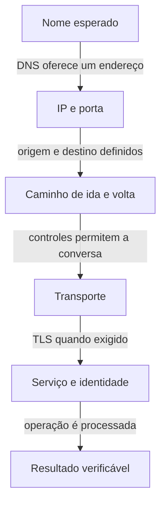

# 13 — Você consegue defender o caminho e a investigação?

Ana diz que a loja não abre. Bruno diz que o link está ativo. As duas informações podem ser verdadeiras ao mesmo tempo. Seu trabalho agora é transformar essa aparente contradição em perguntas verificáveis, sem escolher uma causa antes de observar o fluxo.

Nesta revisão, você vai prever comportamentos, defender decisões e transferir o raciocínio para cenários diferentes. O objetivo é explicar **mecanismo, evidência e limite**. Decorar uma sequência de nomes de serviços não substitui esse trabalho.

## Como usar esta revisão

Para os desafios de navegador, aplicação e banco, use o núcleo das aulas 00–09. Para os desafios de várias VPCs e rede local, acrescente as aulas [10](10-peering-tgw.md), [11](11-conectividade-hibrida.md) e [12](12-falha-recuperacao-dns.md). Você pode voltar a um trecho e tentar novamente; esta página não atribui nota de carreira nem garante resultado em uma entrevista.

Mantemos os endereços fictícios: VPC A `10.20.0.0/16`, aplicação `10.20.2.10`, banco `10.20.3.20:5432`, VPC B `10.30.0.0/16`, VPC C `10.40.0.0/16` e rede local `172.20.0.0/16`. Nenhuma atividade abaixo autoriza testes contra esses endereços em redes reais.

## O mapa que você precisa reconstruir

Imagine uma entrega em um condomínio. Saber o endereço, ter caminho e receber permissão são condições diferentes. Ainda falta saber se o canal é adequado e se alguém atendeu ao pedido. O limite da analogia continua valendo: uma operação digital pode esperar em filas, envolver várias conexões e produzir efeito antes de a resposta chegar.

O mapa acompanha uma conversa que usa DNS e, quando exigido, TLS. Não é uma ordem universal de todos os protocolos nem uma única conexão cobrindo a loja inteira. Aplicação → banco é outra conversa; ALB → aplicação também pode ser. Permissão deve ser avaliada em cada trecho, não apenas uma vez ao final do caminho.

Para cada seta, pergunte o que precisaria ser observado para demonstrá-la e o que esse teste deixaria incerto. Uma resposta DNS não demonstra a rota; uma conexão TCP não valida o certificado; uma resposta HTTP não demonstra qualquer operação de negócio.

## Exemplo acompanhado: duas falas, uma investigação

Considere este relato sintético: o navegador de Ana informa erro de certificado ao abrir o nome da loja. O catálogo funcionava antes. O painel da conexão com a AWS não acusa falha.

1. **Delimite a operação.** Estamos falando do HTTPS do navegador para o nome da loja. Não começamos pelo acesso ao banco.
2. **Localize a etapa observada.** O cliente chegou a uma negociação TLS e recusou algo na validação apresentada. Isso favorece investigar nome esperado, cadeia de confiança e validade, sem provar que todas as outras etapas funcionam.
3. **Mantenha hipóteses concorrentes.** Pode haver um certificado inadequado para o nome ou uma resposta DNS levando a um destino diferente do esperado. Não precisamos abrir portas para distinguir essas hipóteses.
4. **Escolha a evidência.** Compare nome solicitado, endereço resolvido e certificado apresentado. Em teste local controlado, preservar nome HTTP e SNI ao selecionar o endereço é diferente de simplesmente digitar um IP no navegador.
5. **Corrija com escopo.** Uma correção deve restaurar a identidade esperada. Desabilitar a validação TLS mascara o problema e retira uma proteção.
6. **Valide e comunique.** Confirmar o catálogo prova aquela leitura testada. Ainda não informa o resultado de uma compra anterior nem a capacidade em qualquer carga.

SNI é a indicação do nome do servidor enviada pelo cliente na negociação TLS. Ela ajuda um servidor a escolher a configuração apropriada. Retome o mecanismo na [aula de HTTPS e TLS](05-https-tls.md); não transforme a observação de um certificado em diagnóstico automático de sua causa.

Uma falha comum de investigação seria mudar simultaneamente DNS, certificado e firewall e depois declarar que “a rede foi corrigida”. Mesmo que o sintoma desapareça, ficaria difícil saber qual mudança era necessária e que risco as demais introduziram.

## Defenda uma escolha pelo requisito

| Decisão | Defesa que precisamos ouvir | Evidência ou limite a declarar |
| --- | --- | --- |
| Subnet pública ou privada | Quem precisa iniciar qual conversa e por qual entrada ou saída? | Rota pública não dá IP público, permissão e processo a todo recurso. |
| NAT ou entrada pelo balanceador | É saída iniciada pela aplicação ou entrada de clientes? | NAT não é uma publicação genérica da aplicação. |
| SG ou NACL | Qual controle, direção, associação e estado da conversa importam? | NACL exige analisar o retorno; SG não verifica regras de negócio. |
| Peering ou TGW | Quais pares precisam conversar e quem administra as rotas? | Peering não é transitivo; attachment TGW não demonstra a política. |
| VPN ou Direct Connect | Quais proteção, volume, disponibilidade e operação são necessários? | Não presumir criptografia de Direct Connect ou menor latência universal. |
| Contingência e retorno | Que falha é suportada e com quais dependências compartilhadas? | Componente ativo não comprova capacidade e jornada recuperadas. |

Essas respostas não precisam ser longas. Precisam ligar a escolha à necessidade e indicar o próximo teste que poderia revelar uma premissa errada.

## Responda antes de abrir

### 1. O catálogo abre, mas confirmar uma compra demora. Por onde você começa?

Resposta comentada

Delimito a operação e desenho suas dependências. Comparo a etapa em que há espera: pool de conexões, conexão com banco, consulta, outra API ou resposta ao cliente. A abertura do catálogo demonstra uma operação diferente. Medir a espera específica ajuda a escolher uma hipótese; aumentar a banda sem isso não identifica a causa.

### 2. A conexão TCP com o banco funciona, mas a operação é recusada. Liberar mais portas é a correção?

Resposta comentada

Não é uma conclusão sustentada. A conexão bem-sucedida indica que aquele transporte funcionou no teste. Precisamos identificar quem recusou e por quê: autenticação do banco, permissão sobre dados, validação da aplicação ou outro requisito. Controles de rede e autorização para a operação têm responsabilidades diferentes.

### 3. A ↔ B funciona e B ↔ C funciona. Qual informação falta para prever A ↔ C?

Resposta comentada

O mecanismo e a política. Se forem dois peerings, não há trânsito IP via B. Se for TGW, precisamos das tabelas das VPCs, associação, propagação e rotas efetivas de ida e retorno. Se B recebe e refaz uma chamada, tratamos duas conversas de aplicação e avaliamos esse acesso intermediado.

### 4. A rede voltou depois de um timeout. Você pode afirmar que a compra falhou?

Resposta comentada

Não. A operação pode ter produzido efeito antes da perda da resposta. Recuperar conectividade não recupera automaticamente esse conhecimento. Precisamos consultar e reconciliar o estado segundo o protocolo da aplicação; repetir sem critério pode duplicar um efeito. O [estudo de timeout e idempotência](../acid/07-timeout-idempotencia.md) aprofunda esse limite.

## Exercício de transferência: mude a hipótese, não só o endereço

Escolha dois desafios. Para cada um, entregue um desenho pequeno com direções, duas hipóteses em etapas diferentes, uma evidência discriminante, uma mitigação com limite e um critério de validação. Não é necessário implantar nenhum serviço.

### Desafio A — Outra porta e outra direção

Até aqui a aplicação iniciava TCP para o banco em `5432`. Agora um serviço em B precisa chamar uma interface HTTPS privada em A, porta `443`. A chamada não termina, embora A consiga iniciar uma chamada para B. Explique por que a conversa no sentido inverso não é prova suficiente. Marque a rota e os controles que precisariam ser avaliados para a nova iniciativa.

### Desafio B — Uma decisão de isolamento mudou

A e B podem conversar; C deve continuar isolada de A. Um inventário mostra os três attachments no mesmo TGW, mas não mostra suas tabelas. Proponha quais informações solicitar antes de declarar conformidade. Depois altere a política para permitir C → um serviço em B e explique como impedir que a aplicação de B vire uma ponte indevida para A.

### Desafio C — O caminho alternativo atende parte da jornada

A VPN de contingência está disponível, o DNS responde e o catálogo abre. Uma dependência da confirmação de compra ainda falha. Não escolha antecipadamente entre rota, controle, nome, capacidade e aplicação. Defina a sequência de evidências que separa pelo menos duas dessas causas. Diga também o que impediria anunciar recuperação completa.

### Desafio D — A mesma aparência, outra causa

Um colega recebe apenas a informação “a loja não abre”. Prepare duas versões sintéticas: numa, o nome não resolve; na outra, o nome resolve, o TCP conecta e TLS recusa a identidade apresentada. Mantenha o relato inicial igual. Liste quais perguntas e observações liberadas distinguem as versões sem revelar a causa no título.

Use os [laboratórios locais](laboratorio/README.md) para observar mecanismos controlados e os [simulados](simulados/README.md) para praticar a investigação com evidências solicitadas. Um laboratório de loopback não reproduz a AWS; uma configuração sintética não comprova tráfego real.

## Como revisar sua defesa

Leia sua resposta e procure três saltos: uma evidência sobre ida usada como prova do retorno; uma evidência sobre transporte usada como prova de negócio; um componente saudável usado como prova de toda a jornada. Se encontrar um salto, acrescente o teste que falta ou declare a incerteza.

Depois confira se sua proposta mantém o requisito de proteção. Publicar o banco, abrir todas as portas ou ignorar certificados pode alterar o sintoma e ao mesmo tempo violar a necessidade original. Uma boa mitigação tem escopo, observação de efeito e critério para interromper.

## O que levar da trilha

Você deve conseguir contar a história de uma conversa: quem inicia, como encontra o destino, por onde vai e volta, quais controles permitem o fluxo, como o canal é protegido, quem atende e qual resultado pode ser demonstrado. Quando faltar informação, transforme a lacuna em uma pergunta verificável.

[Anterior: falhas, DNS e recuperação](12-falha-recuperacao-dns.md) · [Voltar ao índice da trilha](README.md)
