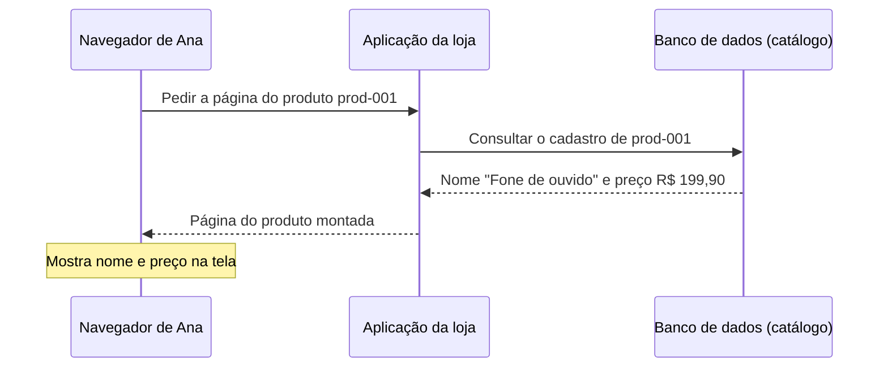

# Aula 1 — Você clicou em um produto. O que aconteceu?

> Trilha: [System Design a partir do zero](../00-system-design-from-zero.md) · Cenário: [Loja Horizonte](00-scenario.md) · Como as aulas são escritas: [guia editorial](../../learning-guide.md)

**Ana abre a Loja Horizonte e toca no fone de ouvido. A página mostra o nome, o preço e uma fotografia. Como essas informações chegaram à tela?**

Esta aula responde a essa pergunta do zero. Ao final, você deve conseguir **explicar de onde vêm o nome, o preço e a fotografia de um produto e acompanhar o caminho dessas informações até a tela**.

## Objetivos observáveis

Depois desta aula, sem decorar, você consegue:

- dizer quem faz o pedido e quem responde;
- apontar onde ficam o nome, o preço e a fotografia;
- explicar por que a fotografia provoca um segundo pedido;
- ler o diagrama de comportamento e a arquitetura;
- dizer, diante de "o preço aparece mas a foto não", qual é o próximo passo;
- reconhecer o que esta arquitetura **ainda não** garante.

## Roteiro

[A cena](#cena) → [o que precisamos entregar](#requisitos) → [os papéis](#papeis) → [o caminho normal](#caminho) → [o desenho do comportamento](#mermaid) → [alternativas e trade-offs](#tradeoffs) → [como isso poderia funcionar na AWS](#aws) → [a arquitetura](#arquitetura) → [quando a foto não aparece](#falha) → [perguntas](#perguntas) → [exercício](#exercicio) → [resumo](#resumo).

<a id="cena"></a>
## O que aconteceu na loja?

Ana está no aplicativo da loja — na prática, uma página aberta no **navegador**, o programa que ela usa para ver sites (Chrome, Safari, Firefox são navegadores). Ela toca no fone de ouvido. Em um instante, a página do produto aparece com três informações: o **nome** ("Fone de ouvido"), o **preço** (R$ 199,90) e uma **fotografia**.

Essas informações não estavam prontas no celular de Ana. O navegador precisou **pedi-las** a outro programa e **montar** a tela com o que recebeu. Vamos destrinchar esse pedido.

<a id="requisitos"></a>
## O que precisamos entregar nesta etapa?

Antes de pensar em qualquer tecnologia, vale escrever o que a loja precisa oferecer **nesta** etapa. Dois tipos de necessidade (ambos explicados no [guia editorial](../../learning-guide.md)):

**Requisitos funcionais** — capacidades que a pessoa usa:

- consultar o nome e o preço de um produto pelo seu identificador;
- exibir a fotografia correspondente ao produto;
- quando a fotografia não puder ser obtida, mostrar uma **indicação de imagem indisponível** sem apagar o nome e o preço que já apareceram.

**Requisitos não funcionais** — qualidades exigidas dessas capacidades (aqui, poucas e pertinentes):

- **proteção contra alterações não autorizadas**: ninguém que apenas visita a loja pode mudar o preço ou a foto;
- **tempo de resposta sob uma carga definida**: a aplicação deve montar a resposta da página do produto dentro de um limite, para uma quantidade combinada de acessos;
- **comportamento previsível quando a foto falha**: a página continua útil (nome e preço) mesmo sem a imagem.

Um requisito não funcional **não** é secundário: é ele que, mais adiante, vai pesar em várias decisões. E "usar um banco de dados gerenciado" ou "usar a AWS" **não** são requisitos funcionais — Ana não pediu isso. São decisões/restrições tecnológicas, que aparecem só depois.

**Requisitos verificáveis.** "Rápido" e "seguro" não são verificáveis como estão. Para medir o tempo de resposta, precisaríamos combinar: a **operação** (montar a página de um produto), a **medida** (tempo até a resposta sair da aplicação), o **limite** (um valor-alvo), a **carga** (quantos pedidos ao mesmo tempo), a **janela** (por quanto tempo medimos), o **ponto de medição** (na aplicação, não no celular de Ana) e o **tratamento dos erros** (pedidos que falharam contam?).

> Para esta aula, adotamos uma meta **hipotética**: *a aplicação monta a resposta da página do produto em até 300 ms no percentil 95, para até 50 pedidos por segundo, medidos na aplicação, durante uma janela de 5 minutos, descontando respostas de erro.* Isso é uma **hipótese do cenário** para dar concretude — não é um padrão da indústria, um benchmark nem um resultado medido. E atenção: esse tempo é o da **aplicação**, não o tempo total até a página terminar de carregar no navegador de Ana (que inclui rede, imagem e desenho da tela).

<a id="papeis"></a>
## Entenda a ideia: os papéis

Vamos nomear quem participa. São **papéis de software**, não necessariamente máquinas.

- **Cliente** — o programa que **faz o pedido**. Aqui, o navegador de Ana é o cliente.
- **Servidor** — o programa que **recebe o pedido e responde**. "Servidor" é um papel: um software que atende solicitações. Ele executa em alguma infraestrutura (um computador na nuvem, por exemplo), mas não precisa ser imaginado como uma única máquina física — pode haver vários computadores por trás.
- **Aplicação da loja** — o software servidor que entende os pedidos da loja: recebe "quero ver o produto prod-001", busca as informações e devolve a resposta.
- **Requisição** (ou pedido) — a mensagem que o cliente envia pedindo algo.
- **Resposta** — a mensagem que o servidor devolve.
- **Banco de dados** — um programa especializado em **guardar e consultar registros** de forma organizada. Um **registro** é um conjunto de informações sobre uma coisa — por exemplo, o registro do `prod-001` guarda seu nome e seu preço.
- **Arquivo de imagem** — a fotografia é um **arquivo**: uma sequência de bytes que representa a imagem. É diferente de um registro de texto como nome e preço.

As três responsabilidades que aparecem nesta aula:

1. **executar o programa** da loja (a aplicação que atende os pedidos);
2. **guardar os registros do catálogo** (nome e preço de cada produto);
3. **guardar os arquivos das fotografias** (as imagens dos produtos).

> **Separar registros e fotografias é uma decisão deste exemplo**, não uma lei. Bancos de dados **conseguem** guardar arquivos; é comum, porém, manter textos curtos (nome, preço) no banco e os arquivos grandes (imagens) em um armazenamento próprio para arquivos. Veremos o porquê nos [trade-offs](#tradeoffs).

<a id="caminho"></a>
## Acompanhe o funcionamento

Usaremos sempre o mesmo produto, `prod-001`. O caminho tem **duas partes**, porque o nome/preço e a fotografia são obtidos separadamente.

### Parte A — a página do produto

O navegador de Ana envia uma requisição à aplicação:

```text
GET /products/prod-001
```

`GET` quer dizer "me entregue"; `/products/prod-001` diz **o quê**: o produto de identificador `prod-001`. (Trate esse endereço como um exemplo ilustrativo; nenhuma API foi publicada ou executada nesta aula.)

A aplicação, ao receber o pedido:

1. consulta no banco de dados o registro de `prod-001`;
2. obtém o nome ("Fone de ouvido") e o preço (R$ 199,90);
3. monta uma página em **HTML** — a linguagem que descreve a página que o navegador vai desenhar (texto, onde fica cada coisa, e **referências** a imagens);
4. devolve essa página ao navegador na resposta.

Não vamos escrever HTML nem ensinar a programar a página; basta saber que a página é uma **descrição** que o navegador interpreta para desenhar a tela.

### Parte B — a fotografia

A página devolvida contém uma **referência** à imagem, algo como:

```text

```

Isso **não** é a foto; é um endereço que diz ao navegador: "para mostrar a imagem, peça-a aqui". Então o navegador faz um **segundo pedido**, agora para a imagem:

```text
GET /products/prod-001/image
```

A mesma aplicação recebe esse pedido e:

1. identifica qual arquivo corresponde ao produto;
2. lê esse arquivo do armazenamento de arquivos;
3. devolve os **bytes** da imagem ao navegador.

O navegador então coloca a imagem na página já exibida.

Três pontos importantes:

- os dados do produto (nome, preço) e o arquivo de imagem chegam em **respostas distintas**, a dois pedidos distintos;
- **referenciar** uma imagem na página não significa que os bytes dela vieram da consulta ao banco — eles vêm do pedido da imagem;
- neste piloto, o navegador **não** fala diretamente com o banco de dados nem com o armazenamento de arquivos: tudo passa pela aplicação.

> Este caminho — a aplicação também entrega as imagens — é uma **escolha didática inicial**. Ele tem um custo: a aplicação gasta trabalho enviando bytes de imagem, além de montar páginas. Outras formas de entregar imagens serão comparadas em aulas posteriores.

<a id="mermaid"></a>
## O desenho do comportamento

**Pergunta que o desenho responde:** na consulta dos dados do produto (parte A), em que ordem as mensagens acontecem e quem fala com quem?

**Como ler:** o tempo corre de cima para baixo. Cada seta é uma mensagem. As linhas verticais são os participantes. A busca da fotografia (parte B) é mostrada à parte, no texto acima e na [arquitetura](#arquitetura), para não sobrecarregar este desenho.



**Passo a passo:** (1) o navegador pede a página de `prod-001`; (2) a aplicação consulta o cadastro no banco; (3) o banco devolve o nome e o preço; (4) a aplicação monta a página e responde; o navegador mostra nome e preço. A fotografia virá no segundo pedido.

**Conclusão curta:** o nome e o preço vêm de uma **consulta ao banco**, interpretada pela aplicação e devolvida como página. Nada aqui ainda fala sobre a imagem.

<a id="tradeoffs"></a>
## Alternativas e trade-offs

Antes de nomear serviços, vale olhar duas decisões deste desenho. Para cada uma: o problema, as alternativas, o que ganhamos, o que custa, por que escolhemos agora, e o que faria reconsiderar.

**1. Guardar as fotografias separadas dos registros.**
Problema: onde ficam as imagens? Alternativas: (a) dentro do banco, junto do registro; (b) em um armazenamento de arquivos à parte. Escolha agora: (b). Favorece: manter o banco enxuto para consultas de texto e tratar arquivos grandes onde isso é barato e simples. Custo/limite: passam a existir **dois lugares** para cuidar, e a aplicação precisa saber ler os dois. Reconsiderar se: as imagens fossem minúsculas e raras, ou se um requisito exigisse transação única cobrindo texto e arquivo. (Não é verdade que banco "não pode" guardar arquivo; é uma escolha de adequação.)

**2. A aplicação entrega as imagens.**
Problema: quem envia os bytes da foto ao navegador? Alternativas: (a) a própria aplicação lê e envia; (b) servir a imagem por um caminho dedicado a conteúdo estático/entrega na borda. Escolha agora: (a), por simplicidade didática. Favorece: um só componente para entender neste momento. Custo/limite: a aplicação gasta tempo e capacidade enviando imagens, competindo com o trabalho de montar páginas. Reconsiderar se: o volume de imagens crescer ou o tempo de resposta sofrer — aí comparamos entrega dedicada e cache/CDN (aula futura).

**3. Uma única cópia da aplicação no desenho inicial.**
Problema: quantas instâncias da aplicação desenhar agora? Alternativas: (a) uma; (b) várias atrás de um balanceador. Escolha agora: (a), porque o foco é o **caminho da consulta**, não a continuidade. Favorece: um desenho simples de explicar. Custo/limite: se essa única instância parar, a loja para — este desenho **não** demonstra continuidade. Reconsiderar se: surgir um requisito de sobreviver à falha de uma instância (aula futura sobre escala e disponibilidade).

Repare que "mais barato", "mais rápido" e "mais simples" não andam sempre juntos: separar imagens pode simplificar o banco e, ao mesmo tempo, criar trabalho operacional de cuidar de dois lugares. Um trade-off descreve o que trocamos — nunca é desculpa para violar um requisito obrigatório (por exemplo, a proteção contra alterações não autorizadas vale em qualquer alternativa).

<a id="aws"></a>
## Como isso poderia funcionar na AWS

Agora, e só agora, mapeamos cada **papel** a um serviço. Antes das siglas, o nome por extenso:

- **Amazon EC2** (*Elastic Compute Cloud*) — fornece computadores virtuais na nuvem onde você executa seus programas.
- **Amazon RDS** (*Relational Database Service*) **for PostgreSQL** — um serviço gerenciado que opera um banco de dados relacional (aqui, o PostgreSQL) para você.
- **Amazon S3** (*Simple Storage Service*) — um serviço para guardar e recuperar **arquivos** (chamados de objetos), organizados em "baldes" chamados *buckets*.

| Conceito (papel) | Serviço | Papel no exemplo | O que **não** resolve sozinho |
|---|---|---|---|
| Executar o programa |  Amazon EC2 | Hospeda e executa a aplicação da loja | Não vem com a aplicação pronta; alguém instala e opera o programa |
| Guardar os registros |  Amazon RDS for PostgreSQL | Mantém os registros do catálogo (nome, preço) e responde às consultas | Não implementa as regras de negócio da loja; isso é a aplicação |
| Guardar os arquivos |  Amazon S3 | Armazena os arquivos das fotografias em um bucket privado | Não envia a imagem por iniciativa própria; a aplicação pede e repassa |

Alguns cuidados, para não aprender errado:

- a **EC2** oferece o computador; a aplicação não nasce pronta nela — é instalada e operada;
- o **RDS** cuida da operação do banco (instalação, cópias de segurança, correções), mas **as regras comerciais da loja ficam na aplicação**, não no banco. ([RDS é um serviço gerenciado que automatiza tarefas de administração do banco.](https://docs.aws.amazon.com/AmazonRDS/latest/UserGuide/Welcome.html))
- o **S3** entrega um objeto **quando é solicitado e autorizado**; ele não "manda a imagem sozinho";
- usar serviços gerenciados **não** torna a jornada automaticamente disponível — continuidade é outra decisão;
- **esta combinação não é obrigatória** para todo e-commerce; é uma implementação didática.

Nesta variante, algumas escolhas de segurança valem desde já:

- o **catálogo é visível ao público** (qualquer pessoa pode ver nome, preço e foto de um produto);
- o **banco não é exposto diretamente ao navegador** — quem fala com o banco é a aplicação;
- o **bucket S3 é privado**: por padrão, buckets novos bloqueiam acesso público e os objetos não são públicos ([S3 bloqueia acesso público por padrão](https://docs.aws.amazon.com/AmazonS3/latest/userguide/configuring-block-public-access-bucket.html));
- a aplicação é autorizada a ler **apenas os objetos necessários**;
- **credenciais da AWS não são entregues ao navegador**;
- o acesso da aplicação ao S3 usa uma **role** apropriada (uma identidade com permissões que a aplicação assume), **não** chaves fixas escritas no código.

Permissões, em uma frase: cada acesso ao banco e ao S3 passa por uma identidade com permissão mínima; o navegador nunca recebe essas permissões. O detalhamento de identidade e acesso é assunto de outro módulo ([F03](../../01-fundamentals/03-security-identity.md)); aqui basta o princípio.

> **A arquitetura é didática, não está pronta para produção nem foi implantada.** Rede, TLS, capacidade, cópias de segurança, observabilidade e disponibilidade exigem decisões próprias, que **não** estão resolvidas aqui.

### Requisito → decisão → como verificar

| Requisito | Implicação no desenho | Como verificar | Estado |
|---|---|---|---|
| Consultar nome e preço | Registros no RDS; a aplicação consulta por `prod-001` | Pedir `prod-001` e conferir nome/preço na resposta | decisão proposta; ainda não testado |
| Exibir a fotografia | Arquivo no S3; a aplicação lê e repassa | Pedir a imagem e conferir os bytes recebidos | decisão proposta; ainda não testado |
| Indicação de imagem indisponível | A página mostra um aviso se a imagem falhar, sem apagar nome/preço | Simular falha da imagem e observar a página | planejado no comportamento; ainda não testado |
| Proteção contra alteração não autorizada | Banco não exposto; bucket privado; sem credenciais no navegador; role de leitura | Revisar quem pode escrever; tentar acesso indevido deve ser negado | coerência analisada; não testado |
| Tempo de resposta sob carga | Uma instância EC2 atende; meta hipotética definida | Teste de carga medindo o p95 na aplicação | não testado |
| Continuidade se a instância falhar | Uma única instância no desenho | — | **não atendido pelo desenho atual**; planejado para etapa futura |

Repare: um serviço aparecer no desenho **não** significa "requisito atendido". Desempenho, continuidade e segurança operacional só podem ser chamados de atendidos depois de evidência.

<a id="arquitetura"></a>
## A arquitetura (implementação possível)

O desenho abaixo mostra **uma implementação possível** do caminho, incluindo a busca da fotografia (que ficou de fora do Mermaid). Ele responde: **quais componentes participam e como se ligam?**

![Arquitetura lógica da consulta ao catálogo da Loja Horizonte: o Navegador de Ana, fora da nuvem AWS, faz dois pedidos à Aplicação da loja, que executa em uma instância Amazon EC2; para montar a página, a aplicação consulta o Amazon RDS for PostgreSQL (nome e preço do catálogo); para a fotografia, a aplicação lê o arquivo de um bucket privado no Amazon S3; as respostas voltam ao navegador pela aplicação. RDS e S3 são consultados pela aplicação para finalidades diferentes, não em sequência um do outro.](assets/01-catalog-aws.svg)

Arquivo editável (fonte do diagrama): [`assets/01-catalog-aws.drawio`](assets/01-catalog-aws.drawio). Para editar, abra esse arquivo no [diagrams.net](https://www.drawio.com/) (menu *File → Open*) ou no app de desktop; a exportação `.svg` foi gerada a partir dele e também pode ser reaberta no editor.

**Como ler:** o **navegador fica fora** da caixa tracejada da AWS. Dentro dela, a **aplicação executa na EC2**. A aplicação consulta o **RDS** (para nome e preço) e lê o arquivo no **S3** (para a fotografia): são dois caminhos com **finalidades diferentes**, não uma sequência em que um depende do outro. As respostas voltam ao navegador pela aplicação.

**O que o desenho apoia e o que omite:**

- apoia os requisitos de **consultar o catálogo** e **exibir a fotografia** (mostra onde cada informação mora e quem a busca);
- é uma **visão lógica**: a caixa "Nuvem AWS" não representa rede real. **Rede, sub-redes, zonas de disponibilidade (AZs), TLS, balanceamento, cópias de segurança e observabilidade foram omitidos de propósito** — a legenda do desenho registra isso. O S3 **não** fica dentro de uma sub-rede, e por isso não foi desenhado dentro de nenhuma;
- **não** demonstra continuidade: há uma única instância; se ela parar, a loja para.

<a id="falha"></a>
## O que acontece quando algo falha?

**Falha: o nome e o preço aparecem, mas a fotografia não.**

Primeiro, o que isso já nos diz: a **parte A funcionou** (a página veio, com nome e preço). Logo, a consulta ao banco e a montagem da página deram certo. O problema está na **parte B**: o pedido da imagem (`GET /products/prod-001/image`) não resultou na foto.

Esse sintoma **não** prova que o banco está fora do ar — ao contrário, o banco respondeu (vieram nome e preço). Também **não** prova que o S3 inteiro está indisponível: pode ser um problema só com aquele arquivo ou com a permissão de lê-lo.

Hipóteses simples a considerar (duas ou três bastam):

- a **referência à imagem está errada** na página (aponta para um endereço que não corresponde ao arquivo);
- o **arquivo esperado não existe** no bucket (nunca foi enviado, ou foi removido);
- a **aplicação não tem acesso** àquele objeto (a permissão de leitura não cobre esse arquivo);
- houve uma **falha no caminho de obtenção** da imagem (a leitura não se completou).

O que observar, sem precisar de comandos ainda não ensinados: qual foi a resposta ao pedido da imagem (ela chegou a ser atendida?); se o endereço da imagem na página corresponde ao produto; se outros produtos mostram foto (ajuda a separar "problema geral" de "problema deste arquivo").

Enquanto a causa é investigada, há uma escolha de apresentação simples e honesta: **mostrar uma indicação de "imagem indisponível"**, preservando o nome e o preço já exibidos. Nunca inventar uma foto ou um preço no lugar. Isso atende o requisito de comportamento previsível na falha.

(Não precisamos, aqui, de mecanismos como repetição automática, circuit breaker ou CDN — eles chegam em aulas próprias.)

<a id="perguntas"></a>
## Verifique seu entendimento

Responda em voz alta antes de abrir a resposta.

### 1. (compreensão) Quem pede e quem responde?

Quando Ana abre a página do produto, quem é o cliente e quem é o servidor?

**Follow-up:** o "servidor" é obrigatoriamente uma única máquina física?

<details>
<summary><strong>Ver resposta comentada</strong></summary>

**Resposta esperada:** o cliente é o navegador de Ana (faz o pedido); o servidor é a aplicação da loja (recebe e responde).

**Por que faz sentido:** cliente e servidor são papéis de software definidos por quem pede e quem atende.

**Resposta ao follow-up:** não. Servidor é um papel; o software executa em infraestrutura e pode haver vários computadores por trás.

**O que observar:** não confunde o navegador com o servidor; entende "servidor" como papel, não como máquina única.

</details>

### 2. (compreensão) Onde ficam nome, preço e fotografia?

Nesta aula, onde está guardado o nome e o preço, e onde está a fotografia?

**Follow-up:** isso quer dizer que um banco de dados é incapaz de guardar arquivos?

<details>
<summary><strong>Ver resposta comentada</strong></summary>

**Resposta esperada:** nome e preço ficam como **registros** no banco de dados (RDS for PostgreSQL); a fotografia é um **arquivo** no armazenamento de arquivos (S3).

**Por que faz sentido:** separar texto curto (registro) de arquivo grande (imagem) é a decisão deste cenário.

**Resposta ao follow-up:** não. Bancos conseguem guardar arquivos; aqui foi uma **escolha** de adequação, não uma impossibilidade.

**O que observar:** não trata a separação como lei universal; usa os termos registro e arquivo corretamente.

</details>

### 3. (aplicação) O que a EC2 faz no exemplo?

Qual é o papel da EC2 aqui, e o que ela **não** faz sozinha?

**Follow-up:** criar a instância EC2 já coloca a loja no ar?

<details>
<summary><strong>Ver resposta comentada</strong></summary>

**Resposta esperada:** a EC2 fornece o computador onde a **aplicação da loja executa**. Ela não traz a aplicação pronta nem implementa as regras da loja.

**Por que faz sentido:** EC2 é computação; o programa é instalado e operado por quem constrói a loja.

**Resposta ao follow-up:** não. A instância é só a capacidade de execução; ainda é preciso instalar, configurar e operar a aplicação (e tratar rede, segurança, etc.).

**O que observar:** separa "ter o computador" de "ter a aplicação funcionando"; não atribui as regras de negócio ao serviço de compute.

</details>

### 4. (aplicação) Por que a imagem provoca outra solicitação?

A página já chegou com nome e preço. Por que o navegador faz um segundo pedido para mostrar a fotografia?

**Follow-up:** os bytes da foto vieram da consulta ao banco?

<details>
<summary><strong>Ver resposta comentada</strong></summary>

**Resposta esperada:** a página traz apenas uma **referência** à imagem (``), não a imagem em si. Para obter os bytes, o navegador faz um novo pedido ao endereço da imagem.

**Por que faz sentido:** nome/preço e arquivo de imagem são respostas distintas a pedidos distintos.

**Resposta ao follow-up:** não. Os bytes vieram do pedido da imagem (a aplicação leu o arquivo do S3), não da consulta ao banco.

**O que observar:** não confunde referenciar a imagem com já ter os bytes; separa as duas respostas.

</details>

### 5. (diagnóstico) O preço aparece e a foto não: qual o próximo passo?

A página mostra "Fone de ouvido" e R$ 199,90, mas a imagem não carrega. O que você conclui e qual é o próximo passo?

**Follow-up:** isso prova que o banco de dados está fora do ar?

<details>
<summary><strong>Ver resposta comentada</strong></summary>

**Resposta esperada:** a parte A funcionou (nome e preço vieram), então o problema está na obtenção da **imagem**. Próximo passo: verificar o pedido da imagem — se a referência na página está correta, se o arquivo existe no bucket e se a aplicação tem permissão de lê-lo — e, enquanto isso, mostrar "imagem indisponível" sem apagar nome e preço.

**Por que faz sentido:** o sintoma localiza a falha na parte B; nome e preço presentes mostram que o banco respondeu.

**Resposta ao follow-up:** não. O banco respondeu (vieram nome e preço). O sintoma também não prova que o S3 inteiro caiu — pode ser aquele objeto ou a permissão.

**O que observar:** não salta para "banco fora" nem "S3 fora"; distingue falha geral de falha de um arquivo/permissão; preserva os dados já exibidos.

</details>

### 6. (mudança de requisito) Trocar a fotografia exige trocar a infraestrutura?

A loja quer substituir a foto do `prod-001` por uma nova. Isso exige mudar EC2, RDS e S3?

**Follow-up:** e se, em vez disso, a loja exigisse que a página do produto continue no ar mesmo se a instância da aplicação falhar?

<details>
<summary><strong>Ver resposta comentada</strong></summary>

**Resposta esperada:** não. Trocar a foto é substituir o **arquivo** correspondente no S3 (e garantir que a referência aponte para o arquivo certo). Os serviços e o desenho continuam os mesmos.

**Por que faz sentido:** a fotografia é um arquivo no armazenamento; mudá-la é uma operação de dados, não de arquitetura.

**Resposta ao follow-up:** aí sim o desenho precisaria evoluir: uma única instância não sobrevive à própria falha. Atender essa continuidade é tema de uma aula futura (escala e disponibilidade) — **não** acrescentamos esses componentes agora só para "cobrir" o requisito.

**O que observar:** separa mudança de dado de mudança de arquitetura; reconhece honestamente o limite da instância única sem inventar a solução agora.

</details>

<a id="exercicio"></a>
## Resolva uma pequena mudança

**Exercício.** Leia a situação e responda no papel, reutilizando apenas o que esta aula ensinou.

> A Loja Horizonte quer uma garantia: *"a página do produto deve continuar mostrando nome e preço mesmo quando a fotografia não puder ser carregada"*.
>
> 1. Identifique de que **tipo** é esse requisito (funcional ou não funcional) e enuncie-o de forma verificável.
> 2. Relacione-o a uma **decisão** do desenho (o que no caminho/arquitetura o apoia).
> 3. Explique um **limite**: o que esse comportamento **não** garante.
> 4. Diga **como você verificaria** que foi atendido.

<details>
<summary><strong>Ver solução comentada</strong></summary>

**Resposta esperada:**
1. É um requisito de **qualidade (não funcional)** sobre o comportamento na falha. Enunciado verificável: *quando o pedido da imagem de um produto falhar, a página desse produto continua exibindo nome e preço e mostra uma indicação de "imagem indisponível", em vez de ficar sem conteúdo.*
2. **Decisão que apoia:** nome/preço e fotografia vêm de pedidos separados; como a parte A (página com nome e preço) não depende da parte B (imagem), a página pode ser mostrada mesmo sem a foto, exibindo o aviso.
3. **Limite:** isso não garante que a foto vai aparecer, nem corrige a causa (referência errada, objeto ausente, permissão). Também não diz nada sobre o banco estar lento ou a instância cair.
4. **Como verificar:** simular a falha da imagem (por exemplo, apontar para um arquivo inexistente) e observar se a página mantém nome e preço e mostra o aviso, sem inventar foto nem preço.

**Por que faz sentido:** o requisito é sobre comportamento sob falha; a separação dos dois pedidos é exatamente o que permite degradar a página sem perdê-la.

**O que observar:** classifica o requisito, liga-o à separação de pedidos, reconhece o limite (não conserta a causa) e propõe uma verificação observável — sem pedir retry, cache ou CDN.

</details>

<a id="resumo"></a>
## O que aprendemos e o que vem depois

**Resumo.** Quando Ana abre um produto, o navegador (cliente) pede a página à aplicação (servidor); a aplicação consulta o **catálogo** no banco para nome e preço, monta a página e responde. A página referencia a imagem, o que leva o navegador a um **segundo pedido**; a aplicação lê o **arquivo** no S3 e devolve os bytes. Na AWS, isso mapeia para EC2 (executa a aplicação), RDS for PostgreSQL (registros) e S3 (arquivos), com o banco não exposto e o bucket privado. É uma visão **didática**, com rede, continuidade e desempenho ainda **não** resolvidos.

**Checklist observável.** Você consegue, sem consultar:

- [ ] dizer quem é cliente e quem é servidor nesta cena;
- [ ] apontar onde ficam nome, preço e fotografia;
- [ ] explicar por que a imagem exige um segundo pedido;
- [ ] mapear EC2, RDS e S3 aos três papéis e dizer o que cada um não resolve sozinho;
- [ ] diante de "preço aparece, foto não", indicar o próximo passo sem culpar o banco;
- [ ] nomear uma propriedade que esta arquitetura ainda **não** garante.

**Próxima etapa (planejada).** A seguir, a loja ganha um **carrinho e um pedido** — e com eles novas perguntas: o que acontece quando duas pessoas querem a última unidade? Essa aula ainda não existe; será escrita na sequência da trilha.

---

## Fontes

Consultadas em **11/10/2026**. Documentação da AWS em `latest` muda; revalide antes de um laboratório. Afirmações marcadas como escolha do cenário ou hipótese didática não são comportamento de produto.

- Amazon EC2 — computação na nuvem: [documentação](https://docs.aws.amazon.com/ec2/).
- Amazon RDS — serviço gerenciado de banco relacional (automatiza administração; não implementa regras da aplicação): [What is Amazon RDS?](https://docs.aws.amazon.com/AmazonRDS/latest/UserGuide/Welcome.html).
- Amazon S3 — armazenamento de objetos; buckets e objetos **privados por padrão**, acesso público bloqueado: [Block Public Access](https://docs.aws.amazon.com/AmazonS3/latest/userguide/configuring-block-public-access-bucket.html).
- Identidade e permissões da aplicação (role, menor privilégio): aprofundamento em [F03](../../01-fundamentals/03-security-identity.md).
- AWS Architecture Icons (ícones de EC2, RDS e S3): [página oficial](https://aws.amazon.com/architecture/icons/).
- Mermaid (diagrama de sequência): [documentação oficial](https://mermaid.js.org/syntax/sequenceDiagram.html).
- diagrams.net / Draw.io (fonte editável da arquitetura): [site oficial](https://www.drawio.com/).
- Apresentação com `<details>` no GitHub: [documentação](https://docs.github.com/en/get-started/writing-on-github).

**Procedência dos ícones:** EC2 reutilizado por referência ao asset existente de F04 (`../../01-fundamentals/assets/aws-ec2-32.svg`), sem cópia local. RDS e S3 copiados sem alteração gráfica do pacote oficial AWS Architecture Icons (release `Icon-package_07312026`): variante *Architecture-Service-Icons / Arch_32* de **Amazon RDS** (categoria Databases) e **Amazon Simple Storage Service** (categoria Storage). Não há variante de arquitetura específica "RDS for PostgreSQL"; usamos o ícone genérico de RDS com o nome por extenso no texto, e **não** o ícone de Aurora. O nome local `aws-rds-32.svg` / `aws-s3-32.svg` segue a convenção do repositório.

**Formato dos ícones no diagrama (exceção deste piloto):** os SVGs oficiais acima são a origem preservada. Dentro do `01-catalog-aws.drawio`, porém, os três ícones estão embutidos como **PNGs de 256×256 px derivados desses SVGs**, não como SVG. Essa conversão foi adotada por compatibilidade: no editor testado, ícones embutidos como SVG não eram renderizados. Os PNGs **não** são byte-idênticos aos SVGs oficiais (são uma rasterização deles). Componentes, rótulos e conectores do diagrama continuam independentes e editáveis. A exportação `01-catalog-aws.svg` contém essas imagens **rasterizadas**; portanto a arquitetura exportada **não** é integralmente vetorial. Esta é uma decisão pontual deste piloto, não uma regra para os próximos diagramas.

**Inspiração × autoria:** a abordagem de evoluir a aplicação passo a passo foi inspirada em um vídeo didático sobre uma aplicação de fotos; a **Loja Horizonte** e todos os exemplos são autorais desta trilha. Veja a nota em [00-scenario.md](00-scenario.md).
