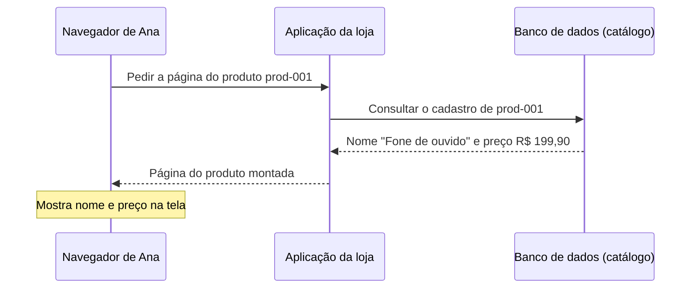

# Aula 1 — Você clicou em um produto. O que aconteceu?

[Trilha System Design a partir do zero](../00-system-design-from-zero.md) · [Cenário da Loja Horizonte](00-scenario.md)

Ana abre a Loja Horizonte e toca no fone de ouvido. A página mostra o nome, o preço e uma fotografia. **De onde vieram essas informações?**

Nesta aula, você acompanhará o caminho entre o navegador, a aplicação e os lugares onde os dados ficam guardados. Ao final, conseguirá explicar por que a página e a fotografia chegam em respostas diferentes e por onde começar a investigar quando uma delas falha.

## Roteiro

**Entenda o caminho:** [cenário](#cena) → [requisitos](#requisitos) → [participantes](#papeis) → [funcionamento](#caminho) → [desenho do pedido](#mermaid).

**Aplique e pratique:** [trade-offs](#tradeoffs) → [AWS](#aws) → [arquitetura](#arquitetura) → [falhas](#falha) → [perguntas](#perguntas) → [exercício](#exercicio) → [resumo](#resumo).

<a id="cena"></a>
## 1. O que aconteceu na loja?

Ana está usando o **navegador**, o programa que abre sites, como Chrome, Safari ou Firefox. Ao selecionar o produto `prod-001`, ela vê:

- **Nome:** Fone de ouvido.
- **Preço:** R$ 199,90.
- **Fotografia:** a imagem correspondente ao produto.

Neste exemplo, o navegador ainda não tem essas informações. Ele precisa pedi-las à aplicação da loja e usar as respostas para apresentar a página.

> A Loja Horizonte, seus personagens e seus dados são fictícios. A arquitetura serve para estudo: não foi implantada nem teve seu desempenho medido.

<a id="requisitos"></a>
## 2. O que a loja precisa oferecer?

Antes de escolher tecnologias, precisamos entender **o que deve funcionar e em quais condições**. Essas necessidades são os **requisitos** do sistema.

### Requisitos funcionais: o que a pessoa consegue fazer

A loja precisa permitir a consulta do nome, do preço e da fotografia de um produto pelo seu identificador. Se a fotografia não puder ser carregada, a página deve mostrar um aviso de imagem indisponível sem apagar o nome e o preço.

### Requisitos não funcionais: como isso precisa funcionar

Para esta etapa, vamos considerar três qualidades:

- **Proteção:** visitantes podem consultar o catálogo, mas não alterar preços ou fotografias.
- **Tempo de resposta:** a aplicação precisa responder dentro de um prazo definido, mesmo recebendo uma quantidade conhecida de pedidos. Na [seção 7](#meta), esse prazo vira uma meta que pode ser medida.
- **Comportamento na falha:** um problema na fotografia não deve inutilizar a página inteira.

As categorias se complementam. Mostrar um aviso é um comportamento; manter a página útil durante uma falha é uma qualidade desse comportamento.

“Usar AWS” e “usar um banco gerenciado” são escolhas tecnológicas do exemplo. Não são funcionalidades que Ana pediu.

<a id="papeis"></a>
## 3. Quem participa da consulta?

**Cliente** é o programa que faz o pedido. Aqui, é o navegador de Ana.

**Servidor** é o programa que recebe o pedido e responde. Esse nome descreve um papel. O programa precisa executar em um computador, mas “servidor” não significa obrigatoriamente uma única máquina física.

**Aplicação da loja** é o programa servidor que entende os pedidos do catálogo, busca as informações e prepara as respostas.

Uma **requisição** é a mensagem enviada pelo cliente. Uma **resposta** é a mensagem devolvida pelo servidor. Neste exemplo, essa conversa utiliza **HTTP**, o protocolo — isto é, o conjunto de regras combinadas — que organiza essas mensagens na web.

A aplicação consulta dois tipos de informação:

| Informação | Onde fica neste exemplo | O que significa |
|---|---|---|
| Nome e preço | Banco de dados | Um programa que guarda e consulta informações organizadas. O cadastro de um produto é um **registro**. |
| Fotografia | Armazenamento de arquivos | A imagem é um arquivo formado por **bytes**, unidades de dados que o navegador interpreta para exibi-la. |

São três responsabilidades: **executar a aplicação, guardar os registros e guardar os arquivos**. Separá-las ajuda a entender quem faz cada parte do trabalho.

Bancos de dados também podem guardar arquivos. Aqui escolhemos manter as fotografias separadas; veremos os motivos e os limites dessa escolha nos trade-offs.

<a id="caminho"></a>
## 4. Acompanhe os dois pedidos

### Pedido A — obter a página do produto

O navegador solicita a página de `prod-001`:

```text
GET /products/prod-001
```

Nesse exemplo, `GET` indica uma solicitação de leitura. O caminho `/products/prod-001` identifica a página do produto que Ana quer consultar.

A aplicação:

1. Consulta o registro de `prod-001` no banco.
2. Obtém o nome “Fone de ouvido” e o preço R$ 199,90.
3. Monta uma página em **HTML**, a linguagem que descreve o conteúdo da página e suas referências a outros recursos, como imagens.
4. Devolve o HTML ao navegador.

O navegador interpreta essa resposta para apresentar a página. Você não precisa saber programar HTML para acompanhar o restante do exemplo.

### Pedido B — obter a fotografia

O HTML contém uma referência à fotografia:

```html

```

Isso é **um endereço para buscar a imagem**, não o arquivo da fotografia. Ao encontrar essa referência, o navegador faz outro pedido:

```text
GET /products/prod-001/image
```

A aplicação:

1. Identifica o arquivo correspondente ao produto.
2. Lê o arquivo no armazenamento.
3. Devolve os bytes da fotografia ao navegador.

O navegador usa essa segunda resposta para mostrar a imagem na página. Por isso, o nome e o preço podem aparecer enquanto a fotografia ainda está carregando.

**São duas solicitações, cada uma com sua própria resposta:** uma traz o HTML; a outra, a fotografia. Nesta versão da loja, ambas passam pela aplicação. O navegador não consulta diretamente o banco nem o armazenamento dos arquivos.

<a id="mermaid"></a>
## 5. O caminho da página em um desenho

O desenho abaixo foi feito com **Mermaid**, uma ferramenta que gera diagramas a partir de texto. Ele mostra apenas o **pedido A**, que busca nome e preço. Leia de cima para baixo: as linhas verticais representam os participantes e as setas mostram as mensagens.



Observe quem prepara a resposta: **o banco fornece os dados; a aplicação monta a página; o navegador a apresenta**. A fotografia será obtida em outro pedido, como vimos na parte B.

<a id="tradeoffs"></a>
## 6. Por que escolher esse desenho?

Um **trade-off** é a avaliação do que uma escolha favorece e de quais custos ou limites ela traz. Neste exemplo, tomamos três decisões.

### Registros e fotografias separados

**Escolha:** guardar nome e preço no banco e as fotografias em outro armazenamento. A alternativa seria guardar também os arquivos no banco.

**Ganho e limite:** cada lugar recebe uma responsabilidade, mas a aplicação precisa relacionar corretamente produto e arquivo e lidar com os dois acessos. A separação não garante, sozinha, menor custo ou melhor desempenho.

**Quando reconsiderar:** se fosse necessária uma **transação** única — uma operação em que registro e arquivo são gravados juntos, ou nenhum dos dois é gravado.

### A aplicação também entrega a fotografia

**Escolha:** o navegador pede tanto a página quanto a imagem à aplicação. Outra opção seria entregar as imagens por um caminho dedicado.

**Ganho e limite:** temos um único ponto de entrada para acompanhar nesta aula. Em contrapartida, a aplicação também trabalha lendo e enviando os arquivos.

**Quando reconsiderar:** se esse trabalho prejudicar as consultas ou se o volume de imagens aumentar. Nesse caso, vale comparar outras formas de entrega.

### Uma instância da aplicação

**Escolha:** começar o desenho com uma única instância, isto é, um computador virtual executando o programa. A alternativa seria executar a aplicação em mais de uma instância.

**Ganho e limite:** fica mais fácil acompanhar a consulta, mas a loja depende dessa instância. Se ela parar, a aplicação deixa de atender.

**Quando reconsiderar:** se surgir o requisito de continuar atendendo mesmo quando uma instância falhar. Ele exigiria outro desenho.

A simplicidade desta primeira aula **não torna a arquitetura pronta para produção**. Uma decisão deve respeitar os requisitos obrigatórios, mesmo quando a alternativa mais simples parece atraente.

<a id="aws"></a>
## 7. Uma implementação possível na AWS

Agora que os papéis estão claros, podemos associá-los a serviços da AWS.

**Amazon EC2 — Elastic Compute Cloud:** fornece computadores virtuais na nuvem para executar programas. A aplicação da loja será instalada em uma dessas instâncias.

**Amazon RDS — Relational Database Service:** é um serviço gerenciado de banco de dados. Escolhemos o **PostgreSQL**, um programa de banco de dados muito usado, para guardar e consultar os registros do catálogo. Gerenciado significa que parte da administração do banco é realizada pelo serviço; isso não cria automaticamente as regras da loja.

**Amazon S3 — Simple Storage Service:** guarda e recupera dados como **objetos**, organizados em **buckets**. Neste exemplo, cada fotografia é um arquivo armazenado como objeto em um bucket.

| Serviço | Papel no exemplo | Limite importante |
|---|---|---|
|  Amazon EC2 | Executa a aplicação da loja. | Criar a instância não instala nem configura a loja automaticamente. |
|  Amazon RDS for PostgreSQL | Guarda os registros do catálogo e responde às consultas. | O serviço não define automaticamente como a loja deve funcionar. |
|  Amazon S3 | Guarda os arquivos das fotografias. | A aplicação ainda precisa solicitar o arquivo e estar autorizada a recebê-lo. |

### Catálogo público não significa banco ou bucket públicos

Ana pode consultar os produtos, mas não recebe acesso direto ao banco nem credenciais da AWS. O **bucket permanece privado**: a aplicação obtém os objetos e entrega as imagens ao navegador.

Para ler no S3, a aplicação usa uma **role**, uma identidade com as permissões necessárias, em vez de chaves fixas escritas no código. O acesso ao banco também precisa de configuração própria; a role usada para o S3 não autoriza automaticamente as consultas ao PostgreSQL.

A ideia é conceder somente o acesso necessário a cada participante. Os detalhes de identidade e autorização são aprofundados em [Segurança e identidade](../../01-fundamentals/03-security-identity.md).

<a id="meta"></a>
### Como transformar “rápido” em uma meta

Vamos adotar uma **meta hipotética**, ainda não testada:

> Durante cinco minutos, com até 50 solicitações por segundo, pelo menos 95% das respostas bem-sucedidas da página do produto devem ser concluídas pela aplicação em até **300 milissegundos — 0,3 segundo**.

Essa é uma forma de expressar um alvo de **percentil 95, ou p95**: no conjunto avaliado, pelo menos 95 de cada 100 respostas bem-sucedidas precisam ficar dentro desse tempo. Algumas podem demorar mais.

A medição começa quando a aplicação recebe a solicitação e termina quando conclui sua resposta. Ela **não inclui** o caminho pela rede, a busca da fotografia nem o tempo que o navegador leva para apresentar tudo na tela. As respostas com erro devem ser contadas separadamente; excluí-las desse cálculo não as transforma em sucesso.

Também há uma diferença entre **50 solicitações por segundo**, que é uma taxa de chegada, e o número de solicitações que ficam em andamento ao mesmo tempo.

### Como cada requisito influencia a arquitetura

| Requisito | Decisão relacionada | Como verificar |
|---|---|---|
| Consultar nome e preço | A aplicação consulta o cadastro no RDS. | Solicitar `prod-001` e conferir os dados recebidos. |
| Exibir a fotografia | A aplicação obtém o arquivo no S3. | Solicitar a imagem e conferir se corresponde ao produto. |
| Manter a página útil sem a imagem | Página e fotografia têm pedidos separados; a página precisa estar preparada para a falha. | Provocar falha da imagem e observar se nome, preço e aviso permanecem visíveis. |
| Impedir alterações por visitantes | Acesso de consulta não concede permissão de escrita nos dados. | Revisar as permissões e testar tentativas de alteração não autorizadas. |
| Atender à meta de tempo | O caminho de consulta precisa ser medido sob a carga definida na meta. | Executar o teste e avaliar tempos e erros separadamente. |
| Continuar atendendo se a instância falhar | **Não atendido pelo desenho atual.** | Exigiria uma evolução da arquitetura e um teste de falha. |

Essas verificações **ainda não foram executadas**. Colocar um serviço no desenho não comprova desempenho, segurança operacional ou recuperação.

<a id="arquitetura"></a>
## 8. A arquitetura da consulta

O desenho reúne as duas partes: a página e a fotografia. Ele mostra **onde a aplicação executa e quais informações busca em cada dependência**.


[Abrir o diagrama editável no Draw.io](assets/01-catalog-aws.drawio).

O navegador está fora do agrupamento AWS. Dentro dele, a aplicação executa na EC2 e usa RDS e S3 para finalidades diferentes. **RDS não envia a fotografia ao S3, e S3 não consulta o RDS:** quem coordena os dois acessos é a aplicação.

> Esta é uma visão lógica. A configuração de rede, a proteção das conexões, as zonas de disponibilidade, os backups e o monitoramento não estão detalhados. A caixa “Nuvem AWS” não representa uma rede ou sub-rede.

<a id="falha"></a>
## 9. O nome e o preço aparecem, mas a fotografia não

No caminho simplificado desta aula, temos evidência de que o **pedido A foi atendido**: a aplicação obteve os dados e devolveu a página. Agora precisamos investigar o **pedido B**, que deveria trazer a imagem.

Isso não comprova a saúde atual de todo o banco nem significa que o S3 inteiro está indisponível. O problema pode estar no endereço usado, no arquivo, na permissão ou no caminho de leitura.

| Hipótese | O que procurar |
|---|---|
| Referência incorreta | O endereço da imagem na página corresponde ao produto? |
| Arquivo ausente | O arquivo esperado existe no armazenamento? |
| Acesso não permitido | A aplicação está autorizada a ler esse objeto? |
| Falha na obtenção | O pedido da imagem recebeu resposta? Outras fotografias carregam? |

Enquanto a causa é investigada, o comportamento esperado é **mostrar “imagem indisponível” sem apagar nome e preço**. A separação dos pedidos ajuda, mas a página precisa estar preparada para esse caso, e esse tratamento deve ser testado. Não devemos inventar uma fotografia ou um preço para esconder a falha.

<a id="perguntas"></a>
## 10. Verifique seu entendimento

Responda em voz alta antes de abrir cada resposta.

### 1. Quem pede e quem responde?

Quando Ana abre a página do produto, quem é o cliente e quem é o servidor?

**Pergunta extra:** o servidor precisa ser uma única máquina física?

<details>
<summary><strong>Resposta comentada: cliente e servidor</strong></summary>

**Resposta:** o navegador é o cliente: faz o pedido. A aplicação da loja é o servidor: recebe o pedido e responde.

Cliente e servidor descrevem papéis. O software precisa executar em infraestrutura, mas esse papel não obriga o uso de uma única máquina física.

**Confira sua resposta:** você identificou os programas e o papel de cada um, em vez de confundir a pessoa com o cliente de software?

</details>

### 2. Onde ficam nome, preço e fotografia?

Onde essas informações estão guardadas neste exemplo?

**Pergunta extra:** essa escolha significa que bancos de dados não conseguem guardar arquivos?

<details>
<summary><strong>Resposta comentada: onde cada informação fica</strong></summary>

**Resposta:** nome e preço ficam nos registros do RDS for PostgreSQL. A fotografia fica como objeto no S3.

Bancos também podem guardar arquivos. Separar os dois armazenamentos foi uma decisão deste cenário, não uma limitação universal dos bancos.

**Confira sua resposta:** você explicou a escolha da loja sem transformá-la em uma regra para todo sistema?

</details>

### 3. O que a EC2 faz?

Qual é o papel da EC2 nesta arquitetura?

**Pergunta extra:** criar uma instância já coloca a loja no ar?

<details>
<summary><strong>Resposta comentada: o papel da EC2</strong></summary>

**Resposta:** a EC2 fornece o computador virtual onde a aplicação executa.

A instância não traz a Loja Horizonte pronta. Ainda é necessário instalar e configurar a aplicação e seu acesso aos demais recursos.

**Confira sua resposta:** você separou a infraestrutura que executa o programa do próprio programa?

</details>

### 4. Por que a fotografia exige outro pedido?

A página já chegou com nome e preço. Por que o navegador faz uma nova solicitação?

**Pergunta extra:** os bytes da fotografia vieram da consulta ao banco?

<details>
<summary><strong>Resposta comentada: o segundo pedido</strong></summary>

**Resposta:** o HTML traz uma referência à imagem, não o arquivo. O navegador solicita o endereço indicado para receber os bytes.

Nesta arquitetura, a aplicação lê a fotografia no S3 e responde a esse segundo pedido. Os bytes da imagem não vieram da consulta de nome e preço ao RDS.

**Confira sua resposta:** você distinguiu o endereço que aponta para a fotografia do conteúdo da própria fotografia?

</details>

### 5. O preço aparece e a fotografia não. Por onde começar?

Ana vê “Fone de ouvido” e R$ 199,90, mas a imagem não carrega. Qual é o próximo passo?

**Pergunta extra:** isso prova que o banco está fora do ar ou que o S3 inteiro falhou?

<details>
<summary><strong>Resposta comentada: por onde investigar</strong></summary>

**Resposta:** investigar o pedido da imagem. Confira o endereço solicitado, a resposta recebida, a existência do arquivo e a permissão da aplicação para lê-lo.

No fluxo desta aula, a consulta que gerou a página já foi atendida. Isso ajuda a localizar a investigação, mas não prova a saúde atual de todos os componentes. A falha da fotografia também pode afetar apenas aquele objeto ou acesso.

**Confira sua resposta:** você procurou evidências antes de escolher uma causa e manteve nome e preço visíveis enquanto a imagem era investigada?

</details>

### 6. Trocar a fotografia exige mudar a arquitetura?

A loja quer substituir a fotografia de `prod-001`. É preciso trocar EC2, RDS e S3?

**Pergunta extra:** e se a exigência fosse continuar atendendo mesmo quando a instância da aplicação falhasse?

<details>
<summary><strong>Resposta comentada: mudança de dado ou de arquitetura</strong></summary>

**Resposta:** trocar a fotografia é uma alteração nos dados. Podemos substituir o arquivo correspondente ou atualizar sua referência, mantendo os mesmos serviços.

Já continuar atendendo sem a única instância disponível exigiria uma evolução da arquitetura. O desenho atual não atende a esse requisito.

**Confira sua resposta:** você distinguiu uma mudança de conteúdo de uma nova exigência sobre o funcionamento do sistema?

</details>

<a id="exercicio"></a>
## 11. Aplique o que aprendeu

O exercício tem duas partes. A primeira retoma a falha da fotografia; a segunda usa o mesmo raciocínio em uma situação nova. Responda às duas antes de abrir a solução.

### Parte A — Consolidação

Ana vê “Fone de ouvido” e R$ 199,90, mas a fotografia não aparece. A Loja Horizonte pede:

> “Mesmo quando a fotografia não puder ser carregada, a página deve continuar mostrando nome e preço e apresentar um aviso de imagem indisponível.”

1. Qual requisito está em jogo e o que precisa ser observado para considerá-lo atendido?
2. Qual decisão da arquitetura ajuda a cumpri-lo?
3. O que essa decisão não garante?
4. Como você verificaria o resultado?

### Parte B — Uma pequena variação: o manual do produto

Imagine que a loja passe a oferecer o manual do fone de ouvido em **PDF**, isto é, um documento guardado em um arquivo. Ana poderia abri-lo a partir da página do produto.

Essa variação existe apenas neste exercício. O cenário da Loja Horizonte e a arquitetura da aula continuam os mesmos.

1. Onde poderia ficar a referência que indica qual manual pertence ao produto?
2. Onde poderia ficar o arquivo do manual?
3. Quando Ana pede o manual, quem faz a solicitação e quem responde?
4. A página aparece, mas o manual não abre. O que você investigaria?

Use apenas o que esta aula apresentou: não é preciso escolher um serviço novo nem escrever código.

<details>
<summary><strong>Solução comentada das partes A e B</strong></summary>

**Parte A — a fotografia não carrega**

**1. Requisito:** quando o pedido da imagem falhar, nome e preço continuam visíveis e a página mostra o aviso. Você pode descrevê-lo como um comportamento — mostrar o aviso — ou como uma qualidade — manter a página útil durante a falha. As duas leituras servem, desde que deixem claro o que deve ser observado.

**2. Decisão que ajuda:** página e fotografia são obtidas em pedidos separados. A página pode apresentar nome e preço sem esperar o sucesso da imagem, desde que esteja preparada para a falha.

**3. Limite:** isso não recupera o arquivo nem corrige sua referência ou permissão. Também não garante atendimento se a única instância da aplicação parar.

**4. Verificação:** provocar a falha da imagem, por exemplo usando no teste uma referência a um arquivo ausente, e observar a página. Nome, preço e aviso devem permanecer disponíveis, sem informação inventada.

**Parte B — o manual do produto**

Uma resposta possível reaproveita o caminho da fotografia:

**1. Referência:** no registro de `prod-001`, no banco de dados, junto do nome e do preço. A aplicação usa essa referência para colocar na página um link para o manual. A referência indica onde está o arquivo; ela não é o próprio documento.

**2. Arquivo:** no armazenamento de arquivos. Na implementação desta aula, seria um objeto em um bucket privado do S3, como as fotografias.

**3. Quem pede e quem responde:** o navegador de Ana solicita o manual, por exemplo com `GET /products/prod-001/manual`. A aplicação obtém o arquivo no armazenamento e devolve seus bytes. O caminho é o mesmo da fotografia: navegador → aplicação → obtenção do arquivo → resposta.

**4. Investigação:** a página apareceu, então o pedido da página foi atendido; o problema está no pedido do manual. Confira se o link aponta para o manual certo, se o arquivo existe no armazenamento, se a aplicação tem permissão para lê-lo e se o pedido recebeu resposta.

Há uma diferença em relação à fotografia: o navegador pede a imagem sozinho ao montar a página, enquanto o manual só é solicitado quando Ana abre o link.

Outras respostas também podem estar corretas. A aplicação poderia, por exemplo, deduzir o arquivo a partir do identificador do produto, ou o PDF poderia ficar no próprio banco. O importante é justificar a escolha, como fizemos nos trade-offs da fotografia.

**Confira sua solução:** nas duas partes, você ligou a necessidade a uma decisão, reconheceu um limite e indicou o que observar? Na parte B, separou a referência ao manual do próprio arquivo?

</details>

<a id="resumo"></a>
## 12. O que você deve levar desta aula

**O navegador pede; a aplicação coordena; os armazenamentos fornecem informações diferentes.** Na nossa implementação, a EC2 executa a aplicação, o RDS guarda os registros do catálogo e o S3 guarda as fotografias.

Use este checklist para revisar:

- [ ] Consigo acompanhar os pedidos da página e da fotografia sem juntá-los em uma única resposta.
- [ ] Sei explicar por que EC2, RDS e S3 aparecem no desenho.
- [ ] Consigo relacionar uma necessidade da loja a uma decisão e ao seu limite.
- [ ] Investigo uma falha usando evidências, sem culpar um serviço por reflexo.
- [ ] Consigo aplicar o mesmo caminho a outro arquivo do produto, como um manual.
- [ ] Sei o que precisaria ser testado antes de afirmar que a arquitetura atende aos requisitos.

**Próxima etapa (planejada):** carrinho e pedido — o que a loja precisa guardar para continuar a compra de Ana? Essa aula ainda não está disponível. As etapas seguintes estão listadas na [trilha System Design a partir do zero](../00-system-design-from-zero.md).
