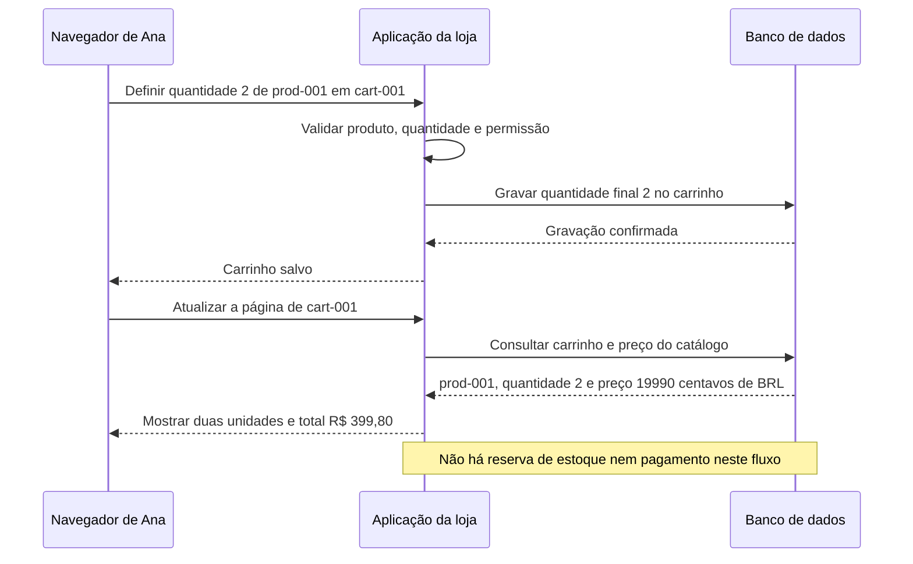
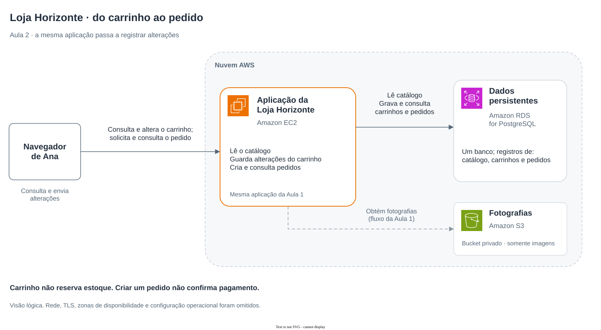

# Aula 2 — Você colocou no carrinho. O que a loja precisa guardar?

[Trilha System Design a partir do zero](../00-system-design-from-zero.md) · [Aula 1 — A consulta ao catálogo](01-from-click-to-catalog.md) · [Cenário da Loja Horizonte](00-scenario.md)

Ana encontrou o fone de ouvido, colocou uma unidade no carrinho e depois mudou a quantidade para duas. Ao atualizar a página, espera encontrar sua escolha. Em seguida, quer criar um pedido. **O que a aplicação precisa guardar em cada momento?**

Na Aula 1, a aplicação consultava informações para apresentar o produto. Agora, ela também recebe alterações e registra escolhas. Ao final, você conseguirá acompanhar essas gravações e explicar a diferença entre um carrinho, um pedido registrado e uma compra paga.

## Roteiro

**Entenda a mudança:** [cena](#cena) → [requisitos e regras](#requisitos) → [conceitos](#conceitos) → [carrinho](#caminho) → [sequência dos pedidos](#mermaid) → [pedido registrado](#pedido).

**Decida e pratique:** [alternativas](#tradeoffs) → [AWS e arquitetura](#aws) → [falha e verificação](#falha) → [perguntas](#perguntas) → [exercício](#exercicio) → [resumo](#resumo).

<a id="cena"></a>
## 1. Ana quer continuar a compra

Continuamos com o mesmo produto da Loja Horizonte:

| Informação | Valor nesta cena |
|---|---|
| Produto | `prod-001` — Fone de ouvido |
| Preço de uma unidade | R$ 199,90 |
| Quantidade escolhida | Duas unidades |
| Total dos produtos | R$ 399,80 |

O preço permanece o mesmo durante esta cena. Essa é uma **premissa didática**, não uma promessa de que os preços de uma loja nunca mudam. Frete, descontos e tributos não entram neste cálculo.

Ana faz três coisas diferentes: consulta o produto, altera uma escolha e solicita o registro de um pedido. Precisamos distinguir esses passos antes de escolher onde guardar os dados.

> A loja, os personagens, os identificadores e os valores são fictícios. Estamos propondo um funcionamento para estudo; não existe uma aplicação de compras implantada ou testada nesta aula.

<a id="requisitos"></a>
## 2. O que precisa funcionar nesta etapa?

Um **requisito** descreve uma necessidade do sistema. Aqui, os comportamentos esperados são:

- Adicionar um produto, consultar o carrinho, alterar sua quantidade e remover um item.
- Recuperar a escolha ao atualizar a página do mesmo carrinho.
- Calcular e apresentar o total dos produtos usando o preço do catálogo.
- Criar um pedido com identificador, itens, valores e situação registrados.
- Informar uma entrada inválida sem apresentar uma gravação como bem-sucedida.

Também queremos duas qualidades: recuperar um carrinho já salvo depois do reinício do **processo da aplicação** e impedir que uma pessoa consulte ou altere o carrinho de outra. Reiniciar o processo significa parar e iniciar novamente o programa da loja; não significa necessariamente desligar a máquina ou apagar seu disco.

As regras escolhidas para esta aula são:

1. A quantidade de cada item precisa ser um número inteiro positivo. Definir duas unidades significa guardar a quantidade final `2`, não acrescentar mais duas a cada envio.
2. Remover um item é uma operação explícita. Neste contrato, quantidade zero ou negativa não substitui essa operação.
3. Um carrinho vazio não pode gerar um pedido.
4. **Adicionar ao carrinho não reserva estoque.**
5. **Criar um pedido não confirma pagamento nem promete disponibilidade do produto.**

As duas últimas regras já fazem parte do [cenário comum](00-scenario.md). Os mecanismos de reserva e pagamento serão desenvolvidos depois. Não devemos apresentá-los como garantias da arquitetura desta aula.

<a id="conceitos"></a>
## 3. Consultar, alterar e guardar

### Leitura e escrita

Uma **leitura** obtém uma informação, como o nome de um produto. Uma **escrita** registra uma mudança, como a quantidade escolhida no carrinho. Mostrar o número `2` na tela não comprova uma gravação persistente.

### Carrinho e pedido

O **carrinho** reúne escolhas que Ana ainda pode alterar. O **pedido**, neste exemplo, registra uma solicitação de compra com os itens e os valores validados naquele momento.

| Registro | O que representa | O que não significa |
|---|---|---|
| Carrinho | A escolha atual de produtos e quantidades | Estoque reservado ou preço definitivamente garantido |
| Pedido registrado | Uma solicitação de compra identificada, pendente das próximas etapas | Produto reservado, pagamento aprovado ou entrega confirmada |

Guardar um pedido permite consultá-lo depois sem depender do conteúdo atual do carrinho. Uma mudança posterior no carrinho não deve reescrever silenciosamente os itens desse pedido.

### Persistência

**Persistir** significa guardar a informação para recuperá-la além da execução atual do programa. Se o carrinho existir somente na memória do processo da aplicação, esse estado desaparece quando o processo termina. Guardá-lo no banco permite que uma nova execução da aplicação o consulte novamente, desde que a gravação tenha sido concluída e o banco esteja acessível.

Isso não torna o banco infalível nem garante disponibilidade da loja. Estamos separando a vida do programa da vida do registro que ele precisa recuperar.

### Como encontrar o mesmo carrinho?

A aplicação precisa atribuir uma referência a cada carrinho. Usaremos `cart-001` para acompanhar o de Ana. É um identificador didático: diferencia um registro de outro.

No exemplo, o endereço `/carts/cart-001` identifica a página desse carrinho. Ao atualizar essa página, o navegador pede novamente o mesmo endereço. Assim, fica explícito **qual registro deve ser consultado**; guardar os dados sem recuperar a referência correta não basta.

**Conhecer o identificador não concede permissão.** A aplicação ainda precisa verificar quem pode consultar ou alterar aquele carrinho. Nesta aula, acompanhamos Ana autorizada no caminho normal, mas não implementamos login nem um mecanismo real de autorização. Esse controle permanece um requisito a construir e verificar. O desenho não prova que Bruno esteja impedido de acessar o registro de Ana.

<a id="caminho"></a>
## 4. Acompanhe a alteração do carrinho

Ao começar um carrinho, a aplicação cria sua referência e a devolve ao navegador. Vamos partir do carrinho `cart-001`, no qual Ana já colocou uma unidade de `prod-001`.

### Ana muda a quantidade para duas

O navegador envia uma instrução à aplicação. Uma representação possível é:

```text
POST /carts/cart-001/items

productId: prod-001
quantity: 2
```

`POST` é um método de HTTP usado para solicitar que a aplicação processe uma instrução. O significado dos campos depende do contrato definido pela loja. Aqui, `quantity: 2` pede para **definir a quantidade final como duas unidades**. A palavra `POST`, sozinha, não valida os dados nem garante que sejam gravados.

A aplicação precisa:

1. Verificar a permissão para alterar o carrinho identificado.
2. Validar que `prod-001` existe no catálogo e que a quantidade recebida é um inteiro positivo.
3. Gravar a quantidade final no carrinho.
4. Receber a confirmação da gravação antes de informar que o carrinho foi salvo.

Uma quantidade negativa deve ser recusada. Uma referência a produto inexistente também precisa de uma resposta apropriada; não devemos inventar um produto para completar o registro.

### O que fica guardado?

Uma representação simplificada do carrinho seria:

```json
{
  "cartId": "cart-001",
  "items": [
    { "productId": "prod-001", "quantity": 2 }
  ]
}
```

Escolhemos guardar a referência ao produto e a quantidade. Para apresentar o carrinho, a aplicação consulta também o catálogo, de onde vêm nome e preço atuais. Essa é uma escolha deste exemplo; outras lojas podem manter mais informações no carrinho.

### Ana atualiza a página

O navegador faz uma consulta:

```text
GET /carts/cart-001
```

Como na Aula 1, `GET` solicita uma leitura. A aplicação verifica o acesso, consulta o carrinho e o catálogo e prepara a página. Não usamos essa consulta para pedir uma alteração na quantidade.

O total dos produtos é calculado na aplicação:

```text
unitPriceMinor = 19990
quantity = 2
itemsTotalMinor = 19990 × 2 = 39980
currency = BRL
```

`Minor` indica a unidade menor da moeda: neste material, usamos centavos inteiros para BRL. Assim, `39980` representa R$ 399,80. Não estamos estabelecendo duas casas decimais como regra para todas as moedas.

O navegador pode mostrar uma estimativa enquanto Ana escolhe, mas a aplicação calcula o valor usado no registro com o preço do catálogo. Ela não deve aceitar como preço autorizado um total alterável enviado pela página.

O carrinho continua sendo uma intenção. Antes de registrar o pedido, os dados precisam ser validados novamente. Se o preço tiver mudado, a regra proposta é apresentar o novo valor e pedir nova confirmação, em vez de trocar silenciosamente o valor que Ana viu. O exemplo numérico acompanha o preço estável declarado no início; a implementação de mudanças concorrentes de preço não é desenvolvida aqui.

<a id="mermaid"></a>
## 5. O caminho da gravação e da consulta

O Mermaid responde a uma pergunta: **como a escolha pode reaparecer depois que Ana atualiza a página?** O desenho acompanha o caminho normal de um carrinho existente. A verificação de permissão é um passo exigido pelo desenho, não uma proteção já implementada.



São duas operações distintas: a primeira registra a escolha; a segunda recupera os dados para apresentar a página. A segunda não depende de o processo ainda se lembrar do carrinho em sua memória.

<a id="pedido"></a>
## 6. Ana escolhe criar o pedido

Agora, Ana quer registrar sua solicitação de compra. A aplicação recebe a referência ao carrinho, verifica o acesso e consulta seus itens. Valida produtos, quantidades e valores antes de criar um registro diferente: o pedido.

Uma representação didática do resultado seria:

```json
{
  "orderId": "order-001",
  "cartId": "cart-001",
  "status": "REGISTRADO",
  "currency": "BRL",
  "items": [
    {
      "productId": "prod-001",
      "name": "Fone de ouvido",
      "quantity": 2,
      "unitPriceMinor": 19990
    }
  ],
  "itemsTotalMinor": 39980
}
```

`REGISTRADO` é o nome escolhido para a situação inicial neste exemplo. Significa que a solicitação foi guardada e está pendente das próximas etapas. Não significa que as unidades estejam reservadas ou que houve cobrança.

O pedido guarda os itens e os valores validados naquele momento. Esse **retrato do pedido** permite recuperar sua composição mesmo que o carrinho seja alterado depois. Alterações posteriores de um pedido exigiriam uma regra própria; não seriam uma consequência automática de editar o carrinho.

### Pedido e itens precisam formar um registro completo

Se a implementação guardar o pedido e seus itens em registros separados, uma falha no meio não deve deixar um pedido apresentado como completo sem os itens correspondentes.

No PostgreSQL, podemos agrupar essas gravações em uma **transação**: um conjunto de passos que confirma tudo junto ou descarta as mudanças desse conjunto. A aplicação só deve anunciar o pedido registrado depois da confirmação. Essa é a propriedade necessária aqui; os detalhes de transações são um aprofundamento em [bancos, transações e consistência](../../01-fundamentals/06-databases-transactions-consistency.md).

Essa transação fica dentro do banco. Não engloba a fotografia no S3, uma reserva de estoque ainda não desenhada nem um provedor de pagamento. Também não impede, por si só, que dois envios criem dois pedidos. Acompanhamos **uma tentativa de criação**; reconhecer tentativas repetidas e lidar com uma resposta perdida exige uma regra adicional, que esta aula não implementa.

<a id="tradeoffs"></a>
## 7. Onde guardar o carrinho?

Antes de nomear os serviços, compare três alternativas. O requisito é recuperar a escolha após atualizar a página e após reiniciar o processo da aplicação, mantendo a referência ao mesmo carrinho.

| Alternativa | O que favorece | Limite que precisamos considerar |
|---|---|---|
| Armazenamento no navegador | Pode recuperar escolhas nesse navegador, se a persistência local for implementada | Os dados podem ser removidos ou alterados; não representam um registro autorizado de pedido e não ficam automaticamente disponíveis em outro navegador |
| Apenas memória do processo da aplicação | Mantém o estado enquanto aquele processo está executando | O estado se perde ao encerrar o processo; não atende ao requisito de recuperação após reinício |
| Banco de dados | Separa o registro do carrinho da execução atual da aplicação | Exige operações de leitura e escrita, identificação do carrinho, controle de acesso e tratamento de falhas no banco |

Guardar no navegador não significa necessariamente perder tudo ao atualizar a página. Depende de onde e como o navegador guarda os dados. O motivo da nossa escolha é o requisito completo, não uma limitação inventada das outras opções.

**Escolha:** guardar carrinhos e pedidos no banco já usado pelo catálogo, reunindo os registros consultados pela aplicação. É uma decisão desta etapa didática, não a única solução possível para persistir um carrinho.

**Ganho e limite:** a aplicação pode recuperar esses registros depois de reiniciar, mas passa a depender do banco para as operações correspondentes. O armazenamento, sozinho, não implementa validação de preço, permissão ou recuperação de qualquer falha.

**Quando reconsiderar:** uma nova exigência sobre volume, tempo de resposta, uso sem conexão ou acesso por vários dispositivos pode mudar a decisão. Precisaríamos descrever e medir essa necessidade antes de acrescentar componentes.

<a id="aws"></a>
## 8. Como isso poderia funcionar na AWS?

Podemos evoluir a mesma implementação da Aula 1:

- **Amazon EC2:** continua fornecendo a máquina virtual onde o programa da loja executa. A aplicação ganha operações para validar, gravar e consultar carrinhos e pedidos.
- **Amazon RDS for PostgreSQL:** continua sendo o banco relacional gerenciado do exemplo. Além do catálogo, recebe registros de carrinhos e pedidos. A aplicação e o modelo de dados precisam definir como relacioná-los e como usar as transações necessárias.
- **Amazon S3:** continua guardando as fotografias em um bucket privado, lidas pela aplicação. Não ganha a responsabilidade de decidir quantidades, preços ou situações de pedidos.

Os serviços são os mesmos; o comportamento e o modelo de dados evoluíram porque surgiu uma necessidade de escrita. Um banco gerenciado não cria as regras da Loja Horizonte automaticamente.

<a id="arquitetura"></a>
### A arquitetura da nova etapa

O desenho responde a outra pergunta: **quais componentes executam a lógica e guardam cada tipo de informação?** Ele reúne catálogo, carrinhos e pedidos no mesmo banco deste exemplo; o caminho das fotografias permanece o da Aula 1.



[Abrir o diagrama editável no Draw.io](assets/02-cart-order-aws.drawio).

> Esta é uma visão lógica proposta. Rede, autenticação, autorização, backups e recuperação operacional não estão implementados pelo desenho. O agrupamento AWS não representa uma rede nem uma sub-rede.

<a id="falha"></a>
## 9. A aplicação reiniciou e o carrinho desapareceu

Imagine uma primeira versão que guardava o carrinho **somente na memória do processo da aplicação**. Ana viu duas unidades na tela. Depois, o programa foi encerrado e iniciado novamente, e a página mostrou um carrinho vazio.

Nesse cenário, o processo novo não recebe automaticamente a memória do processo anterior. Por isso, informar “carrinho salvo” quando houve apenas uma alteração nessa memória não atende ao requisito de recuperação após reinício.

Não estamos afirmando que reiniciar um processo apaga o disco da EC2 ou o banco. O ponto é que **aquele estado nunca foi persistido fora da memória do processo**.

Se o desenho proposto usa banco, mas o carrinho também desaparece, precisamos investigar antes de escolher uma causa:

| O que verificar | O que a evidência ajuda a distinguir |
|---|---|
| A gravação de `cart-001` foi confirmada? | Alteração somente na tela ou memória, falha de escrita ou registro efetivamente persistido |
| A consulta posterior usa o mesmo identificador? | Dados ausentes ou tentativa de abrir outro carrinho |
| A aplicação está consultando o banco e o ambiente esperados? | Problema no registro ou no caminho usado para recuperá-lo |
| Os dados foram lidos, mas não apareceram na página? | Falha de armazenamento ou de montagem da resposta |

Um carrinho vazio na tela não prova que todo o banco perdeu os dados. Se a recuperação falhar, a página deve informar o problema, sem apresentar um carrinho vazio como se tivesse confirmado que não existem itens.

### Como verificar a proposta?

Os testes abaixo descrevem o que executaríamos em uma aplicação da loja; **não foram executados aqui**.

| Teste proposto | Resultado esperado |
|---|---|
| Guardar duas unidades e atualizar `/carts/cart-001` | Recuperar duas unidades e calcular R$ 399,80 com o preço desta cena |
| Reiniciar somente o processo depois da gravação confirmada | Recuperar o registro persistido do mesmo carrinho |
| Enviar quantidade negativa | Recusar a entrada sem substituir a escolha anterior por um valor inválido |
| Alterar um total enviado pelo navegador | Calcular o valor autorizado com o catálogo, sem aceitar esse total como preço da loja |
| Tentar acessar o carrinho de outra pessoa | Recusar o acesso; o mecanismo de identificação e autorização ainda precisa ser implementado e testado |
| Interromper a gravação de pedido e itens antes da confirmação | Não apresentar como concluído um pedido parcialmente registrado |
| Editar o carrinho depois de criar `order-001` | Preservar os itens e os valores daquele pedido |

Esses resultados são critérios da proposta. O material de estudo renderizado corretamente não comprova que uma loja real atende a eles.

<a id="perguntas"></a>
## 10. Verifique seu entendimento

Responda em voz alta antes de abrir cada resposta.

### 1. Mudar o número na tela é o mesmo que salvar?

Ana vê duas unidades depois de tocar em um botão. O que ainda falta saber antes de afirmar que a escolha foi persistida?

**Pergunta extra:** uma leitura posterior precisa buscar qual carrinho?

<details>
<summary><strong>Resposta comentada: tela e registro persistido</strong></summary>

É preciso verificar se a aplicação recebeu e validou a alteração, concluiu a gravação e consegue recuperar o registro. Alterar a apresentação não comprova uma escrita no banco.

A consulta precisa usar a referência ao mesmo carrinho, `cart-001`. Persistir os itens e depois consultar outro identificador não demonstra perda dos dados.

**Confira sua resposta:** você separou a apresentação, a gravação e a recuperação do mesmo registro?

</details>

### 2. Por que a memória da aplicação não atende ao requisito?

O requisito inclui recuperar o carrinho depois de encerrar e iniciar novamente o processo. Por que mantê-lo somente na memória desse processo não basta?

**Pergunta extra:** guardar no navegador também significa perder tudo a cada atualização da página?

<details>
<summary><strong>Resposta comentada: vida do processo e persistência</strong></summary>

Ao encerrar o processo, seu estado em memória não é automaticamente transferido para a próxima execução. A aplicação precisa recuperar a escolha de um armazenamento apropriado e manter a referência ao carrinho.

Um navegador pode persistir dados localmente e recuperá-los após atualizar a página. Isso exige implementação e tem limites próprios. Nesta etapa, aproveitamos o banco já usado pelo catálogo para reunir os registros consultados pela aplicação, sem afirmar que toda alternativa perde dados no refresh ou necessariamente falha nesses requisitos.

**Confira sua resposta:** você explicou o mecanismo e o requisito, em vez de declarar uma tecnologia sempre superior?

</details>

### 3. De onde vem o total de R$ 399,80?

Quais informações a aplicação usa para obter esse valor? Um campo de total enviado pelo navegador é suficiente?

**Pergunta extra:** `19990` significa R$ 19.990,00 neste material?

<details>
<summary><strong>Resposta comentada: preço do catálogo e quantidade validada</strong></summary>

A aplicação usa o preço autorizado do catálogo, `19990` centavos de BRL, e a quantidade validada `2`: o resultado é `39980` centavos, ou R$ 399,80. O valor enviado pela página pode ser alterado e não substitui esse cálculo autorizado.

Neste cenário, `19990` representa R$ 199,90. A convenção de centavos inteiros foi escolhida para BRL; não define a subdivisão de todas as moedas.

**Confira sua resposta:** você identificou a origem do preço, a unidade e o papel da validação?

</details>

### 4. Saber o endereço do carrinho permite alterá-lo?

Bruno conhece `/carts/cart-001`. Esse endereço, sozinho, autoriza uma alteração no carrinho de Ana?

**Pergunta extra:** desenhar uma verificação de permissão comprova que ela funciona?

<details>
<summary><strong>Resposta comentada: referência não é permissão</strong></summary>

O endereço identifica o recurso. A aplicação ainda precisa verificar quem está fazendo a solicitação e se essa pessoa pode acessar aquele carrinho. Um identificador difícil de adivinhar também não substitui essa verificação.

O diagrama mostra um controle exigido. A identificação e a autorização reais não foram implementadas ou testadas nesta aula.

**Confira sua resposta:** você distinguiu encontrar um registro de ter permissão para usá-lo?

</details>

### 5. O que muda ao criar o pedido?

Depois de criar `order-001`, Ana altera a quantidade no carrinho. Os itens daquele pedido devem mudar automaticamente?

**Pergunta extra:** `REGISTRADO` significa que houve reserva ou pagamento?

<details>
<summary><strong>Resposta comentada: carrinho e pedido são registros distintos</strong></summary>

O pedido guarda os itens e os valores validados no momento de seu registro. Editar o carrinho não deve reescrever silenciosamente esse retrato. Alterar um pedido exigiria uma regra própria.

`REGISTRADO` significa que a solicitação foi guardada e está pendente das etapas seguintes. Não confirma estoque reservado, pagamento ou entrega.

**Confira sua resposta:** você separou a escolha editável da solicitação registrada e das etapas ainda não realizadas?

</details>

### 6. Uma transação no banco resolve toda a compra?

Qual problema resolvemos agrupando a gravação do pedido e de seus itens em uma transação?

**Pergunta extra:** isso também impede que duas solicitações criem dois pedidos ou confirma um pagamento externo?

<details>
<summary><strong>Resposta comentada: limite da transação local</strong></summary>

Agrupar as gravações permite confirmar o conjunto ou descartar suas mudanças, evitando apresentar como completo um pedido parcialmente registrado no banco.

Isso não transforma duas solicitações em uma única tentativa e não inclui uma operação de pagamento externo, o S3 ou uma reserva ainda não desenhada. Repetição e resposta perdida exigem regras adicionais.

**Confira sua resposta:** você explicou a garantia local sem estendê-la a outros participantes ou tentativas?

</details>

<a id="exercicio"></a>
## 11. Aplique o que aprendeu

### Parte A — Recuperar a escolha

Ana definiu duas unidades, recebeu a confirmação de gravação e está na página `/carts/cart-001`. O processo da aplicação foi reiniciado; o banco permaneceu acessível e o registro não foi alterado.

1. Qual registro a nova execução precisa consultar?
2. De onde vêm o preço e a quantidade usados para apresentar a página?
3. Qual total dos produtos esperamos nesta cena?
4. O que você investigaria se a página mostrasse um carrinho vazio?

### Parte B — Remover um item e preservar um pedido

Ana já criou `order-001` com duas unidades. Depois, remove `prod-001` de `cart-001`, que não tinha outros itens.

1. O que muda no carrinho?
2. O pedido anterior deve perder seus itens ou mudar o total automaticamente?
3. Ana pode criar outro pedido a partir desse carrinho vazio, pelas regras desta aula?
4. O primeiro pedido permite afirmar que o estoque foi reservado ou que Ana pagou?

<details>
<summary><strong>Solução comentada: recuperar, remover e preservar os registros</strong></summary>

**Parte A**

A aplicação precisa consultar `cart-001`, depois de verificar o acesso. O carrinho fornece `prod-001` e a quantidade `2`; o catálogo fornece o preço `19990` em BRL. Com a premissa de preço estável, o total dos produtos é `39980` centavos, R$ 399,80.

Se a tela vier vazia, procure a evidência da gravação, confira se o identificador e o banco consultados são os esperados e examine o caminho até a apresentação. O reinício do processo não comprova que o registro tenha desaparecido do banco. Nesta parte do exercício, dissemos explicitamente que o registro permanece lá.

**Parte B**

A operação de remoção deixa o carrinho sem itens. A aplicação deve gravar essa mudança, sem usar quantidade negativa ou zero como substituto da operação definida no contrato.

O pedido `order-001` permanece com os itens e os valores registrados: duas unidades e total dos produtos de R$ 399,80. Uma mudança nesse pedido precisaria de uma regra própria. Pelas regras desta aula, o carrinho vazio não pode gerar outro pedido.

Nada disso confirma reserva ou pagamento do pedido anterior. Ele continua registrado e pendente das próximas etapas.

**Confira sua solução:** você recuperou a referência correta, explicou a origem dos valores e manteve separadas as mudanças do carrinho, o registro do pedido e a execução da compra?

</details>

<a id="resumo"></a>
## 12. O que você deve levar desta aula

**O carrinho guarda a escolha atual; o pedido registra uma solicitação validada. A aplicação precisa confirmar a gravação e conseguir recuperar o registro correto.**

- [ ] Distingo uma mudança na tela de uma escrita persistida.
- [ ] Explico como a referência permite consultar novamente o mesmo carrinho.
- [ ] Sei por que essa referência não substitui a permissão de acesso.
- [ ] Calculo o total dos produtos com quantidade validada, preço do catálogo e moeda explícita.
- [ ] Separo carrinho, pedido registrado, reserva e pagamento.
- [ ] Explico o limite de uma transação local, sem prometer impedir toda repetição.
- [ ] Investigo uma falha de recuperação usando evidências.
- [ ] Sei quais comportamentos ainda precisam ser implementados e testados.

**Continue na [Aula 3 — A loja cresceu. Como Ana continua no mesmo carrinho?](03-scaling-and-session.md):** escala e sessão para manter a continuidade entre os acessos. Você pode voltar ao [índice da trilha](../00-system-design-from-zero.md) para rever o percurso.
