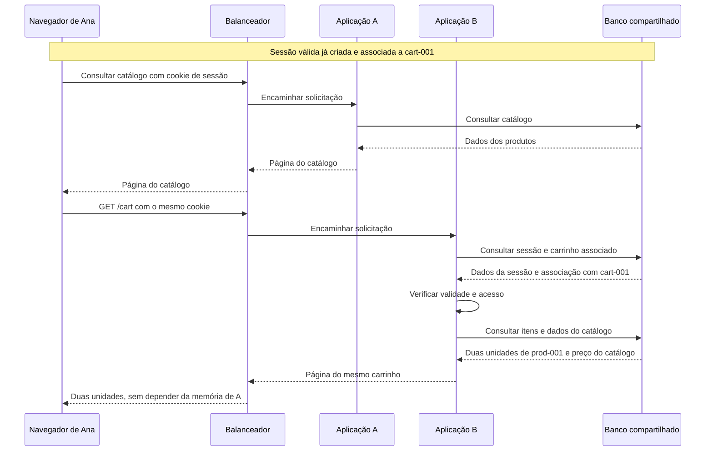
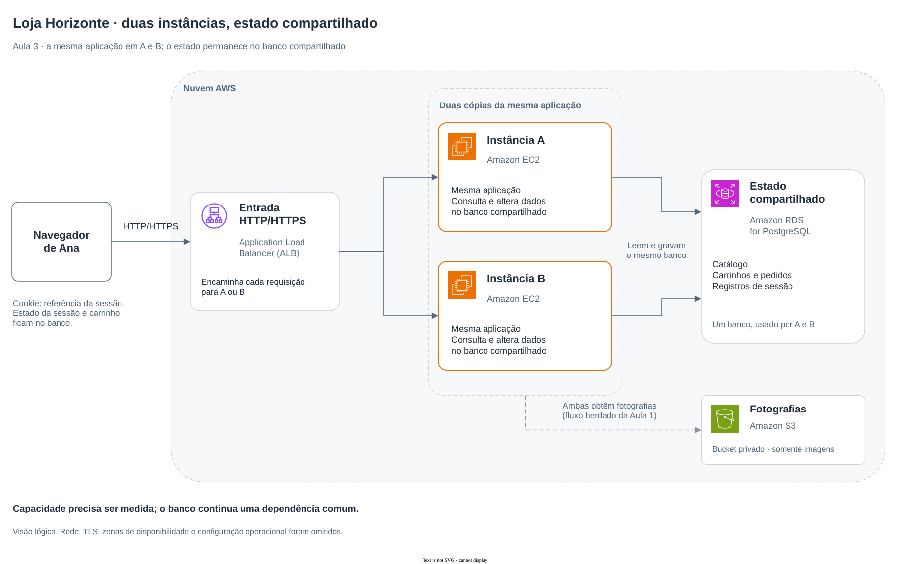

# Aula 3 — A loja cresceu. Como Ana continua no mesmo carrinho?

[Trilha System Design a partir do zero](../00-system-design-from-zero.md) · [Aula 2 — Do carrinho ao pedido](02-from-cart-to-order.md) · [Cenário da Loja Horizonte](00-scenario.md)

Ana colocou duas unidades do fone de ouvido no carrinho. A loja passa a receber mais visitas e a equipe considera executar uma segunda cópia da aplicação. Ana volta ao catálogo e escolhe “Meu carrinho”. **Como recuperar a mesma escolha quando outra cópia recebe a solicitação?**

Nesta aula, você vai separar dois problemas: aumentar a capacidade de atendimento e manter a continuidade entre os acessos. Vai acompanhar o papel de um balanceador, de um cookie e de uma sessão, sem confundir nenhum deles com os itens guardados no carrinho.

## Roteiro

**Entenda a necessidade:** [cena](#cena) → [requisitos](#requisitos) → [escala e balanceamento](#escala) → [sessão e cookie](#sessao) → [fluxo normal](#caminho) → [Mermaid](#mermaid).

**Decida e pratique:** [alternativas](#tradeoffs) → [AWS e arquitetura](#aws) → [falha e verificação](#falha) → [perguntas](#perguntas) → [exercício](#exercicio) → [resumo](#resumo).

<a id="cena"></a>
## 1. Mais visitas, duas cópias da aplicação

Na Aula 2, escolhemos persistir carrinhos e pedidos no banco. Vamos manter essa decisão: `cart-001` contém duas unidades de `prod-001`, o Fone de ouvido. O carrinho não voltou a ser um dado guardado somente na memória da aplicação.

Agora a equipe quer avaliar o atendimento de mais solicitações. Para estudar uma possível evolução, vamos assumir que um teste com carga maior identificou um limite na capacidade da aplicação, enquanto o banco ainda tinha capacidade para aquela carga. Essa é uma **hipótese do cenário**, não uma medição realizada.

A proposta é executar duas cópias da mesma aplicação, chamadas **A** e **B**, e distribuir as solicitações entre elas. Não são dois sistemas diferentes: ambas precisam entender as mesmas operações e consultar os registros corretos.

Ana já passou por A. Ao escolher “Meu carrinho”, sua próxima solicitação pode chegar a B. Além disso, ela não quer digitar `/carts/cart-001` toda vez que volta ao catálogo. Precisamos explicar como a aplicação encontra a continuidade dessa navegação.

> A arquitetura, os personagens e as situações são fictícios. Não foram executados testes de carga ou falha de uma loja real, nem provisionados os serviços mostrados nesta aula.

<a id="requisitos"></a>
## 2. O que precisa continuar funcionando?

Os comportamentos esperados são:

- Receber as solicitações por um mesmo ponto de entrada e encaminhá-las a uma das cópias da aplicação.
- Recuperar o mesmo carrinho com uma sessão válida, mesmo quando a solicitação chega a outra cópia.
- Abrir “Meu carrinho” sem depender de um identificador de carrinho digitado pela pessoa.
- Verificar, no servidor, a validade da sessão e qual carrinho ela pode acessar.
- Distinguir uma sessão expirada de um carrinho confirmado como vazio.

Queremos também reduzir a dependência de uma única cópia da aplicação. Isso não elimina todos os pontos de falha: o banco continua compartilhado e uma solicitação em andamento pode falhar.

Antes de afirmar que a capacidade aumentou, seria necessário comparar uma e duas cópias com as mesmas operações e condições, medindo a carga enviada, os tempos de resposta, os erros e o uso dos recursos. Não definimos aqui uma capacidade comprovada nem presumimos que duas cópias atendam ao dobro da carga.

As regras das aulas anteriores permanecem: o carrinho não reserva estoque e um pedido registrado não confirma pagamento. Também continua valendo que conhecer `cart-001` não concede permissão para acessar seus itens.

<a id="escala"></a>
## 3. Aumentar a máquina ou aumentar o número de cópias?

**Capacidade** é o trabalho que o sistema consegue atender nas condições avaliadas. Aumentá-la exige entender onde está o limite: mais aplicação não corrige automaticamente uma consulta lenta ou um banco sobrecarregado.

Há duas possibilidades comuns:

- **Escala vertical:** usar uma máquina com mais recursos, como memória e capacidade de processamento.
- **Escala horizontal:** executar mais cópias da aplicação e distribuir trabalho entre elas.

Nesta etapa, vamos estudar a segunda opção. Ela exige que uma cópia consiga atender sem depender de dados que só existem na memória de outra.

### Quem escolhe a cópia que recebe a solicitação?

Um **balanceador de carga** recebe as solicitações e as encaminha aos destinos configurados. Aqui, esses destinos são A e B. O navegador usa o ponto de entrada da loja; não precisa escolher uma instância por conta própria.

Uma solicitação pode chegar a A e outra a B. Isso é uma possibilidade do fluxo, não uma promessa de alternância rigorosa. A distribuição depende das regras e das condições do balanceador.

O balanceador não guarda o carrinho nem decide, por conhecer um endereço, quem pode acessá-lo. Essas responsabilidades continuam na aplicação e nos seus registros.

### Onde fica o estado de cada visita?

**Estado** é a informação necessária para continuar uma operação ou interação. Os itens do carrinho são um tipo de estado. A associação entre uma visita e seu carrinho é outro.

Imagine que A saiba, apenas em sua memória, qual carrinho pertence àquela visita. B recebe a próxima solicitação, mas não tem essa associação. Os itens podem continuar perfeitamente guardados no banco, enquanto B não sabe qual registro deve consultar.

Portanto, persistir o carrinho e compartilhar a continuidade da visita são decisões relacionadas, mas diferentes.

<a id="sessao"></a>
## 4. Cookie, sessão e carrinho são coisas distintas

Na Aula 2, o endereço `/carts/cart-001` já indicava qual carrinho consultar. Não precisamos inventar uma sessão como requisito obrigatório para ler um endereço que já contém essa referência.

A necessidade nova é outra: Ana abre o catálogo e escolhe **“Meu carrinho”**, sem informar seu identificador na URL. Uma possibilidade é usar uma sessão.

Uma **sessão** representa a continuidade de uma interação entre o navegador e a aplicação. Neste exemplo, seu registro permite relacionar uma referência recebida do navegador ao carrinho correspondente.

Um **cookie** é um pequeno dado que o navegador pode guardar a partir de uma resposta do servidor e enviar nas solicitações seguintes, conforme suas regras. Vamos usá-lo para carregar uma referência opaca à sessão: **opaca** significa que o valor não contém o nome de Ana, os produtos ou o preço.

| Elemento | Papel nesta proposta | Onde fica |
|---|---|---|
| Cookie de sessão | Levar uma referência para a aplicação reconhecer a continuidade | No navegador, enviada nas solicitações aplicáveis |
| Registro da sessão | Associar a referência a `cart-001` e indicar sua validade | Armazenamento compartilhado, acessível a A e B |
| Carrinho | Guardar os produtos e as quantidades escolhidas | Banco de dados, como na Aula 2 |

O cookie não contém uma cópia do carrinho. A e B consultam a associação no servidor e, depois, os itens no banco.

### Como essa associação começa?

Para uma nova visita anônima, a aplicação pode criar uma sessão e um novo carrinho associados e devolver a referência ao navegador. Depois, Ana adiciona os itens como na Aula 2. Nesta cena, chamamos esse carrinho de `cart-001` e acompanhamos sua sessão ainda válida.

Isso não autoriza vincular qualquer carrinho antigo a uma sessão nova só porque alguém conhece seu identificador. Recuperar um carrinho preexistente por outro vínculo exigiria um fluxo legítimo de verificação, que não está desenhado aqui.

Uma representação didática do cabeçalho enviado pela aplicação seria:

```text
Set-Cookie: horizonte_session=VALOR_OPACO_FICTICIO; Path=/; Secure; HttpOnly; SameSite=Lax
```

`Set-Cookie` pede ao navegador que guarde o cookie. `VALOR_OPACO_FICTICIO` é apenas um marcador legível para acompanhar a explicação: **não é um valor de sessão adequado para uma implementação real**. Uma implementação deve usar a geração e a validação seguras de um mecanismo de sessão apropriado, com referências imprevisíveis.

Nesse cabeçalho, `Secure` restringe o envio a conexões HTTPS; `HttpOnly` impede a leitura do cookie por JavaScript da página; `SameSite=Lax` limita em quais situações entre sites ele é enviado. Esses controles ajudam a proteger o cookie, mas não substituem todos os controles de segurança ou a verificação de acesso no servidor.

A aplicação também precisa controlar a expiração e o encerramento da sessão no servidor. Ter um cookie armazenado não prova que a sessão continue válida.

### Uma sessão anônima não é um login

Chamamos a personagem de Ana para acompanhar a história. Isso não significa que o sistema verificou a identidade dessa pessoa. Uma sessão pode existir antes de qualquer login.

Nesta proposta, possuir a referência válida permite usar o escopo associado àquela sessão anônima. Por isso, ela precisa ser protegida. A aplicação verifica a sessão e resolve o carrinho autorizado pela associação guardada no servidor; não aceita um identificador arbitrário como permissão para abrir outro carrinho.

Login e recuperação entre dispositivos exigiriam outras regras. Não estamos construindo um sistema completo de autenticação nesta aula.

<a id="caminho"></a>
## 5. Ana volta ao catálogo e escolhe “Meu carrinho”

Vamos acompanhar uma sessão já criada, válida e associada a `cart-001`.

1. O navegador solicita o catálogo pelo ponto de entrada da loja, enviando o cookie aplicável.
2. O balanceador encaminha essa solicitação a A, que prepara a resposta.
3. Ana escolhe “Meu carrinho”. O navegador envia outra solicitação com a mesma referência de sessão.
4. O balanceador pode encaminhá-la a B.
5. B valida a sessão no armazenamento compartilhado e obtém a associação com `cart-001`.
6. B consulta os itens desse carrinho e os dados necessários do catálogo, calcula os valores como na Aula 2 e prepara a página.

A nova consulta poderia ser representada assim:

```text
GET /cart
Cookie: horizonte_session=VALOR_OPACO_FICTICIO
```

`/cart` representa “o carrinho associado à sessão válida desta solicitação”. O servidor resolve qual é esse carrinho. A referência de sessão não aparece na URL, e o navegador não informa um total autorizado nem ganha acesso a qualquer carrinho que escolher.

Se a sessão for desconhecida, encerrada ou expirada, o fluxo normal deve parar. A aplicação não deve selecionar um carrinho arbitrário nem apresentar uma falha de reconhecimento como prova de que os itens desapareceram.

A e B precisam usar a mesma configuração necessária para reconhecer a sessão e consultar os registros compartilhados. Instalar duas cópias do programa sem configurar seus acessos não cria esse comportamento automaticamente.

<a id="mermaid"></a>
## 6. Duas solicitações, a mesma continuidade

O Mermaid responde à pergunta: **como B encontra o carrinho depois de A ter atendido outra solicitação da mesma visita?** A primeira solicitação ir a A e a segunda a B é um caminho possível, escolhido para explicar o problema.



O balanceador encaminha mensagens; a aplicação interpreta a referência de sessão. O banco contém tanto a associação quanto os dados do carrinho, em registros com responsabilidades distintas.

<a id="tradeoffs"></a>
## 7. Por que escolher esse desenho?

### Uma máquina maior ou mais cópias?

**Escolha:** estudar duas cópias da mesma aplicação, com um balanceador.

**Ganho e limite:** podemos distribuir trabalho e reduzir a dependência de uma única cópia. Em troca, precisamos configurar e operar os destinos, compartilhar o estado necessário e medir o efeito sobre as dependências. Não demonstramos ganho de desempenho ou menor custo apenas acrescentando caixas.

**Quando reconsiderar:** se o limite estiver no banco, em uma consulta ou em outro recurso, aumentar a aplicação pode não resolver. Uma máquina maior também pode ser uma alternativa válida, com seus próprios limites de capacidade, custo e operação.

### Manter a visita na mesma cópia ou compartilhar a sessão?

**Escolha:** permitir que A ou B reconheça a sessão usando registros compartilhados.

**Ganho e limite:** o funcionamento não exige que a próxima solicitação chegue à mesma cópia. Guardar o vínculo apenas na memória de A e tentar manter a visita sempre em A cria dependência daquela cópia; não resolve o atendimento por B quando A deixa de estar disponível.

**Quando reconsiderar:** algumas aplicações podem aceitar afinidade com uma instância, isto é, tentar enviar uma visita à mesma cópia. Seria preciso justificar essa escolha e o comportamento ao perder a afinidade. Ela não substitui a persistência do carrinho nem torna a memória local acessível a B.

### Onde guardar a sessão compartilhada?

**Escolha:** começar com registros de sessão no banco já usado pela loja, junto dos outros tipos de registro, sem misturar suas finalidades.

**Ganho e limite:** aproveitamos uma dependência existente e tornamos o vínculo consultável pelas duas cópias. Porém, consultas e atualizações de sessão também consomem recursos do banco; validade, encerramento e controle de acesso precisam ser implementados.

**Quando reconsiderar:** uma necessidade demonstrada de tempo de resposta, volume, custo ou disponibilidade pode justificar outro armazenamento. Essa avaliação exige medir o comportamento e reconhecer a nova dependência que seria criada.

<a id="aws"></a>
## 8. Uma implementação possível na AWS

Podemos evoluir a implementação das aulas anteriores:

- **Application Load Balancer, ou ALB:** recebe o tráfego HTTP/HTTPS da loja e encaminha solicitações aos destinos configurados. Ele não cria a aplicação nem seus registros de sessão.
- **Amazon EC2:** agora há duas instâncias com cópias da mesma aplicação, A e B. Ambas precisam estar configuradas para acessar os mesmos registros e aplicar as mesmas regras.
- **Amazon RDS for PostgreSQL:** mantém catálogo, carrinhos e pedidos. Nesta proposta, também guarda os registros de sessão compartilhados. Isso não transforma sessão e carrinho em uma única informação.
- **Amazon S3:** mantém o papel das aulas anteriores, guardando fotografias em um bucket privado e fornecendo os objetos à aplicação autorizada.

A configuração da AWS exige decisões de rede, conexões protegidas, permissões e operação. O diagrama lógico não realiza essa configuração.

<a id="arquitetura"></a>
### Onde cada responsabilidade fica?

O Draw.io responde a uma pergunta diferente da sequência: **quais componentes recebem as solicitações e onde fica o estado que as duas cópias precisam consultar?**



[Abrir o diagrama editável no Draw.io](assets/03-scaling-session-aws.drawio).

> Esta é uma visão lógica proposta. Não representa sub-redes ou zonas de disponibilidade e não implementa alta disponibilidade do banco, autenticação completa ou aumento automático do número de instâncias.

<a id="falha"></a>
## 9. A deixa de responder. O que acontece com a visita?

Considere que a sessão continua válida, o banco está acessível e A deixa de responder. B está configurada corretamente e permanece disponível.

Se B receber uma nova consulta com o cookie válido, poderá recuperar a associação e consultar `cart-001`. Não precisa copiar a memória de A para obter esse vínculo, porque ele já está no armazenamento compartilhado.

### Como o balanceador percebe um destino com problema?

Um **health check**, ou verificação de saúde, é uma consulta periódica usada pelo balanceador para avaliar os destinos segundo os critérios configurados. Não é uma garantia de que toda operação da loja funcione corretamente.

O ALB usa intervalos e critérios para considerar um destino saudável ou não. Portanto, a mudança de encaminhamento não é instantânea. Solicitações que já estavam em andamento em A podem falhar; o balanceador não recupera automaticamente o resultado de uma operação interrompida.

Também existe uma condição importante: se todos os destinos registrados estiverem considerados não saudáveis, o ALB pode continuar encaminhando solicitações a eles. Não devemos apresentar a verificação de saúde como um bloqueio absoluto contra qualquer destino com problema.

Se uma alteração estava em andamento e a resposta se perdeu, será necessário verificar o estado e a regra de repetição apropriada. Duas instâncias e um balanceador não resolvem, sozinhos, tentativas repetidas de criação de pedido.

### Sessão expirada não significa carrinho apagado

Se o cookie está ausente ou a sessão expirou no servidor, B pode não ter um vínculo válido para continuar aquela visita. Os itens do carrinho ainda podem estar persistidos.

A aplicação deve tratar essa condição sem revelar registros de outra sessão. Criar uma nova sessão anônima não devolve automaticamente acesso ao carrinho antigo; uma recuperação legítima precisaria de uma regra adicional, por exemplo associada a uma identidade verificada. Essa recuperação não está implementada aqui.

| Sintoma | O que investigar |
|---|---|
| Funciona em A, mas B não reconhece a visita | Cookie recebido, validade da sessão, configuração das duas cópias e acesso ao mesmo armazenamento |
| A consulta falha logo após A parar | Requisição em andamento, critérios e tempo de detecção do balanceador, estado de B |
| Sessão não é mais aceita | Expiração ou encerramento no servidor e regras do cookie; não presumir exclusão dos itens |
| A e B falham ao consultar carrinhos | Dependências compartilhadas, acesso ao banco e erros da aplicação; mais cópias não eliminam um problema comum |

### Como verificar a proposta?

Os testes abaixo são critérios para uma futura aplicação da loja. Não foram executados como testes de uma infraestrutura AWS.

| Teste proposto | O que observar |
|---|---|
| Atender a mesma sessão por A e depois por B | Ambas recuperam o vínculo com `cart-001` e apresentam os mesmos itens persistidos |
| Consultar com uma referência de sessão desconhecida ou expirada | Não obter acesso ao carrinho anterior nem a outro registro arbitrário |
| Encerrar A com B e banco disponíveis | Observar erros durante a transição e novas consultas atendidas por B, sem prometer continuidade de cada requisição |
| Tornar o banco inacessível para as duas cópias | Reconhecer a dependência compartilhada e informar a falha sem inventar um carrinho vazio |
| Comparar uma e duas cópias sob condições equivalentes | Medir carga, tempos e erros; verificar se o limite da aplicação mudou ou se outra dependência passou a limitar o atendimento |

<a id="perguntas"></a>
## 10. Verifique seu entendimento

Responda em voz alta antes de abrir cada resposta.

### 1. Duas instâncias significam o dobro da capacidade?

O que precisaríamos verificar antes de afirmar que A e B atendem ao dobro da carga de uma única instância?

**Pergunta extra:** se o banco já fosse o limite, acrescentar uma aplicação resolveria necessariamente?

<details>
<summary><strong>Resposta comentada: capacidade precisa de evidência</strong></summary>

Precisamos comparar as configurações com operações e condições equivalentes, medindo a carga enviada, os tempos, os erros e o uso dos recursos. Distribuir solicitações é uma decisão; o ganho resultante precisa ser medido.

Se o banco já limita o atendimento, mais aplicações podem não ajudar e podem até aumentar a pressão sobre ele. A hipótese da cena é que o limite inicial estava na aplicação, mas isso não foi medido em uma loja real.

**Confira sua resposta:** você ligou a mudança ao limite observado, em vez de contar instâncias como prova de capacidade?

</details>

### 2. O balanceador sabe qual é o carrinho de Ana?

Qual é o papel do balanceador e quem resolve a referência de sessão para encontrar o carrinho?

**Pergunta extra:** a solicitação seguinte é obrigada a ir para B depois de uma solicitação atendida por A?

<details>
<summary><strong>Resposta comentada: encaminhar e interpretar são responsabilidades distintas</strong></summary>

O balanceador recebe e encaminha solicitações aos destinos configurados. A aplicação valida a sessão e consulta a associação com o carrinho no servidor.

A depois B é um caminho possível, escolhido para o exemplo. A distribuição não promete essa alternância rígida por pessoa; depende das regras e das condições do balanceador.

**Confira sua resposta:** você separou a escolha do destino das regras e dos registros da loja?

</details>

### 3. O que o cookie guarda neste desenho?

O navegador carrega todos os produtos do carrinho dentro de `horizonte_session`?

**Pergunta extra:** uma sessão anônima válida prova que o sistema verificou a identidade da pessoa chamada Ana?

<details>
<summary><strong>Resposta comentada: referência de sessão e dados da compra</strong></summary>

Neste desenho, o cookie carrega uma referência opaca. O registro no servidor associa a sessão válida ao carrinho, e os itens ficam no banco.

Uma sessão anônima não é um login. A referência válida permite o escopo associado àquela interação e precisa ser protegida, mas não comprova a identidade formal da personagem. A aplicação continua responsável por verificar validade e acesso.

**Confira sua resposta:** você distinguiu referência, registro de sessão, itens e identidade?

</details>

### 4. Por que B não pode depender da memória de A?

Os itens estão no banco, mas somente A guarda a associação entre a visita e `cart-001`. O que pode falhar quando B recebe “Meu carrinho”?

**Pergunta extra:** tentar manter todas as solicitações em A torna essa associação acessível a B quando A para?

<details>
<summary><strong>Resposta comentada: estado compartilhado para continuar em outra cópia</strong></summary>

B pode não reconhecer qual carrinho consultar, embora os itens continuem persistidos. Precisamos tornar a associação necessária acessível às duas cópias, além de manter os dados do carrinho.

Afinidade com A pode direcionar solicitações enquanto as condições permitem, mas não compartilha sua memória com B. A proposta desta aula usa registros de sessão no banco já existente, reconhecendo o custo e a dependência dessa decisão.

**Confira sua resposta:** você separou a perda do vínculo da perda dos itens e reconheceu o limite da afinidade?

</details>

### 5. A sessão expirou. O carrinho foi apagado?

Ana ainda tem um cookie no navegador, mas a aplicação recusa a sessão por expiração. Isso demonstra que `cart-001` deixou de existir?

**Pergunta extra:** basta criar uma nova sessão e informar o identificador antigo para recuperar acesso?

<details>
<summary><strong>Resposta comentada: validade do acesso e persistência dos itens</strong></summary>

Não. A sessão pode ter perdido a validade enquanto os itens permanecem no banco. O servidor precisa aplicar a regra de expiração mesmo que o navegador ainda envie o cookie.

Uma nova sessão não recebe automaticamente o direito de acessar um carrinho antigo por conhecer seu identificador. Recuperar esse vínculo exige um fluxo legítimo de verificação, que não foi implementado nesta aula.

**Confira sua resposta:** você distinguiu o registro persistido do direito de retomar aquele acesso?

</details>

### 6. Health check elimina as falhas durante a troca?

A parou de responder. O balanceador garante que nenhuma solicitação seja afetada enquanto passa a usar B?

**Pergunta extra:** duas aplicações garantem que o banco esteja disponível ou que uma criação de pedido possa ser repetida com segurança?

<details>
<summary><strong>Resposta comentada: limites da detecção e da redundância</strong></summary>

Não. A detecção usa intervalos e critérios; solicitações em andamento ou durante a transição podem falhar. Se todos os destinos estiverem considerados não saudáveis, o ALB pode continuar tentando encaminhar solicitações a eles.

O banco continua uma dependência compartilhada. Reconhecer tentativas repetidas também exige uma regra própria da operação; não é uma garantia fornecida pelo balanceador ou pelo número de instâncias.

**Confira sua resposta:** você descreveu o que pode continuar funcionando e também o que ainda pode falhar?

</details>

<a id="exercicio"></a>
## 11. Aplique o que aprendeu

### Parte A — A atende, depois B atende

Ana tem uma sessão válida associada a `cart-001`, com duas unidades de `prod-001` persistidas. A responde à consulta do catálogo. A próxima consulta a “Meu carrinho” chega a B; o banco está acessível.

1. Qual informação o navegador precisa levar para B reconhecer a continuidade desta visita?
2. Quais registros B precisa consultar?
3. O que deve acontecer se só A mantiver a associação da sessão em memória?
4. A passagem de A para B confirma que Ana reservou produtos ou pagou?

### Parte B — A parou e a sessão expirou

Agora A está indisponível, B responde e os itens de `cart-001` continuam no banco, mas a sessão de Ana expirou no servidor.

1. B deve apresentar o carrinho antigo apenas porque o navegador ainda envia o cookie?
2. Qual é a diferença entre A indisponível e a sessão expirada?
3. É correto mostrar um carrinho vazio como prova de que os itens foram perdidos?
4. Que regra adicional seria necessária para devolver legitimamente acesso ao carrinho anterior?

<details>
<summary><strong>Solução comentada: distribuir o atendimento e verificar a continuidade</strong></summary>

**Parte A**

O navegador leva a referência opaca pelo cookie aplicável. B verifica sua validade no registro de sessão compartilhado, resolve a associação com `cart-001` e consulta os itens e os dados necessários do catálogo.

Se a associação existir somente na memória de A, B não a recebe automaticamente. Isso pode impedir que reconheça a continuidade, mesmo com os itens persistidos. Nesse caso, o desenho ainda não atende ao requisito de trocar a cópia que atende a visita.

Nenhum desses passos reserva estoque ou confirma pagamento. Estamos consultando a mesma escolha, com as regras das aulas anteriores preservadas.

**Parte B**

B precisa recusar o uso de uma sessão expirada para abrir o carrinho anterior. O cookie ainda presente não renova a validade no servidor.

A indisponibilidade de A é um problema em um destino do atendimento. A expiração é uma condição do vínculo usado para acessar os dados. B pode estar saudável e, mesmo assim, não haver uma sessão válida para continuar aquela visita.

Os itens foram explicitamente mantidos no banco neste enunciado; apresentar um carrinho vazio como se tivesse confirmado sua exclusão seria incorreto. Devolver acesso exigiria um fluxo legítimo de recuperação ou uma associação verificada, por exemplo após comprovar uma identidade autorizada. Essa regra adicional não foi implementada no desenho da aula.

**Confira sua solução:** você verificou a referência e o vínculo, localizou os dados no lugar correto e separou falha de instância, validade da sessão e persistência do carrinho?

</details>

<a id="resumo"></a>
## 12. O que você deve levar desta aula

**Mais cópias distribuem o atendimento. A continuidade depende de cada cópia conseguir verificar o acesso e consultar o estado necessário, sem depender da memória de outra.**

- [ ] Distingo escala vertical de horizontal e sei que o ganho precisa ser medido.
- [ ] Explico o papel do balanceador sem atribuir a ele as regras do carrinho.
- [ ] Separo cookie, sessão, carrinho e identidade verificada.
- [ ] Acompanho como B encontra o mesmo carrinho depois de A ter atendido a visita.
- [ ] Explico por que a sessão compartilhada é uma decisão distinta da persistência dos itens.
- [ ] Não confundo expiração de sessão com exclusão dos dados do carrinho.
- [ ] Reconheço os limites de health checks e das dependências compartilhadas.
- [ ] Sei o que ainda exigiria implementação, medição e testes.

**Continue na [Aula 4 — O catálogo cresceu. Como encontrar os produtos sem esperar tanto?](04-catalog-queries.md):** consultas, índices e evidências para investigar o trabalho do banco. Você pode voltar ao [índice da trilha](../00-system-design-from-zero.md) para rever o percurso.
