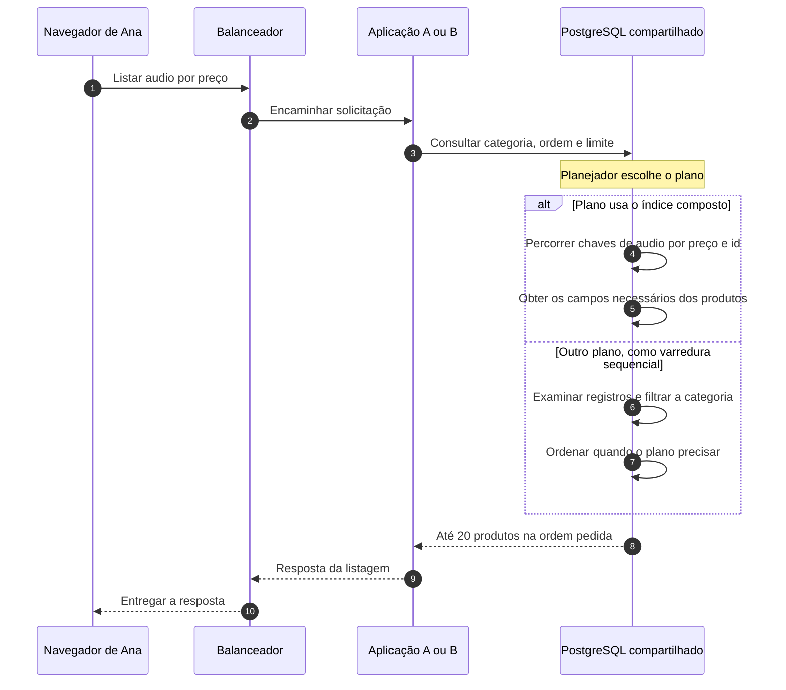
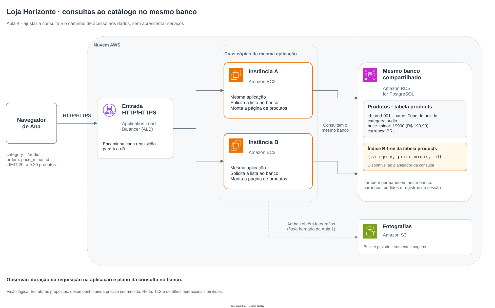

# Aula 4 — O catálogo cresceu. Como encontrar os produtos sem esperar tanto?

[Trilha System Design a partir do zero](../00-system-design-from-zero.md) · [Aula 3 — Escala e sessão compartilhada](03-scaling-and-session.md) · [Cenário da Loja Horizonte](00-scenario.md)

Ana abre a categoria Áudio e escolhe ver os produtos do menor para o maior preço. A loja continua com duas cópias da aplicação e um banco compartilhado, mas agora precisa localizar e ordenar uma parte de um catálogo maior. Como investigar esse trabalho antes de acrescentar mais componentes?

Ao final, você conseguirá explicar uma consulta, o papel de um índice e quais evidências permitem avaliar se uma mudança ajudou. Os exemplos são didáticos: não executamos consultas nem medimos desempenho nesta aula.

## Roteiro

- [A nova necessidade](#cena) e [o que precisa funcionar](#requisitos).
- [A consulta](#consulta), [o índice](#indice) e [o caminho da solicitação](#caminho).
- [Alternativas e limites](#tradeoffs), [implementação na AWS](#aws) e [investigação de falhas](#falha).
- [Perguntas](#perguntas), [exercício](#exercicio) e [resumo](#resumo).

<a id="cena"></a>
## 1. Ana quer escolher entre vários produtos

Nas primeiras aulas, acompanhamos a consulta de um produto pelo seu identificador, como `prod-001`. Agora Ana quer uma **lista**: os primeiros produtos da categoria Áudio, ordenados pelo preço.

São perguntas diferentes. Encontrar um produto específico não exige necessariamente o mesmo caminho que encontrar uma categoria e ordenar seus produtos.

Nesta etapa, acrescentamos o campo **categoria** ao exemplo do catálogo. O código `audio` representa a categoria Áudio. O produto recorrente continua sendo `prod-001`, **Fone de ouvido**, por **R$ 199,90**, em **BRL**.

Vamos considerar um relato de espera ao abrir essa lista. Isso é um ponto de partida para investigar, não uma prova de que falta um índice. A demora pode estar na aplicação, na obtenção de uma conexão, no banco ou em outra parte do caminho.

<a id="requisitos"></a>
## 2. O que precisa funcionar nesta etapa?

Os **requisitos funcionais**, isto é, os comportamentos esperados, são:

- listar somente os produtos da categoria pedida;
- ordenar pelo menor preço, usando o identificador para desempatar preços iguais;
- devolver **até 20 produtos** nessa primeira lista;
- devolver uma lista vazia quando a categoria consultada não tiver produtos.

Continuam valendo as regras da loja: consultar o catálogo não reserva estoque, adicionar ao carrinho não reserva estoque e criar um pedido não confirma pagamento. Não estamos alterando esses fluxos.

Os **requisitos não funcionais** descrevem as condições em que esses comportamentos precisam funcionar. Aqui importam o tempo de resposta, a proteção dos dados e o efeito da mudança sobre as escritas. Visitantes continuam consultando dados públicos pela aplicação; essa rota não permite alterar preços nem oferece acesso direto ao banco.

### Uma meta que poderíamos verificar

Vamos usar uma **hipótese didática de teste**, ainda não executada. Estes números não são uma recomendação universal nem uma medição da loja:

| Parte do teste proposto | Definição neste exemplo |
|---|---|
| Operação | Listar a categoria `audio`, por preço e identificador, com limite de 20 produtos |
| Dados | 100 mil produtos fictícios, dos quais 10 mil pertencem a `audio`, mantendo a mesma distribuição nas comparações |
| Carga | 50 solicitações de listagem por segundo e duas alterações de preço por segundo |
| Janela | Cinco minutos, com a mesma configuração de aplicação e banco |
| Alvo da listagem | Pelo menos 95% das respostas bem-sucedidas concluídas pela aplicação em até 300 milissegundos, ou 0,3 segundo |
| Ponto de medição | Do recebimento da solicitação pela aplicação até a conclusão da resposta pela aplicação |
| Erros e escritas | Contabilizar erros e timeouts separadamente; registrar também duração e erros das alterações de preço |

Os limites aceitáveis de erros e de regressão das escritas ainda precisam ser combinados antes do ensaio. O quadro define o alvo da listagem; a aprovação completa também depende desses critérios.

Esse alvo de tempo é uma forma de expressar o **percentil 95, ou p95**: pelo menos 95 de cada 100 respostas bem-sucedidas precisam ficar dentro do limite. As que falham não viram sucesso por ficarem fora desse cálculo. Um bom p95, sozinho, não aprova um teste que apresentou erros ou prejudicou as escritas.

A medição descrita não inclui o percurso completo pela internet, o carregamento das fotografias nem a apresentação da página pelo navegador. Também não é a mesma medida que o tempo de uma consulta dentro do banco.

### O que estamos assumindo

Usaremos o PostgreSQL já escolhido para o banco da loja. Os produtos têm identificadores únicos, categoria e preço preenchidos; os preços deste exemplo estão todos em BRL. A presença de um banco relacional é uma escolha da implementação. Ana pediu uma lista ordenada, não uma tecnologia específica.

<a id="consulta"></a>
## 3. Como dizer ao banco quais produtos queremos?

Uma **consulta** é um pedido para obter dados. **SQL** é a linguagem usada aqui para expressar esse pedido ao banco relacional.

Chamaremos a tabela de produtos de `products`. Uma tabela organiza registros em linhas e campos em colunas. A representação física deste exemplo usa `price_minor` para o preço em centavos, correspondente ao `priceMinor` das aulas anteriores.

Estes são alguns registros fictícios, em uma ordem apenas ilustrativa:

| id | name | category | price_minor | currency |
|---|---|---|---|---|
| `prod-001` | Fone de ouvido | `audio` | 19990 | BRL |
| `prod-002` | Caixa de som | `audio` | 29990 | BRL |
| `prod-003` | Fone compacto | `audio` | 9990 | BRL |
| `prod-004` | Fone dobrável | `audio` | 19990 | BRL |
| `prod-005` | Cabo USB | `acessorios` | 3990 | BRL |

Podemos expressar a listagem assim:

```sql
SELECT id, name, price_minor, currency
FROM products
WHERE category = 'audio'
ORDER BY price_minor ASC, id ASC
LIMIT 20;
```

| Trecho | O que significa |
|---|---|
| `SELECT` | Escolher os campos que queremos receber |
| `FROM products` | Consultar a tabela de produtos |
| `WHERE category = 'audio'` | Manter somente os registros dessa categoria |
| `ORDER BY price_minor ASC, id ASC` | Ordenar pelo preço crescente e, nos empates, pelo identificador crescente |
| `LIMIT 20` | Devolver no máximo 20 registros |

Com os cinco registros mostrados, a resposta contém quatro produtos, nesta ordem: `prod-003`, `prod-001`, `prod-004` e `prod-002`. O cabo USB fica fora da categoria. O identificador desempata os dois preços de 19990 centavos.

O exemplo SQL usa um valor literal para facilitar a leitura. Na aplicação, o valor da categoria deve ser passado como **parâmetro**: um valor enviado separadamente do texto SQL, sem montar esse texto pela concatenação da entrada recebida. A opção de ordenação seleciona um SQL conhecido pela aplicação; nomes de colunas e palavras SQL não são valores de parâmetro.

**Limitar o resultado não significa limitar a 20 o trabalho interno do banco.** Dependendo do caminho escolhido, ele pode precisar examinar muito mais registros para descobrir quais são os primeiros. A ordenação também precisa estar no SQL; a ordem de gravação das linhas não garante a ordem da resposta.

O desempate por identificador torna a ordem definida para os registros dessa consulta. Ele não congela o catálogo enquanto preços e produtos mudam. Estamos tratando apenas da primeira lista, não de um mecanismo completo de paginação.

<a id="indice"></a>
## 4. Um caminho de acesso para essa pergunta

Um **índice** é uma estrutura que o banco mantém para ajudar a localizar dados. No PostgreSQL, um índice **B-tree** organiza chaves de busca de modo que o banco possa localizar valores e percorrer faixas ordenadas sem ter que começar sempre por uma varredura da tabela inteira.

Para esta consulta, a proposta é um **índice composto**: um índice cuja chave reúne mais de uma coluna, em uma ordem definida.

```sql
CREATE INDEX products_category_price_id_idx
ON products (category, price_minor, id);
```

Esse comando propõe um índice com nome próprio na tabela existente. O tipo padrão usado nessa forma do PostgreSQL é B-tree. Não executamos esse comando nesta aula.

A ordem das colunas acompanha a pergunta:

1. `category`: localizar a faixa da categoria `audio`.
2. `price_minor`: percorrer os produtos dessa faixa pelo preço.
3. `id`: desempatar produtos com o mesmo preço.

Uma parte dessa ordem seria `audio / 9990 / prod-003`, depois `audio / 19990 / prod-001`, depois `audio / 19990 / prod-004`. Isso descreve as chaves do índice; não significa que a tabela inteira foi fisicamente reorganizada nessa ordem.

O índice permite um caminho que combina filtro e ordenação. Se o banco o escolher, poderá aproveitar essa ordem e encerrar a busca quando tiver os resultados necessários. Isso não garante exatamente 20 leituras internas. Campos como nome e moeda ainda podem exigir acesso aos registros da tabela, pois não fazem parte desse índice.

### Quem decide usar o índice?

O **planejador de consultas** compara caminhos possíveis e escolhe um **plano de execução**: as operações que o banco usará para produzir o resultado.

Ele considera estimativas sobre o volume e a distribuição dos dados, chamadas de **estatísticas**, além dos custos dos caminhos disponíveis. Pode escolher percorrer um índice, percorrer a tabela ou combinar outras operações.

Uma varredura sequencial, que percorre os registros da tabela, pode ser uma boa escolha para uma tabela pequena ou uma consulta que precisa de grande parte dos dados. A presença de `Seq Scan` em um plano não é, sozinha, um defeito.

Também não basta qualquer índice. Um caminho ordenado por `(category, name)` atende a outra organização; ele não oferece a mesma ordem por preço e identificador. Avaliamos o índice em relação à consulta concreta.

<a id="caminho"></a>
## 5. Acompanhe a listagem de Ana

1. O navegador solicita `GET /products?category=audio&sort=price`.
2. O ALB encaminha a solicitação a uma das cópias da aplicação, A ou B, como na Aula 3.
3. A aplicação valida a opção de categoria e a ordenação pedida, preparando a consulta com parâmetros.
4. O PostgreSQL escolhe um plano para filtrar, ordenar e limitar os resultados.
5. O banco devolve os campos solicitados, com até 20 produtos.
6. A aplicação prepara a resposta para Ana.

Essa rota é uma representação didática da nova operação. A aplicação continua responsável pelo que pede ao banco e pelo que devolve à pessoa. As fotografias mantêm o caminho apresentado nas aulas anteriores.

Uma lista vazia pode ser uma resposta correta. Uma falha de acesso ao banco é outra situação e precisa ser tratada como falha, sem inventar uma lista de produtos.

<a id="mermaid"></a>
### Dois caminhos possíveis dentro do banco

O Mermaid responde: **em que momento o banco escolhe como produzir a lista?** Os dois caminhos abaixo são exemplos; não esgotam os planos possíveis.



O índice fica dentro do banco compartilhado. A aplicação envia a consulta; não precisa escolher manualmente um percurso diferente para A e outro para B.

<a id="tradeoffs"></a>
## 6. Por que escolher essa mudança?

### Acrescentar um caminho de acesso no banco existente

**Escolha:** avaliar o índice `(category, price_minor, id)` para a consulta de categoria ordenada por preço e identificador.

**Ganho e limite:** o caminho pode reduzir trabalho de leitura e ordenação dessa consulta. Em troca, ocupa armazenamento e precisa ser mantido conforme produtos são inseridos, removidos ou alterados. Uma mudança de preço também pode exigir atualização do índice. O benefício da leitura precisa ser comparado ao custo das escritas.

**Quando reconsiderar:** se o plano não beneficiar a consulta, se a consulta mudar ou se a manutenção custar mais do que o ganho observado, a proposta precisa ser revista. Criar um índice para cada combinação imaginável amplia custo e trabalho operacional.

### Comparar antes de acrescentar componentes

Mais cópias da aplicação podem ajudar quando o limite está na aplicação. Elas não mudam automaticamente o trabalho necessário para cada consulta no mesmo banco e podem aumentar a concorrência sobre ele.

Um banco com mais capacidade também pode ajudar em certas condições, com seu custo correspondente. Antes de escolhê-lo, vale investigar se a consulta está fazendo trabalho desnecessário. Nenhuma dessas opções tem ganho garantido sem observar o problema real.

**Decisão desta aula:** propor e verificar um caminho de acesso para a consulta concreta, preservando a arquitetura da Aula 3. Isso não atesta que a meta de tempo foi atingida. Cache e distribuição de conteúdo serão necessidades discutidas na próxima etapa.

<a id="aws"></a>
## 7. Como isso poderia funcionar na AWS?

Os serviços continuam com os mesmos papéis:

| Componente | Papel nesta etapa |
|---|---|
|  Application Load Balancer | Encaminhar as solicitações às cópias da aplicação |
|  Amazon EC2 | Executar A e B, que preparam a mesma consulta de listagem |
|  Amazon RDS for PostgreSQL | Manter os dados e executar a consulta; o índice é um objeto no banco existente |
|  Amazon S3 | Continuar guardando as fotografias, com acesso autorizado como antes |

Carrinhos, pedidos e sessões continuam preservados. A nova estrutura não cria outro banco nem transforma o índice em um serviço AWS separado.

Criar um índice envolve trabalho real no banco. A forma comum de `CREATE INDEX` bloqueia escritas na tabela durante sua construção; uma mudança em produção exige avaliar execução, carga e operação. A possibilidade de reduzir esse bloqueio tem condições próprias, registradas nas fontes de manutenção. Esta aula não é um procedimento de implantação.

<a id="arquitetura"></a>
### O que mudou no desenho?

O Draw.io responde: **onde ficam a tabela, o índice e os componentes que já atendiam a loja?** Ele mostra uma implementação proposta, sem resultados de teste de carga ou garantia de disponibilidade.



[Abrir a fonte editável do diagrama](assets/04-catalog-queries-aws.drawio).

<a id="falha"></a>
## 8. O índice foi criado. Por que a lista ainda demora?

Imagine que a equipe tenha criado o índice, mas Ana continue esperando. O sintoma mostra que o problema percebido persiste. Ainda precisamos localizar o trabalho ou a espera.

| Hipótese | Evidência que ajuda a investigar |
|---|---|
| A aplicação executa uma consulta diferente da que desenhamos | Conferir a consulta e seus parâmetros reais, inclusive filtro, ordenação e limite |
| O plano escolhido não se beneficia desse índice | Examinar plano, estimativas, quantidade de registros e necessidade de ordenação |
| A chamada ao banco passa tempo esperando | Investigar obtenção de conexão, bloqueios e outras consultas concorrentes |
| O atraso está em outra parte da operação | Observar o tempo da requisição na aplicação e as etapas de carregamento no navegador |
| A manutenção de índices está tornando escritas mais caras | Comparar duração, erros e recursos consumidos nas alterações de produtos |

### Estimativa e execução são evidências diferentes

No PostgreSQL, colocar **`EXPLAIN`** antes da consulta mostra o plano estimado. Os valores de `cost` são estimativas de custo do planejador, não milissegundos medidos.

**`EXPLAIN ANALYZE` executa a consulta** para observar seu comportamento. `BUFFERS` acrescenta informações sobre acessos aos buffers, as áreas usadas para manter páginas de dados em memória. Ler essas informações exige distinguir cache do banco e outras camadas; um contador de leitura não prova sozinho uma leitura física de disco.

O comando abaixo **executaria a consulta de leitura** em um ambiente preparado. Não há saída de plano nesta aula porque não o executamos:

```sql
EXPLAIN (ANALYZE, BUFFERS)
SELECT id, name, price_minor, currency
FROM products
WHERE category = 'audio'
ORDER BY price_minor ASC, id ASC
LIMIT 20;
```

Ao comparar antes e depois, observe o caminho escolhido, os registros examinados e devolvidos, a ordenação e os tempos efetivamente medidos. Use o mesmo conjunto de dados, a mesma carga e condições registradas. A primeira execução e as seguintes podem se comportar de modo diferente por causa dos caches.

**Um plano mais rápido não mede a página inteira.** O tempo dentro do PostgreSQL, o tempo da chamada ao banco observado pela aplicação e o tempo total da requisição têm pontos de início e fim diferentes. Não some nem subtraia essas medidas como se fossem partes perfeitamente equivalentes.

Um teste da proposta também precisa conferir os produtos retornados, a ordem e o comportamento das escritas. Se a resposta estiver errada, um tempo menor não atende ao requisito.

<a id="perguntas"></a>
## 9. Verifique seu entendimento

Responda em voz alta antes de abrir cada comentário.

### 1. Duas cópias da aplicação tornam essa consulta rápida?

**Pergunta extra:** A e B enviam uma consulta que examina muitos registros ao mesmo banco. O que mudou no trabalho de cada consulta?

<details>
<summary>Ver resposta comentada</summary>

Acrescentar cópias não reduz, por si só, o trabalho de cada listagem no PostgreSQL. As cópias distribuem solicitações entre aplicações; elas podem aumentar a quantidade de consultas concorrentes sobre o banco. Precisamos localizar o limite e avaliar o plano da consulta antes de atribuir a demora à quantidade de aplicações.

</details>

### 2. Por que a ordem das colunas do índice importa?

**Pergunta extra:** Que relação existe entre `category`, `price_minor`, `id` e as partes do SQL?

<details>
<summary>Ver resposta comentada</summary>

A igualdade por categoria permite localizar uma faixa de chaves. Dentro dessa faixa, preço e identificador fornecem a ordem pedida. Um índice organizado por categoria e nome não oferece a mesma ordem por preço e identificador. Isso explica a proposta, sem garantir que o planejador a escolherá em toda execução.

</details>

### 3. `LIMIT 20` garante somente 20 leituras?

**Pergunta extra:** O que acontece se existirem apenas quatro produtos na categoria?

<details>
<summary>Ver resposta comentada</summary>

O limite controla a quantidade máxima devolvida, não todo o trabalho necessário para encontrar e ordenar os resultados. O plano pode examinar mais registros. Se só houver quatro produtos elegíveis, devolvemos esses quatro; não completamos a resposta com produtos de outra categoria.

</details>

### 4. O índice guarda uma segunda cópia completa da loja?

**Pergunta extra:** Onde ficam o nome do produto, a moeda e os registros de carrinho?

<details>
<summary>Ver resposta comentada</summary>

Esse índice mantém um caminho pelas chaves de categoria, preço e identificador, dentro do banco existente. Nome e moeda continuam nos registros de produtos e podem precisar ser buscados na tabela. Carrinhos, pedidos e sessões mantêm seus registros e funções. O índice não é uma réplica independente nem uma nova aplicação.

</details>

### 5. O plano mostrou `Seq Scan`. Isso prova que está errado?

**Pergunta extra:** E se a tabela for pequena ou a consulta precisar de muitos de seus registros?

<details>
<summary>Ver resposta comentada</summary>

Uma varredura sequencial pode ser a alternativa escolhida com razão. Julgue o trabalho e o resultado nas condições da consulta, não apenas o nome da operação. Estatísticas, volume, distribuição e custos influenciam o planejador. Compare estimativas e execução antes de tentar impor um caminho.

</details>

### 6. A leitura melhorou. Podemos encerrar a avaliação?

**Pergunta extra:** O que precisamos observar quando o preço de um produto muda?

<details>
<summary>Ver resposta comentada</summary>

Precisamos confirmar a correção da lista, a meta da operação e o efeito sobre as escritas. Alterar um preço pode exigir manter as chaves do índice, acrescentando trabalho e armazenamento. Uma melhoria de leitura não autoriza ignorar erros, escritas prejudicadas ou o restante da jornada de Ana.

</details>

<a id="exercicio"></a>
## 10. Aplique o que aprendeu

### Parte A — A lista da categoria Áudio

Use os cinco produtos da [seção da consulta](#consulta).

1. Quais identificadores a consulta devolve, e em que ordem?
2. Por que `prod-001` aparece antes de `prod-004`?
3. Qual índice você proporia avaliar para esse filtro e essa ordem?
4. O que precisaria medir antes de dizer que a meta de tempo foi atendida?

### Parte B — A pergunta da loja mudou

Agora uma nova tela pede produtos de `audio` em ordem alfabética por `name`, com desempate por `id`. Ela também devolve até 20 produtos.

1. O índice por categoria, preço e identificador oferece diretamente essa nova ordem?
2. Que outro caminho você consideraria avaliar?
3. Por que não criar imediatamente índices para todas as combinações possíveis?

<details>
<summary>Ver solução comentada</summary>

Na Parte A, a ordem é `prod-003`, `prod-001`, `prod-004`, `prod-002`. O preço coloca o produto de 9990 centavos primeiro; o identificador desempata os dois de 19990. O cabo USB pertence a outra categoria. O limite de 20 não exige inventar mais resultados.

O índice `(category, price_minor, id)` é uma proposta coerente para avaliar. A validação precisa conferir o resultado e medir a operação sob os dados, a carga e a janela combinados, observando também erros e escritas. Ler o desenho ou criar o índice não comprova o alvo de 300 milissegundos.

Na Parte B, o índice anterior pode continuar sendo considerado para filtrar a categoria, mas não fornece diretamente a ordem por nome. Um candidato a avaliar é `(category, name, id)`. Uma varredura com ordenação também pode ser suficiente, dependendo do volume e da frequência dessa tela. A escolha exige comparar os planos e o custo total. Cada índice acrescenta armazenamento e manutenção; seu benefício deve justificar esse trabalho.

</details>

<a id="resumo"></a>
## 11. O que você deve levar desta aula

- Uma consulta expressa quais dados queremos, com filtro, ordem e limite.
- Um índice oferece um caminho de acesso para determinados padrões de consulta.
- O planejador escolhe entre caminhos; a presença de um índice não garante seu uso.
- Melhorar uma leitura pode acrescentar trabalho às escritas.
- A proposta precisa ser verificada com resultados corretos e medições comparáveis.

Consigo explicar:

- [ ] a diferença entre consultar `prod-001` e listar uma categoria;
- [ ] como `(category, price_minor, id)` se relaciona com o SQL apresentado;
- [ ] por que `LIMIT 20` não garante apenas 20 leituras internas;
- [ ] a diferença entre estimativa de plano e consulta executada;
- [ ] por que o índice permanece no banco existente e não altera as regras de estoque e pagamento.

**Continue na [Aula 5 — Todo mundo consulta os mesmos produtos. O que podemos reaproveitar?](05-cache-cdn.md):** cópias públicas de listagens, entrega de fotografias e limites de atualização.

[Voltar ao índice da trilha](../00-system-design-from-zero.md) · [Rever a Aula 3](03-scaling-and-session.md).
