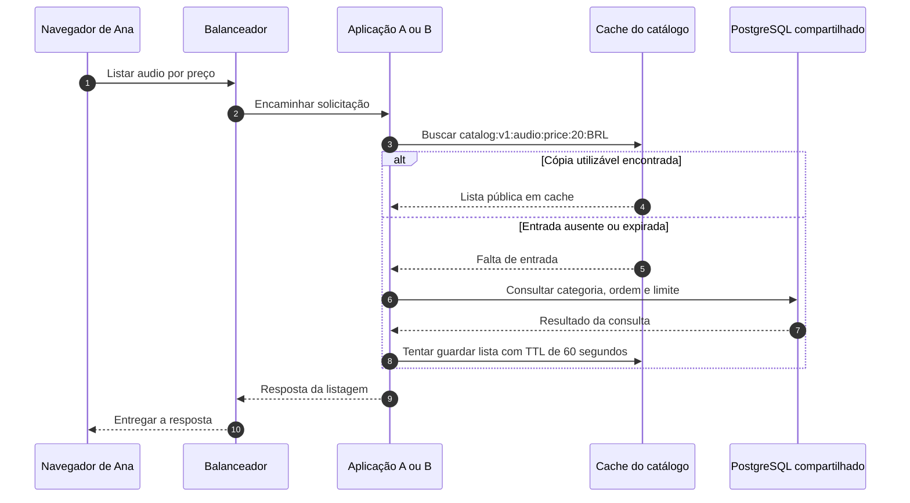
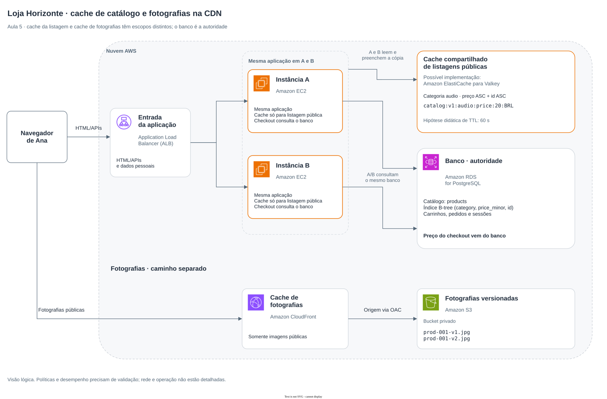

# Aula 5 — Todo mundo consulta os mesmos produtos. O que podemos reaproveitar?

[Trilha System Design a partir do zero](../00-system-design-from-zero.md) · [Aula 4 — Consultas e índices](04-catalog-queries.md) · [Cenário da Loja Horizonte](00-scenario.md)

Ana e Bruno abrem a categoria Áudio, na mesma ordem de preço, e veem as mesmas fotografias. A aplicação repete a consulta da Aula 4, mesmo quando os dados não mudaram. Como reaproveitar parte desse trabalho e entregar as imagens mais perto das pessoas?

Ao final, você conseguirá distinguir cache de dados e distribuição de arquivos, acompanhar uma leitura com e sem cópia disponível e explicar os riscos de dados antigos. A arquitetura é uma proposta didática: não executamos um cache, uma distribuição ou um teste de desempenho nesta aula.

## Roteiro

- [A situação](#cena) e [o que precisa continuar correto](#requisitos).
- [Cache](#cache), [chave e conteúdo](#chave) e [caminho da consulta](#caminho).
- [Fotografias e CDN](#cdn), [alternativas](#tradeoffs) e [implementação na AWS](#aws).
- [Falhas](#falha), [perguntas](#perguntas), [exercício](#exercicio) e [resumo](#resumo).

<a id="cena"></a>
## 1. A loja repete uma resposta que não mudou

A Aula 4 propôs um índice para ajudar o banco a encontrar produtos por categoria e preço. Mesmo com um caminho de acesso adequado, cada consulta ainda envolve trabalho: receber o pedido, executar o plano e preparar o resultado.

Agora considere uma hipótese do cenário: muitas pessoas pedem a mesma primeira lista de até 20 produtos de `audio`, com preço crescente e identificador como desempate. Também consultam a mesma fotografia de `prod-001`, o **Fone de ouvido**, inicialmente a **R$ 199,90**, em **BRL**.

Temos duas oportunidades diferentes:

- reaproveitar a **lista pública de produtos** entre solicitações;
- reaproveitar e distribuir os **arquivos de fotografia**.

Isso não prova que precisamos dessas mudanças. Precisamos confirmar a repetição, o custo do trabalho e quanto tempo cada informação pode ficar antiga. Um cache também acrescenta dependências e manutenção.

<a id="requisitos"></a>
## 2. O que precisa continuar correto?

Os **requisitos funcionais**, os comportamentos esperados, continuam sendo listar os produtos da categoria pedida, na ordem correta, e entregar as fotografias correspondentes.

Acrescentamos uma escolha do cenário: **a listagem pública pode apresentar uma cópia temporariamente antiga**, enquanto o registro do pedido precisa validar o preço no banco, como na Aula 2. Essa tolerância é uma decisão que uma loja real precisaria acordar para cada informação.

| Condição | Como avaliar a proposta |
|---|---|
| Separação entre pessoas | Conferir que a cópia pública contém somente dados do catálogo, sem carrinho, sessão, identidade ou pedido |
| Correspondência da lista | Conferir categoria, ordem, limite e moeda na chave e no resultado |
| Atualização | Verificar preenchimento, expiração e invalidação; registrar os limites de atualização ainda não resolvidos |
| Confirmação do preço | Consultar a fonte de dados do pedido e tratar mudanças de preço antes de confirmar a operação |
| Eficiência | Comparar consultas ao banco, tempo de resposta e erros sob os mesmos dados e carga, separando acertos e faltas de cache |
| Falhas | Avaliar a capacidade do banco quando o cache estiver vazio ou indisponível |

Usaremos **60 segundos** como tempo inicial de vida da lista no cache e **300 segundos** como referência de frescor das fotografias. São escolhas didáticas, não metas universais nem garantias de atualização nesse prazo. Os limites aceitáveis de atraso, erros e carga precisam ser combinados antes de aprovar uma implantação.

O alvo hipotético de desempenho da Aula 4 continua sem medição. Uma taxa alta de acertos no cache, sozinha, não comprova que a operação ficou correta ou atingiu esse alvo.

Continuam valendo as regras da loja: adicionar ao carrinho não reserva estoque; criar um pedido não confirma pagamento. A próxima aula desenvolverá a disputa pela última unidade.

<a id="cache"></a>
## 3. Uma cópia para reaproveitar trabalho

Um **cache** mantém uma cópia de uma informação para tentar atender solicitações seguintes com menos trabalho. Nesta proposta, o banco continua sendo a **fonte de verdade**, o lugar em que a loja mantém e confirma os dados originais.

O cache da lista é compartilhado pelas aplicações A e B. Uma resposta pública preenchida por A pode ser reaproveitada por B. Assim, o reaproveitamento não depende da memória de uma única cópia da aplicação. O cache é acessado pelas aplicações autorizadas; o navegador continua pedindo a lista à aplicação, sem acessar esse serviço diretamente.

| Termo | O que significa neste exemplo |
|---|---|
| Acerto, ou **hit** | A aplicação encontrou uma cópia utilizável para a chave pedida |
| Falta, ou **miss** | Não há uma cópia utilizável para aquela chave |
| **TTL**, de *time to live* | Tempo de vida definido para a entrada; aqui, 60 segundos a partir de seu preenchimento |
| **Expiração** | A entrada deixa de ser utilizável conforme seu tempo de vida |
| **Invalidação** | A aplicação remove uma cópia para que uma leitura posterior precise reconstruí-la |

Uma lista vazia também pode ser uma resposta correta guardada no cache. Ela é diferente de uma falta de entrada.

### Expirar não é atualizar em segundo plano

No fluxo que vamos usar, a expiração não dispara uma consulta periódica ao banco. Uma próxima solicitação que não encontre a cópia fará a busca e tentará preencher o cache.

Uma entrada também pode desaparecer antes de seu TTL, por exemplo por pressão de memória, conforme a política configurada. O desenho deve funcionar com faltas; guardar algo no cache não é uma forma de garantir sua preservação.

**TTL de 60 segundos não garante que toda alteração apareça para todos em até 60 segundos.** O tempo começa no preenchimento da entrada. Há leituras em andamento, possíveis falhas de invalidação e outras cópias, como páginas já abertas. Os limites de atualização precisam ser analisados para o fluxo inteiro.

<a id="chave"></a>
## 4. Qual pergunta essa cópia responde?

A **chave** é a identificação usada para localizar uma entrada. Vamos representar a chave da primeira lista de Áudio assim:

```text
catalog:v1:audio:price:20:BRL
```

| Parte | Significado neste exemplo |
|---|---|
| `catalog` | Cópia de dados públicos do catálogo |
| `v1` | Versão do formato dessa representação |
| `audio` | Categoria consultada |
| `price` | Ordem crescente por preço, com identificador crescente para desempatar |
| `20` | Limite de produtos da primeira lista |
| `BRL` | Moeda dos preços apresentados |

O índice do banco ajuda a executar uma consulta. A chave de cache identifica uma resposta que podemos reaproveitar. As duas estruturas têm funções diferentes.

Se uma opção altera o resultado, ela precisa ser considerada na chave ou na decisão de não reaproveitar aquela entrada. Uma lista de outra categoria não pode receber a chave de `audio`. Novos filtros, páginas ou regras exigiriam rever esse desenho.

Um produto dentro da lista pública poderia ser representado assim; o exemplo não mostra a entrada completa do cache:

```json
{
  "id": "prod-001",
  "name": "Fone de ouvido",
  "priceMinor": 19990,
  "currency": "BRL",
  "imagePath": "/prod-001-v1.jpg"
}
```

O novo campo `imagePath` referencia o arquivo que a aplicação apresentará pelo endereço de fotografias do CloudFront. O preço continua em centavos inteiros. A representação não contém a sessão de Ana, o carrinho ou o preço final de um pedido.

### O que fica fora desse cache compartilhado

Carrinhos, sessões, pedidos e respostas personalizadas continuam no fluxo da aplicação e do banco. Não colocaremos esses dados na entrada pública.

Receber um cookie não torna uma resposta automaticamente privada para todos os caches HTTP. A aplicação precisa separar conteúdo público e personalizado. Cabeçalhos de cache também não substituem a decisão sobre quais dados a própria aplicação grava no cache compartilhado.

<a id="caminho"></a>
## 5. A aplicação procura a cópia e consulta o banco quando precisa

Esse funcionamento é chamado de **cache-aside**: a aplicação coordena a consulta ao cache e à fonte de dados.

1. Ana solicita `GET /products?category=audio&sort=price`.
2. O ALB encaminha a solicitação a A ou B.
3. A aplicação identifica que essa é a primeira lista pública, com limite 20 e moeda BRL, e monta a chave.
4. Se encontrar uma cópia utilizável, prepara a resposta com ela.
5. Se não encontrar, executa a consulta no PostgreSQL, que continua podendo usar o índice da Aula 4.
6. Com o resultado do banco, tenta preencher o cache com TTL de 60 segundos e devolve a lista.

Uma falha ao preencher o cache não precisa apagar um resultado válido já obtido do banco. Esse tratamento precisa existir na aplicação, assim como o registro da falha. Não decorre apenas de desenhar uma caixa de cache.

<a id="mermaid"></a>
### Com cópia disponível e sem cópia disponível

O Mermaid responde: **quem consulta o banco quando a lista não está no cache?**



O cache não busca o banco sozinho nesse fluxo. O diagrama mostra os caminhos normais; erro de acesso ao cache precisa de um tratamento próprio, apresentado adiante.

### O preço mudou depois do preenchimento

Imagine uma alteração fictícia do preço de `prod-001`: o banco passa de 19990 para 21990 centavos. Uma cópia já guardada pode continuar mostrando R$ 199,90.

Uma estratégia é confirmar primeiro a alteração no banco e depois invalidar as entradas afetadas. A próxima falta poderá reconstruir a lista. Se a alteração mudar a posição do produto, não basta pensar somente na página desse produto: listas que o incluem ou passam a incluí-lo também podem ser afetadas.

Há limites: a invalidação pode falhar, e uma leitura antiga em andamento pode preencher novamente uma entrada depois dela. TTL e remoção simples não resolvem todas essas corridas. O desenho desta aula não implementa um protocolo de consistência forte entre banco e cache.

Na criação do pedido, a aplicação volta a consultar os dados e as regras no banco. Se o preço mudou, o fluxo precisa apresentar e tratar essa mudança antes de confirmar o pedido. A cópia pública e o valor enviado pelo navegador não decidem sozinhos o preço registrado.

<a id="cdn"></a>
## 6. As fotografias podem seguir um caminho próprio

Uma **CDN**, ou rede de distribuição de conteúdo, mantém pontos de atendimento que podem reutilizar arquivos e entregá-los de locais mais próximos das pessoas. Neste exemplo, usaremos **Amazon CloudFront** para as fotografias públicas dos produtos.

O caminho evolui: o navegador passa a pedir a fotografia ao endereço do CloudFront. Havendo uma cópia utilizável, ela pode ser atendida ali. Quando for necessário buscar a origem, o CloudFront consulta o S3 autorizado e pode guardar o objeto conforme sua política.

A **origem** é de onde a distribuição obtém o conteúdo. Aqui, a origem das fotografias é o S3. O RDS continua sendo a fonte dos dados de catálogo e do pedido; ele não é a origem de arquivos dessa distribuição.

O CloudFront desta proposta atende **somente fotografias**. Solicitações de catálogo à aplicação, carrinhos, sessões e pedidos continuam pelo ALB. Não estamos colocando HTML ou APIs personalizadas nessa distribuição.

### Bucket privado e fotografia pública são compatíveis

O bucket S3 continua privado. O **Origin Access Control, ou OAC**, permite configurar o acesso do CloudFront à origem, com a autorização correspondente no bucket.

Esse controle protege o acesso à origem. As fotografias deste cenário continuam públicas para visitantes pelo CloudFront. OAC não faz login de Ana nem transforma uma imagem pública em conteúdo restrito a uma pessoa.

### Frescor no navegador e no CloudFront

O **cache do navegador** e o **cache do CloudFront** são camadas diferentes. Uma resposta de fotografia poderia trazer estes cabeçalhos HTTP, informações que acompanham a resposta:

```http
HTTP/1.1 200 OK
Content-Type: image/jpeg
Cache-Control: public, max-age=300
```

`public` permite o uso por caches compartilhados. `max-age=300` indica que a resposta é considerada fresca enquanto sua idade estiver abaixo de 300 segundos, ou cinco minutos. Receber uma cópia não reinicia esse prazo. Estamos supondo uma política do CloudFront compatível com esse valor, com TTL mínimo zero e limite máximo que o permita. A configuração da distribuição também influencia o comportamento.

Esse cabeçalho é uma escolha para a fotografia pública. Para respostas sensíveis, diretivas como `private` e `no-store` têm outras finalidades: `private` restringe caches compartilhados; `no-store` instrui a não armazenar a resposta. Elas não substituem a autorização nem a correta configuração dos intermediários. Nesta proposta, as APIs personalizadas ficam fora do CloudFront.

Nenhum desses cabeçalhos ajusta automaticamente o TTL de 60 segundos da lista no cache da aplicação. São mecanismos distintos.

### Uma fotografia nova recebe outro nome

Vamos chamar o arquivo inicial de `prod-001-v1.jpg`. Uma nova fotografia pode ser gravada como `prod-001-v2.jpg`, e a aplicação passa a devolver o novo caminho.

São objetos com nomes e URLs diferentes. Esse **versionamento do nome** não é a funcionalidade S3 Versioning. O `v1` no nome da foto também é diferente da versão do formato da chave `catalog:v1:...`.

Trocar o nome exige atualizar as referências: se a lista em cache ou uma página antiga ainda aponta para `v1`, ela continuará pedindo `v1`. A nova fotografia não aparece em uma página somente por existir no S3. Remover o objeto anterior cedo demais também pode quebrar referências ainda usadas.

Outra ferramenta é a **invalidação do CloudFront**, que remove cópias nos caches da distribuição. Ela não apaga cópias do navegador, não remove a lista do cache da aplicação e não muda os arquivos no S3. Se a origem ainda contiver os mesmos bytes no mesmo caminho, uma nova busca poderá trazer os mesmos bytes.

<a id="tradeoffs"></a>
## 7. Por que propor essas duas mudanças?

### Reaproveitar a lista pública entre A e B

**Escolha:** avaliar um cache compartilhado, com chave explícita e TTL, para uma listagem pública frequentemente repetida.

**Ganho e limite:** acertos podem evitar repetir a consulta ao banco. Em troca, temos memória, conexões, custo financeiro, tratamento de falhas e trabalho para lidar com cópias antigas. Faltas ainda dependem do banco, e informações personalizadas exigem outra análise.

**Quando reconsiderar:** se houver poucas repetições, muitas variantes, atualizações frequentes ou exigência de atualização que o desenho não cumpra, o benefício pode não compensar. As consultas e os índices continuam relevantes para reconstruir as entradas.

### Entregar fotografias pelo CloudFront

**Escolha:** usar uma distribuição para arquivos públicos que podem ser reutilizados, mantendo a origem S3 privada.

**Ganho e limite:** cópias podem reduzir viagens à origem e aproximar a entrega. Há configuração, custo de solicitações e transferência, controle de acesso à origem e coordenação das referências a arquivos novos. Não afirmamos que toda solicitação terá acerto nem que a página ficará dentro de uma meta sem medir.

**Quando reconsiderar:** distribuição de acessos, tamanho dos arquivos, frequência de troca, custos e regras de atualização precisam justificar a opção. A listagem e a fotografia também podem ter gargalos diferentes.

<a id="aws"></a>
## 8. Uma implementação possível na AWS

| Componente | Papel nesta etapa |
|---|---|
|  ALB e  aplicações EC2 A/B | Continuar atendendo operações dinâmicas; a aplicação coordena cache e banco |
| Amazon ElastiCache para Valkey | Uma opção gerenciada para o cache compartilhado das listagens públicas |
|  RDS for PostgreSQL | Manter produtos, índice, carrinhos, pedidos e sessões; validar os dados usados no pedido |
|  CloudFront | Atender as fotografias e buscar a origem autorizada quando necessário |
|  S3 privado | Guardar os arquivos de imagem que o CloudFront pode consultar mediante OAC |

ElastiCache é uma implementação possível, não um requisito universal para reaproveitar uma resposta. Nesta proposta ele não recebe sessões, carrinhos ou pedidos. Sua configuração de acesso, capacidade e falhas ainda precisaria ser definida e testada.

<a id="arquitetura"></a>
### Dois caminhos, com responsabilidades diferentes

O Draw.io responde: **onde ficam a cópia pública da listagem, a fonte dos dados e a distribuição de fotografias?** Ele não representa uma implantação nem garante desempenho ou disponibilidade.

No desenho, **checkout** significa o fluxo de finalização da compra. Aqui mostramos a validação do preço para criar o pedido; o pagamento continua separado.



[Abrir a fonte editável do diagrama](assets/05-cache-cdn-aws.drawio).

<a id="falha"></a>
## 9. A cópia sumiu ou ficou antiga. O que acontece?

| Situação | O que verificar e tratar |
|---|---|
| Entrada ausente ou expirada | Consultar a fonte e tentar preencher a entrada; isso faz parte do fluxo normal |
| Erro ou demora ao acessar o cache | Aplicar o limite de espera previsto e decidir se cabe consultar o banco; registrar a falha separadamente de um miss normal |
| Muitas solicitações encontram o cache vazio | Verificar a carga simultânea no banco; as faltas podem gerar muitas reconstruções da mesma lista |
| A lista continua com preço antigo | Conferir chave, preenchimento, expiração, invalidação e leituras em andamento |
| A fotografia nova não aparece | Conferir o caminho devolvido pela aplicação, o objeto na origem, a cópia no CloudFront e o cache do navegador |
| O banco também está indisponível | Tratar a falha da operação; este desenho não garante reconstruir a lista nem confirmar um pedido |

Usar o banco quando o cache falha é um **fallback**, um caminho alternativo programado. Ele precisa de limites: tempo de espera, quantidade de tentativas e capacidade disponível. Repetir tentativas sem controle pode agravar a indisponibilidade. Não estamos implementando esses controles com a simples inclusão do serviço no desenho.

### O que medir antes de dizer que melhorou?

- Quantas buscas encontraram uma cópia utilizável? Essa proporção é a **taxa de acerto**.
- Quanto demoram acertos, faltas e erros, separadamente?
- Quantas consultas e reconstruções chegam ao banco, inclusive quando o cache está vazio?
- Como uma alteração de preço ou fotografia se propaga, e quais cópias continuam antigas?
- Qual é o efeito sobre custo, memória, tráfego, erros e operações de pedido?

Compare condições equivalentes às da Aula 4. O tempo da requisição da aplicação, o tempo de carregar uma fotografia e o tempo da página inteira são medidas diferentes. A proposta precisa ser verificada com o conteúdo correto, os erros contabilizados e os limites de atualização combinados.

<a id="perguntas"></a>
## 10. Verifique seu entendimento

Responda antes de abrir os comentários.

### 1. Um acerto no cache prova que o preço ainda é o atual?

**Pergunta extra:** O banco mudou de 19990 para 21990 centavos depois do preenchimento. Qual valor orienta a criação do pedido?

<details>
<summary>Ver resposta comentada</summary>

O acerto mostra que há uma cópia utilizável segundo a política do cache, não que ela corresponde à última alteração do banco. A criação do pedido consulta os dados e as regras no RDS. Se o preço mudou, a aplicação precisa tratar essa mudança antes de confirmar a operação; o valor antigo da lista não é autoridade suficiente.

</details>

### 2. O que a chave precisa distinguir?

**Pergunta extra:** Bruno consulta `acessorios` na mesma ordem. Podemos devolver a entrada de `audio`?

<details>
<summary>Ver resposta comentada</summary>

A chave deve distinguir as opções que alteram o resultado reaproveitado. A categoria de Bruno exige outra entrada, como `catalog:v1:acessorios:price:20:BRL`. Usar a chave de Áudio produziria uma resposta errada, mesmo que ela fosse entregue rapidamente. O mesmo raciocínio vale para uma nova ordem, limite, moeda ou representação.

</details>

### 3. TTL de 60 segundos atualiza o banco e todas as telas nesse intervalo?

**Pergunta extra:** Sem nova solicitação após a expiração, quem executa a consulta neste fluxo?

<details>
<summary>Ver resposta comentada</summary>

O TTL descreve a vida da entrada a partir do preenchimento. Na proposta cache-aside, a próxima falta é que faz a aplicação consultar o banco e tentar guardar outra cópia. Não há atualização periódica automática. Invalidações com falha, preenchimentos concorrentes e páginas já abertas impedem tratar esse TTL como uma garantia rígida de propagação de toda mudança.

</details>

### 4. Invalidar uma foto no CloudFront limpa todas as cópias?

**Pergunta extra:** A lista ainda referencia `prod-001-v1.jpg`. A existência de `prod-001-v2.jpg` muda esse pedido?

<details>
<summary>Ver resposta comentada</summary>

A invalidação remove cópias da distribuição, não do navegador ou do cache de listagens. A referência antiga continua pedindo o objeto v1. Precisamos atualizar as referências e tratar a cópia da lista quando necessário. Se o S3 ainda tem os mesmos bytes em v1, buscá-los novamente não produz a fotografia v2.

</details>

### 5. S3 privado significa que Ana precisa fazer login para ver a foto?

**Pergunta extra:** Qual acesso é controlado por OAC nesta arquitetura?

<details>
<summary>Ver resposta comentada</summary>

OAC controla o acesso do CloudFront à origem S3 autorizada. Neste cenário, a fotografia é pública para os visitantes pela distribuição. Esse controle não autentica Ana nem decide quem pode abrir seu carrinho. Operações personalizadas continuam no caminho da aplicação e exigem suas próprias verificações.

</details>

### 6. Se o cache parar, basta mandar tudo ao banco?

**Pergunta extra:** O que acontece quando muitas solicitações tentam reconstruir a mesma lista simultaneamente?

<details>
<summary>Ver resposta comentada</summary>

O fallback precisa ser implementado e limitado à capacidade disponível. Muitas faltas ou falhas podem elevar a concorrência e a carga sobre o RDS. Devemos observar esperas, tentativas e erros, e tratar a operação se a fonte também falhar. A presença do cache não garante que o banco consiga atender qualquer volume quando o cache estiver indisponível.

</details>

<a id="exercicio"></a>
## 11. Aplique o que aprendeu

### Parte A — A mesma pergunta e uma pergunta diferente

A guarda a primeira lista de `audio`, por preço e identificador, com até 20 produtos em BRL. Depois, B recebe duas solicitações: Ana pede essa lista e Bruno pede a categoria `acessorios`.

1. Que chave B procura em cada solicitação?
2. Se a entrada de Áudio existe e a de Acessórios não, qual solicitação precisa consultar o RDS no caminho normal?
3. Uma lista vazia guardada para Acessórios equivale à ausência da entrada?
4. Onde ficam o carrinho e a sessão de Ana nesta proposta?

### Parte B — Preço e fotografia mudaram

O banco recebe o novo preço de 21990 centavos para `prod-001` e uma referência a `prod-001-v2.jpg`. O S3 já tem esse novo arquivo, mas a lista pública em cache ainda contém 19990 e `prod-001-v1.jpg`.

1. Que cópia precisa ser tratada para a aplicação reconstruir a listagem com os novos dados? Qual é o limite de uma remoção simples?
2. Por que invalidar v1 no CloudFront não basta para atualizar essa lista ou uma página já aberta?
3. Ao criar o pedido, de onde a aplicação obtém o preço que precisa validar?

<details>
<summary>Ver solução comentada</summary>

Na Parte A, B procura `catalog:v1:audio:price:20:BRL` para Ana e `catalog:v1:acessorios:price:20:BRL` para Bruno. A cópia de Áudio pode atender Ana. A ausência da entrada de Acessórios faz B consultar o banco e tentar preenchê-la. Uma lista vazia guardada é um resultado existente e pode ser um acerto; ausência de entrada é outra situação. Sessão e carrinho continuam nos registros do banco, acessados pela aplicação com as verificações apresentadas antes.

Na Parte B, precisamos tratar a entrada da listagem no cache da aplicação, considerando outras listas afetadas. Uma próxima falta pode reconstruí-la, mas falha de invalidação ou preenchimento concorrente com dados antigos ainda pode trazer atraso. O desenho não elimina essas corridas. Invalidar o arquivo na distribuição não altera a referência da lista nem apaga a página ou o cache do navegador. A confirmação do preço do pedido consulta a fonte no RDS e aplica as regras vigentes, tratando a diferença antes de confirmar a operação.

</details>

<a id="resumo"></a>
## 12. O que você deve levar desta aula

- Cache reaproveita uma cópia e exige uma política para conteúdo, chave, atualização e falhas.
- O cache da lista e a distribuição das fotografias atendem necessidades distintas.
- TTL não é uma promessa de atualização instantânea nem um substituto para a fonte de verdade.
- OAC protege o acesso à origem S3; os visitantes continuam vendo fotografias públicas pelo CloudFront.
- Decisões de pedido validam dados no banco, preservando as regras da loja.

Consigo explicar:

- [ ] acerto, falta, expiração e invalidação;
- [ ] por que categoria, ordem, limite e moeda fazem parte da chave;
- [ ] quem consulta o banco e preenche o cache no cache-aside;
- [ ] por que uma URL nova de fotografia exige atualizar referências;
- [ ] por que carrinhos e sessões ficam fora das cópias públicas;
- [ ] o que observar quando o cache ou a origem falham.

**Continue na [Aula 6 — Ana e Bruno querem a última unidade. Quem consegue reservar?](06-last-unit.md):** duas tentativas, uma unidade e a decisão de reserva no banco.

[Voltar ao índice da trilha](../00-system-design-from-zero.md) · [Rever a Aula 4](04-catalog-queries.md).
