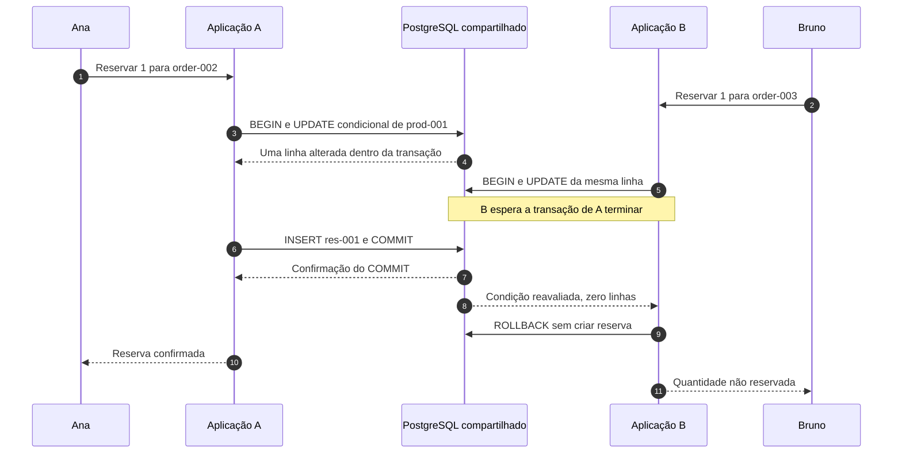

# Aula 6 — Ana e Bruno querem a última unidade. Quem consegue reservar?

[Trilha System Design a partir do zero](../00-system-design-from-zero.md) · [Aula 5 — Cache e CDN](05-cache-cdn.md) · [Cenário da Loja Horizonte](00-scenario.md)

Ana e Bruno querem uma unidade do mesmo Fone de ouvido. Cada solicitação pode chegar a uma cópia diferente da aplicação. O estoque disponível de `prod-001` é um: como impedir que a loja confirme duas reservas?

Ao final, você conseguirá explicar por que consultar o saldo não basta, como uma alteração condicional participa da decisão e por que a reserva precisa ser registrada na mesma transação. Os exemplos SQL e os resultados esperados são didáticos; não executamos um banco ou uma disputa real nesta aula.

## Roteiro

- [A disputa](#cena), [os requisitos](#requisitos) e [o problema da concorrência](#concorrencia).
- [A reserva no banco](#reserva) e [o caminho de uma tentativa](#caminho).
- [Alternativas](#tradeoffs), [implementação na AWS](#aws) e [falhas](#falha).
- [Perguntas](#perguntas), [exercício](#exercicio) e [resumo](#resumo).

<a id="cena"></a>
## 1. Dois pedidos, uma unidade disponível

Nesta nova cena, já existem dois pedidos registrados, com **uma unidade de `prod-001` cada**:

| Pessoa | Pedido desta cena | Quantidade solicitada |
|---|---|---|
| Ana | `order-002` | 1 |
| Bruno | `order-003` | 1 |

Esses pedidos são distintos de `order-001`, o exemplo anterior com duas unidades. Registrar um pedido ainda não garante estoque nem confirma pagamento.

A aplicação valida no servidor que cada pessoa pode operar seu próprio pedido e que a quantidade é válida. Para acompanhar a disputa, assumiremos esses dois pedidos elegíveis, sem alteração ou cancelamento concorrente durante a tentativa.

O saldo disponível começa em **1**. Ana envia sua tentativa, e Bruno também. O ALB pode encaminhar a primeira para A e a segunda para B, as cópias da mesma aplicação apresentadas na Aula 3.

Um **pedido de reserva** é uma tentativa. Uma **reserva confirmada** é uma promessa registrada que retira aquela quantidade do saldo disponível para outras reservas. A resposta de sucesso só deve ser enviada depois de o banco confirmar a gravação.

<a id="requisitos"></a>
## 2. O que a loja precisa garantir?

A regra de negócio é: **não prometer duas vezes a mesma última unidade**. Ela precisa valer mesmo quando A e B atendem ao mesmo tempo.

| Condição | Resultado esperado neste exemplo |
|---|---|
| Duas tentativas distintas, uma unidade disponível | No máximo uma reserva confirmada de uma unidade |
| Reserva confirmada | Saldo reduzido e registro da reserva gravado juntos |
| Tentativa sem quantidade suficiente | Nenhuma nova reserva e nenhum saldo consumido por essa tentativa |
| Falha ao registrar a reserva antes da confirmação | Desfazer também a redução do saldo |
| Isolamento entre pessoas | Cada pessoa opera apenas seu pedido; a recusa não revela dados da reserva da outra |
| Pagamento | Continuar separado da reserva |

O saldo precisa permanecer não negativo. Mas isso, sozinho, não comprova que a loja fez apenas uma promessa: também precisamos conferir os registros de reserva.

Estamos tratando **um produto e uma unidade por tentativa**. Múltiplos produtos, quantidades variadas e transições de pedido exigiriam ampliar a análise. Todos os caminhos que consomem ou devolvem estoque precisam respeitar o protocolo escolhido.

Tempo de espera, limites de tentativa, carga e tratamento de erros também precisam ser definidos e medidos. Esta aula analisa a coerência da decisão; não apresenta um resultado de desempenho ou uma operação de reserva já implantada.

Continuam valendo as regras: adicionar ao carrinho não reserva estoque; criar um pedido não confirma pagamento. Uma lista em cache pode estar antiga e não decide quem conseguiu reservar.

<a id="concorrencia"></a>
## 3. Duas leituras corretas podem levar a duas promessas erradas

**Concorrência** significa que operações se sobrepõem. Não é necessário que tudo aconteça exatamente no mesmo instante.

Imagine este caminho incorreto:

| Passo | A, atendendo Ana | B, atendendo Bruno |
|---|---|---|
| 1 | Lê saldo 1 | |
| 2 | | Também lê saldo 1 |
| 3 | Decide reservar e grava saldo 0 | |
| 4 | | Também decide reservar e grava saldo 0 |
| 5 | Registra uma reserva | Registra outra reserva |

O saldo termina em zero, mas há duas reservas para uma unidade. Uma restrição que apenas proíbe números negativos não detecta esse erro.

O problema é a separação entre **observar uma condição** e **efetivar uma decisão baseada nela**. A leitura de A não impede B de agir sobre outra leitura do mesmo saldo.

Também não basta colocar qualquer sequência entre `BEGIN` e `COMMIT`. Precisamos que a forma de alterar o saldo controle a disputa, além de reunir as gravações que devem confirmar juntas.

<a id="reserva"></a>
## 4. A condição precisa participar da alteração

Vamos representar o saldo em uma tabela `inventory`, com uma linha por produto. `available` é a quantidade disponível para novas reservas.

| product_id | available antes da disputa |
|---|---|
| `prod-001` | 1 |

O modelo proposto exige:

- `product_id` como **chave primária**, identificando uma única linha de estoque por produto;
- `available` inteiro, obrigatório (`NOT NULL`) e com a condição `CHECK (available >= 0)`;
- reservas identificadas de forma única, vinculadas a pedidos e produtos existentes;
- quantidade de reserva inteira, obrigatória e positiva, com um estado definido, como `active`.

`NOT NULL` impede a ausência do valor. `CHECK` verifica uma condição; ele não substitui `NOT NULL`. Uma **chave estrangeira** pode ligar a reserva ao pedido ou produto existente. Essas restrições ajudam a proteger os dados, mas não implementam sozinhas todo o protocolo de reserva.

### Um trecho que tenta consumir a unidade

A aplicação começa uma transação com `BEGIN` e executa este trecho **dentro dela**:

```sql
-- Trecho da transação; ainda não é o fluxo completo de reserva.
UPDATE inventory
SET available = available - 1
WHERE product_id = 'prod-001'
  AND available >= 1
RETURNING product_id, available;
```

`UPDATE` altera registros. O `WHERE` exige, na própria alteração, a existência de saldo suficiente. `RETURNING` devolve os valores das linhas alteradas, depois da mudança.

Para a linha única de `prod-001`, temos duas possibilidades normais:

- **Uma linha devolvida:** a tentativa conseguiu reduzir o saldo dentro da transação. Ainda falta registrar a reserva e confirmar tudo.
- **Nenhuma linha devolvida:** a condição não foi satisfeita. Neste exemplo, com a linha de estoque existente, a tentativa não conseguiu consumir a unidade.

Zero linhas não é um erro SQL e não desfaz automaticamente a transação. A aplicação precisa interpretar o resultado, encerrar essa tentativa e não criar uma reserva a partir dele.

### Por que B não usa simplesmente o saldo antigo?

Para esta explicação, consideramos o PostgreSQL no nível de isolamento **Read Committed**, ou leitura confirmada. Isolamento define regras para operações sobrepostas.

Se A alterou a linha e ainda não terminou sua transação, uma tentativa de B de alterar essa mesma linha pode esperar. Se A confirmar, o PostgreSQL reavalia a condição do `UPDATE` de B sobre a versão atualizada da linha. Com saldo zero, `available >= 1` não é satisfeita.

Se A desfizer sua transação, a unidade continua disponível e B pode conseguir reservá-la. Isso explica dois resultados possíveis; não estamos prometendo quem vence nem uma política de justiça na ordem de atendimento.

### Redução e registro precisam confirmar juntos

Uma **transação** reúne operações que devem ser confirmadas juntas, com `COMMIT`, ou desfeitas, com `ROLLBACK`.

Somente se o `UPDATE` devolver uma linha, a aplicação tenta registrar a reserva na **mesma transação e conexão**. Para Ana, um trecho ilustrativo seria:

```sql
-- Somente após uma linha retornada pelo UPDATE, na mesma transação.
INSERT INTO reservations
    (id, order_id, product_id, quantity, status)
VALUES
    ('res-001', 'order-002', 'prod-001', 1, 'active');
```

Os identificadores são exemplos fictícios. Uma implementação gera e controla suas referências e usa parâmetros para valores recebidos; não monta SQL concatenando entradas.

Se a inserção falhar, a aplicação deve desfazer a transação para não manter um saldo reduzido sem a reserva correspondente. Se tudo estiver pronto, tenta confirmar com `COMMIT` e só responde sucesso quando receber a confirmação.

Os blocos SQL acima são **trechos condicionais**, não um roteiro para executar um depois do outro sem verificar resultados. O controle completo precisa distinguir os caminhos:

```text
iniciar a transação na mesma conexão
tentar executar a redução condicional do saldo
se o comando falhar ou a espera terminar sem resultado conclusivo:
    executar ROLLBACK quando a conexão permitir
    encerrar com falha, sem criar uma reserva

se nenhuma linha foi devolvida:
    executar ROLLBACK
    encerrar sem criar reserva nem responder sucesso

se uma linha foi devolvida:
    tentar inserir a reserva do pedido autorizado
    se ocorrer erro antes de confirmar:
        executar ROLLBACK
        encerrar sem reserva confirmada por esse caminho
    caso contrário:
        tentar COMMIT
        se a confirmação de sucesso do COMMIT for recebida:
            responder reserva confirmada
        se o banco informar que a transação não foi confirmada:
            tratar o erro e desfazer quando cabível e possível
            encerrar sem responder reserva confirmada
        se a conexão cair sem sabermos o resultado:
            tratar o desfecho como desconhecido
            consultar e reconciliar a operação antes de repetir efeitos
```

Uma queda de conexão durante a confirmação merece tratamento próprio: um `ROLLBACK` posterior não desfaz um `COMMIT` que já aconteceu. Voltaremos a esse limite na investigação de falhas.

<a id="caminho"></a>
## 5. Acompanhe uma tentativa de cada pessoa

1. A aplicação valida a pessoa, o pedido elegível e a quantidade de uma unidade.
2. A e B usam transações e conexões próprias para suas respectivas tentativas.
3. Cada uma tenta alterar a mesma linha de estoque com a condição de saldo suficiente.
4. Quem conseguir a alteração tenta gravar sua reserva na mesma transação.
5. A aplicação confirma ou desfaz as gravações conforme os resultados.
6. Uma resposta de reserva confirmada depende da confirmação do banco.

Nesse caminho, carrinho, lista pública e fotografia continuam exercendo seus papéis anteriores. A decisão da reserva usa o banco que mantém o saldo e o registro da promessa.

<a id="mermaid"></a>
### Uma ordem possível: Ana confirma e Bruno não consegue a unidade

O Mermaid responde: **o que acontece com a segunda tentativa enquanto a primeira ainda está decidindo?** Ele mostra uma ordem possível, sem execução real ou tempos medidos.



Se A desfizer a transação antes de confirmar, B pode obter a unidade. O importante é preservar a regra nas diferentes ordens de execução, não fazer o desenho favorecer uma pessoa.

<a id="tradeoffs"></a>
## 6. Quais alternativas podemos comparar?

| Alternativa | Como participa da decisão | Ganho e limite |
|---|---|---|
| Alteração condicional | Reduzir somente quando a condição de saldo for satisfeita; verificar o resultado | Expressa diretamente esta disputa de uma linha; ainda exige transação com o registro e pode gerar espera |
| `SELECT FOR UPDATE` | Ler e bloquear a linha; decidir e gravar dentro da mesma transação | Permite decisões a partir da linha protegida; aumenta a importância de manter a transação curta e não bloqueia toda leitura comum |
| Controle por versão | Incluir uma versão esperada na condição de um `UPDATE` e avançá-la na alteração | Detecta que outra operação mudou o registro; exige tratar conflitos e seu `UPDATE` também pode esperar por bloqueios |

Na segunda opção, não basta ler com bloqueio em uma transação e depois gravar em outra. A proteção precisa abranger a decisão e as gravações relacionadas. Na terceira, comparar uma versão é uma estratégia da aplicação; não significa eliminar os bloqueios usados pelo banco.

**Escolha desta aula:** alteração condicional para um produto e uma unidade, com redução e reserva na mesma transação.

**Ganho e limite:** aproveitamos o banco existente e um ponto de decisão para a disputa. A linha de um produto muito procurado pode concentrar espera. O desenho não resolve reservas de vários produtos, liberação, repetição de solicitações ou integração com pagamento por si só.

**Quando reconsiderar:** novas regras, quantidades, padrões de disputa e resultados de testes podem exigir outro modelo. A escolha precisa preservar a regra de negócio, inclusive quando uma alternativa parece mais rápida.

As transações devem ser curtas. Esperar a pessoa decidir ou um provedor de pagamento responder enquanto a linha está bloqueada prolonga a disputa. O pagamento externo permanece para a próxima aula, fora desta transação local.

<a id="aws"></a>
## 7. Como isso poderia funcionar na AWS?

| Componente | Papel nesta etapa |
|---|---|
|  ALB | Encaminhar as solicitações sem decidir quem possui a última unidade |
|  Aplicações EC2 A/B | Validar a tentativa, coordenar a transação e tratar seu resultado |
|  RDS for PostgreSQL | Manter estoque e reservas e aplicar as operações concorrentes na mesma fonte |
| Cache compartilhado do catálogo | Continuar reaproveitando apenas as listagens públicas da Aula 5 |
|  CloudFront e  S3 | Continuar atendendo as fotografias, sem participar da decisão de reserva |

Uma sessão válida permite à aplicação reconhecer o contexto autorizado da visita. Ela não bloqueia automaticamente o estoque para aquela pessoa. O saldo e a reserva são decididos no banco, usando o fluxo proposto.

<a id="arquitetura"></a>
### Onde fica o ponto de decisão?

O Draw.io responde: **quais aplicações disputam a unidade e onde a redução e a promessa ficam juntas?** A implementação é proposta; rede, operação e desempenho ainda exigiriam configuração e testes.


[Abrir a fonte editável do diagrama](assets/06-last-unit-aws.drawio).

<a id="falha"></a>
## 8. A tentativa falhou. O que podemos concluir?

| Situação | O que tratar ou verificar |
|---|---|
| O `UPDATE` não devolveu linha | Não criar reserva; encerrar a tentativa conforme o resultado e as validações do pedido |
| O saldo foi reduzido, mas o `INSERT` falhou antes da confirmação | Desfazer a transação; conferir que saldo e reserva não ficaram separados |
| A transação ficou esperando outra operação | Observar bloqueios, duração e limites de espera; não multiplicar tentativas sem controle |
| A conexão caiu durante o `COMMIT` | Tratar o desfecho como desconhecido até reconciliar a operação |
| A aplicação caiu depois de o banco confirmar | A resposta pode ter se perdido, embora a reserva tenha sido gravada |

### Timeout não prova que a reserva falhou

Um **timeout** é o encerramento de uma espera após um limite. Ele informa o que a aplicação conseguiu observar, não se todas as gravações deixaram de acontecer.

Se a confirmação do banco ou a resposta a Ana se perder, repetir cegamente a reserva pode criar outros efeitos. É necessário reconhecer qual operação está sendo consultada, verificar seus registros autorizados e tratar repetições com uma regra própria. Um saldo zero não revela sozinho se a unidade ficou com Ana, com Bruno ou com outra tentativa.

Também não basta uma consulta imediata sem resultado para inventar uma conclusão sobre uma operação ainda em andamento. Reconciliação e tratamento de repetições precisam de um protocolo; o SQL desta aula não o implementa.

### Uma reserva não desaparece apenas porque o tempo passou

Uma reserva ativa retira quantidade do saldo disponível. Se a loja definir uma validade, precisa de estado e de um mecanismo para tratar a expiração ou o cancelamento.

O TTL do cache da Aula 5 não libera estoque no RDS. Para liberar uma reserva, a transição precisa verificar que ela ainda pode ser liberada, mudar seu estado e recompor o saldo de forma coordenada, **uma única vez**. Incrementar o saldo duas vezes para a mesma reserva também violaria a regra.

O fluxo SQL demonstrado cobre a aquisição. Cancelamento, expiração, liberação e sua disputa com outras transições ainda precisam de implementação e testes próprios; não são garantias já entregues pelo desenho.

### Cenários para verificar a proposta

- Com saldo 1 e duas tentativas distintas de uma unidade, observar no máximo uma reserva confirmada.
- Se a transação que começou a alterar desfizer suas operações, verificar se a outra tentativa pode obter a unidade.
- Provocar uma falha ao inserir a reserva e conferir que a redução não permaneceu confirmada.
- Simular confirmação ou resposta perdida e distinguir o registro no banco da resposta recebida pela pessoa.
- Conferir autorização, saldo não negativo e correspondência entre os registros e as quantidades prometidas.

Esses são testes propostos, não resultados executados. Tempos, carga, esperas, erros e limites precisam ser registrados sem confundir ausência de resposta com ausência de efeito.

<a id="perguntas"></a>
## 9. Verifique seu entendimento

Responda antes de abrir os comentários.

### 1. Ana e Bruno leram saldo 1. Ambos podem receber uma reserva confirmada?

**Pergunta extra:** O saldo final zero, sozinho, comprova que houve apenas uma reserva?

<details>
<summary>Ver resposta comentada</summary>

As duas leituras não autorizam duas promessas. Se ambos apenas gravarem zero e criarem registros, o saldo pode continuar não negativo com duas reservas indevidas. Precisamos de um protocolo que participe da alteração e ligue o consumo à reserva. O resultado deve ser conferido no saldo e nos registros, não apenas em um deles.

</details>

### 2. Por que a condição está dentro do `UPDATE`?

**Pergunta extra:** Se A confirmar primeiro e deixar saldo zero, o que acontece com a condição da tentativa concorrente de B em Read Committed?

<details>
<summary>Ver resposta comentada</summary>

Ela permite decidir a alteração sobre a linha no banco, em vez de confiar apenas numa leitura anterior da aplicação. Depois de esperar uma alteração concorrente confirmada, B reavalia a condição sobre a versão atualizada. Com saldo zero, não altera essa linha. Se A desfizer sua transação, a unidade pode continuar disponível para B.

</details>

### 3. Nenhuma linha em `RETURNING` significa erro e rollback automático?

**Pergunta extra:** A aplicação pode seguir com o `INSERT` da reserva nesse caminho?

<details>
<summary>Ver resposta comentada</summary>

Zero linhas é um resultado normal do comando, não uma ordem automática para desfazer toda a transação. A aplicação precisa reconhecê-lo, encerrar o caminho sem criar reserva e sem responder sucesso. Neste exemplo com a linha de estoque existente, a condição de saldo não foi satisfeita.

</details>

### 4. O `UPDATE` deu certo, mas o `INSERT` falhou. O que precisa acontecer?

**Pergunta extra:** Por que usar a mesma transação e conexão?

<details>
<summary>Ver resposta comentada</summary>

Antes de confirmar, devemos desfazer a transação para que a redução não fique gravada sem sua reserva. As operações precisam pertencer à mesma transação no banco. Separá-las em transações ou conexões independentes pode confirmar uma parte e perder a outra. A resposta de sucesso depende da confirmação do conjunto.

</details>

### 5. O TTL do cache libera uma reserva ativa?

**Pergunta extra:** O que precisa ser coordenado se a loja cancelar ou expirar essa reserva?

<details>
<summary>Ver resposta comentada</summary>

O TTL controla uma entrada de cache e não altera o saldo de estoque. A liberação exige verificar o estado da reserva, efetuar a transição permitida e recompor o saldo uma única vez. O relógio sozinho não executa esse trabalho, e uma liberação repetida pode criar quantidade que a loja não possui. Esse fluxo ainda não foi implementado no exemplo SQL.

</details>

### 6. Ana recebeu timeout. Podemos concluir que Bruno ficou com a unidade?

**Pergunta extra:** É seguro repetir a reserva com uma nova referência sem verificar a tentativa anterior?

<details>
<summary>Ver resposta comentada</summary>

O timeout não identifica o vencedor nem prova que a tentativa de Ana foi desfeita. O banco pode ter confirmado e a resposta ter se perdido. Precisamos reconhecer e reconciliar a operação, com acesso autorizado aos registros e uma regra de repetição. Uma nova referência, por si só, não impede efeitos duplicados.

</details>

<a id="exercicio"></a>
## 10. Aplique o que aprendeu

### Parte A — Ana confirma primeiro

Considere saldo inicial 1. Ana tenta uma unidade para `order-002`, e Bruno tenta uma para `order-003`. A reduz o saldo dentro de sua transação, e B fica esperando a mesma linha. A insere `res-001` e recebe a confirmação do `COMMIT`.

1. Qual saldo a condição do `UPDATE` de B encontra depois de a transação de A terminar?
2. Quantas linhas B altera e qual caminho sua aplicação deve seguir?
3. Quando A pode responder reserva confirmada a Ana?
4. Isso confirma o pagamento de Ana?

### Parte B — A primeira tentativa precisa desfazer

Recomece com saldo 1 e sem nenhuma reserva dessas tentativas. Agora o `INSERT` de A falha antes do `COMMIT`, e A desfaz a transação. B continua tentando uma unidade.

1. A redução feita por A deve permanecer confirmada?
2. B pode conseguir a unidade depois de A desfazer? O que ainda precisa gravar e confirmar?
3. Se uma confirmação de B se perder, por que o saldo sozinho não resolve a investigação?

<details>
<summary>Ver solução comentada</summary>

Na Parte A, a confirmação de A deixa o saldo em zero e mantém uma reserva ativa de uma unidade. B reavalia a condição, não obtém linha e não deve inserir reserva nem responder sucesso. A responde reserva confirmada depois da confirmação do banco. Pagamento continua sendo outra etapa.

Na Parte B, o rollback descarta a redução da tentativa de A. Com a unidade ainda disponível, B pode conseguir a alteração, mas precisa inserir sua própria reserva para `order-003` e confirmar a transação antes de responder sucesso. Se o desfecho da confirmação ficar desconhecido, precisamos investigar o registro da operação; o saldo zero não diz sozinho quem reservou ou qual resposta se perdeu.

</details>

<a id="resumo"></a>
## 11. O que você deve levar desta aula

- Consultar estoque e efetivar uma reserva são ações diferentes.
- Uma alteração condicional participa da decisão concorrente sobre a linha.
- Redução do saldo e registro da promessa precisam confirmar ou desfazer juntos.
- Resposta perdida não comprova ausência de gravação.
- Reserva, liberação e pagamento têm regras distintas que precisam ser coordenadas.

Consigo explicar:

- [ ] por que duas leituras de saldo 1 não garantem uma única promessa;
- [ ] como o `WHERE` e o resultado de `RETURNING` participam da decisão;
- [ ] quando criar a reserva, desfazer a tentativa e responder sucesso;
- [ ] o que a transação protege e o que ficou fora deste exemplo;
- [ ] por que cache, TTL e timeout não decidem sozinhos a situação da reserva.

**Continue na [Aula 7 — O pagamento ficou sem resposta. Como evitar cobrar duas vezes?](07-payment-uncertain.md):** intenção persistida, contrato de idempotência e acompanhamento do resultado externo.

[Voltar ao índice da trilha](../00-system-design-from-zero.md) · [Rever a Aula 5](05-cache-cdn.md).
