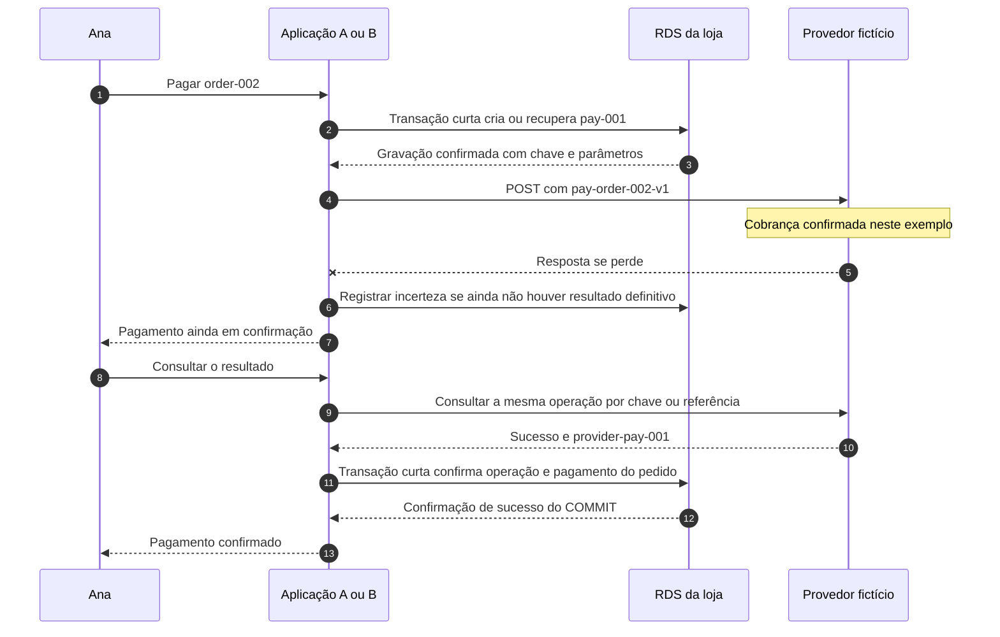
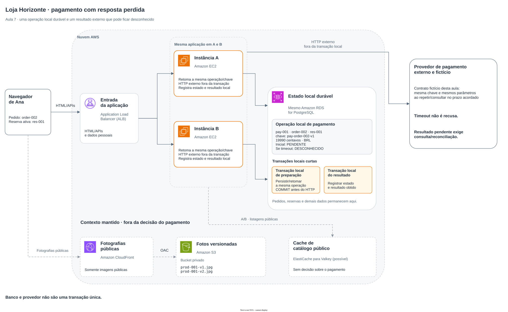

# Aula 7 — O pagamento ficou sem resposta. Como evitar cobrar duas vezes?

[Trilha System Design a partir do zero](../00-system-design-from-zero.md) · [Aula 6 — A última unidade](06-last-unit.md) · [Cenário da Loja Horizonte](00-scenario.md)

Vamos continuar uma possibilidade da Aula 6: Ana conseguiu a reserva `res-001` para `order-002`. A loja pede o pagamento a um provedor externo, mas a resposta se perde. Ana deve tentar outra vez? A cobrança aconteceu?

Ao final, você conseguirá distinguir uma intenção de pagamento de suas tentativas de comunicação, explicar o papel da idempotência e acompanhar a reconciliação de um resultado incerto. O provedor, seus caminhos e seus estados são fictícios. Não executamos uma cobrança, uma API de pagamento ou um teste de falha nesta aula.

**Reconciliação** é comparar as evidências do provedor com os registros da loja e ajustar o estado local conforme o resultado confirmado, sem criar outra cobrança.

## Roteiro

- [A resposta perdida](#cena), [os requisitos](#requisitos) e [os registros de pagamento](#pagamento).
- [Idempotência](#idempotencia) e [o caminho da operação](#caminho).
- [Alternativas](#tradeoffs), [implementação na AWS](#aws) e [falhas](#falha).
- [Perguntas](#perguntas), [exercício](#exercicio) e [resumo](#resumo).

<a id="cena"></a>
## 1. A loja enviou a cobrança, mas não recebeu uma conclusão

Nesta cena, o pedido de Ana tem uma unidade de `prod-001`, o Fone de ouvido, e um total já validado no servidor de **19990 centavos, em BRL**. A reserva está ativa e o pedido pode iniciar o pagamento. Os valores são fictícios, e não vêm do preço exibido em cache nem de um total escolhido pelo navegador.

O provedor é outro sistema. Sua **API**, o contrato de requisições e respostas usado pela aplicação, recebe o pedido de pagamento e informa o resultado.

Considere dois caminhos possíveis:

- a requisição não chegou a ser processada;
- a cobrança foi confirmada pelo provedor, mas a resposta não chegou à loja.

Um **timeout**, o fim de uma espera após um limite, pode ocorrer nos dois caminhos. Ele descreve o que a aplicação conseguiu observar; não prova que o provedor deixou de agir.

Também pode acontecer de A enviar a requisição e cair. Uma tentativa posterior de Ana chegará a B, que precisa reconhecer a mesma operação em vez de inventar outra cobrança.

<a id="requisitos"></a>
## 2. O que precisa continuar correto?

A regra é **não transformar uma repetição da mesma intenção em outra cobrança**. Precisamos separar esse objetivo das condições que o tornam possível.

| Condição | Como avaliar a proposta |
|---|---|
| Intenção identificável | A e B encontram a mesma operação durável para o pedido |
| Parâmetros consistentes | A repetição usa a mesma referência, valor, moeda e demais dados que fazem parte da intenção |
| Resultado incerto | Manter e investigar a incerteza, sem declarar recusa ou pagamento por suposição |
| Registro local | Atualizar a operação e o estado de pagamento do pedido de forma coordenada |
| Proteção | Validar quem pode operar e consultar o pedido; a chave não substitui autorização |
| Repetição limitada | Respeitar o contrato, a janela permitida, os limites de tentativas e a capacidade do provedor |

O RDS mantém os registros locais da loja. O fato de a cobrança ter ocorrido no outro sistema precisa de evidência do provedor. Um registro local pendente não prova ausência de cobrança externa.

Esta aula considera **uma intenção de pagamento por pedido** e um único provedor. Trocar o meio de pagamento, autorizar uma nova intenção, estornar, disputar uma cobrança ou coordenar várias formas de pagamento exigiria ampliar o modelo.

Tempos de espera, janela de repetição, carga, erros e limites operacionais precisam ser definidos antes de aprovar uma integração. Não há uma garantia universal de prazo ou de processamento completo baseada apenas no desenho.

<a id="pagamento"></a>
## 3. Pedido, operação e tentativa são coisas diferentes

- **Pedido:** o registro comercial criado pela loja, como `order-002`.
- **Operação de pagamento:** a intenção de cobrar um valor determinado para esse pedido, como `pay-001`.
- **Tentativa de comunicação:** um envio ou uma consulta feita para acompanhar essa operação. Pode haver mais de uma tentativa sem criar outra intenção.

Antes de enviar a cobrança, a aplicação registra a operação no banco. Uma representação didática seria:

```text
operationId: pay-001
orderId: order-002
reservationId: res-001
amountMinor: 19990
currency: BRL
idempotencyKey: pay-order-002-v1
state: PENDENTE
```

O valor é uma fotografia dos dados autorizados para essa intenção. Ele não é recalculado a partir de um anúncio em cache a cada repetição. Se uma mudança de valor ou de outro parâmetro for necessária, precisamos de uma regra para essa mudança; não reutilizamos silenciosamente a mesma intenção com dados diferentes.

### Duas aplicações precisam encontrar o mesmo registro

No modelo desta aula, `payment_operations` tem uma operação identificada de forma única e uma restrição de unicidade por pedido, como `UNIQUE (order_id)`. **Unicidade** impede dois registros locais para essa mesma associação.

Em uma transação local curta, a aplicação valida o pedido elegível e cria ou recupera sua operação. Se A e B disputarem a criação, a restrição e o tratamento do resultado precisam levá-las ao mesmo registro confirmado. A aplicação não envia uma cobrança antes de confirmar qual operação foi persistida.

Isso protege a identidade local da intenção. A restrição no RDS não controla, sozinha, o que o provedor externo executa.

O recorte de uma operação por pedido também tem limites: ele não implementa automaticamente novas intenções depois de uma recusa. Esse fluxo precisaria de regras próprias para o pedido e para a operação anterior.

<a id="idempotencia"></a>
## 4. A mesma intenção precisa ser reconhecida no destino

**Idempotência**, neste pagamento, é a propriedade contratada para que repetir a mesma intenção não provoque outra cobrança dentro das condições definidas. Ela não significa que toda tentativa receberá uma resposta final imediata ou o mesmo status HTTP.

Usaremos a chave estável `pay-order-002-v1`. A aplicação guarda essa chave junto da operação antes do primeiro envio. Uma nova tentativa de comunicação mantém a chave e os parâmetros correspondentes.

Adicionar `POST` ou repetir os mesmos bytes não faz isso acontecer automaticamente. O provedor precisa oferecer e implementar a capacidade de reconhecer a intenção. O nome `Idempotency-Key` abaixo é uma convenção da API fictícia deste exemplo, não uma garantia presente em qualquer API.

### O contrato do provedor faz parte da solução

Para explicar o fluxo, assumimos que o provedor fictício oferece estas capacidades:

| Parte do contrato | Condição usada neste exemplo |
|---|---|
| Escopo da chave | Reconhecer a chave na conta da loja e na operação de cobrança acordadas |
| Parâmetros | Comparar a intenção; uma chave existente não autoriza mudar valor, moeda ou demais parâmetros da operação |
| Chamadas simultâneas | Coordenar pedidos com a mesma chave para não criar duas cobranças dessa intenção; uma resposta pode continuar pendente |
| Retenção | Documentar por quanto tempo a associação é preservada e a partir de qual evento o prazo é contado |
| Consulta | Permitir acompanhar a mesma operação por sua chave ou referência, conforme o contrato |
| Resultado | Distinguir processamento pendente, sucesso definitivo e recusa definitiva |

São **premissas da API fictícia**, não funcionalidades implementadas pela presença de um cabeçalho. Uma integração real precisa conferir cada uma na documentação e nos testes do provedor escolhido.

Não fixaremos um prazo universal de retenção. O fluxo pressupõe que a aplicação sabe que ainda está dentro da janela válida. Se isso não puder ser confirmado, ela não deve repetir automaticamente a cobrança com outra chave ou ignorar o prazo.

A capacidade de consulta também não surge automaticamente da idempotência. Ela é outra parte do contrato que estamos exigindo para investigar resultados incertos.

### Um envio com identidade estável

No exemplo, a aplicação chama `POST /payments`. Estes são os campos relevantes do envio, e não uma mensagem HTTP completa ou uma integração executável:

```http
Idempotency-Key: pay-order-002-v1
Content-Type: application/json

{
  "merchantReference": "pay-001",
  "amountMinor": 19990,
  "currency": "BRL"
}
```

`merchantReference` é a referência da loja que ajuda a relacionar a operação externa com a local. Autenticação e os dados necessários do meio de pagamento não são mostrados; não há cartões, contas ou credenciais reais.

Se a resposta se perder, trocar a chave para `pay-order-002-v2` pode fazer o provedor entender uma nova intenção. O sufixo não é um contador de tentativas a ser incrementado depois de um timeout.

<a id="caminho"></a>
## 5. Quatro passos para acompanhar a mesma operação

### Preparar e confirmar os registros locais

Em uma transação curta no RDS, a aplicação valida a pessoa e o pedido, verifica as condições da reserva e cria ou recupera `pay-001`, com seu valor e chave estáveis. Confirma essa gravação antes do envio externo.

Se a confirmação local ficar desconhecida, deve consultar e reconciliar essa preparação antes de enviar ou criar outra operação. Guardar a intenção de forma durável permite a B retomá-la depois de uma falha de A.

### Chamar o provedor fora da transação

Depois, a aplicação faz a chamada HTTP. Ela não mantém uma transação do RDS aberta esperando a rede ou a decisão de pagamento.

A transação local não abrange o sistema externo. Dar `ROLLBACK` no banco da loja não desfaz uma cobrança que o provedor já confirmou.

### Consultar quando o resultado for incerto

Após timeout ou perda de conexão, a aplicação mantém o desfecho como desconhecido e consulta a operação conforme o contrato. Se a consulta ainda disser pendente ou não localizar uma conclusão, isso não autoriza inventar recusa nem criar outra chave.

Uma consulta poderia devolver estes dados fictícios:

```json
{
  "merchantReference": "pay-001",
  "providerReference": "provider-pay-001",
  "status": "SUCCEEDED",
  "amountMinor": 19990,
  "currency": "BRL"
}
```

Esse é um exemplo de resultado confirmado pelo provedor, não a resposta recebida no momento do timeout. A aplicação verifica a origem autorizada da informação e sua correspondência com a operação, o valor e a moeda.

Se repetir um envio for uma opção válida, ele usa a mesma operação, chave e parâmetros, dentro da janela e dos limites contratados. Esperas crescentes entre tentativas, chamadas de **backoff**, e uma variação aleatória, chamada **jitter**, podem ajudar a evitar muitas repetições concentradas. Isso não substitui o controle da intenção.

### Registrar o resultado definitivo de forma repetível

Quando houver evidência suficiente, outra transação local curta registra o resultado da operação e o estado de pagamento do pedido juntos. Se a mesma conclusão chegar novamente, aplicar o resultado não deve gerar outra cobrança ou repetir efeitos de negócio.

O modelo precisa controlar transições: um timeout atrasado não pode rebaixar uma operação já confirmada para desconhecida. Resultados incompatíveis exigem investigação, em vez de simplesmente deixar a última resposta sobrescrever a anterior.

O controle pode ser resumido assim:

```text
em uma transação local curta:
    validar o pedido e criar ou recuperar a operação única
    preservar valor, moeda, referência e chave dessa intenção
    confirmar a gravação antes de qualquer envio externo

fora da transação do banco:
    enviar ou consultar conforme o contrato do provedor
    em repetição permitida, manter a mesma chave e os mesmos parâmetros
    se o resultado for incerto, manter a investigação da mesma operação
    se a janela não for comprovadamente válida, interromper envios automáticos

ao obter um resultado definitivo validado:
    em nova transação local curta:
        conferir a operação e as transições permitidas
        registrar o resultado e o estado de pagamento do pedido juntos
        tratar uma conclusão já aplicada sem repetir efeitos
    se a confirmação local ficar desconhecida, consultar os registros
    não iniciar outra cobrança para consertar uma gravação local
```

<a id="mermaid"></a>
### A cobrança aconteceu, mas a primeira resposta se perdeu

O Mermaid responde: **como retomar a mesma operação quando o efeito externo pode ter ocorrido antes da confirmação local?** É uma sequência possível, sem execução real nem tempos medidos.



A pode cair e B continuar esse acompanhamento, pois o contexto está no banco. O desenho não assegura retomada automática se ninguém iniciar o trabalho; disparo e execução de trabalho em segundo plano serão assunto da próxima aula.

<a id="tradeoffs"></a>
## 6. O que estamos escolhendo e quais são os limites?

**Escolha:** manter uma intenção durável e estável, exigir um contrato de idempotência e consulta no provedor e aplicar o resultado local de forma repetível.

**Ganho e limite:** conseguimos relacionar tentativas e investigar a operação depois de falhas. Em troca, precisamos de registros, restrições, estados, tratamento de concorrência, consultas e regras de retenção e repetição. A coordenação depende de capacidades do provedor; o banco sozinho não as fornece.

**Quando reconsiderar:** outro provedor, várias intenções por pedido, mudanças de valor, reserva com validade concorrente e regras diferentes de pagamento exigem rever o modelo. Se a API não oferecer as capacidades assumidas, não podemos apenas manter o mesmo desenho e declarar a mesma garantia.

| Atalho | O problema que deixa aberto |
|---|---|
| Repetir o `POST` sem reconhecer a intenção | O provedor pode executar outra cobrança |
| Criar uma nova chave depois de um timeout | A primeira operação pode ter ocorrido e a nova parecer outra intenção |
| Proteger apenas o registro local com `UNIQUE` | A restrição não controla o efeito no sistema externo |
| Manter uma transação local aberta durante o HTTP | Prolonga bloqueios e não inclui o provedor na transação |

Idempotência, registro local e reconciliação trabalham juntos. Nenhum rótulo no diagrama entrega sozinho uma garantia global de execução exatamente uma vez.

<a id="aws"></a>
## 7. Uma implementação possível na AWS

| Componente | Papel nesta etapa |
|---|---|
|  ALB | Encaminhar solicitações sem decidir o resultado da cobrança |
|  Aplicações EC2 A/B | Validar o pedido, controlar a intenção, chamar e consultar o provedor |
|  RDS for PostgreSQL | Guardar pedidos, reservas e operações de pagamento, com transações locais curtas |
| Provedor externo fictício | Executar a operação externa segundo seu contrato de idempotência, estados e consulta |
| Cache,  CloudFront e  S3 | Continuar atendendo catálogo público e fotografias, sem decidir o pagamento |

Não acrescentamos um serviço AWS para executar o pagamento. O provedor está fora da fronteira da transação do RDS. Configuração de rede, autenticação e operação ainda precisariam ser implementadas e testadas em uma integração real.

<a id="arquitetura"></a>
### Dois sistemas, com registros e responsabilidades próprios

O Draw.io responde: **onde a loja guarda sua intenção e onde o efeito externo precisa ser confirmado?** Ele distingue as transações locais da chamada HTTP, sem prometer uma transação única entre os sistemas.



[Abrir a fonte editável do diagrama](assets/07-payment-uncertain-aws.drawio).

<a id="falha"></a>
## 8. O que pode falhar entre esses passos?

| Situação | O que preservar e investigar |
|---|---|
| A operação foi criada, mas a aplicação caiu antes do envio | Recuperar o registro e sua identidade; ainda precisamos verificar o que foi enviado antes de decidir uma repetição |
| O provedor confirmou, mas a aplicação caiu antes de gravar o resultado | Consultar a mesma operação e aplicar a conclusão localmente |
| A consulta informa pendente ou resultado ainda não localizado | Manter a investigação; isso pode ser inconclusivo sobre uma requisição em andamento |
| A janela de retenção venceu ou não é conhecida | Interromper envios automáticos e reconciliar; não presumir que uma chave antiga continua protegida |
| Outra tentativa muda valor, moeda ou referência sob a mesma chave | Tratar a incompatibilidade; não reaproveitar silenciosamente a intenção |
| O `COMMIT` local ficou sem confirmação | Consultar os registros; outra cobrança não conserta a dúvida sobre uma transação local |
| A aplicação recebe uma recusa definitiva validada | Registrar o resultado segundo as regras; não confundir com erro de transporte ou resposta genérica de erro |

### O estado conhecido não deve esconder a incerteza

Para estudar o acompanhamento, podemos usar estados locais simplificados:

- **PENDENTE:** operação criada ou ainda sem conclusão.
- **DESCONHECIDO:** a comunicação não permitiu concluir o resultado externo.
- **CONFIRMADO:** há resultado definitivo validado de sucesso, registrado localmente.
- **RECUSADO:** há resultado definitivo validado de recusa, registrado localmente.

Esses nomes são escolhas do exemplo. Não representam todos os estados possíveis de um meio de pagamento. Um código HTTP de erro, sozinho, não determina qual estado de negócio aconteceu.

**Pagamento confirmado não significa produto entregue.** Preparação, entrega, estorno e outras etapas têm decisões próprias. Também não estamos detalhando autorização, captura ou liquidação financeira.

### E se a reserva expirar enquanto o resultado ainda é incerto?

Na sequência normal, partimos de uma reserva ativa. Em um fluxo completo, ela pode mudar enquanto o provedor processa o pagamento. Se chegar um sucesso depois de uma expiração ou cancelamento, há uma situação a reconciliar entre pagamento e estoque.

Não podemos fingir que o rollback local desfez a cobrança, nem liberar estoque apenas porque a comunicação deu timeout. Estorno e compensação exigem operações e regras próprias. A coordenação completa com o ciclo de vida da reserva permanece fora do fluxo demonstrado, como na Aula 6.

### O que verificar antes de aprovar a proposta?

- Duas solicitações da mesma intenção encontram o mesmo registro, chave e parâmetros.
- Uma queda antes ou depois do envio não faz a aplicação inventar outra intenção.
- Chamadas concorrentes e resultados pendentes têm o comportamento acordado no provedor.
- Resultados repetidos não rebaixam estados definitivos nem repetem efeitos de negócio.
- Falhas, retenção, esperas, tentativas e sua carga são observadas com limites definidos.
- Um resultado externo confirmado e uma confirmação local perdida podem ser reconciliados.

Esses são cenários de teste propostos. Não executamos uma cobrança ou essas falhas, e o diagrama não substitui a validação do contrato externo.

<a id="perguntas"></a>
## 9. Verifique seu entendimento

Responda antes de abrir os comentários.

### 1. O timeout prova que a cobrança não aconteceu?

**Pergunta extra:** Qual é a diferença entre a loja não receber uma conclusão e o provedor não executar a operação?

<details>
<summary>Ver resposta comentada</summary>

O fim da espera descreve a observação da loja. A cobrança pode não ter sido processada ou pode ter ocorrido com a resposta perdida. Precisamos acompanhar a mesma operação e obter evidência do provedor antes de classificar seu resultado. Tratar a ausência de resposta como recusa pode levar a outra cobrança indevida.

</details>

### 2. A chave sozinha faz qualquer `POST` ficar seguro para repetir?

**Pergunta extra:** O que precisamos saber sobre escopo, retenção e chamadas simultâneas?

<details>
<summary>Ver resposta comentada</summary>

O destino precisa implementar o contrato. Devemos conhecer onde a chave vale, por quanto tempo sua associação é mantida, como os parâmetros são comparados e o que acontece com solicitações simultâneas. Consulta e significado dos estados também precisam ser definidos. Um cabeçalho com nome conhecido não cria essas capacidades automaticamente.

</details>

### 3. Podemos trocar a chave ou o valor depois de uma resposta perdida?

**Pergunta extra:** A mudança para `pay-order-002-v2` é apenas outra tentativa da mesma operação?

<details>
<summary>Ver resposta comentada</summary>

Uma chave nova pode identificar outra intenção, enquanto a anterior ainda pode ter sido executada. Uma mudança de valor sob a chave antiga também viola a correspondência da operação. A repetição permitida preserva a chave e os parâmetros; mudanças reais exigem regras que considerem o desfecho e os limites da intenção anterior.

</details>

### 4. Por que não manter uma transação do banco aberta durante o pagamento?

**Pergunta extra:** Um `ROLLBACK` no RDS desfaz a cobrança já confirmada pelo provedor?

<details>
<summary>Ver resposta comentada</summary>

O provedor não participa dessa transação local. Segurar a transação durante o HTTP prolonga bloqueios sem fornecer uma confirmação conjunta dos dois sistemas. Usamos etapas locais curtas e acompanhamento externo. Se o provedor confirmou, um rollback do RDS não estorna esse efeito; a conclusão precisa ser reconciliada e tratada segundo o contrato.

</details>

### 5. A e B recebem o mesmo sucesso. O que deve acontecer no banco?

**Pergunta extra:** Um timeout atrasado pode mudar uma operação confirmada para desconhecida?

<details>
<summary>Ver resposta comentada</summary>

As aplicações precisam reconhecer a mesma intenção e aplicar as transições locais de forma repetível, sem outra cobrança ou efeitos duplicados. Registrar o resultado e o pagamento do pedido deve ser coordenado. Uma conclusão já confirmada não deve ser rebaixada por uma observação antiga; informações incompatíveis exigem investigação.

</details>

### 6. O provedor ainda não localizou o resultado. Podemos liberar a reserva e cobrar de novo?

**Pergunta extra:** E se a primeira operação terminar com sucesso depois disso?

<details>
<summary>Ver resposta comentada</summary>

Uma consulta inconclusiva não autoriza criar outra intenção nem tratar o estoque como automaticamente liberado. A operação pode estar em andamento. Precisamos respeitar a janela e reconciliar o pagamento com a situação da reserva. Uma conclusão tardia exige regras próprias; o exemplo não fornece cancelamento, estorno ou compensação automática.

</details>

<a id="exercicio"></a>
## 10. Aplique o que aprendeu

### Parte A — A resposta se perdeu

A criou e confirmou `pay-001` para `order-002`, no valor de 19990 centavos em BRL, com a chave `pay-order-002-v1`. O provedor confirmou o pagamento, mas a resposta se perdeu. Ana tenta acompanhar a compra novamente e chega a B.

1. Quais dados B precisa recuperar antes de decidir o que fazer?
2. B deve criar outra operação ou usar os dados persistidos da mesma intenção?
3. Que evidência permite registrar o pagamento confirmado?
4. Por que a reserva e o pedido não devem ser tratados como cancelados só pelo timeout?

### Parte B — O efeito externo já existe

B consultou a operação e recebeu um sucesso validado, com `provider-pay-001`. Ao registrar o resultado e o estado de pagamento do pedido no RDS, a conexão cai durante a confirmação local.

1. Qual confirmação ficou desconhecida agora?
2. Uma nova chamada para criar uma cobrança resolve esse problema?
3. Que registros devemos consultar e como tratar a repetição da atualização local?

<details>
<summary>Ver solução comentada</summary>

Na Parte A, B recupera a operação persistida, o pedido, a reserva e as condições necessárias para continuar o acompanhamento, incluindo chave, valor, moeda e parâmetros da intenção. Não inventa outra chave. Usa a consulta e, quando contratualmente permitido, a repetição da mesma operação dentro dos limites. Uma conclusão definitiva autorizada e correspondente do provedor permite registrar o resultado local. O timeout não declarou recusa nem cancelou estoque ou pedido.

Na Parte B, já temos evidência do efeito externo; a dúvida é sobre a confirmação da transação local. Devemos consultar a operação e o estado de pagamento do pedido no RDS e aplicar somente as transições ainda necessárias, sem repetir efeitos. Outra cobrança não resolve essa incerteza. A recuperação precisa preservar a mesma intenção e não rebaixar uma conclusão já gravada.

</details>

<a id="resumo"></a>
## 11. O que você deve levar desta aula

- Timeout não informa sozinho se o efeito externo aconteceu.
- Uma intenção de pagamento precisa de identidade durável, chave estável e parâmetros consistentes.
- Idempotência depende de um contrato no destino, com escopo e limites.
- Transações locais curtas não tornam banco e provedor uma transação única.
- Consulta, transições controladas e reconciliação permitem acompanhar o que ainda não sabemos.

Consigo explicar:

- [ ] pedido, operação e tentativa de comunicação;
- [ ] por que confirmar a preparação local antes do envio externo;
- [ ] quando a mesma chave pode ser reutilizada e quando interromper envios automáticos;
- [ ] como investigar um efeito remoto confirmado e um resultado local incerto;
- [ ] por que pagamento, reserva e entrega exigem coordenação, sem prometer uma garantia global pelo desenho.

**Continue na [Aula 8 — O trabalho precisa continuar. Como processar sem deixar Ana esperando?](08-async-work.md):** aceitação durável, publicação e acompanhamento por uma fila.

[Voltar ao índice da trilha](../00-system-design-from-zero.md) · [Rever a Aula 6](06-last-unit.md).
