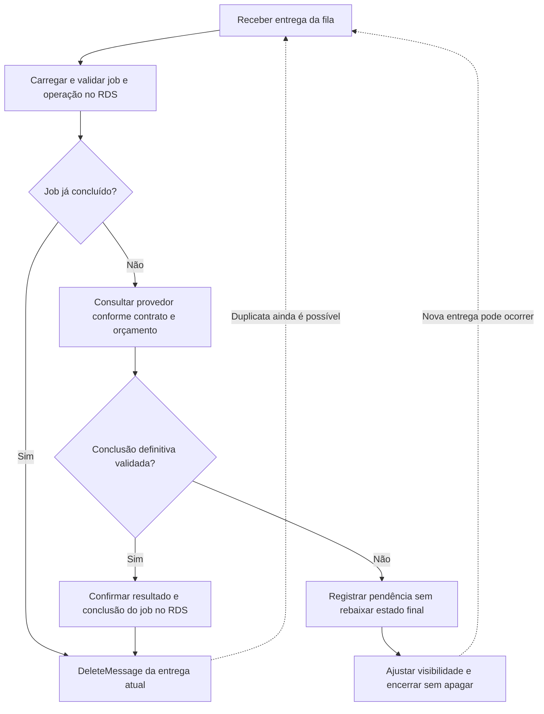

# Aula 8 — O trabalho precisa continuar. Como processar sem deixar Ana esperando?

[Trilha System Design a partir do zero](../00-system-design-from-zero.md) · [Aula 7 — Pagamento com resposta perdida](07-payment-uncertain.md) · [Cenário da Loja Horizonte](00-scenario.md)

O pagamento de `order-002` ainda está em acompanhamento. A loja conhece a operação `pay-001`, mas pode precisar consultar o provedor novamente. Ana não deveria manter a mesma requisição aberta até o resultado chegar. Como aceitar esse trabalho e continuar depois?

Ao final, você conseguirá acompanhar uma tarefa desde seu registro até a confirmação do processamento, explicar uma fila e tratar repetições sem criar outra intenção de pagamento. A fila, o trabalhador e o provedor são uma proposta didática: não executamos mensageria, cobranças, SQL ou testes de falha nesta aula.

## Roteiro

- [O trabalho pendente](#cena), [os requisitos](#requisitos) e [a resposta assíncrona](#assincrono).
- [Fila e entrega](#fila), [caminho completo](#caminho) e [decisão do trabalhador](#mermaid).
- [Alternativas](#tradeoffs), [implementação na AWS](#aws) e [falhas](#falha).
- [Perguntas](#perguntas), [exercício](#exercicio) e [resumo](#resumo).

<a id="cena"></a>
## 1. A primeira resposta não precisa ser a conclusão de todo o trabalho

Vamos continuar o caso da Aula 7: Ana tem `order-002`, reserva `res-001` e a operação fictícia `pay-001`, no valor autorizado de 19990 centavos em BRL. A resposta de pagamento ficou incerta, e a loja precisa acompanhar essa mesma operação.

O trabalho desta aula é **consultar e reconciliar uma operação existente**, até registrar uma conclusão definitiva ou sinalizar que ela ainda exige acompanhamento. Ele não cria uma nova cobrança nem inventa outra chave.

Chamaremos essa tarefa de `job-001`, do tipo `RECONCILIAR_PAGAMENTO`. Um **job** é uma unidade de trabalho acompanhável. O pedido comercial, a operação de pagamento, a tarefa e a mensagem que transporta seu aviso são registros diferentes.

O acompanhamento deve poder continuar depois da primeira resposta e da queda de uma cópia da aplicação. Para isso, precisamos registrar o compromisso assumido, transportar a tarefa e tratar o resultado. Apenas iniciar uma função na memória de A não resolve essa necessidade.

<a id="requisitos"></a>
## 2. O que significa aceitar esse trabalho?

| Condição | Como avaliar a proposta |
|---|---|
| Responsabilidade registrada | Antes de responder aceitação, confirmar a tarefa e sua intenção de publicação no banco |
| Identidade preservada | Repetições apontam para `job-001` e `pay-001`, sem criar outra cobrança |
| Recuperação após queda | Outra execução consegue encontrar os registros necessários |
| Confirmação segura | A entrega só é removida após confirmar o resultado local que autoriza isso |
| Pendência visível | Resultado incerto não vira pagamento recusado nem tarefa concluída por suposição |
| Limites operacionais | Registrar orçamento de consultas, esperas, retenção, falhas e necessidade de intervenção |

A aplicação valida quem pode solicitar ou consultar o acompanhamento desse pedido. Conhecer `job-001` não é uma permissão para acessar os dados de Ana.

Precisamos medir separadamente o tempo da primeira resposta e o tempo até a conclusão da tarefa. Uma resposta rápida de aceitação não comprova que o trabalho foi executado ou que o pagamento terminou.

Os limites de carga, espera, repetição, retenção e intervenção ainda precisam ser definidos e testados. O desenho não garante retomada automática nem execução em um prazo universal.

<a id="assincrono"></a>
## 3. Separar a aceitação da execução

No processamento **síncrono**, o programa que chamou espera a execução para receber sua resposta. No processamento **assíncrono**, parte do trabalho pode continuar separada daquela primeira interação.

O processamento assíncrono não remove a responsabilidade de informar e registrar o resultado. Ele exige uma forma de acompanhar o que foi aceito e o que ainda falta fazer.

### Uma resposta de aceitação

Depois da gravação confirmada da tarefa, a API fictícia da loja poderia responder:

```http
HTTP/1.1 202 Accepted
Content-Type: application/json

{
  "jobId": "job-001",
  "operationId": "pay-001",
  "state": "PENDENTE",
  "statusPath": "/jobs/job-001"
}
```

**`202 Accepted` significa aceito para processamento, ainda não concluído.** Não significa pagamento confirmado, mensagem já consumida ou garantia de execução futura.

O caminho de acompanhamento é uma escolha dessa API de exemplo. A pessoa autorizada poderia consultá-lo para ver o estado do trabalho e do pagamento, que precisam ser apresentados sem confundir os dois.

Se a resposta de aceitação se perder, a aplicação deve reconhecer a tarefa já registrada para essa finalidade. Neste recorte, uma restrição de unicidade por operação e tipo de tarefa ajuda a recuperar o mesmo `job-001`, em vez de criar um acompanhamento a cada clique.

<a id="fila"></a>
## 4. Uma fila transporta o aviso do trabalho

Uma **fila** permite que um programa envie mensagens e outro as receba para processamento. Usaremos **Amazon SQS Standard** como implementação possível.

O **produtor** envia uma mensagem. O **consumidor**, que chamaremos de trabalhador ou **worker**, recebe e trata essa mensagem. Esses são papéis do código; não exigem uma tecnologia diferente para cada papel.

A mensagem pode carregar referências suficientes para encontrar o trabalho durável:

```json
{
  "eventId": "evt-001",
  "jobId": "job-001",
  "operationId": "pay-001",
  "type": "RECONCILIAR_PAGAMENTO"
}
```

`evt-001` identifica o aviso lógico. Ele não é o identificador que o SQS atribui ao envio. Se o publicador enviar o mesmo aviso novamente, precisamos continuar reconhecendo o mesmo trabalho.

O trabalhador busca os parâmetros e estados no RDS e valida a relação entre as referências. A mensagem não contém cartão, credencial ou uma instrução para decidir um novo valor de cobrança.

### Receber não é apagar

Ao receber uma mensagem, o consumidor obtém um **ReceiptHandle**, uma referência àquela recepção. Ele é usado no `DeleteMessage`, a operação que pede a remoção da mensagem depois do processamento.

O **visibility timeout** é um período de invisibilidade após a recepção. Ele reduz a sobreposição entre consumidores enquanto alguém trabalha, mas **não é uma trava exclusiva**. No SQS Standard, duplicatas são possíveis, inclusive durante esse período.

Se a mensagem não for removida, poderá ficar disponível para nova recepção. Uma nova recepção tem seu próprio ReceiptHandle. `eventId`, identificador do SQS e referência da recepção têm funções distintas.

### Por que precisamos aceitar repetições?

SQS Standard usa entrega **pelo menos uma vez** e pode entregar mensagens fora da ordem de envio. A lógica precisa tolerar duplicatas e não depender de uma ordem global exata.

Até depois de uma exclusão bem-sucedida pode ocorrer uma entrega duplicada. A identidade durável do trabalho e o tratamento idempotente continuam necessários; um recibo de transporte não substitui o estado do negócio.

<a id="caminho"></a>
## 5. Como ligar banco, fila e trabalhador?

### Registrar a tarefa e o aviso juntos

Há uma nova falha possível: gravar `job-001` no banco e cair antes de enviar sua mensagem. Também seria errado enviar a mensagem e depois falhar ao gravar a tarefa que ela referencia.

Usaremos uma **outbox**, uma tabela de avisos a publicar. Em uma transação local curta, a aplicação confere a operação existente e grava a tarefa e o aviso `evt-001` juntos.

| Registro | Papel nesta proposta |
|---|---|
| Operação `pay-001` | Manter a intenção e o estado de pagamento da Aula 7 |
| Tarefa `job-001` | Acompanhar esse trabalho, seu estado e seu orçamento de consultas |
| Outbox `evt-001` | Guardar o aviso ainda não publicado para a tarefa |

Só depois da confirmação dessa transação a aplicação responde aceitação. A outbox permanece consultável se A cair. Ela não publica sozinha: um processo separado precisa ler os avisos confirmados e enviá-los.

### Publicar depois da confirmação

Chamaremos esse processo de **publicador**. Seu caminho é:

```text
ler um aviso confirmado e ainda pendente na outbox
enviar à fila as mesmas referências de evento, tarefa e operação

se a aceitação do envio pela fila for confirmada:
    registrar a publicação no banco
se o envio ou sua confirmação falhar:
    manter a publicação pendente e tratar a repetição com limites
```

Se o envio acontecer e o publicador cair antes de registrar a publicação, ele pode enviar o aviso de novo. Essa duplicata é esperada no desenho. A aceitação pelo SQS confirma uma etapa de transporte, não a conclusão da tarefa.

A outbox mantém a intenção de publicar junto dos registros locais. Ela **não cria uma transação única entre RDS e SQS**.

### Processar a mesma tarefa sem repetir efeitos

O trabalhador carrega o estado atual do job e da operação. Se o objetivo já foi concluído e isso está confirmado no RDS, ele pode reconhecer a duplicata sem repetir a consulta externa. Se a operação já tiver um resultado definitivo validado, mas o job ainda estiver aberto, a aplicação confirma o encerramento correspondente do job em uma transação local, sem precisar redescobrir o mesmo resultado no provedor.

Caso precise consultar, primeiro verifica a política de tentativas e registra o uso de seu orçamento durável de maneira coordenada. Essa gravação precisa ficar confirmada antes da consulta externa. Se falhar ou sua confirmação ficar incerta, a aplicação não consulta nem apaga a entrega: confere os registros antes de continuar, sem presumir que o orçamento está livre. Consumidores simultâneos não podem simplesmente ler o mesmo contador e ambos gastar a última tentativa sem controle. Reservar orçamento também não equivale a marcar a tarefa como concluída.

Depois, consulta o provedor fictício seguindo o contrato da Aula 7. Erro ou timeout dessa consulta deixa o resultado inconclusivo; quando possível, a aplicação registra essa observação e encerra a tentativa sem remover a entrega, conforme sua política. O trabalho continua ligado à mesma operação; não envia uma cobrança nova para tentar descobrir o resultado.

Ao aplicar uma conclusão, usa uma transação local curta para registrar o resultado da operação, o estado de pagamento do pedido e a conclusão do job de forma coordenada. Revalida o estado antes de gravar: uma consulta antiga ou pendente não pode rebaixar um resultado definitivo já confirmado.

Somente após uma confirmação conhecida que autorize a conclusão, pede `DeleteMessage` com o ReceiptHandle da entrega atual.

```text
receber a mensagem e guardar o ReceiptHandle desta entrega
carregar e validar tarefa, operação e política no RDS
se não for possível validar os registros:
    registrar a causa quando possível e encerrar sem apagar a entrega
se a operação já tem conclusão definitiva e a tarefa ainda está aberta:
    revalidar e confirmar o encerramento correspondente do job no RDS
    se a confirmação ficar incerta, conferir os registros antes de apagar

se a tarefa já está concluída de forma confirmada:
    reconhecer a duplicata e pedir DeleteMessage desta entrega
caso contrário, se a política permitir consultar:
    registrar e confirmar o uso do orçamento de consulta de maneira coordenada
    se a gravação falhar ou a confirmação ficar incerta:
        conferir os registros e encerrar sem consultar nem apagar a entrega
    consultar o provedor para a mesma operação
    tratar erro ou timeout da consulta como resultado inconclusivo
    em transação local curta, revalidar o estado:
        se houver conclusão definitiva validada:
            registrar resultado, pagamento do pedido e conclusão do job
        se continuar inconclusivo:
            registrar a pendência sem rebaixar uma conclusão já existente
    se a confirmação local ficar incerta:
        consultar os registros antes de remover a entrega
    se a conclusão local estiver confirmada:
        pedir DeleteMessage desta entrega
    se o trabalho continuar pendente:
        ajustar a visibilidade conforme a política e encerrar sem DeleteMessage
se o orçamento ou a política não permitirem continuar:
    sinalizar necessidade de acompanhamento, sem declarar pagamento recusado
```

Não gravamos uma marca definitiva de “já processado” antes de fazer e confirmar o trabalho. Uma queda entre essa marca e o resultado poderia fazer a próxima execução descartar uma tarefa ainda incompleta.

### E se o provedor ainda disser pendente?

Para simplificar esta aula, conservamos **a mesma mensagem** enquanto o objetivo estiver pendente. A tentativa termina sem apagá-la; a aplicação pode ajustar a visibilidade conforme os limites e o intervalo pretendido antes de outra consulta.

Não mantemos uma transação aberta nem um trabalhador dormindo à espera do resultado. Se o ajuste de visibilidade falhar, a mensagem pode voltar antes do esperado. Duplicatas e consumidores sobrepostos ainda precisam obedecer ao orçamento durável e preservar estados definitivos.

Um reagendamento com novas mensagens seria outra opção, mas exigiria garantir a continuidade durável antes de remover a entrega anterior. Esse mecanismo não é implementado no recorte escolhido.

<a id="mermaid"></a>
### O que precisa estar confirmado antes de remover a entrega?

O Mermaid mostra os caminhos de uma recepção com consulta permitida pela política. Falhas e esgotamento de limites ainda precisam do tratamento descrito no texto.



O ramo que remove a mensagem pressupõe confirmação local conhecida. Uma falha no `COMMIT` ou na comunicação dessa confirmação exige conferir os registros antes de agir.

<a id="tradeoffs"></a>
## 6. O que ganhamos ao separar o trabalho?

**Escolha:** registrar a responsabilidade no banco, publicar um aviso por outbox e tratar a tarefa com um consumidor de SQS Standard.

**Ganho e limite:** a primeira requisição pode terminar antes do acompanhamento completo, e diferentes consumidores podem assumir tarefas. Em troca, surgem atrasos, duplicatas, novos estados, processos e trabalho operacional para observar o que continua pendente.

**Quando reconsiderar:** volume, tempo aceitável até conclusão, custo, ordenação necessária e limites do provedor precisam justificar a opção. Mais consumidores podem aumentar a carga no banco e no provedor; não significam capacidade infinita.

| Alternativa | O que precisa ser considerado |
|---|---|
| Manter todo o trabalho na requisição | Simplicidade inicial, mas a pessoa continua esperando e uma queda interrompe aquele processo |
| Consultar uma tabela de tarefas sem fila | Também pode ser válido; exige implementar seleção, concorrência, espera e operação desse processamento |
| Usar fila e trabalhadores | Separa transporte e execução, mas requer tratar publicação, reentrega, confirmação e monitoramento |

Uma fila FIFO teria outras propriedades de ordenação e deduplicação, com seus limites. Trocar o tipo de fila não tornaria o efeito de um provedor externo e o banco uma transação única. Nesta aula, usamos Standard e assumimos explicitamente suas repetições.

<a id="aws"></a>
## 7. Uma implementação possível na AWS

| Componente | Papel nesta etapa |
|---|---|
|  ALB e  aplicações A/B | Validar a solicitação e confirmar o trabalho durável antes da resposta |
|  RDS for PostgreSQL | Manter operação, pedido, tarefa, orçamento e outbox |
| Publicador | Papel do código que lê avisos confirmados e os envia à fila |
| Amazon SQS Standard | Transportar mensagens entre publicador e consumidores, com reentregas possíveis |
| Trabalhador em EC2 | Papel do código que consulta a operação, registra o resultado e confirma o processamento |
| Provedor externo fictício | Informar o resultado da mesma operação segundo o contrato da Aula 7 |

Publicador e trabalhador são responsabilidades do programa. Podemos implementá-los com processos em EC2, sem tornar Lambda ou outro serviço um requisito desta aula. Quantidade de processos, implantação, permissões e capacidade ainda precisam ser escolhidas e testadas.

O cache de catálogo, o CloudFront e o S3 mantêm os papéis anteriores. Eles não decidem o pagamento nem substituem o registro da tarefa.

<a id="arquitetura"></a>
### Onde ficam o compromisso, o transporte e a execução?

O Draw.io responde: **quais componentes registram, publicam e processam o trabalho?** Ele separa transação local, fila e provedor, sem representar uma implantação já realizada.


[Abrir a fonte editável do diagrama](assets/08-async-work-aws.drawio).

<a id="falha"></a>
## 8. O processo caiu ou a tarefa continua pendente. E agora?

| Situação | O que precisa acontecer |
|---|---|
| Queda depois de gravar a outbox e antes do envio | O publicador precisa encontrar o aviso confirmado ainda pendente |
| Envio aceito, mas marca de publicação não confirmada | Pode haver novo envio do mesmo aviso; o consumidor reconhece o trabalho existente |
| Queda antes de concluir a tarefa no RDS | Não remover a mensagem como se o trabalho estivesse completo |
| Resultado confirmado no RDS e queda antes do `DeleteMessage` | A próxima entrega reconhece a conclusão e não repete seus efeitos |
| Confirmação do `DeleteMessage` perdida ou duplicata posterior | Continuar reconhecendo o estado durável, sem inventar outra operação |
| Resultado ainda incerto | Manter acompanhamento com limites, sem marcar o job concluído só para apagar a mensagem |

O objetivo do job é obter e registrar um resultado definitivo dessa operação de pagamento. Ele pode terminar com um sucesso ou uma recusa validada. Portanto, **job concluído não significa pagamento aprovado**, nem produto entregue.

Uma conclusão tardia também pode encontrar a reserva expirada, como na Aula 7. Registrar o fato do pagamento não resolve automaticamente estoque, entrega ou estorno; pendências dessas regras precisam continuar visíveis.

### Mensagens problemáticas precisam de um caminho de investigação

Uma **dead-letter queue**, ou **DLQ**, recebe mensagens encaminhadas após o limite de recebimentos configurado para a fila de origem. Ela ajuda a separar entregas que continuam sem tratamento, para análise e eventual reprocessamento.

Esse limite costuma ser configurado por `maxReceiveCount`, a quantidade máxima de recebimentos antes do encaminhamento previsto na política. Receber uma mensagem não é necessariamente consultar o provedor ou tentar cobrar. O orçamento total de consultas pertence ao job e precisa ser controlado separadamente.

DLQ não é uma lixeira nem uma declaração de pagamento recusado. É necessário observar mensagens, causas, registros da tarefa e condições para qualquer nova tentativa. Reprocessar sem corrigir a causa ou sem preservar a identidade pode apenas repetir o problema.

Fila e DLQ também têm retenção: uma mensagem não fica guardada para sempre. Ir para a DLQ ou expirar na fila não conclui o job. O registro durável continua exigindo acompanhamento e eventual intervenção, sem garantia de retomada automática.

O serviço pode organizar mensagens, mas não inicia sozinho o publicador ou o trabalhador da nossa aplicação. Uma outbox antiga, tarefas abertas e consumidores parados precisam ser detectados operacionalmente.

### O que observar antes de dizer que funcionou?

- Tempo até aceitar a solicitação e tempo até concluir o trabalho, separadamente.
- Idade das tarefas abertas e dos avisos ainda não publicados.
- Mensagens recebidas, reentregas e consultas externas, sem tratar esses números como equivalentes.
- Erros, esperas, orçamento consumido, mensagens na DLQ e retenção.
- Correção das transições e ausência de efeitos duplicados nas falhas propostas.

Não basta medir que a resposta `202` saiu rápido. Precisamos verificar onde o trabalho está, qual resultado foi registrado e o que ainda exige ação.

<a id="perguntas"></a>
## 9. Verifique seu entendimento

Responda antes de abrir os comentários.

### 1. `202 Accepted` confirma que Ana pagou?

**Pergunta extra:** O que a aplicação precisa confirmar antes de responder que aceitou o trabalho?

<details>
<summary>Ver resposta comentada</summary>

A resposta aceita processamento ainda não concluído. Antes dela, a aplicação confirma o compromisso durável da tarefa e sua intenção de publicação. O resultado de pagamento depende do acompanhamento da operação e de uma conclusão validada. Aceitação, envio, recepção e conclusão são momentos distintos.

</details>

### 2. Por que gravar uma outbox junto da tarefa?

**Pergunta extra:** Se o publicador enviar e cair antes de registrar a publicação, o que a próxima execução pode fazer?

<details>
<summary>Ver resposta comentada</summary>

A outbox guarda a intenção de enviar na mesma transação dos registros locais. Assim, uma queda não deixa a tarefa aceita dependendo apenas da memória do processo. Se o envio já ocorreu e a marca não ficou confirmada, pode haver repetição do mesmo aviso. O consumidor precisa reconhecer a mesma tarefa; não existe uma confirmação única entre banco e fila.

</details>

### 3. Receber uma mensagem dá exclusividade ao trabalhador?

**Pergunta extra:** O visibility timeout elimina a necessidade de tratamento idempotente?

<details>
<summary>Ver resposta comentada</summary>

A invisibilidade reduz sobreposição, mas não impede absolutamente outra entrega no SQS Standard. Duas execuções ainda podem encontrar o mesmo trabalho. Elas precisam controlar orçamento e transições e preservar resultados definitivos. Uma referência de recepção é útil para remover aquela entrega, não para provar exclusividade sobre o negócio.

</details>

### 4. Quando podemos pedir `DeleteMessage`?

**Pergunta extra:** O que a próxima entrega deve fazer se a conclusão ficou gravada, mas a exclusão falhou?

<details>
<summary>Ver resposta comentada</summary>

Pedimos a exclusão após uma conclusão local conhecida que autorize encerrar esse acompanhamento. Se a exclusão falhar ou aparecer uma duplicata posterior, a próxima execução encontra o job concluído e não repete a consulta ou os efeitos. Usa a referência da recepção atual para tratar a entrega. Marcar definitivamente como processado antes do trabalho criaria uma janela de perda.

</details>

### 5. O provedor continua pendente. Podemos concluir o job para tirar a mensagem da fila?

**Pergunta extra:** Qual caminho escolhemos nesta aula para outra consulta?

<details>
<summary>Ver resposta comentada</summary>

O objetivo ainda não foi atingido. Registramos a pendência e conservamos a mensagem, ajustando sua visibilidade conforme a política e encerrando a tentativa sem apagá-la. Outra entrega pode retomar o mesmo job dentro dos limites. Se for necessário outro mecanismo de reagendamento, ele precisa garantir continuidade durável antes de remover a entrega antiga.

</details>

### 6. Uma mensagem na DLQ significa que o pagamento foi recusado?

**Pergunta extra:** Por que contar recebimentos da fila não substitui um orçamento de consultas?

<details>
<summary>Ver resposta comentada</summary>

A DLQ organiza entregas que atingiram o limite configurado, não o resultado do pagamento. Uma recepção pode nem executar consulta externa, e outro processamento pode consumir orçamento de modo diferente. O job continua exigindo acompanhamento se não houver conclusão. A investigação e um eventual reprocessamento precisam respeitar sua identidade, seus registros e a causa da falha.

</details>

<a id="exercicio"></a>
## 10. Aplique o que aprendeu

### Parte A — O publicador caiu depois de enviar

A aplicação confirmou `job-001` e `evt-001` no RDS. O publicador enviou o aviso ao SQS, mas caiu antes de confirmar a marca de publicação. Depois ele envia o mesmo aviso novamente.

1. Isso deve criar outra operação de pagamento?
2. Quais identificadores permitem reconhecer o mesmo trabalho?
3. Por que marcar a publicação antes de tentar o envio seria perigoso?

### Parte B — O trabalhador caiu depois de confirmar

O trabalhador consultou `pay-001`, registrou um resultado definitivo e confirmou no RDS o estado correspondente do pagamento e a conclusão de `job-001`. Ele caiu antes de remover a entrega. Outro trabalhador recebe uma duplicata.

1. Precisa fazer outra consulta ou criar outra cobrança?
2. O que precisa conferir antes de pedir a exclusão da entrega atual?
3. Como seria diferente se a consulta anterior tivesse retornado apenas pendente?

<details>
<summary>Ver solução comentada</summary>

Na Parte A, as repetições continuam referindo-se ao evento `evt-001`, à tarefa `job-001` e à operação `pay-001`. Elas não autorizam outra cobrança. Marcar publicação antes do envio poderia esconder da próxima execução um aviso que nunca chegou à fila. A ordem escolhida admite duplicatas, que precisam de tratamento seguro no consumidor.

Na Parte B, a nova execução confere o estado durável já concluído e trata a entrega sem repetir efeitos. Não cria outra operação de pagamento nem consulta novamente apenas por ter recebido a mensagem. Pede a exclusão com o ReceiptHandle daquela recepção. Se o resultado continuasse pendente, não haveria conclusão para justificar esse caminho: a tentativa registraria a pendência e encerraria sem apagar, respeitando orçamento, visibilidade e acompanhamento.

</details>

<a id="resumo"></a>
## 11. O que você deve levar desta aula

- Processamento assíncrono separa a primeira resposta da execução completa.
- A outbox registra a intenção de publicação junto da tarefa, mas não elimina repetições.
- A fila transporta mensagens; o RDS mantém a identidade e o estado do trabalho.
- Receber, confirmar no banco e remover a entrega são passos diferentes.
- Pendência, DLQ e expiração exigem acompanhamento, sem inventar um resultado de negócio.

Consigo explicar:

- [ ] o que `202 Accepted` informa e o que ainda falta verificar;
- [ ] como publicador, fila e trabalhador colaboram;
- [ ] por que visibilidade e exclusão não entregam processamento global único;
- [ ] quando remover a entrega e quando preservar acompanhamento;
- [ ] por que job concluído, pagamento aprovado e pedido entregue são estados distintos.

**Continue na [Aula 9 — A loja falhou. Como voltar sem perder o que foi confirmado?](09-failure-recovery.md):** continuidade, restauração e reconciliação sem confundir disponibilidade com resultado correto.

[Voltar ao índice da trilha](../00-system-design-from-zero.md) · [Rever a Aula 7](07-payment-uncertain.md).
