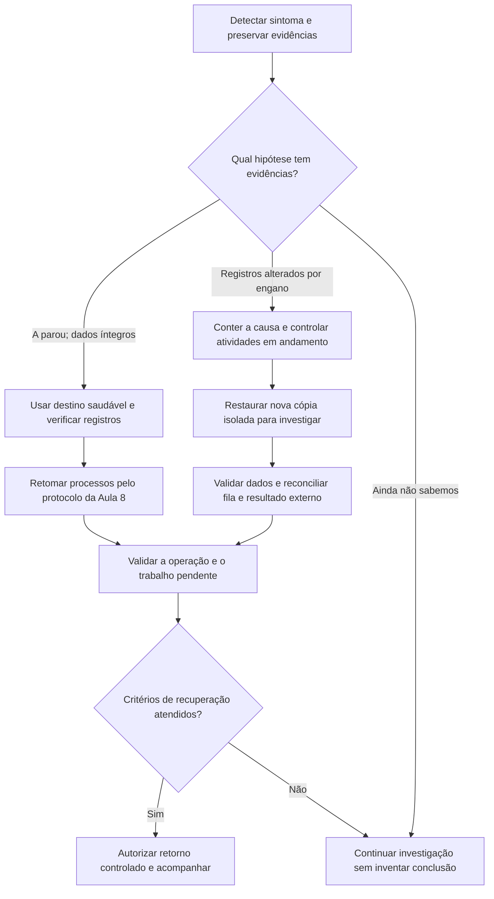

# Aula 9 — A loja falhou. Como voltar sem perder o que foi confirmado?

[Trilha System Design a partir do zero](../00-system-design-from-zero.md) · [Aula 8 — Trabalho assíncrono](08-async-work.md) · [Cenário da Loja Horizonte](00-scenario.md)

A loja aceitou acompanhar o pagamento de Ana. A tarefa está registrada, mas uma parte do sistema para. Basta reiniciar? E se o sistema estiver respondendo normalmente, mas alguém tiver apagado registros por engano?

Ao final, você conseguirá distinguir essas falhas, explicar o papel de redundância e backup e propor uma recuperação que verifique os dados e o trabalho pendente. Os incidentes e a cronologia são fictícios. Não executamos falhas, restaurações, failover, filas ou pagamentos nesta aula.

## Roteiro

- [Os dois incidentes](#cena), [os requisitos](#requisitos) e [o significado de recuperar](#recuperacao).
- [Sinais](#sinais), [retomada do trabalho](#caminho) e [decisão de recuperação](#mermaid).
- [Alternativas](#tradeoffs), [implementação na AWS](#aws) e [restauração de dados](#recuperar).
- [Falhas e validação](#falha), [perguntas](#perguntas), [exercício](#exercicio) e [resumo](#resumo).

<a id="cena"></a>
## 1. Duas falhas que pedem respostas diferentes

Continuamos a mesma compra das aulas anteriores:

```text
pedido: order-002
operação de pagamento: pay-001
tarefa de acompanhamento: job-001
aviso na outbox: evt-001
```

A aplicação confirmou a gravação da tarefa e do aviso no RDS antes de aceitar o acompanhamento, como na Aula 8. O pagamento ainda não tem uma conclusão local validada. A aceitação não virou aprovação.

**Incidente A:** a cópia A da aplicação para. B continua disponível, e os registros confirmados no banco permanecem íntegros.

**Incidente B:** em outro exercício, uma alteração errada apaga registros de acompanhamento no banco. O RDS continua acessível, assim como o site. Há um problema nos dados mesmo sem uma máquina parada.

Esses são dois cenários separados. Antes de escolher a recuperação, precisamos descobrir qual deles se aproxima das evidências. Reiniciar uma máquina não recria os registros apagados; restaurar todo o banco seria uma intervenção desnecessária no primeiro caso.

<a id="requisitos"></a>
## 2. O que precisa voltar a funcionar?

O requisito não é apenas abrir a página inicial. Ana precisa consultar o pedido, receber uma indicação honesta do pagamento e ter o acompanhamento tratado sem outra cobrança indevida.

| Necessidade | Como verificar a proposta |
|---|---|
| Continuar uma consulta após a queda de A | Uma execução em B encontra os registros confirmados e aplica a autorização de acesso |
| Preservar a intenção de pagamento | Continuar usando `pay-001` e o contrato da Aula 7, sem gerar outra cobrança para descobrir o resultado |
| Recuperar dados afetados por erro lógico | Encontrar um ponto recuperável, restaurar uma cópia e comparar seus dados com as evidências do incidente |
| Não perder o acompanhamento | Verificar tarefa, outbox, fila, entregas em andamento e resultado externo antes de declarar conclusão |
| Medir a recuperação completa | Registrar interrupção, detecção, restauração, validação e retorno das operações escolhidas |

Continuam em aberto os limites aprovados de tempo, perda aceitável de dados, carga e intervenção. Também precisamos definir responsáveis, acesso à recuperação e critérios para interromper ou autorizar uma retomada.

<a id="recuperacao"></a>
## 3. Disponível, preservado e correto são perguntas diferentes

**Disponibilidade** é conseguir usar uma capacidade quando ela é necessária. **Durabilidade** é a preservação dos dados confirmados diante das falhas consideradas. **Correção** é respeitar as regras e registrar fatos válidos.

Essas propriedades se relacionam, mas não são equivalentes. Podemos consultar rapidamente um registro errado. Uma cópia pode preservar fielmente uma exclusão indevida. Um pagamento pode ter acontecido no provedor enquanto a loja está indisponível.

Uma **réplica** mantém outra cópia dos dados conforme um mecanismo de replicação. Um **backup** guarda uma cópia recuperável, associada a um momento ou conjunto de dados. Replicar alterações atuais e recuperar um estado anterior têm funções diferentes.

### Quanto tempo podemos ficar parados? Quanto podemos perder?

**RTO**, objetivo de tempo de recuperação, é o tempo máximo aceitável entre a interrupção e a restauração do serviço definido. **RPO**, objetivo de ponto de recuperação, expressa em tempo a perda aceitável de dados em relação ao ponto recuperável.

São objetivos do negócio, definidos para um escopo de falha e operação. Um serviço AWS ou um backup configurado não demonstra que foram atingidos.

Esta cronologia é **sintética**, apenas para ensinar a diferença entre etapas:

```text
10:00 — a operação escolhida fica indisponível
10:02 — o incidente é detectado
10:18 — uma cópia do banco está disponível para validação
10:25 — dados e operação são validados; o serviço é retomado neste exemplo
```

O tempo de recuperação desse exemplo seria 25 minutos desde a interrupção. Os dois minutos até a detecção entram na conta. A cópia pronta às 10:18 ainda não comprovaria a recuperação do serviço.

Se o ponto de dados recuperado fosse 09:58, teríamos uma lacuna inicial de dois minutos antes da interrupção. Isso exige apurar quais confirmações ficaram de fora. Escritas ou efeitos externos ocorridos depois das 10:00 também precisam ser considerados. Essa conta, sozinha, não prova ausência de perda nem atendimento a um RPO aprovado.

Uma tolerância de tempo não autoriza inventar o estado de um pagamento. Dados confirmados, efeitos externos e a própria possibilidade de recuperar cada registro precisam ser verificados.

<a id="sinais"></a>
## 4. O que observar antes de escolher uma ação?

Um **log** registra eventos, com contexto. Uma **métrica** resume medidas ao longo do tempo. Um **alarme** sinaliza uma condição definida a partir de observações. Os três precisam ser planejados; acrescentar caixas a um desenho não os implementa.

| Sinal | O que ajuda a investigar | O que não comprova sozinho |
|---|---|---|
| Health check de A falhando | Disponibilidade do destino para a verificação configurada | Que o banco foi perdido ou que B concluiu a tarefa |
| Erros de conexão com o RDS | Falha de acesso ao banco | Se uma transação interrompida confirmou ou não |
| Tarefas abertas ou avisos antigos | Atraso no acompanhamento ou na publicação | Que o pagamento foi recusado |
| Mensagens na DLQ | Entregas que atingiram o limite configurado | Que apagar ou reenviar tudo resolveria a causa |
| Registros ausentes e histórico de alterações | Possível erro lógico e seu alcance | Qual cópia está correta sem comparação |

Use identificadores como `order-002`, `pay-001`, `job-001` e `evt-001` para relacionar evidências, com controle de acesso e sem registrar cartões ou credenciais. Horários, origem e conteúdo dos registros precisam ser confiáveis o suficiente para a investigação.

O health check verifica a condição configurada, não todas as regras da loja. Uma página responder HTTP 200 não demonstra que o pagamento, o banco e o trabalho assíncrono estão corretos.

<a id="caminho"></a>
## 5. Se A caiu e os dados continuam íntegros

O caminho normal já foi construído: a aplicação confirma a tarefa e a outbox, o publicador envia o aviso e o trabalhador acompanha a operação. O estado necessário à continuidade não pode depender só da memória de A.

No incidente A, uma retomada proposta segue esse raciocínio:

1. Observar a falha e a saúde de A e B, sem presumir que as solicitações em andamento terminaram.
2. Permitir novas solicitações a um destino saudável conforme a configuração do balanceador. B consulta os mesmos registros duráveis.
3. Se uma confirmação ficou incerta, conferir os registros antes de repetir a operação. Não recriar a intenção de pagamento.
4. Iniciar ou manter outra execução do publicador e do trabalhador conforme o procedimento operacional. Eles seguem os registros e o protocolo da Aula 8.
5. Validar consulta, autorização, publicação pendente e andamento das tarefas antes de encerrar o incidente.

Se o aviso ainda não foi publicado, a outbox confirmada permite encontrá-lo. Se houve envio e a marca de publicação não ficou confirmada, pode ocorrer novo envio. Se o job já estiver concluído, uma duplicata não deve repetir seus efeitos. O orçamento de consultas e as transições continuam coordenados no banco.

O ALB não transfere para B uma função interrompida na memória de A. Também não reinicia sozinho o publicador ou o trabalhador. Health checks e encaminhamento têm limites: pode haver erros durante a detecção, e todos os destinos não saudáveis podem provocar encaminhamento em modo *fail-open*, conforme o comportamento do serviço.

Não precisamos restaurar o banco apenas porque uma instância da aplicação parou. Primeiro usamos as evidências de que os dados estão preservados e recuperamos a capacidade afetada.

<a id="mermaid"></a>
### Qual recuperação responde à falha observada?

O Mermaid mostra a **ordem de investigação e validação**. As duas hipóteses não esgotam todos os incidentes possíveis.



O desenho não executa os processos nem autoriza uma troca automática de banco. A investigação pode indicar outra ação ou exigir intervenção.

<a id="tradeoffs"></a>
## 6. Escolher proteção conforme a falha

**Escolha:** preservar os registros duráveis, preparar continuidade para falhas de componentes e avaliar recuperação de dados separadamente. Para o banco, comparamos Multi-AZ e backup, sem tratá-los como substitutos universais.

**Ganho e limite:** redundância pode reduzir interrupções de infraestrutura; backups permitem investigar e recuperar estados anteriores. Em troca, há custo financeiro, configuração, retenção, proteção de acesso, testes e trabalho para reconciliar sistemas que não voltam juntos no tempo.

**Quando reconsiderar:** os objetivos aprovados, as dependências, a carga, o custo e os resultados dos exercícios devem orientar a solução. Nesta aula não adicionamos outra Região nem prometemos recuperação de qualquer falha regional.

| Opção | Favorece | Limite importante |
|---|---|---|
| Recuperar A enquanto B atende | Continuidade da aplicação quando seus dados e dependências estão preservados | B também precisa de capacidade, configuração e acesso válidos |
| Adicionar RDS Multi-AZ DB instance | Disponibilidade do banco diante de falhas de infraestrutura cobertas | Uma alteração errada pode ser replicada; não recupera o estado anterior |
| Preparar backups e restauração | Recuperação de dados em um ponto disponível e investigação de erro lógico | Leva tempo e não reconcilia automaticamente sistemas externos |

Uma correção controlada nos dados atuais também pode ser uma alternativa após investigar a causa. Restaurar uma cópia para comparar não obriga substituir todo o banco de produção. Não escolhemos a ação definitiva sem conhecer alcance, evidências e riscos.

<a id="aws"></a>
## 7. Uma implementação possível na AWS

| Componente | Papel e limite nesta etapa |
|---|---|
|  ALB e  aplicações A/B | Verificar destinos e encaminhar novas solicitações; não transportar execução em memória |
|  RDS for PostgreSQL existente | Manter os registros confirmados da loja e do acompanhamento |
| RDS Multi-AZ DB instance, como proposta | Primary e standby com replicação síncrona em AZs distintas, na mesma Região; standby não atende leitura |
| Backups automáticos e PITR, como proposta | Permitir recuperar uma nova instância em um ponto disponível dentro da retenção configurada |
| Publicador, SQS e trabalhador | Retomar o acompanhamento com as identidades e confirmações da Aula 8; fila e processos precisam de operação própria |

**AZ**, Zona de Disponibilidade, é uma área de infraestrutura isolada dentro de uma Região AWS. A proposta Multi-AZ considerada aqui é o modelo de **DB instance com um standby**, não o produto Multi-AZ DB cluster nem uma réplica para escalar leitura.

Em um failover do RDS, outro recurso assume o papel de banco principal. A resolução DNS do endpoint é atualizada, e a aplicação precisa restabelecer conexões. Solicitações ou transações interrompidas ainda exigem conferir o resultado; repetir indiscriminadamente pode violar as regras das aulas anteriores.

A replicação síncrona ajuda na continuidade diante das falhas consideradas, mas pode propagar a alteração indevida do incidente B. Ela não é um histórico que desfaça esse erro.

Essas proteções são propostas de arquitetura. Não habilitamos Multi-AZ, backups, permissões ou alarmes; não medimos tempos de failover ou restauração.

### Onde atuam redundância e restauração?

O Draw.io mostra **quais componentes e dados são afetados por cada estratégia**. Os caminhos de Multi-AZ e PITR são propostas comparadas, não recursos já implantados.


[Abrir a fonte editável do diagrama](assets/09-failure-recovery-aws.drawio).

<a id="recuperar"></a>
## 8. Se o problema está nos dados, restaurar é uma etapa

**PITR**, recuperação para um ponto no tempo, permite escolher um ponto recuperável a partir dos backups e registros mantidos pelo serviço. No RDS, essa recuperação cria **outra instância de banco**, sem modificar a origem. Precisamos verificar retenção e intervalo efetivamente disponíveis, não presumir que qualquer horário pode ser escolhido.

Uma proposta de recuperação para o incidente B é:

```text
identificar a causa, os registros afetados e o período de risco
conter novas alterações indevidas e coordenar os processos em andamento
preservar evidências e escolher um ponto recuperável para investigar
restaurar uma nova instância isolada, com acesso controlado
comparar dados, confirmações e efeitos externos
definir e validar a correção ou a troca de banco, se justificada
autorizar retomada por etapas e acompanhar as pendências
```

É um roteiro de raciocínio, não um procedimento operacional pronto para execução. Conter atividades exige coordenação: parar novos recebimentos não cancela trabalhadores que já receberam mensagens nem chamadas externas em andamento. Conexões antigas também não podem continuar gravando em outro banco sem controle.

A cópia restaurada fica isolada da aplicação para investigação. Sua criação não altera automaticamente o destino das conexões. Uma eventual troca exige decisão, validação e coordenação dos leitores e escritores; não acontece só porque a nova instância ficou disponível.

### O banco voltou a um horário. O restante da loja também voltou?

Não. Os registros de `pay-001`, `job-001`, `evt-001` e do orçamento de consultas pertencem ao RDS e refletem o ponto restaurado, se já existiam nele. A fila e o provedor têm seus próprios históricos.

| Possível diferença após restaurar | Cuidado necessário |
|---|---|
| Outbox volta a dizer pendente, mas o aviso já foi publicado | Pode haver repetição; preservar a identidade e conferir o estado do trabalho |
| Job volta a aberto, mas a mensagem já foi removida | Não presumir que a fila ainda retomará o trabalho; investigar a continuidade durável |
| Fila contém referência a um job ausente na cópia | Não inventar os dados ou recriar a cobrança a partir da mensagem |
| Orçamento restaurado mostra menos consultas do que já ocorreram | Reconstituir o consumo com evidências confiáveis ou suspender consultas até uma decisão segura |
| Provedor concluiu o pagamento depois do ponto escolhido | Consultar e reconciliar a mesma operação conforme seu contrato, sem iniciar outra cobrança |

Se o ponto preceder a criação de `pay-001`, até a identidade original pode estar ausente na cópia. Precisamos de evidências confiáveis para recuperá-la. Gerar uma nova chave para “resolver” a ausência pode criar outro efeito externo.

Não retiramos uma mensagem nem marcamos um job concluído para fazer os contadores parecerem normais. Quando não houver dados suficientes para reconciliar com segurança, a pendência e a necessidade de intervenção permanecem explícitas.

Fotografias no S3, cache, fila, DLQ e provedor não são restaurados junto dessa instância RDS. Dependências e estados derivados também precisam de avaliação antes de liberar as operações afetadas. Isso ainda não é um protocolo completo de recuperação de toda a loja.

<a id="falha"></a>
## 9. Como descobrir se o plano realmente funciona?

Um **runbook** é um procedimento operacional com ações, responsáveis, verificações e condições de parada. O roteiro desta aula pode ajudar a escrevê-lo, mas não substitui um exercício de recuperação em ambiente controlado.

| Exercício proposto | Evidência a coletar |
|---|---|
| Interromper A com B disponível | Erros durante a detecção, continuidade das consultas e preservação dos registros |
| Interromper um trabalhador antes e depois da confirmação local | Reentregas, conclusão do job e ausência de outra intenção de pagamento |
| Exercitar failover do banco proposto | Conexões restabelecidas, resultados incertos conferidos e operação validada |
| Restaurar uma cópia após erro lógico simulado | Ponto disponível, dados recuperados, diferenças posteriores e acesso controlado |
| Retomar com fila e banco em momentos diferentes | Referências ausentes, duplicatas, orçamento reconstituído e pendências identificadas |

Esses exercícios **não foram executados**. Antes deles, precisamos definir ambiente, isolamento, autorização operacional, carga, limites e forma de interromper com segurança. Nesta implementação validamos a página de estudo, seus links, respostas e diagramas.

O encerramento do incidente exige validar as operações afetadas e os dados, registrar perdas ou pendências conhecidas e acompanhar o retorno. Uma página inicial acessível, um banco disponível ou uma fila vazia são evidências parciais.

<a id="perguntas"></a>
## 10. Verifique seu entendimento

Responda antes de abrir os comentários.

### 1. A parou. Devemos restaurar o banco imediatamente?

**Pergunta extra:** O que precisamos confirmar para B continuar o atendimento?

<details>
<summary>Ver resposta comentada</summary>

Primeiro investigamos a falha. Se os dados confirmados continuam íntegros, recuperar a aplicação pode ser suficiente. B precisa estar saudável, ter capacidade e acesso aos mesmos registros. Solicitações interrompidas exigem conferir o resultado. Não há motivo para voltar o banco no tempo apenas porque A parou.

</details>

### 2. O ALB considera B saudável. O job de Ana está concluído?

**Pergunta extra:** Quem precisa retomar a publicação e o acompanhamento?

<details>
<summary>Ver resposta comentada</summary>

O health check comprova apenas a condição configurada naquele destino. Outra execução do publicador e do trabalhador precisa ser iniciada ou mantida operacionalmente e seguir os registros duráveis. O ALB não move a função interrompida de A para B. A conclusão do job depende do resultado local validado, não da saúde da página.

</details>

### 3. Um standby Multi-AZ desfaz uma exclusão indevida?

**Pergunta extra:** Para que tipo de problema ele ajuda nesta proposta?

<details>
<summary>Ver resposta comentada</summary>

A replicação pode levar a exclusão indevida ao standby. O modelo com um standby favorece disponibilidade diante de falhas de infraestrutura cobertas e não fornece leitura para a aplicação. Recuperar um estado anterior pede outro mecanismo, como backup e restauração, além de investigação. Disponibilidade e correção dos registros são perguntas diferentes.

</details>

### 4. O PITR criou uma instância. Podemos direcionar todo o tráfego para ela?

**Pergunta extra:** O que aconteceu com os pagamentos e mensagens posteriores ao ponto restaurado?

<details>
<summary>Ver resposta comentada</summary>

A criação é uma etapa. Precisamos validar a cópia, comparar confirmações e reconciliar os sistemas antes de decidir a correção ou troca. Pagamentos e mensagens não voltaram juntos ao horário escolhido. A origem também pode conter escritas mais recentes. A nova instância não muda automaticamente as conexões da aplicação nem autoriza uma retomada sem coordenação.

</details>

### 5. A cópia ficou pronta às 10:18. Esse é o tempo completo de recuperação?

**Pergunta extra:** O que RTO e RPO pedem que seja definido e verificado?

<details>
<summary>Ver resposta comentada</summary>

Na cronologia sintética, a operação só foi validada e retomada às 10:25: seriam 25 minutos desde a interrupção, incluindo a detecção. RTO é um limite aceitável para a recuperação do serviço definido. RPO limita a perda aceitável de dados em tempo. Precisamos de objetivos aprovados, ponto recuperável e apuração dos dados e efeitos; a disponibilidade da cópia não demonstra tudo isso.

</details>

### 6. A cópia restaurada não conhece um job que aparece na fila. Podemos recriá-lo e cobrar?

**Pergunta extra:** Como tratar o orçamento de consultas se o banco voltou a um valor antigo?

<details>
<summary>Ver resposta comentada</summary>

A mensagem não autoriza inventar dados, outra operação ou outra chave. Buscamos evidências confiáveis da identidade e do resultado original. O orçamento restaurado também pode omitir consumo que já aconteceu; é preciso reconstituí-lo ou suspender novas consultas até uma decisão segura. Se não houver informações suficientes, mantemos a pendência e a intervenção, sem declarar conclusão nem criar nova cobrança.

</details>

<a id="exercicio"></a>
## 11. Aplique o que aprendeu

### Parte A — A caiu depois da aceitação

Ana recebeu a aceitação do acompanhamento. `job-001` e `evt-001` estão confirmados no RDS. A cai antes da publicação. B está saudável, e os dados permanecem íntegros.

1. Qual registro permite descobrir que ainda há algo a publicar?
2. O que o ALB faz e o que depende de outra execução da aplicação?
3. Quais evidências você buscaria antes de afirmar que o acompanhamento foi recuperado?

### Parte B — O banco voltou; os outros sistemas, não

Após um erro lógico, uma cópia é restaurada para um ponto anterior à conclusão de `job-001`. Ela mostra o job aberto. A mensagem já foi removida depois de uma conclusão local no banco original; o provedor mantém o resultado externo. Novas escritas também podem existir na origem.

1. A fila vai necessariamente fazer o trabalho reaparecer?
2. O que comparar antes de decidir corrigir os dados ou usar a cópia restaurada?
3. Por que criar outra cobrança ou liberar todos os processos de uma vez seria inadequado?

<details>
<summary>Ver solução comentada</summary>

Na Parte A, a outbox confirmada preserva o aviso pendente. O ALB pode encaminhar novas solicitações a B conforme a saúde e a configuração, mas não inicia nem transfere o publicador. Outra execução precisa consultar a outbox e seguir o protocolo. Verificamos publicação, recepção, registros do job e pendências, mantendo a identidade do pagamento.

Na Parte B, a mensagem pode não existir mais; não há retomada garantida pela fila. Comparamos a cópia e a origem, a identidade e o resultado da operação, a conclusão anterior, outbox, mensagens, orçamento e escritas posteriores. O resultado externo deve ser validado segundo o contrato original. Uma correção dos dados atuais pode ser preferível a uma troca completa, dependendo das evidências. Uma nova cobrança não recupera o passado; reiniciar processos sem coordenação pode repetir efeitos ou gravar em bases diferentes. Pendências sem evidência suficiente continuam exigindo intervenção.

</details>

<a id="resumo"></a>
## 12. O que você deve levar desta aula

- Falha de uma aplicação e erro lógico nos dados pedem investigações diferentes.
- Redundância favorece continuidade; backup e restauração permitem recuperar estados anteriores.
- RTO e RPO são objetivos a definir e validar, não promessas obtidas ao escolher um serviço.
- Restaurar o RDS não restaura automaticamente fila, pagamentos ou o trabalho posterior ao ponto escolhido.
- Recuperação exige validar a operação, reconciliar estados e tornar pendências visíveis.

Consigo explicar:

- [ ] por que A parar não significa que o banco foi perdido;
- [ ] por que um health check não prova que o job foi concluído;
- [ ] a diferença entre Multi-AZ DB instance e recuperação por backup;
- [ ] o que precisa ser comparado após um PITR;
- [ ] quais evidências faltam antes de declarar a loja recuperada.

**Continue na [Aula 10 — A loja precisa mudar. Como atualizar com compras em andamento?](10-safe-changes.md):** convivência de versões, implantação gradual e limites do retorno de código.

[Voltar ao índice da trilha](../00-system-design-from-zero.md) · [Rever a Aula 8](08-async-work.md).
