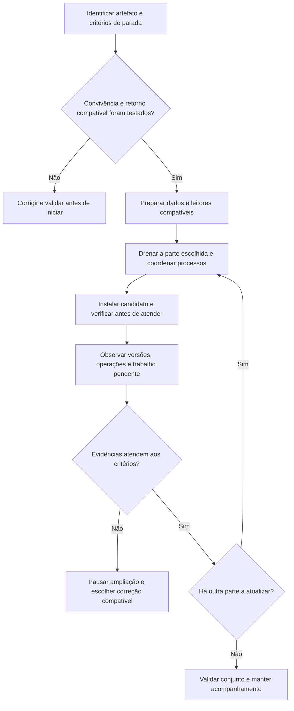

# Aula 10 — A loja precisa mudar. Como atualizar com compras em andamento?

[Trilha System Design a partir do zero](../00-system-design-from-zero.md) · [Aula 9 — Recuperação de falhas](09-failure-recovery.md) · [Cenário da Loja Horizonte](00-scenario.md)

A loja precisa de uma melhoria enquanto Ana continua acompanhando sua compra. Vamos trocar o programa em todas as máquinas ao mesmo tempo? O que acontece se uma versão nova escrever algo que a versão anterior não entende?

Ao final, você conseguirá propor uma atualização gradual, identificar os contratos que precisam continuar compatíveis e explicar quando interromper, voltar ou corrigir uma mudança. Esta é a décima e última aula da sequência introdutória. Não executamos implantação, migração, rollback, filas ou pagamentos; os exemplos representam a aplicação fictícia da loja.

## Roteiro

- [A mudança](#cena), [os requisitos](#requisitos) e [as versões](#versoes).
- [Compatibilidade](#compatibilidade), [atualização gradual](#caminho) e [decisão de avançar](#mermaid).
- [Alternativas](#tradeoffs), [implementação na AWS](#aws) e [critérios de publicação](#publicar).
- [Falhas](#falha), [perguntas](#perguntas), [exercício](#exercicio) e [resumo](#resumo).

<a id="cena"></a>
## 1. A tarefa de Ana continua; o programa vai mudar

Continuamos com os registros conhecidos:

```text
pedido: order-002
operação de pagamento: pay-001
chave da intenção: pay-order-002-v1
tarefa: job-001
aviso: evt-001

artefato atual: horizonte-v1
artefato candidato: horizonte-v2
```

Os nomes dos artefatos são rótulos fictícios, não tags criadas neste repositório. A versão do programa e a identidade da intenção são coisas distintas: instalar `horizonte-v2` não transforma a chave do pagamento em `pay-order-002-v2`.

A equipe quer registrar e mostrar **o motivo de uma tarefa continuar pendente, quando ele for conhecido**. Na proposta desta aula, v2 usa um novo campo opcional, `pending_reason`, nos registros do job e em sua resposta de acompanhamento. v1 continua usando os campos anteriores.

Esse motivo é uma explicação auxiliar. Não substitui o estado validado do job ou do pagamento. Ausência de motivo não significa sucesso, recusa nem autorização para outra cobrança.

Temos duas cópias da aplicação, A e B, ligadas ao mesmo banco. Publicador e trabalhador também executam código da loja, com versões que precisam ser controladas. A atualização pode afetar mais do que a página que Ana vê.

<a id="requisitos"></a>
## 2. O que a mudança precisa preservar?

| Necessidade | Como avaliar a proposta |
|---|---|
| Continuar atendendo durante uma atualização parcial | Verificar capacidade e dependências dos destinos que permanecem em atendimento |
| Manter o sentido dos registros | v1 e v2 convivem sem reinterpretar pagamento, job, orçamento ou reserva |
| Continuar lendo dados antigos | v2 aceita o novo motivo ausente ou nulo, sem inventar uma explicação |
| Preservar consumidores anteriores | Dados, respostas e mensagens produzidos durante a mudança não quebram leitores ainda ativos |
| Poder interromper e avaliar o retorno | Definir antes as condições de pausa e testar a compatibilidade do código anterior |
| Reconhecer o que foi instalado | Relacionar artefato, configuração, versão em cada processo e evidências observadas |

Os limites de erro, latência, carga, duração de observação e capacidade disponível precisam ser definidos e testados. Não adotamos um percentual universal de tráfego nem uma promessa de interrupção zero.

<a id="versoes"></a>
## 3. Um artefato identificável, mais de um contrato

Um **artefato** é o pacote do programa preparado para executar, associado a uma versão identificável. Precisamos saber qual pacote foi testado e qual está em cada processo. Recriar um pacote diferente sob o mesmo nome enfraquece essa rastreabilidade.

Uma **implantação**, ou **deploy**, coloca uma versão em um ambiente. Fazer isso em uma máquina não implica atualizar automaticamente as demais, o banco ou os consumidores da fila.

Um **contrato** descreve o que as partes esperam umas das outras: campos e significados de uma resposta, dados persistidos ou mensagens, por exemplo. A compatibilidade precisa considerar tanto a versão que lê quanto a que escreve.

Neste exemplo, uma resposta fictícia de v2 para o acompanhamento poderia incluir:

```json
{
  "jobId": "job-001",
  "operationId": "pay-001",
  "state": "PENDENTE",
  "pending_reason": null
}
```

O `null` representa um motivo ainda não registrado. A aplicação continua apresentando o estado conhecido. Esse campo não confirma o resultado de `pay-001`.

Adicionar um campo não garante compatibilidade por si só. Um cliente pode rejeitar campos desconhecidos; um programa pode depender da posição das colunas ou apagar um campo que não conhece. Precisamos testar os programas reais, inclusive configurações e bibliotecas que usam.

**Rollback** é voltar a uma versão anterior. **Corrigir adiante** é preparar outra versão que resolva o problema mantendo os dados já produzidos. A escolha depende do que mudou e do que continua compatível, não apenas de ter o pacote antigo guardado.

<a id="compatibilidade"></a>
## 4. Preparar os leitores antes de ativar novas escritas

Para esta mudança, propomos acrescentar `pending_reason` como campo opcional que aceita nulo. As versões anteriores precisam continuar operando sem preenchê-lo e sem destruir seu valor ao atualizar outros campos.

| Combinação a testar | Condição esperada |
|---|---|
| v1 com a estrutura expandida | Continua lendo e escrevendo os campos antigos, tolerando o acréscimo |
| v2 com registros antigos ou criados por v1 | Trata motivo ausente ou nulo sem falhar nem inventar uma conclusão |
| v1 após uma escrita de v2 | Preserva os campos e significados necessários, inclusive ao fazer outra atualização |
| Clientes antigos com a resposta de v2 | Toleram o campo adicional conforme o contrato verificado |
| Publicador e trabalhador durante a convivência | Entendem os registros e as mensagens que podem encontrar |

O aviso `evt-001` mantém o formato e o tipo `RECONCILIAR_PAGAMENTO` da Aula 8. Não criamos um novo formato de mensagem nesta mudança. Ainda assim, registros antigos, duplicatas, mensagens retidas e eventual reprocessamento precisam continuar sendo tratados pelo protocolo já definido.

### Expandir, migrar e só depois retirar compatibilidade

Esse raciocínio costuma ser organizado como **expandir → migrar → contrair**:

1. **Expandir:** preparar uma estrutura compatível, como o campo opcional, e leitores capazes de lidar com a transição antes de ativar as novas escritas.
2. **Migrar:** atualizar os programas de forma controlada e, quando necessário, transformar dados com origem e regras verificáveis.
3. **Contrair:** retirar o formato antigo somente quando nenhum componente depender dele e a decisão sobre a janela de retorno estiver resolvida.

Na mudança escolhida, **não precisamos remover uma coluna nem tornar o motivo obrigatório**. Registros sem uma explicação confiável podem continuar nulos. Preencher todos com um motivo inventado criaria informação falsa.

Mesmo uma alteração aditiva pode exigir bloqueios no banco e afetar a carga. O comportamento da alteração, sua duração e seus efeitos precisam ser avaliados na versão do PostgreSQL e nas condições escolhidas; não executamos SQL de migração aqui.

Se futuramente removermos um campo ou significado exigido por v1, voltar ao pacote v1 original pode deixar de ser seguro. Guardar um backup, por si só, não torna esse retorno compatível.

<a id="caminho"></a>
## 5. Atualizar uma parte, observar e decidir

Uma estratégia **rolling** atualiza a aplicação por partes. Vamos propor uma cópia de cada vez, com pausa para verificar antes de seguir. Isso exige capacidade suficiente nas cópias restantes e compatibilidade durante a convivência.

O caminho abaixo depende de um procedimento de implantação ainda a definir; não é executado pelo ALB sozinho:

1. Identificar o artefato candidato, a configuração, os responsáveis e os critérios de parada. Testar convivência e retorno em ambiente controlado.
2. Preparar a extensão compatível dos dados. Confirmar que aplicações, clientes, publicador e trabalhador atuais continuam funcionando antes de ativar novos escritores.
3. Com B saudável e capaz de atender a carga prevista, retirar A de novas solicitações e acompanhar a **drenagem**: o encerramento do atendimento já em andamento.
4. Coordenar também os processos fora do tráfego HTTP, se existirem em A. Só então substituir e iniciar seu código conforme o procedimento.
5. Verificar A com v2, suas dependências e as operações escolhidas antes de recolocá-la no atendimento. Observar A v2 e B v1 convivendo.
6. Se as evidências atenderem aos critérios, repetir o processo em B e nos demais papéis de código. Se não atenderem, interromper a ampliação e decidir a correção.
7. Validar o conjunto após a atualização e conservar a opção de retorno enquanto os contratos a permitirem.

O ALB deixa de encaminhar novas solicitações a um destino em desregistro e permite drenar as que já estavam em andamento. O prazo e o encerramento precisam ser configurados e observados; parar o processo cedo demais pode causar erros. Drenagem não promete que qualquer operação longa terminará sem falhar.

### E o trabalhador da fila?

Retirar A do ALB não interrompe automaticamente um consumidor SQS, o publicador ou uma chamada ao provedor. Esses papéis podem estar em processos na mesma EC2 ou em outras; a localização precisa ser conhecida antes de parar a instância.

Para atualizar um trabalhador, precisamos controlar novas recepções e o trabalho que ele já recebeu. Uma tentativa interrompida pode ser reentregue e precisa obedecer à mesma identidade, orçamento e transições da Aula 8. Não apagamos a entrega apenas para acelerar a atualização. Uma chamada externa já iniciada também pode terminar depois do pedido de parada.

A convivência de versões inclui esses processos, não apenas A e B no balanceador. Alterar primeiro um produtor para emitir um formato incompatível e atualizar os consumidores depois criaria uma janela de falha.

<a id="mermaid"></a>
### O que autoriza avançar para a próxima parte?

O Mermaid mostra a **ordem da decisão de implantação**, não uma ferramenta já configurada.



Uma falha ao preparar dados ou verificar a instância também interrompe o avanço. O desenho não faz rollback automático nem declara a mudança bem-sucedida por haver uma resposta HTTP.

<a id="tradeoffs"></a>
## 6. Por que atualizar por partes?

**Escolha:** propor rolling com uma cópia por etapa, preservando contratos e decidindo a ampliação a partir de evidências.

**Ganho e limite:** podemos detectar problemas antes de trocar toda a frota. Em troca, precisamos de capacidade nas cópias restantes, controle de processos, compatibilidade temporária e observação. Uma alteração no banco compartilhado ainda pode afetar as duas versões.

**Quando reconsiderar:** capacidade, custo, tempo aceitável, risco dos dados e necessidade de limitar a exposição podem justificar outro processo. A simplicidade do cenário não comprova que duas máquinas bastam sob qualquer carga.

| Estratégia | Ideia | Cuidado necessário |
|---|---|---|
| All-at-once | Trocar toda a frota de uma vez | Amplia a exposição simultânea e pode interromper o atendimento |
| Rolling | Atualizar partes da frota em sequência | Exige convivência de versões e capacidade durante cada etapa |
| Blue/green | Preparar um ambiente alternativo e depois mudar o tráfego | Custo, estado compartilhado e compatibilidade continuam relevantes ao voltar |
| Canary | Começar com uma parcela observada antes de ampliar | Precisa de controle de exposição e evidências representativas |

Essas ideias podem ser combinadas. Atualizar uma das duas instâncias não define automaticamente uma canary pequena ou um percentual fixo de tráfego. Neste recorte, não construímos outro ambiente nem configuramos divisão percentual.

<a id="aws"></a>
## 7. Uma implementação possível na AWS

| Componente | Papel e limite durante a mudança |
|---|---|
|  ALB | Encaminhar solicitações e participar do desregistro/drenagem; não instalar o artefato |
|  aplicações A/B em EC2 | Executar versões identificadas; durante a transição, A pode estar em v2 e B em v1 |
|  mesmo RDS for PostgreSQL | Manter dados compatíveis com os programas ativos; expansão proposta para o campo opcional |
| Publicador, SQS e trabalhador | Preservar contratos, mensagens e processamento durante a atualização dos processos |
| Provedor externo fictício | Manter o contrato e a identidade da operação existente; não participar do rollback de código |

O procedimento poderia ser automatizado depois, mas não escolhemos uma ferramenta de implantação nesta aula. Ferramentas também precisam de configurações, permissões, testes e critérios; instalar uma não resolve por si só compatibilidade ou efeitos externos.

### Quais versões convivem e qual estado compartilham?

O Draw.io mostra **a arquitetura durante uma etapa proposta do rolling**. A v2 e B v1 compartilham registros; não há um banco voltando no tempo quando trocamos o programa.


[Abrir a fonte editável do diagrama](assets/10-safe-changes-aws.drawio).

<a id="publicar"></a>
## 8. O que verificar antes de dizer que a mudança terminou?

Precisamos relacionar sinais à versão e ao fluxo afetado, sem registrar informações privadas desnecessárias.

| Evidência | Pergunta que ajuda a responder |
|---|---|
| Artefato e configuração por processo | Sabemos o que está executando em A, B, publicador e trabalhador? |
| Erros e latência por versão | A mudança piorou as operações escolhidas sob a carga observada? |
| Leituras e escritas cruzadas | v1 continua funcionando com dados produzidos por v2 e vice-versa? |
| Job, outbox, fila e DLQ | O acompanhamento continua avançando ou apenas a página está saudável? |
| Estado de `pay-001` e identidade da intenção | As versões preservam o contrato e evitam inventar outra cobrança? |
| Evidências de retorno compatível | O pacote anterior ainda consegue operar sobre o estado atual? |

Uma sequência de verificações proposta é:

```text
registrar versão, configuração, escopo e critérios antes de começar
validar compatibilidade e capacidade nas condições escolhidas
atualizar uma parte e verificar o atendimento e o trabalho pendente
comparar as evidências com os critérios de avanço
se houver desvio, interromper a ampliação e avaliar o estado produzido
retornar código somente se os contratos atuais permitirem
caso contrário, manter contenção e preparar correção compatível
validar o conjunto e registrar pendências após a decisão
```

Os limites e o período de observação precisam ser definidos para o cenário e testados. Poucas requisições sem erro podem não cobrir picos, tarefas demoradas, dados antigos ou reentregas. Sucesso da ferramenta de implantação e health check aprovado são evidências parciais.

Se uma instância restante não suportar a carga enquanto a outra está fora, precisamos rever capacidade ou estratégia antes de iniciar. A sequência acima não concede capacidade adicional automaticamente.

<a id="falha"></a>
## 9. A nova versão falhou. Podemos simplesmente voltar?

**Se os contratos continuam compatíveis**, retornar o código anterior pode ser uma resposta, com coordenação de atendimento e processos. Ainda precisamos verificar o que v2 escreveu ou iniciou antes da volta.

**Se houve perda de compatibilidade**, recolocar v1 pode produzir outra falha. Podemos precisar conter a operação afetada e preparar uma correção adiante, mantendo pendências visíveis. A possibilidade concreta depende das evidências, não de uma regra universal de rollback.

| Situação | Por que exige atenção |
|---|---|
| v2 apresenta motivo opcional incorretamente | Podemos corrigir a apresentação, mas precisamos preservar os fatos e o estado autoritativo |
| Nova restrição impede escrita de v1 | O retorno do código não remove a incompatibilidade na estrutura dos dados |
| Mensagem já foi publicada | O rollback do produtor não recolhe automaticamente o que está na fila ou em processamento |
| Provedor concluiu `pay-001` | Voltar o programa não desfaz esse fato nem autoriza outra intenção de cobrança |
| Instância foi encerrada antes da drenagem | Podem ocorrer erros ou resultados incertos; conferir registros antes de repetir |

Restaurar o banco inteiro para desfazer um deploy também poderia retirar escritas legítimas e criar desencontros com a fila e o provedor, como na Aula 9. Isso é uma decisão de recuperação de dados, não um botão equivalente a voltar o pacote.

Antes de aplicar a proposta, seria necessário exercitar convivência, migração, drenagem, interrupção do trabalhador e retorno compatível em ambiente controlado. Esses testes de aplicação e infraestrutura **não foram executados**; a validação local desta implementação verifica o material de estudo e sua interface.

<a id="perguntas"></a>
## 10. Verifique seu entendimento

Responda antes de abrir os comentários.

### 1. Instalar v2 exige outra chave para o pagamento de Ana?

**Pergunta extra:** Qual a diferença entre versão do código e identidade da intenção?

<details>
<summary>Ver resposta comentada</summary>

O programa novo continua acompanhando `pay-001` com a identidade original e o contrato das aulas anteriores. A versão identifica o pacote que executa a lógica; a chave identifica a intenção de negócio. Criar `pay-order-002-v2` apenas por trocar o programa poderia introduzir outra intenção e outro efeito externo. Não é uma recuperação do pagamento existente.

</details>

### 2. Um campo opcional novo é automaticamente compatível?

**Pergunta extra:** O que testar entre os leitores e escritores de v1 e v2?

<details>
<summary>Ver resposta comentada</summary>

Precisamos testar as combinações. v1 pode rejeitar colunas ou campos desconhecidos, depender de posição ou destruir o novo valor ao atualizar. v2 precisa aceitar registros antigos e motivo nulo. Clientes, publicador e trabalhador também participam dos contratos. Aditivo e opcional são escolhas que favorecem a transição, sem provar que os programas realmente a toleram.

</details>

### 3. Retirar A do ALB prepara todos os seus processos para parar?

**Pergunta extra:** O que pode continuar acontecendo fora do tráfego HTTP?

<details>
<summary>Ver resposta comentada</summary>

O desregistro controla o encaminhamento de novas solicitações e a drenagem do atendimento existente conforme a configuração. Consumidor SQS, publicador e chamadas externas não são encerrados por esse mecanismo. Precisamos coordenar novas recepções e trabalho em andamento, preservando o protocolo. Parar uma EC2 que hospeda esses papéis sem conhecê-los pode interromper mais do que a requisição web.

</details>

### 4. A v2 passou no health check. Podemos atualizar B imediatamente?

**Pergunta extra:** Que evidências faltam para decidir a ampliação?

<details>
<summary>Ver resposta comentada</summary>

O health check é uma condição limitada. Precisamos comparar erros, latência, capacidade, operações escolhidas, leitura e escrita entre versões e trabalho assíncrono com os critérios definidos antes. Também precisamos de observação suficiente para o cenário. A v2 saudável no ALB não comprova que mensagens antigas ou pagamentos continuam sendo tratados corretamente.

</details>

### 5. Guardar o pacote v1 garante que podemos fazer rollback?

**Pergunta extra:** O que acontece se v2 removeu um campo exigido por v1?

<details>
<summary>Ver resposta comentada</summary>

O pacote precisa continuar compatível com os dados, respostas e mensagens atuais. Se o formato antigo foi removido, recolocar v1 pode falhar. Além disso, o retorno não desfaz escritas ou efeitos externos. Podemos precisar conter a operação e corrigir adiante. Contrair exige decidir o fim da compatibilidade e da janela de retorno; não basta ter o arquivo anterior disponível.

</details>

### 6. Atualizar A antes de B significa uma canary pequena?

**Pergunta extra:** O que precisa estar preparado para B atender enquanto A está fora?

<details>
<summary>Ver resposta comentada</summary>

Com duas instâncias, uma atualizada pode receber uma parcela relevante da carga; não há percentual pequeno garantido. Canary exige controle de exposição e observação. No rolling proposto, B precisa de capacidade, configuração e dependências válidas durante a retirada de A. Se não houver essas condições, precisamos rever a estratégia ou a capacidade antes de começar.

</details>

<a id="exercicio"></a>
## 11. Aplique o que aprendeu

### Parte A — Duas versões, o mesmo job

A usa v2, B ainda usa v1. A estrutura aceita `pending_reason` nulo. A v2 lê `job-001` criado por v1 sem esse motivo. O aviso `evt-001` continua com o formato da Aula 8.

1. O que v2 deve mostrar quando não há motivo confiável?
2. O que precisamos testar se B atualizar o mesmo registro depois de A?
3. Quais contratos devem continuar válidos antes de atualizar B e o trabalhador?

### Parte B — O pacote voltou; os efeitos ficaram

Durante outra atualização hipotética, um campo exigido por v1 foi removido cedo demais. A v2 também publicou um aviso e recebeu um resultado definitivo para a operação existente. A equipe encontra um erro e propõe reinstalar v1 em todas as máquinas.

1. Por que ter o pacote antigo não basta para autorizar essa volta?
2. O que não será desfeito automaticamente no banco, na fila e no provedor?
3. Que decisão de contenção e correção você proporia antes de ampliar o problema?

<details>
<summary>Ver solução comentada</summary>

Na Parte A, v2 apresenta o estado conhecido sem inventar um motivo nem transformar ausência em conclusão. Testamos se v1 tolera a estrutura e preserva os campos ao atualizar. Aplicações, clientes, publicador e trabalhador precisam compreender os dados e avisos que podem encontrar, inclusive duplicatas e registros antigos. A decisão de avançar depende dessas verificações e das evidências operacionais, não apenas de A responder.

Na Parte B, v1 perdeu uma dependência de dados e pode não operar sobre a estrutura atual. Reinstalar o pacote não recupera automaticamente o campo removido, não recolhe mensagens e não desfaz o pagamento registrado no provedor. Primeiro interrompemos a ampliação, avaliamos alcance e registros e escolhemos uma correção compatível ou retorno apenas quando validado. Não geramos outra chave para o pagamento e não restauramos todo o banco sem a análise de recuperação da Aula 9. Pendências e necessidade de intervenção continuam explícitas.

</details>

<a id="resumo"></a>
## 12. O que você deve levar desta aula

- Uma implantação envolve versões, contratos, capacidade, processos e critérios de decisão.
- Leitores precisam estar preparados antes de ativar escritas que mudem o formato.
- Rolling exige convivência e observação; drenagem HTTP não encerra todo trabalho.
- Retornar código depende da compatibilidade e não desfaz efeitos de negócio.
- Concluir a mudança exige validar operações e estado, além de saber qual pacote está instalado.

Consigo explicar:

- [ ] o que v1 e v2 precisam compartilhar durante a transição;
- [ ] como tratar o motivo opcional sem reinterpretar o pagamento;
- [ ] o que verificar antes de retirar e recolocar uma instância;
- [ ] por que fila e trabalhador precisam de coordenação própria;
- [ ] quando pausar, considerar retorno ou preparar uma correção adiante.

**A sequência de dez aulas está concluída.** Reúna as decisões da loja: qual necessidade motivou cada componente, qual estado ele guarda, como falha e qual evidência ainda falta. Isso é uma base de raciocínio, não comprovação de uma loja implantada ou domínio do assunto.

[Revisar o índice das dez aulas](../00-system-design-from-zero.md) · [Rever a Aula 9](09-failure-recovery.md).
